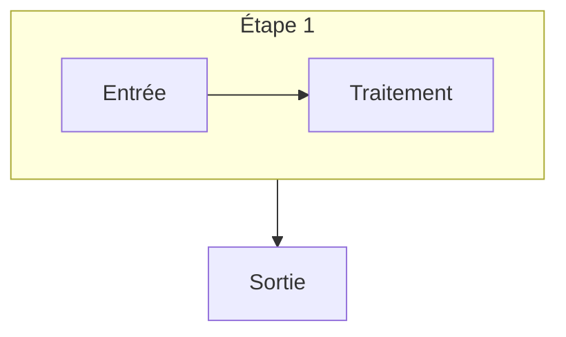

# Rédiger une leçon Cortex

Une leçon = une session de cours = un fichier `<matière>/<NN>-<slug>.mdx` (ex. `aiad/03-rag-avance.mdx`).
Le slug devient l'URL (`/cours/aiad/03-rag-avance/`) : minuscules, sans accents, tirets. Ne plus le changer une fois en
ligne (liens partagés, référencement). Les fichiers de ce dossier qui ne sont pas en `.mdx` sont ignorés par le site.

## Frontmatter

Validé par `src/content.config.ts` : le build échoue si un champ manque ou a le mauvais type.

| Champ | Requis | Rôle |
| --- | --- | --- |
| `title` | oui | Titre de la session. Devient le `<title>` de la page (« Titre · Matière · Cortex ») |
| `subtitle` | non | Accroche en italique sous le titre |
| `subject` | oui | `id` de la matière dans `subjects.json` |
| `session` | oui | Numéro de session (doit correspondre au `NN` du fichier) |
| `description` | oui | 1-2 phrases, **120-200 caractères** : chapeau de la page, carte de la matière, meta description Google |
| `tags` | non | 5 à 8 concepts clés, en mots-clés courts |
| `objectives` | non | 3 à 6 objectifs, chacun commence par un verbe d'action (« Expliquer… », « Choisir… ») |
| `sources` | non | `{ label, url? }`. Le support du prof en premier (sans url), puis chaque source d'un `<DeepDive>` |
| `updated` | oui | Date de dernière modification `AAAA-MM-JJ` (la mettre à jour à chaque révision de fond) |
| `draft` | non | `true` = masquée en production |

## Structure d'une leçon

1. **Chapeau** (1 paragraphe, sans titre) : la question à laquelle la session répond et pourquoi elle compte.
2. **Une `##` par grande partie du support**, dans l'ordre du support. **`###` pour chaque concept.**
   Pas de `####` : le sommaire latéral n'affiche que deux niveaux.
3. Dans chaque partie : explication → visualisation → (éventuellement) `<Callout>`, `<Quiz>`, `<DeepDive>`.
4. **Fin** : une `## À retenir` contenant `<Takeaways>`, 5 points maximum (les « choses à retenir » du prof quand
   elles existent : c'est la matière du quiz d'ouverture de la session suivante).

Repères observés sur les leçons existantes : 5-10 parties, 2-8 `<Quiz>`, 1-6 diagrammes Mermaid, 2-5 `<DeepDive>`.

## Règles de rédaction

- **Français**, termes techniques anglais conservés quand c'est l'usage (*prompt*, *embedding*, *RAG*), expliqués à
  leur première apparition (`<Callout type="definition">` pour les termes centraux).
- **Fidélité** : tout ce qui est dans le support est restitué, rien n'est inventé ni attribué au prof à tort.
  Les chiffres du support gardent leur source dans la légende (`<Figure caption="… · Source : …">`).
- **Enrichissement** : uniquement dans `<DeepDive>`, avec une source vérifiable ajoutée à `sources`. Choisir le `level` :
  `approfondissement` (le mécanisme en dessous), `best-practice` (comment on le fait bien), `terrain` (retour
  d'expérience), `état-de-l-art` (recherche récente).
- **Points d'examen** : `<Callout type="exam">` sur ce que le prof dit explicitement être testé.
- **Une idée par paragraphe**, phrases courtes, gras pour le mot-clé (pas pour des phrases entières).
- **Quiz** : questions qui vérifient la compréhension (piège classique, cas concret), pas la mémoire d'un mot.
  L'explication dit pourquoi la bonne réponse est bonne **et** pourquoi le piège attire.

### Adapter au public

Le public est décrit dans le tableau « Cours existants » de `AGENTS.md`. Pour un nouveau public, l'ajouter à ce tableau.

- **Étudiants ingénieurs (SIGL)** : tutoiement, ton direct, densité élevée, vocabulaire du métier, liens vers le projet
  de l'UE quand le support en parle.
- **Débutants (`ia-zero`)** : tutoiement, exemples du quotidien (téléphone, réseaux sociaux, lycée), aucun terme non
  expliqué, chiffres arrondis et comparés à quelque chose de connu, une visualisation interactive par chapitre
  au minimum. Pas de support : la règle fidélité/enrichissement devient « le cœur dans le flux, le hors-programme
  dans `<DeepDive>` ».

## Visualiser

Pour chaque concept complexe, choisir le support le plus simple qui suffit :

| Besoin | Outil |
| --- | --- |
| Flux, architecture, séquence d'appels, états | Bloc ` ```mermaid ` (flowchart, sequenceDiagram, stateDiagram-v2, classDiagram) |
| Étapes d'un processus | `<Pipeline>` (animé, cliquable) ou `<Steps>` (statique) |
| Deux approches face à face | `<Compare leftTitle rightTitle>` |
| Ordres de grandeur | `<Stat>` dans une `<CardGrid cols={3}>`, ou `<BarChart>` |
| Taxonomie, niveaux, options | `<CardGrid>` + `<Card kicker tone>` |
| Un mécanisme qu'on comprend en le manipulant | Nouvel îlot : voir `src/components/viz/AGENTS.md` |

Envelopper une visualisation dans `<Figure caption="…">` dès qu'elle a besoin d'une légende ou d'une source.
Pièges Mermaid et MDX : section « Pièges connus » de `AGENTS.md`.

## Modèle à copier

````mdx
---
title: Titre de la session
subtitle: Une accroche courte
subject: id-matiere
session: 3
description: Ce que la session permet de comprendre ou de faire, en une à deux phrases (120-200 caractères).
tags: [concept 1, concept 2, concept 3]
objectives:
  - Expliquer …
  - Choisir …
sources:
  - label: Support de cours <SIGLE> Session 3 — Prénom Nom, EPITA SIGL S9
  - label: Auteur, « Titre » (année)
    url: https://…
updated: 2026-01-01
---

La question qui structure la session, et pourquoi elle compte.

## Première grande partie

### Un concept

Explication.

<Callout type="definition" title="Terme">Définition en une phrase.</Callout>



<Quiz question="Une affirmation à vérifier." options={['Vrai', 'Faux']} answer={1}>
  **Faux.** Pourquoi, et pourquoi on aurait pu croire le contraire.
</Quiz>

<DeepDive title="Ce qu'il y a en dessous" level="approfondissement">
  Contenu hors support, dont la source figure dans `sources`.
</DeepDive>

## À retenir

<Takeaways>
1. **Idée 1.** Une phrase d'explication.
2. **Idée 2.** Une phrase d'explication.
</Takeaways>
````

## Checklist avant de rendre

- [ ] Frontmatter complet, `session` = numéro du fichier, `updated` à jour.
- [ ] Tout le support est couvert, dans l'ordre ; rien d'inventé hors `<DeepDive>`.
- [ ] Chaque `<DeepDive>` a sa source dans `sources`.
- [ ] Au moins une visualisation par grande partie.
- [ ] `<Takeaways>` final, 5 points maximum.
- [ ] Entrée `upcoming` correspondante retirée de `subjects.json`, `plannedSessions` cohérent.
- [ ] `npm run build` OK, rendu vérifié clair/sombre, 1440 px/390 px (voir `AGENTS.md` § Vérifier).
