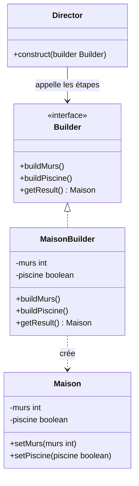
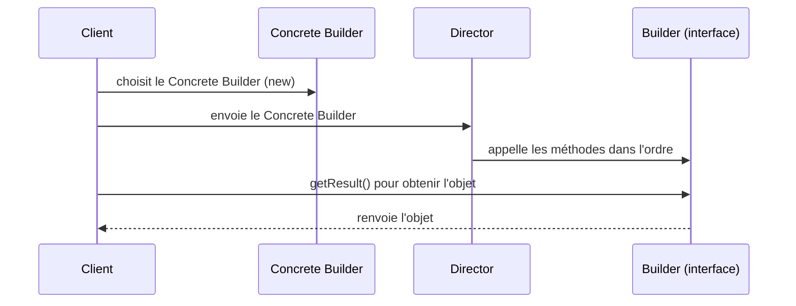
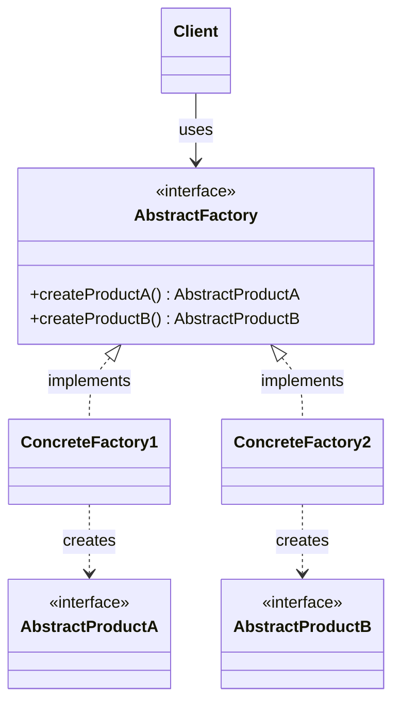
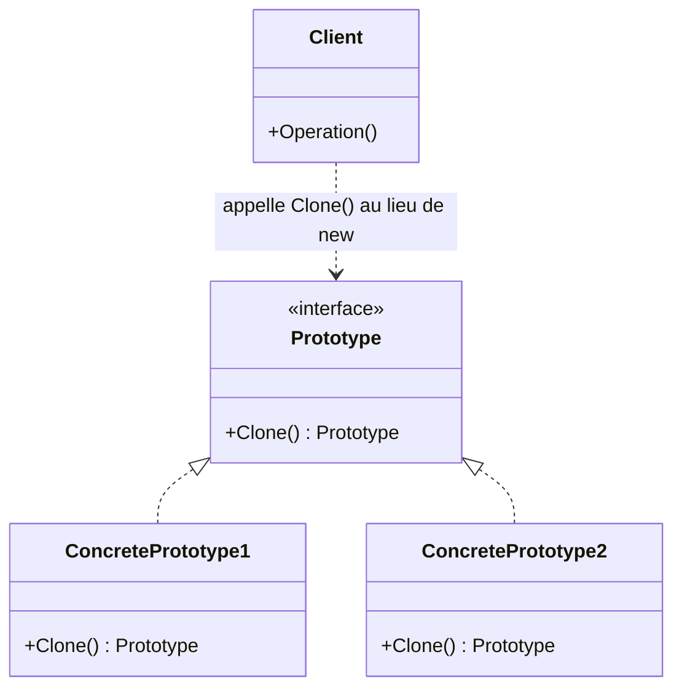

Dans un programme orienté objet, chaque `new UneClasseConcrète(...)` est une petite **dépendance** : le code qui l'écrit sait exactement quelle classe il veut, avec quels paramètres, dans quel ordre. Tant que l'objet est simple, c'est parfait. Quand il devient **complexe**, qu'il existe en **plusieurs variantes** ou qu'il **coûte cher** à préparer, ces `new` dispersés deviennent le premier frein au changement. Les **patterns de création** répondent à une seule question : **qui crée l'objet, et comment le reste du code peut-il l'ignorer ?** Cette session présente la notion de design pattern, puis trois réponses : construire pas à pas (**Builder**), créer des familles cohérentes (**Abstract Factory**) et cloner un modèle (**Prototype**).

<Callout type="note" title="Des exposés d'étudiants">
  Cette partie d'ACOO est construite à partir d'exposés présentés par des groupes d'étudiants SIGL en mars 2026, un pattern par groupe. Leur contenu est restitué dans le flux ; quand un point de l'exposé mérite d'être nuancé, un encadré « pour aller plus loin » le signale.
</Callout>

## Ce qu'est un design pattern

### Une solution nommée à un problème qui revient

<Callout type="definition" title="Design pattern · patron de conception">
  Une **solution éprouvée** à un **problème de conception récurrent**, décrite de façon assez générale pour s'appliquer à des contextes différents. Ce n'est pas du code à copier, mais un **schéma d'organisation** de classes et d'objets, avec un nom.
</Callout>

Le nom compte autant que la solution. Dire « on passe par un Builder » ou « c'est un Adapter » résume en un mot une structure, ses participants et ses compromis : c'est un **vocabulaire commun** entre développeurs. Les exposés se réfèrent tous au **Gang of Four** (GoF), les quatre auteurs du livre qui a fixé ce vocabulaire, et classent chaque pattern dans l'une de ses trois familles.

<CardGrid cols={3}>
  <Card kicker="Création" title="Comment on crée" tone="signal">Rendre le code indépendant de la façon dont les objets sont **instanciés**. Cette session : **Builder**, **Abstract Factory**, **Prototype**.</Card>
  <Card kicker="Structure" title="Comment on assemble" tone="signal">Organiser les **relations** entre classes et objets pour former des structures plus grandes. Session 2 : **Adapter**, **Bridge**, **Decorator**.</Card>
  <Card kicker="Comportement" title="Comment on fait agir" tone="signal">Répartir les **responsabilités** et les algorithmes entre objets. Session 3 : **Visitor**.</Card>
</CardGrid>

<DeepDive title="Le Gang of Four et ses 23 patterns" level="approfondissement">
  Le « Gang of Four » désigne Erich Gamma, Richard Helm, Ralph Johnson et John Vlissides, auteurs de *Design Patterns. Elements of Reusable Object-Oriented Software* (Addison-Wesley, 1994). Le livre catalogue **23 patterns** : 5 de création (Abstract Factory, Builder, Factory Method, Prototype, Singleton), 7 de structure (Adapter, Bridge, Composite, Decorator, Facade, Flyweight, Proxy) et 11 de comportement (dont Iterator, Observer, Strategy, State et Visitor). L'idée vient de l'architecte Christopher Alexander, qui décrivait déjà des « patterns » de bâtiments et de villes. Deux principes traversent tout le livre : **programmer pour une interface, pas pour une implémentation**, et **préférer la composition à l'héritage**. Tu les retrouveras dans presque tous les patterns de cette partie.
</DeepDive>

### La grille de lecture d'un pattern

Tous les exposés suivent la même grille, celle du catalogue du GoF. La connaître permet de lire (et de présenter) n'importe quel pattern de la même façon.

<Steps>
1. **Type** : création, structure ou comportement.
2. **Intention** : ce que fait le pattern, en une phrase.
3. **Motivation** : le problème concret qui le rend nécessaire.
4. **Applicabilité** : les situations où l'utiliser (et, en creux, celles où s'en passer).
5. **Structure et participants** : le diagramme de classes et le rôle de chaque classe.
6. **Collaborations** : qui appelle qui, dans quel ordre (souvent un diagramme de séquence).
7. **Conséquences** : avantages et limites, le prix à payer.
8. **Implémentation, utilisations connues, patterns apparentés** : comment le coder, où on le rencontre, avec quels autres patterns il se combine ou se confond.
</Steps>

<KeyIdea>Un pattern ne se juge pas à sa structure mais à ses **conséquences** : chacun ajoute des classes pour acheter de la souplesse. Il n'est utile que si cette souplesse sert.</KeyIdea>

## Builder

### Intention et motivation

**Type** : pattern de création. **Intention** : **séparer la construction d'un objet complexe de sa représentation**, de sorte que le **même processus de construction** puisse produire **différentes représentations**.

Le problème de départ : un objet qui a beaucoup de parties ou de paramètres. Le construire d'un bloc donne soit un constructeur à rallonge, soit un objet à moitié initialisé qu'on complète au fil de l'eau. Le Builder propose de **construire l'objet progressivement**, étape par étape, à travers une interface dédiée, et de ne récupérer l'objet qu'une fois terminé.

```java
// Sans Builder : que veut dire chaque argument ?
Maison m = new Maison(4, true, false, 2, null, true);
```

L'exposé liste quatre signaux qui justifient un Builder :

<CardGrid cols={2}>
  <Card kicker="Applicabilité" title="L'objet est complexe">Il est fait de plusieurs parties qu'il faut assembler dans un certain ordre.</Card>
  <Card kicker="Applicabilité" title="Beaucoup de paramètres">Dont une bonne partie optionnels : le constructeur devient illisible.</Card>
  <Card kicker="Applicabilité" title="Construction étape par étape">On veut pouvoir enchaîner, différer ou répéter des étapes.</Card>
  <Card kicker="Applicabilité" title="Plusieurs représentations">Le même déroulé doit produire des résultats différents (une maison, un devis de maison, un plan de maison…).</Card>
</CardGrid>

### Structure et participants

Quatre rôles se partagent le travail. Le **Builder** est l'interface qui déclare les étapes de construction. Le **Concrete Builder** l'implémente : il sait fabriquer chaque partie et garde l'objet en cours. Le **Director** (parfois absent) connaît l'**ordre** des étapes, sans savoir comment chacune est réalisée. Le **Client** choisit le Concrete Builder et récupère le produit.

L'exemple de l'exposé construit une `Maison` qui a des murs et, éventuellement, une piscine :

<Figure caption="Builder appliqué à une maison · Source : exposé Builder, groupe 1Pacte">

</Figure>

### Collaborations

Le diagramme de séquence de l'exposé montre la division du travail : le client **choisit** le Concrete Builder et le **confie** au Director ; le Director **appelle les étapes dans l'ordre** ; puis le client demande le résultat **directement au builder** avec `getResult()`. Le Director ne renvoie rien : il ne connaît même pas le type exact du produit.

<Figure caption="Collaborations du Builder · Source : exposé Builder, groupe 1Pacte">

</Figure>

Traduit en Java, le diagramme de classes donne à peu près ceci :

```java
interface Builder {
    void buildMurs();
    void buildPiscine();
    Maison getResult();
}

class MaisonBuilder implements Builder {
    private final Maison maison = new Maison();
    public void buildMurs()    { maison.setMurs(4); }
    public void buildPiscine() { maison.setPiscine(true); }
    public Maison getResult()  { return maison; }
}

class Director {
    // l'ordre des étapes est ici, et nulle part ailleurs
    void construct(Builder builder) {
        builder.buildMurs();
        builder.buildPiscine();
    }
}

// Client
MaisonBuilder builder = new MaisonBuilder();
new Director().construct(builder);
Maison maison = builder.getResult();
```

L'intérêt apparaît dès qu'on ajoute un deuxième Concrete Builder, par exemple un `DevisBuilder` dont `buildMurs()` ajoute une ligne de devis au lieu de poser des murs : **le Director ne change pas**, et le même processus produit une autre représentation.

<Quiz question="Dans le Builder de l'exposé, qui renvoie la Maison au client ?" options={['Le Director, à la fin de construct()', 'Le Concrete Builder, via getResult()', 'Le constructeur de Maison, appelé par le client']} answer={1}>
  **Le Concrete Builder.** Le Director ne fait qu'enchaîner les étapes : il manipule l'interface `Builder` et ignore volontairement le type du produit, ce qui lui permet de piloter un `MaisonBuilder` comme un `DevisBuilder`. Le piège vient de l'intuition « celui qui dirige livre le résultat » ; ici, c'est le builder qui détient l'objet en cours de construction.
</Quiz>

### Conséquences

<Compare leftTitle="Avantages" rightTitle="Inconvénients">
  <Fragment slot="left">
    - **Code plus lisible** : chaque étape a un nom au lieu d'une position dans une liste d'arguments.
    - **Construction progressive** : l'objet n'est livré qu'une fois complet.
    - **Séparation construction / représentation** : un nouveau Concrete Builder suffit pour un nouveau résultat.
    - **Contrôle précis** de la création, étape par étape.
  </Fragment>
  <Fragment slot="right">
    - **Plus de classes** : Builder, Concrete Builder et parfois Director, en plus du produit.
    - **Inutile pour des objets simples** : pour deux champs, un constructeur suffit.
  </Fragment>
</Compare>

### Patterns liés

L'exposé situe le Builder par rapport aux deux autres fabriques : **Factory Method** crée un objet **en une seule étape**, **Abstract Factory** crée des **familles d'objets** ; le Builder, lui, crée **un objet complexe en plusieurs étapes**.

<DeepDive title="Le Builder « fluent » de Java, sans Director" level="best-practice">
  Le Builder qu'on rencontre le plus souvent aujourd'hui n'a pas de Director. Popularisé par Joshua Bloch (*Effective Java*, item « Consider a builder when faced with many constructor parameters »), il remplace les constructeurs « télescopiques » par des appels chaînés : `new Maison.Builder().murs(4).piscine(true).build()`. Chaque méthode renvoie le builder lui-même, et `build()` peut valider l'ensemble avant de créer un objet **immuable**. On le retrouve dans `StringBuilder`, `HttpRequest.newBuilder()` (Java 11) ou l'annotation `@Builder` de Lombok. C'est une variante : le rôle « connaître l'ordre des étapes » passe du Director au code client. Refactoring.Guru présente les deux formes côte à côte.
</DeepDive>

## Abstract Factory

### Intention

**Type** : pattern de création (GoF). **Intention** : fournir une **interface pour créer des familles d'objets liés ou dépendants, sans spécifier leurs classes concrètes**.

Le client ne manipule qu'une **factory abstraite** et des **produits abstraits**. Il ne connaît jamais les implémentations réelles. Conséquence directe : **changer de famille revient à changer de factory**, en un seul endroit du code.

<Figure caption="Structure de l'Abstract Factory · Source : exposé Abstract Factory, SIGL 2027">

</Figure>

Le schéma de l'exposé simplifie : chaque factory concrète crée en réalité **un produit de chaque sorte**, dans sa propre variante. Une `WindowsFactory` crée un `WindowsButton` et une `WindowsWindow` ; une `MacFactory`, un `MacButton` et une `MacWindow`. Le client, lui, ne voit que `Button` et `Window`.

```java
interface UIFactory {
    Button createButton();
    Window createWindow();
}
class WindowsFactory implements UIFactory {
    public Button createButton() { return new WindowsButton(); }
    public Window createWindow() { return new WindowsWindow(); }
}
class MacFactory implements UIFactory {
    public Button createButton() { return new MacButton(); }
    public Window createWindow() { return new MacWindow(); }
}

// Le code applicatif ne contient aucun new de classe concrète
void render(UIFactory ui) {
    Window w = ui.createWindow();
    w.add(ui.createButton());
}
```

### Cas d'usage

L'exposé donne quatre exemples, qui ont tous la même forme : **un problème de variantes**, **une factory par variante**, **un code métier qui ignore la variante**.

<CardGrid cols={2}>
  <Card kicker="UI multiplateforme" title="Un look natif sur chaque OS" tone="signal">La fabrique Windows produit boutons et fenêtres au style Windows, la fabrique macOS les mêmes composants au rendu Apple. **Ajouter Linux = une nouvelle fabrique**, sans toucher au reste de l'application.</Card>
  <Card kicker="Base de données" title="MySQL, PostgreSQL…" tone="signal">La fabrique lit la configuration et instancie les bons objets de connexion et de requête. Le code métier appelle toujours `.query()` sans savoir quel SGBD est derrière : **changer de SGBD = une ligne de config**.</Card>
  <Card kicker="Jeu vidéo" title="Des factions cohérentes" tone="signal">La fabrique Elfes produit `ElfWarrior` et `ElfMage`, **toujours assortis** ; la fabrique Orcs ses propres unités. Le moteur demande « crée un guerrier », la fabrique active décide lequel.</Card>
  <Card kicker="Internationalisation" title="Dates, monnaies, nombres" tone="signal">La fabrique France produit un formateur JJ/MM/AAAA, l'euro et la virgule décimale ; la fabrique USA, MM/DD/YYYY, le dollar et le point. L'application affiche ses données **sans écrire une seule règle de formatage**.</Card>
</CardGrid>

<Quiz question="Une application de gestion utilise une Abstract Factory pour ses connecteurs MySQL et PostgreSQL. On doit supporter SQLite. Que faut-il écrire ?" options={['Modifier chaque classe métier qui fait des requêtes', 'Une SQLiteFactory et ses produits concrets (connexion, requête), puis changer la configuration', 'Ajouter une méthode createSQLiteConnection() à l\'interface de la factory']} answer={1}>
  **Une nouvelle factory concrète et ses produits.** Une nouvelle famille s'ajoute **à côté** de l'existant : le code métier ne parle qu'à l'interface, il ne bouge pas. Le troisième choix est le piège classique : ajouter une méthode à l'interface pour une variante casse le principe, car **toutes** les factories devraient alors l'implémenter. Les méthodes de l'interface correspondent aux **sortes** de produits (connexion, requête), pas aux familles.
</Quiz>

### Limites et problèmes

<CardGrid cols={2}>
  <Card kicker="Limite" title="Rigidité de l'interface" tone="amber">L'interface de la factory fige la liste des produits. Quand les besoins changent, la faire évoluer est difficile.</Card>
  <Card kicker="Limite" title="Over-engineering" tone="amber">La tentation de sortir une Abstract Factory pour un problème qui n'a qu'une seule famille, et n'en aura jamais d'autre.</Card>
  <Card kicker="Limite" title="Complexité qui s'accroît" tone="amber">Chaque évolution du catalogue de produits oblige à **modifier plusieurs classes** à la fois, ce qui augmente la complexité globale du système.</Card>
  <Card kicker="Limite" title="Incompatibilité des produits" tone="amber">Des objets issus de **familles différentes** partagent la même interface technique : rien n'empêche le compilateur de mélanger un bouton Windows et une fenêtre macOS, qui fonctionneront mal ensemble.</Card>
</CardGrid>

Le dernier point explique pourquoi on centralise le choix de la factory : si le code n'obtient ses produits **que** par une seule factory active, il ne peut pas mélanger les familles.

<DeepDive title="Nouvelle famille facile, nouveau produit coûteux" level="approfondissement">
  L'exposé range « ajout de nouvelles familles de produits » dans les limites. Le GoF fait une distinction plus nette. **Ajouter une famille** (Linux, SQLite, une faction) est **facile** : c'est une nouvelle factory concrète, rien d'autre ne change, c'est même l'avantage principal du pattern. **Ajouter une sorte de produit** (un `Slider` en plus du `Button` et de la `Window`) est **coûteux** : il faut modifier l'interface `AbstractFactory` **et toutes** les factories concrètes. C'est ce second cas qui « modifie plusieurs classes ». Retiens donc : l'Abstract Factory est ouverte aux **familles**, fermée aux **sortes de produits**.
</DeepDive>

## Prototype

### Pourquoi cloner

**Type** : pattern de création. **Intention** : créer de nouveaux objets en **clonant un objet déjà configuré**, le **prototype**, plutôt qu'en les construisant à partir de zéro. L'exposé le résume en trois mots-clés :

<CardGrid cols={3}>
  <Card kicker="1 · Cloner" title="Copier-coller un objet" tone="signal">On part d'un objet existant, déjà réglé, pour produire rapidement d'autres objets **similaires**.</Card>
  <Card kicker="2 · Coûteux ou complexe" title="Ne pas tout refaire" tone="signal">Quand la configuration est longue (chargement, calculs, nombreux réglages), copier l'objet évite de la rejouer.</Card>
  <Card kicker="3 · Dès qu'on peut" title="Les gains" tone="signal">Création d'objets coûteuse évitée, création **dynamique** (le type est choisi à l'exécution), **moins de sous-classes**.</Card>
</CardGrid>

Le troisième gain mérite une explication. Sans Prototype, produire « un rapport mensuel avec l'en-tête de l'entreprise » et « un rapport annuel avec l'en-tête du groupe » pousse à créer une sous-classe ou une factory par variante. Avec Prototype, on garde **deux objets modèles** et on les clone : les variantes deviennent des **données**, plus des classes.

### Structure et participants

<Figure caption="Structure du Prototype · Source : exposé Prototype (Amalraj, Stanislas, Antoine)">

</Figure>

- **Prototype** : l'interface qui déclare la méthode `Clone()`, permettant de copier un objet.
- **ConcretePrototype** : implémente `Clone()` et retourne **une copie de lui-même**.
- **Client** : crée de nouveaux objets en appelant `prototype.Clone()` **au lieu d'utiliser `new`**. Il n'a donc pas besoin de connaître la classe exacte de ce qu'il copie.

### Implémentation

Trois points d'implémentation, d'après l'exposé :

<Steps>
1. **Une opération de clonage** : une méthode `Clone()` déclarée dans l'interface, que chaque classe concrète implémente.
2. **Copie superficielle ou profonde** : décider jusqu'où la copie descend dans les objets référencés.
3. **Un Prototype Manager** : une bibliothèque d'objets à cloner, indexée par un nom (« rapport mensuel », « rapport annuel »), dans laquelle le client pioche.
</Steps>

L'exemple de code de l'exposé, en C#, prépare un modèle de rapport puis le clone au lieu de le reconfigurer :

```csharp
abstract class Document
{
    public string Title;
    public abstract Document Clone();
}

class Report : Document
{
    public Headers Headers;
    public override Document Clone() { /* ... */ }
}

// Prototype
var reportTemplate = new Report
{
    Title = "Monthly Report",
    Headers = Microsoft.Office.Word.GetDefaultHeaders()
};

// Clone instead of reconfiguring
var report1 = (Report)reportTemplate.Clone();
report1.Title = "March Report";
```

<DeepDive title="Une classe abstraite, pas une interface" level="approfondissement">
  Sur la slide, `Document` est déclaré `interface` alors qu'il porte un champ (`Title`) et que `Report` utilise `override` : en C#, une interface ne peut pas porter de champ d'instance, et on n'« override » pas un membre d'interface. Le code ci-dessus remplace donc `interface` par `abstract class`, ce qui correspond à l'intention de l'exposé. En .NET, `Clone()` s'implémente souvent en une ligne avec `MemberwiseClone()`, qui produit justement une **copie superficielle** (documentation Microsoft Learn) : les champs de type valeur sont copiés, les champs de type référence pointent vers les mêmes objets.
</DeepDive>

### Copie superficielle ou profonde

C'est **la** difficulté du Prototype, et la limite que l'exposé met en avant.

<Compare leftTitle="Copie superficielle (shallow copy)" rightTitle="Copie profonde (deep copy)">
  <Fragment slot="left">
    On copie les champs de l'objet **un par un**. Pour un champ qui référence un autre objet (`Headers`), on copie **la référence**, pas l'objet : clone et prototype **partagent** le même `Headers`. Rapide, mais une modification de `report1.Headers` se voit aussi dans le modèle.
  </Fragment>
  <Fragment slot="right">
    On copie l'objet **et**, récursivement, les objets qu'il référence. Le clone est **totalement indépendant** du prototype. Plus sûr, mais plus long, et délicat quand les objets se référencent en boucle ou tiennent des ressources (fichier, connexion).
  </Fragment>
</Compare>

Essaie les deux : clone le modèle, puis modifie le titre du clone (un simple texte), puis son logo (qui vit dans l'objet `Headers`).

<Figure caption="Cloner le modèle de rapport, puis modifier le clone · Illustration de l'exemple de l'exposé Prototype">
  <CloneDepth />
</Figure>

<Quiz question='Après une copie superficielle, on exécute report1.Title = "March Report". Le titre du prototype change-t-il ?' options={['Oui, la copie superficielle partage tout', 'Non : Title a été copié dans le clone, c\'est la réaffectation d\'un champ du clone', 'Ça dépend du langage']} answer={1}>
  **Non.** La copie superficielle copie **chaque champ** : `report1` a son propre champ `Title`. Le réaffecter ne touche que le clone. Ce qui est partagé, ce sont les **objets référencés** : modifier `report1.Headers.logo` modifie l'objet `Headers` commun, donc aussi le prototype. Le piège est de croire que « superficielle » veut dire « rien n'est copié » ; en réalité, seul le **premier niveau** est copié.
</Quiz>

### Conséquences et utilisations connues

<Compare leftTitle="Avantages" rightTitle="Limites">
  <Fragment slot="left">
    - **Création rapide** d'objets par clonage.
    - Créer des objets **sans connaître leur classe exacte** : le client n'a qu'un `Prototype` en main.
    - **Moins de sous-classes** : les variantes deviennent des objets modèles.
  </Fragment>
  <Fragment slot="right">
    - **Implémenter le clonage** est parfois complexe (références circulaires, objets qui ne se copient pas).
    - Il faut **choisir et maintenir** la profondeur de la copie pour chaque classe.
  </Fragment>
</Compare>

Deux utilisations connues : les **éditeurs graphiques**, où dupliquer une forme déjà stylée revient à la cloner, et **Unity**, où un **Prefab** sert de modèle : chaque Game Object instancié dans la scène en est une copie.

```mermaid
flowchart TB
  P[Prefab · le prototype] --> G1[Game Object 1]
  P --> G2[Game Object 2]
  P --> G3[Game Object 3]
  classDef proto fill:var(--signal-soft),stroke:var(--signal);
  class P proto
```

<DeepDive title="Le Prefab, un prototype qui reste lié" level="terrain">
  Dans Unity, `Instantiate(prefab)` crée bien une copie du Prefab, mais l'éditeur va plus loin que le Prototype du GoF : les instances restent **liées** à leur Prefab. Modifier le Prefab propage le changement à toutes les instances, sauf aux propriétés qu'une instance a explicitement surchargées (les *overrides*). Unity propose aussi des **Prefab Variants**, des prototypes dérivés d'un autre prototype (documentation « Prefabs » du manuel Unity). C'est un bon exemple de pattern qui évolue en outil.
</DeepDive>

### Patterns liés

L'exposé rattache le Prototype aux trois autres patterns de création : **Abstract Factory**, **Factory Method** et **Builder**. Tous répondent à la même question (comment créer sans `new` concret) avec des moyens différents : une factory par famille, une méthode redéfinie par sous-classe, un assemblage pas à pas, ou une copie d'un modèle.

## Choisir un pattern de création

<Figure caption="Quel pattern de création pour quel problème · Synthèse des trois exposés">
```mermaid
flowchart TB
  Q{Quel est le problème ?}
  Q -->|un objet complexe, beaucoup de paramètres| B[Builder]
  Q -->|des familles d'objets qui doivent aller ensemble| AF[Abstract Factory]
  Q -->|un objet coûteux à configurer, des variantes nombreuses| P[Prototype]
  Q -->|un seul objet, une seule étape, la sous-classe décide| FM[Factory Method]
  classDef cours fill:var(--signal-soft),stroke:var(--signal);
  class B,AF,P cours
```
</Figure>

<Quiz question="Un jeu doit faire apparaître 500 arbres identiques dont la configuration (modèle 3D, textures, physique) prend 200 ms à charger. Quel pattern ?" options={['Builder', 'Abstract Factory', 'Prototype']} answer={2}>
  **Prototype.** Le coût est dans la **configuration**, et les objets sont **similaires** : on configure un arbre une fois, puis on le clone 499 fois. Le Builder attirerait parce que l'arbre est complexe, mais il rejouerait toutes les étapes pour chaque arbre. L'Abstract Factory répond à un autre problème : garantir que des objets de **sortes différentes** appartiennent à la même famille.
</Quiz>

## À retenir

<Takeaways>
1. **Un design pattern est une solution nommée** à un problème de conception récurrent, décrite par une grille : intention, motivation, applicabilité, structure, participants, collaborations, conséquences.
2. **Builder** : séparer la construction d'un objet complexe de sa représentation ; le Director fixe l'ordre des étapes, le Concrete Builder les réalise et livre le résultat par `getResult()`.
3. **Abstract Factory** : une interface pour créer des familles d'objets liés sans nommer leurs classes concrètes ; changer de famille = changer de factory.
4. **Prototype** : créer en clonant un objet déjà configuré ; tout se joue sur le choix entre copie superficielle (références partagées) et copie profonde (objet indépendant).
5. **Chaque pattern ajoute des classes** : il ne vaut que si la souplesse qu'il achète sert vraiment (sinon, over-engineering).
</Takeaways>
