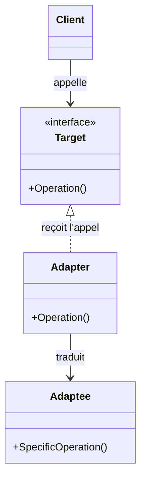
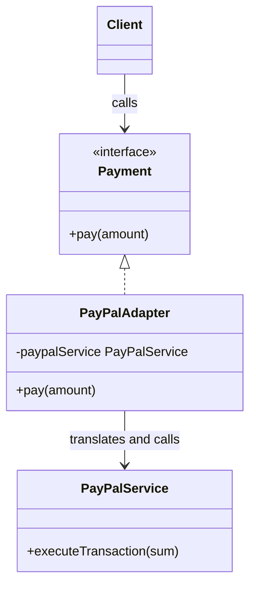
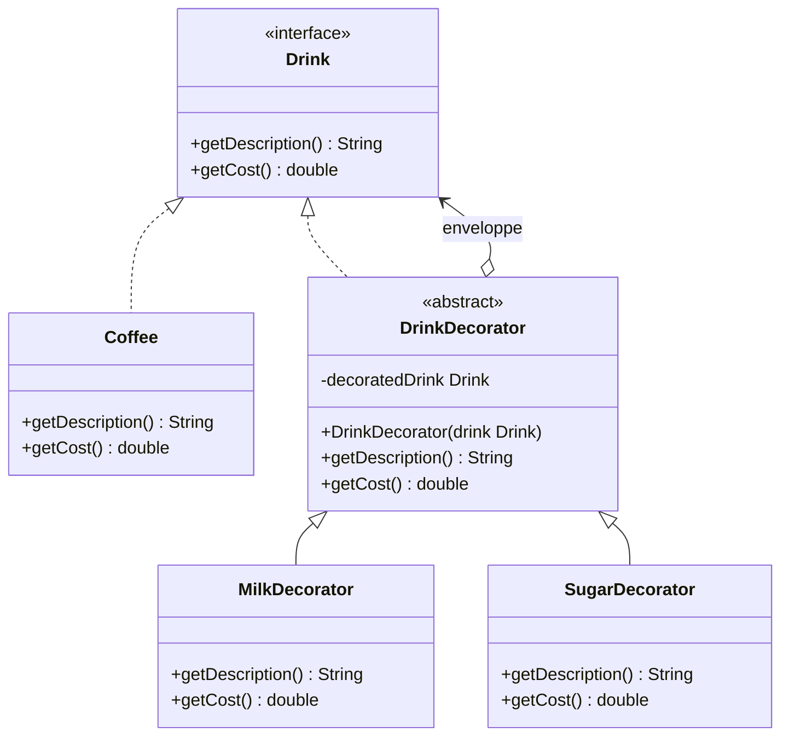

Les patterns de création règlent la naissance des objets. Une fois créés, il faut les **faire tenir ensemble** : brancher une bibliothèque dont l'interface ne correspond pas à la nôtre, éviter qu'une hiérarchie de classes n'explose à chaque nouveau besoin, ajouter un comportement sans toucher à une classe qui marche. Les **patterns de structure** décrivent comment **assembler classes et objets** pour former des structures plus grandes qui restent souples. Ils ont un point commun, que cette session va rendre très concret : ils **préfèrent la composition à l'héritage**.

<Callout type="note" title="Des exposés d'étudiants">
  Cette session est construite à partir de deux exposés SIGL : l'un sur Adapter et Bridge, l'autre sur Decorator. Leur contenu est restitué dans le flux ; les points qui méritent d'être nuancés sont signalés dans les encadrés « pour aller plus loin ».
</Callout>

<Callout type="definition" title="Pattern structurel">
  Un patron de conception qui décrit **comment organiser et combiner des classes ou des objets** pour construire une structure de programme flexible, maintenable et réutilisable. Il porte sur les **relations** entre objets, pas sur leur création ni sur leurs algorithmes.
</Callout>

## Adapter

### Intention et motivation

**Type** : pattern de structure. **Intention** : **convertir l'interface d'une classe en une autre interface, celle qu'attend le client**. **Motivation** : deux classes devraient travailler ensemble mais ne « parlent » pas la même interface ; plutôt que de modifier l'une ou l'autre, on **introduit une classe intermédiaire qui traduit les appels**.

L'image de l'exposé est celle de l'**adaptateur de prise** électrique. La fiche (le client) a la forme d'origine ; la prise murale (l'adaptee) est incompatible ; l'adaptateur se branche entre les deux et **convertit** sans que ni la fiche ni la prise ne changent.

<Figure caption="L'adaptateur de prise · D'après l'exposé Adapter">
```mermaid
flowchart TB
  C[Client · la fiche, forme d'origine] -->|requête| A[Adapter · l'adaptateur, convertit]
  A -->|requête compatible| E[Adaptee · la prise, externe et incompatible]
  classDef ad fill:var(--signal-soft),stroke:var(--signal);
  class A ad
```
</Figure>

### Participants et collaborations

Quatre participants :

<CardGrid cols={2}>
  <Card kicker="Client" title="Celui qui appelle" tone="signal">Ne connaît que l'interface **Target**. Il ignore jusqu'à l'existence de l'Adaptee.</Card>
  <Card kicker="Target" title="L'interface attendue" tone="signal">L'interface que le client sait utiliser, ici avec une méthode `Operation()`.</Card>
  <Card kicker="Adapter" title="Le traducteur" tone="signal">Implémente **Target**, reçoit l'appel et le **traduit** en appel(s) à l'Adaptee.</Card>
  <Card kicker="Adaptee" title="La classe existante" tone="signal">La classe utile mais incompatible, avec sa propre méthode `SpecificOperation()`. On ne la modifie pas.</Card>
</CardGrid>

<Figure caption="Structure de l'Adapter · Source : exposé Adapter, SIGL 2027">

</Figure>

La collaboration se lit en trois temps : le **Client** appelle les méthodes définies par **Target** ; l'**Adapter** récupère l'appel et le traduit pour l'**Adaptee** ; l'**Adaptee** exécute la logique.

### Adapter d'objet, adapter de classe

L'exposé distingue deux variantes, selon la façon dont l'Adapter atteint l'Adaptee :

<Compare leftTitle="Adapter d'objet · composition" rightTitle="Adapter de classe · héritage">
  <Fragment slot="left">
    L'Adapter **contient** une instance de l'Adaptee (un champ) et lui **délègue** le travail. Il peut adapter l'Adaptee **et toutes ses sous-classes**, puisqu'il ne dépend que d'un objet. C'est la forme la plus courante.
  </Fragment>
  <Fragment slot="right">
    L'Adapter **hérite** à la fois de la Target et de l'Adaptee, et appelle directement les méthodes héritées. Cela suppose l'**héritage multiple**, ce que Java et C# n'offrent pas pour les classes : d'où la limite citée par l'exposé.
  </Fragment>
</Compare>

### Exemple : un système de paiement

L'exposé applique le pattern à un paiement. L'application sait payer avec une méthode `pay(amount)` ; le service PayPal, lui, expose `executeTransaction(sum)`. Le `PayPalAdapter` « implémente » l'interface `Payment` et traduit l'un en l'autre.

<Figure caption="Adapter appliqué à un paiement PayPal · D'après l'exposé Adapter, SIGL 2027 (rôles nommés selon le GoF)">

</Figure>

```java
interface Payment {                       // Target
    void pay(double amount);
}

class PayPalAdapter implements Payment {  // Adapter
    private final PayPalService paypalService;   // Adaptee
    PayPalAdapter(PayPalService s) { this.paypalService = s; }

    public void pay(double amount) {
        paypalService.executeTransaction(amount); // la traduction
    }
}

// Le client ne connaît que Payment
Payment p = new PayPalAdapter(new PayPalService());
p.pay(42.0);
```

Ajouter Stripe demain revient à écrire un `StripeAdapter` : **plusieurs Adapters pour une même Target**, c'est la « flexibilité » que l'exposé met en avant.

<DeepDive title="Qui est la Target, qui est l'Adaptee ?" level="approfondissement">
  Sur la slide d'exemple, `PayPalService` est étiqueté « Target » et l'Adaptee est représenté à part. Dans le vocabulaire du GoF (et sur le diagramme de structure du même exposé), la **Target** est l'interface **attendue par le client**, ici `Payment` avec `pay(amount)`, et l'**Adaptee** est la classe existante qu'on adapte, ici `PayPalService` avec `executeTransaction(sum)`. Le schéma ci-dessus suit cette convention. Le moyen de ne pas se tromper : la Target est **du côté du client**, l'Adaptee est **la chose qu'on ne peut pas modifier**.
</DeepDive>

<Quiz question="Une application appelle un service météo via l'interface WeatherProvider.getTemperature(city). On veut utiliser une bibliothèque externe qui expose fetchData(lat, lon) et renvoie des Fahrenheit. Quel est l'Adaptee ?" options={['L\'interface WeatherProvider', 'La bibliothèque externe et sa méthode fetchData', 'La classe qui convertit city en coordonnées et Fahrenheit en Celsius']} answer={1}>
  **La bibliothèque externe.** C'est la classe existante, utile mais incompatible, qu'on ne modifie pas. `WeatherProvider` est la **Target** (ce qu'attend le client) et la classe qui convertit ville et unités est l'**Adapter**. Le piège : confondre « ce qui est adapté » (l'Adaptee) avec « ce qui adapte » (l'Adapter). Note que l'Adapter peut faire bien plus que renommer une méthode : convertir des paramètres, des unités, des formats.
</Quiz>

### Conséquences et patterns associés

<Compare leftTitle="Avantages" rightTitle="Limites">
  <Fragment slot="left">
    - **Code legacy** : réutiliser un ancien composant sans le réécrire ni le modifier.
    - **Réutilisation** de bibliothèques tierces dont on ne contrôle pas l'interface.
    - **Flexibilité** : plusieurs Adapters peuvent se brancher sur la même Target.
  </Fragment>
  <Fragment slot="right">
    - **Multiplication des classes** : un Adapter par cas à adapter.
    - **Complexe** si les Adapters se multiplient (ou s'empilent).
    - L'adapter de classe exige l'**héritage multiple**.
  </Fragment>
</Compare>

L'exposé cite trois patterns associés, tous des « enveloppes » : **Decorator** (qui garde l'interface mais ajoute un comportement), **Facade** (qui simplifie un ensemble de classes derrière une interface unique) et **Bridge** (présenté juste après).

## Bridge

### Intention et motivation

**Type** : pattern de structure. **Alias** : *Handle/Body* (poignée/corps). **Intention** : **découpler une abstraction de son implémentation, afin que les deux puissent varier indépendamment**.

Le **problème** est l'**explosion du nombre de classes**. Prenons l'exemple de l'exposé : on doit exporter des entités (`User`, `Company`, `Product`…) dans plusieurs formats (`Json`, `Xml`, `Csv`…). Avec l'héritage seul, chaque combinaison devient une classe : `UserJsonExporter`, `UserXmlExporter`, `CompanyCsvExporter`… Ajouter une entité ou un format oblige à créer **une classe par élément de l'autre dimension**.

<KeyIdea>L'héritage **multiplie** les dimensions (N entités × M formats), la composition les **additionne** (N + M).</KeyIdea>

Fais varier les deux dimensions et compare :

<Figure caption="Héritage contre Bridge sur l'exemple des exporteurs · D'après l'exposé Bridge, SIGL 2027 (3 × 3 = 9 classes contre 3 + 3 = 6)">
  <ClassExplosion />
</Figure>

L'exposé donne trois indications d'utilisation : **éviter un lien définitif** entre une abstraction et son implémentation (pour pouvoir choisir ou changer l'implémentation à l'exécution), **partager une même implémentation** entre plusieurs objets, et **éviter la prolifération de classes**.

### Constituants et structure

Le Bridge sépare le système en **deux hiérarchies indépendantes**, reliées par un seul lien de composition, le « pont » :

<CardGrid cols={2}>
  <Card kicker="Abstraction" title="Exporter" tone="amber">La classe abstraite que voit le client. Elle **contient une référence** vers un Implémenteur (`formatter : IFormatter`).</Card>
  <Card kicker="Abstraction raffinée" title="UserExporter, CompanyExporter…" tone="signal">Les variantes de l'abstraction : chacune ajoute de la précision (quelles données extraire), sans rien savoir du format.</Card>
  <Card kicker="Implémenteur" title="IFormatter" tone="synapse">L'interface des opérations de bas niveau : `format(data)`.</Card>
  <Card kicker="Implémenteur concret" title="CsvFormatter, JsonFormatter, XmlFormatter" tone="danger">Les implémentations réelles, interchangeables, chacune apportant le contexte de son format.</Card>
</CardGrid>

<Figure caption="Le Bridge appliqué aux exporteurs · Source : exposé Bridge, SIGL 2027">
```mermaid
flowchart TB
  E[Exporter<br/>abstraction] -->|raffinée en| U[User<br/>Exporter] & C[Company<br/>Exporter] & P[Product<br/>Exporter]
  E ==>|le pont| I[IFormatter<br/>implémenteur]
  I -.->|implémenté par| F1[Csv<br/>Formatter] & F2[Json<br/>Formatter] & F3[Xml<br/>Formatter]
  classDef abs fill:var(--amber-soft),stroke:var(--amber);
  classDef impl fill:var(--synapse-soft),stroke:var(--synapse);
  class E abs
  class I impl
```
</Figure>

La **collaboration** est simple : l'Abstraction **transmet les requêtes** du client à son objet Implémenteur. `UserExporter.export()` rassemble les données d'un utilisateur, puis appelle `formatter.format(data)` sans savoir s'il produit du JSON ou du CSV.

```java
abstract class Exporter {
    protected final IFormatter formatter;      // le pont
    Exporter(IFormatter f) { this.formatter = f; }
    abstract File export();
}

class UserExporter extends Exporter {
    UserExporter(IFormatter f) { super(f); }
    File export() {
        RawData data = collectUsers();
        return write(formatter.format(data));  // délégation à l'implémenteur
    }
}

// N'importe quelle combinaison, sans classe dédiée
new UserExporter(new JsonFormatter()).export();
new UserExporter(new CsvFormatter()).export();
```

### Conséquences

<Compare leftTitle="Ce qu'on gagne" rightTitle="Ce que ça coûte">
  <Fragment slot="left">
    - **Capacité d'extension accrue** : on étend chaque hiérarchie de son côté.
    - **Détails d'implémentation cachés** aux clients, qui ne voient que l'abstraction.
    - L'implémentation peut être **choisie ou changée à l'exécution**.
  </Fragment>
  <Fragment slot="right">
    - Le **découplage** de l'interface et de l'implémentation **ajoute de la complexité** : deux hiérarchies et une indirection à comprendre.
  </Fragment>
</Compare>

### Bridge ou Adapter : une question de moment

Les deux patterns placent un objet entre le client et le code qui fait le travail. Ce qui les sépare, d'après les notes de l'exposé, c'est **quand** on les utilise :

<Compare leftTitle="Bridge · à la conception" rightTitle="Adapter · après coup">
  <Fragment slot="left">
    On le **déploie à la conception**, quand on sait d'avance que l'abstraction et l'implémentation vont varier chacune de leur côté. Les deux hiérarchies sont pensées pour aller ensemble.
  </Fragment>
  <Fragment slot="right">
    Si la conception est dépassée (le développement est déjà en cours, les classes existent et ne sont pas compatibles), on passe plutôt par un **Adapter**, souvent utilisé pour **intégrer des applications existantes**.
  </Fragment>
</Compare>

L'exposé note aussi que le Bridge repose, comme **State** et **Strategy**, sur la **composition** : un objet délègue une partie de son comportement à un autre objet, interchangeable.

<DeepDive title="Les patterns liés au Bridge selon le GoF" level="approfondissement">
  La slide indique que le Bridge n'est « pas relié dans le modèle du livre ». Le catalogue du GoF lui donne pourtant deux patterns apparentés : **Abstract Factory**, qui peut créer et configurer un Bridge particulier (choisir le bon Implémenteur concret pour la plateforme), et **Adapter**, avec exactement la distinction de moment vue plus haut : l'Adapter fait fonctionner ensemble des classes **après** leur conception, le Bridge est utilisé **en amont** pour que abstraction et implémentation puissent varier indépendamment. Refactoring.Guru ajoute que Bridge, State et Strategy ont des structures très proches, et que ce qui les distingue est le **problème** qu'ils résolvent.
</DeepDive>

<Quiz question="Une application dessine des formes (Cercle, Carré) avec deux moteurs de rendu (Vectoriel, Raster). Combien de classes concrètes faut-il pour ajouter un Triangle, avec héritage puis avec Bridge ?" options={['1 et 1', '2 et 1', '2 et 2']} answer={1}>
  **2 avec l'héritage, 1 avec le Bridge.** En héritage, chaque forme existe dans chaque moteur : il faut `TriangleVectoriel` et `TriangleRaster`. Avec le Bridge, `Triangle` est une abstraction raffinée qui délègue le dessin à n'importe quel moteur : une seule classe. L'écart paraît faible ici, mais il grandit avec chaque moteur ajouté : c'est la différence entre N × M et N + M.
</Quiz>

## Decorator

### Intention

**Type** : pattern structurel, de la catégorie des patterns qui **organisent les relations**. **Alias** : *Wrapper*. **Intention** : **envelopper un objet dans un autre objet qui lui ajoute un comportement, tout en restant interchangeable avec l'original**. Le pattern **favorise la composition plutôt que l'héritage** pour étendre des fonctionnalités.

« Interchangeable » est le mot-clé : le décorateur **implémente la même interface** que l'objet qu'il enveloppe. Le client reçoit un `Drink` et ne sait pas s'il s'agit d'un café nu ou d'un café enveloppé trois fois.

### Structure

L'exemple de l'exposé est un café qu'on agrémente de lait et de sucre :

<Figure caption="Decorator appliqué aux boissons · Source : exposé Decorator, groupe 4K">

</Figure>

Ce diagramme se lit en quatre rôles :

- **Component** (`Drink`) : l'interface commune, celle que voit le client.
- **ConcreteComponent** (`Coffee`) : l'objet de base, celui qu'on décore.
- **Decorator** (`DrinkDecorator`) : classe abstraite qui **est** un `Drink` **et contient** un `Drink` (`decoratedDrink`). Par défaut, elle transmet chaque appel à l'objet enveloppé.
- **ConcreteDecorator** (`MilkDecorator`, `SugarDecorator`) : chacun ajoute **sa** responsabilité avant ou après la délégation.

```java
abstract class DrinkDecorator implements Drink {
    protected final Drink decoratedDrink;
    DrinkDecorator(Drink drink) { this.decoratedDrink = drink; }
    public String getDescription() { return decoratedDrink.getDescription(); }
    public double getCost()        { return decoratedDrink.getCost(); }
}

class MilkDecorator extends DrinkDecorator {
    MilkDecorator(Drink d) { super(d); }
    public String getDescription() { return super.getDescription() + ", lait"; }
    public double getCost()        { return super.getCost() + 0.50; }
}

// Les décorateurs s'empilent à l'exécution
Drink d = new SugarDecorator(new MilkDecorator(new Coffee()));
d.getCost();   // Sugar → Milk → Coffee, puis les suppléments remontent
```

Empile des décorateurs et regarde l'appel `getCost()` traverser les couches. Le décorateur « promo » est ajouté pour l'exemple : il montre la limite citée par l'exposé, **l'ordre des décorateurs peut modifier le comportement**.

<Figure caption="Envelopper un café et suivre la délégation · Prix fictifs, exemple illustratif bâti sur le diagramme de l'exposé Decorator">
  <DecoratorStack />
</Figure>

### Conséquences

<Compare leftTitle="Avantages" rightTitle="Limites et problèmes">
  <Fragment slot="left">
    - Ajouter **dynamiquement** des responsabilités à un objet, **à l'exécution**.
    - **Flexibilité** : ajouter ou retirer des comportements sans recompiler de hiérarchie.
    - Respect du **principe de responsabilité unique** (*Single Responsibility Principle*, SRP) : chaque fonctionnalité vit dans sa propre classe.
    - Éviter les **nombreuses sous-classes** qui combineraient plusieurs comportements (`CoffeeWithMilkAndSugar`…).
  </Fragment>
  <Fragment slot="right">
    - Beaucoup de **petites classes**.
    - Un code **plus difficile à comprendre** : l'objet réel est caché sous les couches.
    - **L'ordre des décorateurs** peut modifier le comportement.
    - Un **debug** parfois plus complexe : une pile d'appels qui traverse chaque enveloppe.
  </Fragment>
</Compare>

Le dernier avantage est le même problème que celui du Bridge, vu sous un autre angle : avec l'héritage, 3 suppléments combinables donnent 2³ = 8 variantes de café ; avec le Decorator, **3 classes** suffisent, et les combinaisons se font à l'exécution.

<DeepDive title="Le Decorator que tu utilises déjà : java.io" level="terrain">
  La bibliothèque d'entrées-sorties de Java est l'exemple classique du Decorator. `InputStream` est le Component, `FileInputStream` un ConcreteComponent, et `FilterInputStream` le Decorator abstrait dont héritent `BufferedInputStream` (ajoute un tampon) ou `DataInputStream` (ajoute la lecture de types primitifs). On écrit ainsi `new DataInputStream(new BufferedInputStream(new FileInputStream("f.bin")))` : trois couches, une seule interface (documentation Java SE, `BufferedInputStream`).
</DeepDive>

<Quiz question="Un Decorator et un Adapter enveloppent tous deux un objet. Qu'est-ce qui les distingue ?" options={['Le Decorator utilise l\'héritage, l\'Adapter la composition', 'Le Decorator garde la même interface et ajoute un comportement ; l\'Adapter change l\'interface sans ajouter de fonctionnalité', 'Aucune différence, ce sont deux noms du même pattern']} answer={1}>
  **L'interface.** Le Decorator **conserve** l'interface de l'objet enveloppé (il reste interchangeable avec lui) et **enrichit** son comportement ; l'Adapter **convertit** une interface en une autre pour que le client puisse s'en servir. Le premier choix est un piège : les deux reposent surtout sur la **composition** (l'adapter de classe mis à part). C'est aussi pourquoi on peut empiler des décorateurs, alors qu'empiler des adapters n'a en général pas de sens.
</Quiz>

## Choisir un pattern de structure

<Figure caption="Quel pattern de structure pour quel problème · Synthèse des deux exposés">
```mermaid
flowchart TB
  Q{Quel est le problème ?}
  Q -->|une classe existante a la mauvaise interface| A[Adapter]
  Q -->|deux dimensions qui varient et multiplient les classes| B[Bridge]
  Q -->|ajouter des comportements combinables à un objet| D[Decorator]
  A --> A2[Après coup · intégration, legacy]
  B --> B2[À la conception · deux hiérarchies]
  D --> D2[À l'exécution · enveloppes empilées]
  classDef cours fill:var(--signal-soft),stroke:var(--signal);
  class A,B,D cours
```
</Figure>

## À retenir

<Takeaways>
1. **Les patterns de structure organisent les relations** entre objets, et préfèrent presque toujours la composition à l'héritage.
2. **Adapter** : convertir l'interface d'une classe existante (Adaptee) en celle qu'attend le client (Target) ; on l'utilise après coup, pour intégrer du legacy ou une bibliothèque tierce.
3. **Bridge** : découpler une abstraction de son implémentation en deux hiérarchies reliées par composition ; on passe de N × M classes à N + M, et on le décide à la conception.
4. **Decorator** : envelopper un objet dans un autre de même interface qui ajoute un comportement ; les décorateurs s'empilent à l'exécution, mais leur ordre compte.
5. **Le prix commun** : plus de petites classes et une indirection de plus à comprendre et à déboguer.
</Takeaways>
