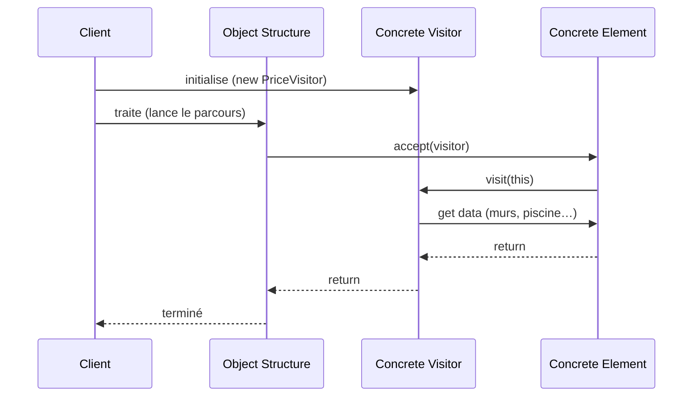

Une hiérarchie de classes bien établie (les nœuds d'un arbre syntaxique, les éléments d'un document, les bâtiments d'un catalogue) attire les opérations : calculer un prix, exporter en JSON, vérifier des règles, afficher… Si chacune devient une méthode dans chaque classe, ces classes grossissent de fonctionnalités **sans rapport entre elles**, et chaque nouvelle opération oblige à les rouvrir toutes. Les **patterns de comportement** traitent de la répartition des **responsabilités et des algorithmes** entre objets ; le **Visitor** en est un cas d'école : il sort les opérations des classes pour les ranger dans des objets « experts ». Cette session le présente en entier, puis le resitue parmi les sept patterns de la partie.

<Callout type="note" title="Un exposé d'étudiants">
  Cette session est construite à partir de l'exposé du groupe 1Pacte (le même qui a présenté le Builder en session 1 : on y retrouve la `Maison`). Les points qui méritent d'être nuancés sont signalés dans les encadrés « pour aller plus loin ».
</Callout>

## Intention et motivation

### Une opération de plus, sans rouvrir les classes

**Type** : pattern de comportement. **Intention** : **définir une nouvelle opération sans changer les classes des éléments sur lesquels elle opère**.

<Compare leftTitle="Le problème" rightTitle="La solution">
  <Fragment slot="left">
    L'**ajout de méthodes variées sur une même classe**. `Maison` finit par porter `calculerPrix()`, `exporterJson()`, `verifierNormes()`, `afficher()`… Des responsabilités qui n'ont rien à voir entre elles, et qu'il faut dupliquer dans `Chalet`, `Immeuble`, etc.
  </Fragment>
  <Fragment slot="right">
    **Déporter ces algorithmes dans des classes « experts » externes**, les visiteurs. Un `PriceVisitor` sait calculer le prix de **chaque** sorte de bâtiment ; un `ExportVisitor` sait tous les exporter. Les classes de bâtiments, elles, ne savent plus qu'une chose : **accepter** un visiteur.
  </Fragment>
</Compare>

<KeyIdea>Sans Visitor, le code est rangé **par élément** (chaque classe porte toutes ses opérations). Avec Visitor, il est rangé **par opération** (chaque visiteur traite tous les éléments).</KeyIdea>

### Quand l'utiliser

L'exposé donne trois conditions, à réunir ensemble :

<CardGrid cols={3}>
  <Card kicker="Applicabilité" title="Beaucoup de classes différentes" tone="signal">Une structure d'objets faite de nombreuses classes ou interfaces différentes, qu'on veut traiter chacune à sa façon.</Card>
  <Card kicker="Applicabilité" title="Des opérations distinctes" tone="signal">Des opérations **distinctes et non liées** entre elles, qui n'ont rien à faire dans les classes des éléments.</Card>
  <Card kicker="Applicabilité" title="Une structure stable" tone="amber">La **structure des classes change rarement**. C'est la condition décisive, expliquée plus bas.</Card>
</CardGrid>

## Structure et collaborations

### Les participants

<CardGrid cols={2}>
  <Card kicker="Client" title="Lance le traitement">**Instancie le visiteur** et **lance le parcours** de la structure.</Card>
  <Card kicker="Object Structure" title="Orchestre le parcours">Contient les éléments (une liste, un arbre…) et les fait **accepter** le visiteur un par un.</Card>
  <Card kicker="Concrete Element" title="Maison, Chalet">Implémente `accept(visitor)`, qui rappelle le visiteur en se passant lui-même.</Card>
  <Card kicker="Concrete Visitor" title="PriceVisitor">Implémente **une opération spécifique**, avec une méthode `visit` par sorte d'élément.</Card>
</CardGrid>

### Le déroulé d'une visite

Le diagramme de séquence de l'exposé montre un aller-retour en deux temps : la structure appelle l'élément (`accept`), puis l'élément rappelle le visiteur (`visit`), qui va chercher les données dont il a besoin.

<Figure caption="Collaborations du Visitor · Source : exposé Visitor, groupe 1Pacte">

</Figure>

<DeepDive title="La structure « orchestre le parcours », pas la construction" level="approfondissement">
  Sur la slide, l'Object Structure « orchestre la construction ». Dans le catalogue du GoF, son rôle est d'**énumérer ses éléments** et de fournir une interface de haut niveau pour que le visiteur les parcoure : c'est souvent une collection ou un **Composite** (un arbre). Elle ne construit rien ; c'est d'ailleurs pourquoi le diagramme de séquence de l'exposé lui fait appeler `accept` sur chaque élément, puis rendre la main au client une fois le parcours terminé.
</DeepDive>

## Implémentation

### Le code de l'exposé

L'exposé implémente un visiteur qui **estime le prix** de bâtiments. L'interface du visiteur déclare une méthode `visit` **par classe d'élément** ; chaque bâtiment implémente `accept` en une ligne.

```java
interface BatimentVisitor {
    void visit(Maison m);
    void visit(Chalet c);
}

interface Building { void accept(BatimentVisitor v); }

class Maison implements Building {
    int murs; boolean piscine;

    @Override
    public void accept(BatimentVisitor v) {
        v.visit(this);
    }
}

class Chalet implements Building {
    int murs; boolean sauna;
    // ... la même chose que pour Maison
}

// le Concrete Visitor
class PriceVisitor implements BatimentVisitor {
    @Override
    public void visit(Maison m) {
        int prix = (m.murs * 1000) + (m.piscine ? 5000 : 0);
        System.out.println("Prix estimé Maison : " + prix + "€");
    }

    @Override
    public void visit(Chalet c) {
        int prix = (c.murs * 1200) + (c.sauna ? 3000 : 0);
        System.out.println("Prix estimé Chalet : " + prix + "€");
    }
}
```

Côté client, il suffit de parcourir la structure : `for (Building b : batiments) b.accept(new PriceVisitor());`. Pour ajouter un export, on écrit un `ExportVisitor` : **ni `Maison` ni `Chalet` ne changent**.

### Pourquoi accept et visit : le double dispatch

On pourrait se demander pourquoi ne pas appeler directement `visitor.visit(b)` sur chaque bâtiment. Parce que, en Java comme en C#, le choix entre `visit(Maison)` et `visit(Chalet)` (la **surcharge**) se fait **à la compilation**, d'après le type déclaré de la variable. Or `b` est déclaré `Building` : le compilateur ne sait pas quelle surcharge prendre, et le code ne compile pas.

Le Visitor contourne le problème avec **deux appels successifs**, chacun résolu dynamiquement sur un objet différent :

<Pipeline steps={[
  { title: 'b.accept(v)', caption: 'Premier choix : le type réel de l\'élément', detail: 'L\'appel est polymorphe : la JVM exécute Maison.accept ou Chalet.accept selon l\'objet réel, même si b est déclaré Building.', tone: 'signal' },
  { title: 'v.visit(this)', caption: 'Dans Maison, this est une Maison', detail: 'À l\'intérieur de Maison.accept, le type de this est connu à la compilation : c\'est Maison. Le compilateur choisit donc la surcharge visit(Maison).', tone: 'signal' },
  { title: 'PriceVisitor.visit(Maison)', caption: 'Second choix : le type réel du visiteur', detail: 'Cet appel est à son tour polymorphe sur le visiteur : PriceVisitor, ExportVisitor… L\'opération exécutée dépend donc des deux types, élément et visiteur.', tone: 'synapse' },
]} />

<Callout type="definition" title="Double dispatch">
  Choisir la méthode à exécuter selon le type réel de **deux** objets à la fois (ici l'élément et le visiteur), alors que l'appel de méthode classique ne choisit que selon un seul (l'objet sur lequel on appelle). Le Visitor l'obtient en enchaînant deux appels polymorphes : `accept`, puis `visit`.
</Callout>

<Quiz question="Le corps de accept est identique dans Maison et dans Chalet (v.visit(this)). Pourquoi ne pas l'écrire une seule fois dans une classe mère commune ?" options={['On peut : l\'héritage suffit, le polymorphisme choisira la bonne surcharge de visit', 'On ne peut pas : dans la classe mère, this a le type de la classe mère, et aucune surcharge visit ne lui correspond', 'On ne peut pas : Java interdit les méthodes accept dans une classe abstraite']} answer={1}>
  **On ne peut pas.** Le choix de la surcharge `visit(Maison)` ou `visit(Chalet)` se fait **à la compilation**, d'après le type statique de `this`. Écrit dans `Maison`, `this` est une `Maison` ; écrit dans une classe mère `BatimentBase`, `this` est un `BatimentBase`, et le compilateur ne trouve pas de `visit(BatimentBase)`. Le piège est de croire que la surcharge est résolue à l'exécution comme une redéfinition (*override*) : seul l'objet **sur lequel** on appelle est choisi dynamiquement, pas les **arguments**. C'est pourquoi chaque élément réécrit `accept`.
</Quiz>

## Le compromis du Visitor

### Ajouter une opération ou ajouter un élément

La troisième condition d'applicabilité, « la structure des classes change rarement », s'explique en regardant ce qu'il faut modifier dans chaque cas. Essaie les deux organisations :

<Figure caption="Ajouter une opération ou un élément, avec ou sans Visitor · Illustration bâtie sur l'exemple Maison/Chalet de l'exposé">
  <VisitorTradeoff />
</Figure>

<Compare leftTitle="Facile avec un Visitor" rightTitle="Coûteux avec un Visitor">
  <Fragment slot="left">
    **Ajouter une opération** : une nouvelle classe visiteur, et c'est tout. Les éléments ne bougent pas, l'opération est rassemblée en un seul endroit au lieu d'être éparpillée dans chaque classe.
  </Fragment>
  <Fragment slot="right">
    **Ajouter une classe d'élément** : l'interface du visiteur gagne une méthode `visit(Immeuble)`, et **tous** les visiteurs existants doivent l'implémenter. Si la hiérarchie change souvent, le Visitor devient un fardeau.
  </Fragment>
</Compare>

<Quiz question="Une équipe développe un éditeur de formules : 6 types de nœuds (Nombre, Plus, Fois…) figés depuis deux ans, et de nouvelles opérations chaque mois (évaluer, simplifier, dériver, afficher en LaTeX). Le Visitor est-il adapté ?" options={['Oui : hiérarchie stable, opérations nombreuses et sans rapport entre elles', 'Non : 6 classes, c\'est trop peu pour un pattern', 'Non : il faudrait plutôt un Decorator par opération']} answer={0}>
  **Oui, c'est le cas idéal.** Les trois conditions de l'exposé sont réunies : plusieurs classes différentes, des opérations distinctes et une structure qui ne bouge plus. Chaque nouvelle opération sera un visiteur, sans toucher aux nœuds. Le Decorator attire parce qu'il « ajoute un comportement », mais il enrichit **un objet** à l'exécution ; il ne range pas une opération qui doit traiter **toutes les sortes** de nœuds différemment.
</Quiz>

### Utilisations connues et patterns apparentés

L'exposé cite trois domaines où le Visitor est courant, qui ont tous une **structure arborescente stable** et des **traitements nombreux** :

<CardGrid cols={3}>
  <Card kicker="Utilisation" title="Analyseurs syntaxiques et compilateurs" tone="signal">L'arbre syntaxique a un jeu de nœuds fixe ; vérification de types, optimisation et génération de code sont autant de visiteurs.</Card>
  <Card kicker="Utilisation" title="Traitement de documents" tone="signal">Paragraphes, titres, images, tableaux : exporter en PDF, en HTML, compter les mots…</Card>
  <Card kicker="Utilisation" title="Systèmes de fichiers" tone="signal">Fichiers et dossiers : calculer une taille, chercher, sauvegarder, en parcourant l'arborescence.</Card>
</CardGrid>

Deux patterns apparentés : **Composite**, qui donne souvent sa forme à l'Object Structure (un arbre d'éléments simples et composés que le visiteur parcourt), et **Iterator**, qui sert à **parcourir** la structure élément par élément pour leur faire accepter le visiteur.

<DeepDive title="Le Visitor face au pattern matching de Java 21" level="état-de-l-art">
  Le Visitor compense une limite des langages qui n'ont qu'un dispatch simple. Depuis Java 21, le **pattern matching pour `switch`** (JEP 441), combiné aux interfaces **`sealed`** (qui fixent la liste exhaustive des sous-classes), permet d'écrire l'opération en un seul endroit sans `accept` : `switch (b) { case Maison m -> …; case Chalet c -> …; }`. Le compilateur vérifie que tous les cas sont traités : ajouter un `Immeuble` à la hiérarchie scellée fait échouer la compilation de chaque `switch` incomplet, exactement comme l'ajout d'une méthode `visit` dans l'interface du visiteur. Le compromis reste donc le même (opérations faciles, nouveaux éléments coûteux), mais avec beaucoup moins de code. Refactoring.Guru détaille par ailleurs pourquoi la surcharge seule ne suffit pas (« Visitor and Double Dispatch »).
</DeepDive>

## Les sept patterns de la partie

Pour réviser l'ensemble, chaque pattern tient en une question :

<CardGrid cols={3}>
  <Card kicker="Création" title="Builder" tone="signal">Comment construire **pas à pas** un objet complexe, et en produire plusieurs représentations ?</Card>
  <Card kicker="Création" title="Abstract Factory" tone="signal">Comment créer des **familles** d'objets cohérentes sans nommer leurs classes ?</Card>
  <Card kicker="Création" title="Prototype" tone="signal">Comment créer en **clonant** un objet déjà configuré ?</Card>
  <Card kicker="Structure" title="Adapter" tone="synapse">Comment brancher une classe dont l'**interface ne convient pas** ?</Card>
  <Card kicker="Structure" title="Bridge" tone="synapse">Comment éviter que **deux dimensions** qui varient ne multiplient les classes ?</Card>
  <Card kicker="Structure" title="Decorator" tone="synapse">Comment **ajouter des comportements** combinables à un objet, à l'exécution ?</Card>
  <Card kicker="Comportement" title="Visitor" tone="amber">Comment **ajouter des opérations** à une hiérarchie stable sans la modifier ?</Card>
</CardGrid>

<Quiz question="Une application doit envoyer des notifications par e-mail, SMS et push, pour trois types de messages (alerte, rappel, promotion), et les canaux comme les types vont s'enrichir. Quel pattern évite d'écrire 9 classes ?" options={['Adapter', 'Bridge', 'Visitor']} answer={1}>
  **Bridge.** Deux dimensions indépendantes qui varient chacune (types de messages et canaux) : l'abstraction `Message` (raffinée en alerte, rappel, promotion) délègue l'envoi à un implémenteur `Canal` (e-mail, SMS, push), soit 3 + 3 classes au lieu de 3 × 3. L'Adapter servirait à brancher un fournisseur de SMS à l'API incompatible, ce qui est un autre problème. Le Visitor attire parce qu'il traite des « combinaisons », mais il suppose une hiérarchie d'éléments **stable**, alors qu'ici les deux côtés vont grandir.
</Quiz>

## À retenir

<Takeaways>
1. **Visitor** : définir une nouvelle opération sans changer les classes des éléments, en la déportant dans une classe visiteur « experte ».
2. **Collaboration** : le client crée le visiteur et lance le parcours, la structure fait `accept` sur chaque élément, l'élément rappelle `visit(this)`, le visiteur lit ses données.
3. **Double dispatch** : `accept` puis `visit` choisissent la méthode selon le type réel de l'élément **et** du visiteur ; c'est pourquoi chaque élément réécrit `accept`.
4. **Le compromis** : ajouter une opération est facile (un visiteur), ajouter une classe d'élément est coûteux (tous les visiteurs changent) ; d'où la condition « structure stable ».
5. **Utilisations** : compilateurs, documents, systèmes de fichiers ; apparenté à Composite (la structure) et Iterator (le parcours).
</Takeaways>
