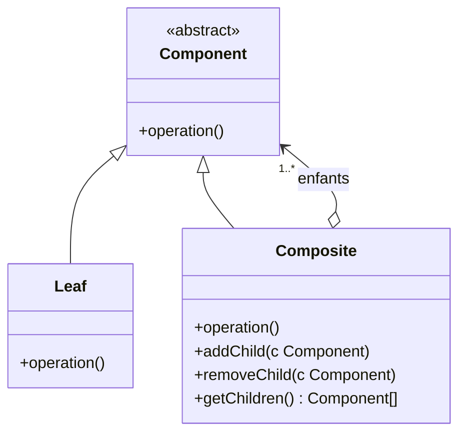
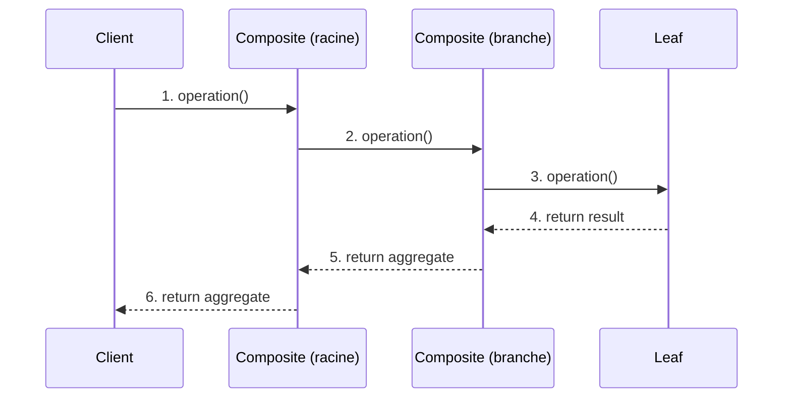
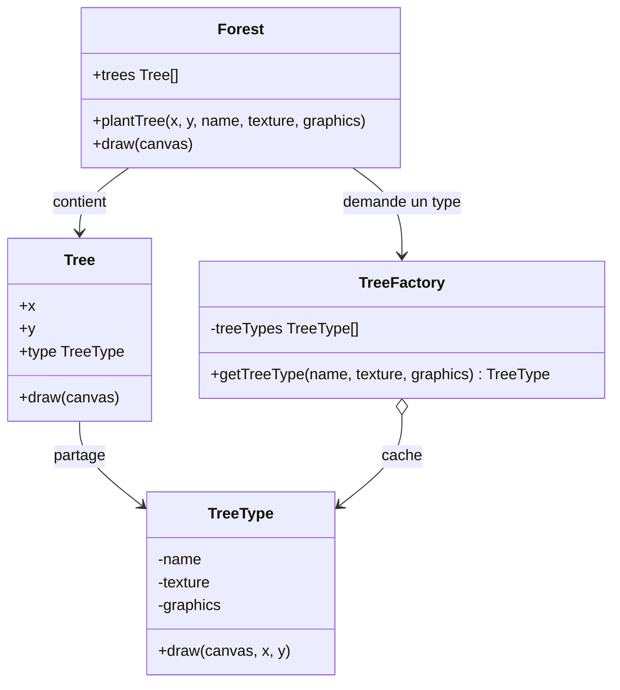

La session 2 a montré trois façons d'assembler des objets : les adapter, les découpler, les envelopper. Deux autres patterns de structure répondent à des problèmes d'**échelle**. Le premier vient de la **forme** des données : un dossier contient des fichiers et d'autres dossiers, une interface graphique contient des panneaux qui contiennent des boutons ; comment écrire du code qui ne se soucie pas de savoir s'il manipule une feuille ou tout un arbre ? C'est le **Composite**. Le second vient de la **quantité** : une forêt d'un million d'arbres, un texte d'un million de caractères ; comment ne pas saturer la mémoire avec des objets qui se ressemblent presque tous ? C'est le **Flyweight**. Les deux se combinent souvent, et tu les retrouveras sous l'**Interpreter** en session 6.

<Callout type="note" title="Des exposés d'étudiants">
  Cette session est construite à partir de deux exposés SIGL, l'un sur Composite, l'autre sur Flyweight. Leur contenu est restitué dans le flux ; les points qui méritent d'être nuancés sont signalés dans les encadrés « pour aller plus loin ».
</Callout>

## Composite

### Intention

**Type** : pattern structurel. **Intention** : **composer des objets en arborescence** pour représenter des **hiérarchies partie-tout**, et permettre au client de **traiter de manière uniforme les objets simples et les compositions d'objets**. Le pattern est aussi appelé *Object Tree* ou *Part-Whole Hierarchy*.

<Callout type="definition" title="Hiérarchie partie-tout">
  Une structure où un **tout** est fait de **parties**, chacune pouvant être elle-même un tout fait d'autres parties : un dossier et son contenu, un document et ses sections, une interface graphique et ses composants.
</Callout>

Le problème qu'il résout : sans Composite, le code client passe son temps à distinguer les cas. « Si c'est un fichier, je l'affiche ; si c'est un dossier, je parcours son contenu et, pour chaque élément, je recommence la même question. » Ces tests de type se répandent partout. Le Composite les supprime grâce à une **interface commune** : un fichier et un dossier répondent tous deux à `afficher()`, et c'est le dossier qui se charge de transmettre l'appel à ses enfants.

L'exposé résume l'usage en deux situations : quand on veut **traiter uniformément tout type d'objet** (simple ou groupe), et quand on doit **représenter une structure hiérarchique**.

### Structure et participants

<Figure caption="Structure du Composite · Source : exposé Composite, groupe MIND7">

</Figure>

Le détail qui fait tout le pattern est la flèche du bas : un **Composite contient des Component**, pas des Leaf. Un composite peut donc contenir des feuilles **et d'autres composites**, à n'importe quelle profondeur.

<CardGrid cols={2}>
  <Card kicker="Component" title="L'interface commune" tone="signal">Déclare l'opération partagée (`operation()`, et selon les choix `add()`, `remove()`, `getChild()`). C'est le **point d'entrée unique** du client.</Card>
  <Card kicker="Leaf" title="La brique de base" tone="signal">Nœud terminal, **sans enfants**. Implémente `operation()` concrètement : c'est lui qui fait le **vrai travail**.</Card>
  <Card kicker="Composite" title="Le nœud intermédiaire" tone="signal">Stocke une liste d'enfants (Leaf ou Composite). **Délègue** `operation()` à chaque enfant et **agrège** les résultats.</Card>
  <Card kicker="Client" title="L'appelant uniforme" tone="signal">Manipule toujours l'arbre via l'interface **Component**, sans jamais distinguer Leaf et Composite.</Card>
</CardGrid>

### Collaborations

Le diagramme de séquence de l'exposé suit un appel du client jusqu'à une feuille. Le client parle à la **racine** ; chaque composite transmet l'appel à ses enfants ; les feuilles répondent ; les résultats remontent en étant **agrégés** à chaque niveau.

<Figure caption="Collaborations du Composite · Source : exposé Composite, groupe MIND7">

</Figure>

### Le code de l'exposé

L'exemple est un système de fichiers : un `Fichier` est une feuille, un `Dossier` est un composite.

```java
import java.util.ArrayList;
import java.util.List;

interface Composant {
    void afficher();
}

class Fichier implements Composant {
    public void afficher() {
        System.out.println("Fichier");
    }
}

class Dossier implements Composant {
    private List<Composant> enfants = new ArrayList<Composant>();

    public void ajouter(Composant c) {
        enfants.add(c);
    }

    public void afficher() {
        System.out.println("Dossier contient :");
        for (Composant c : enfants)
            c.afficher();   // un Fichier ou un autre Dossier : peu importe
    }
}
```

La boucle de `Dossier.afficher()` est le cœur du pattern : elle appelle `afficher()` sur chaque enfant **sans savoir** s'il s'agit d'un fichier ou d'un sous-dossier. Si c'est un sous-dossier, il fera la même chose avec ses propres enfants : la **récursion** vient de la structure, pas d'un test de type.

<Quiz question="On veut calculer la taille totale d'un dossier. Avec le Composite, où écrit-on la somme ?" options={['Dans le client, qui parcourt l\'arbre et additionne la taille des fichiers', 'Dans Dossier.taille(), qui additionne taille() de chaque enfant ; Fichier.taille() renvoie sa propre taille', 'Dans Fichier.taille(), qui remonte vers son dossier parent']} answer={1}>
  **Dans le Composite.** C'est l'**agrégation** du diagramme de séquence : la feuille fait le vrai travail (sa propre taille), le composite délègue à ses enfants et additionne. Le client appelle simplement `racine.taille()`. Le premier choix est ce que le pattern évite : un client qui parcourt l'arbre doit distinguer fichiers et dossiers, et réécrire ce parcours pour chaque nouvelle opération.
</Quiz>

### Conséquences et implémentation

<Compare leftTitle="Conséquences positives" rightTitle="Conséquence négative">
  <Fragment slot="left">
    - Le client traite **de la même façon** un objet simple et un groupe d'objets.
    - **Ajouter de nouveaux types de composants** est très facile : une nouvelle classe qui implémente Component s'insère partout dans l'arbre.
  </Fragment>
  <Fragment slot="right">
    - Il est **difficile de restreindre le type d'enfants** acceptés par un composite (par exemple, interdire un dossier dans un fichier ZIP) : le typage ne l'exprime pas, il faut des **vérifications à l'exécution**.
  </Fragment>
</Compare>

L'exposé donne deux conseils d'implémentation :

- **Maximiser l'interface commune** (Component), pour que le client n'ait presque jamais à vérifier le type concret d'un nœud.
- **Stocker une référence vers le parent** dans chaque composant, pour pouvoir parcourir l'arbre **de bas en haut** (retrouver le chemin complet d'un fichier, propager une modification vers la racine).

<DeepDive title="Transparence ou sûreté : où déclarer add() et remove() ?" level="approfondissement">
  L'exposé fait déclarer `add()`, `remove()` et `getChild()` par le Component, alors que son diagramme ne les met que sur le Composite. Ce sont les deux options que le GoF discute. **Transparence** : les méthodes de gestion des enfants sont dans Component ; le client traite vraiment tout de la même façon, mais une feuille doit implémenter `add()` (en levant une exception ou en ne faisant rien), ce qui n'a pas de sens. **Sûreté** : ces méthodes ne sont que dans Composite ; le compilateur empêche d'ajouter un enfant à une feuille, mais le client doit savoir à quel genre de nœud il parle pour construire l'arbre. Le GoF penche pour la transparence ; la plupart des bibliothèques modernes (et le code de l'exposé, où seul `Dossier` a `ajouter`) choisissent la sûreté.
</DeepDive>

### Utilisations connues et patterns liés

<CardGrid cols={2}>
  <Card kicker="Utilisation" title="Arbres DOM (HTML, XML)" tone="signal">Un nœud est soit du **texte** (feuille), soit un **élément** qui contient d'autres nœuds (composite).</Card>
  <Card kicker="Utilisation" title="Interfaces graphiques" tone="signal">Un composant d'interface peut en contenir d'autres : une fenêtre contient des panneaux, qui contiennent des boutons. Afficher la fenêtre affiche tout le reste.</Card>
</CardGrid>

L'exposé cite trois patterns liés, que tu as déjà croisés : **Decorator**, souvent utilisé avec le Composite (les deux reposent sur une interface commune et la délégation) ; **Iterator**, idéal pour **parcourir** l'arbre ; **Visitor** (session 3), qui permet d'**ajouter de nouvelles opérations** sur l'arbre sans modifier ses classes. C'est la combinaison classique : le Composite donne la forme, le Visitor apporte les traitements.

## Flyweight

### Le problème de la mémoire

**Type** : pattern structurel. **Nom français** : poids mouche. **Intention** : **utiliser le partage des propriétés communes pour supporter de grandes quantités d'objets à granularité fine**.

L'exemple de l'exposé : un jeu vidéo affiche une **forêt d'un million d'arbres**. Chaque arbre a une position `(x, y)` et un **modèle 3D** (maillage, texture). Si chaque objet `Tree` embarque son propre modèle, on duplique un million de fois les mêmes données lourdes, et la **RAM sature**. Or la plupart des arbres ne diffèrent que par leur position : il n'y a peut-être que trois sortes d'arbres.

<KeyIdea>L'objectif du Flyweight tient en une phrase : **ne pas dupliquer ce qui est commun**.</KeyIdea>

### Le cœur : séparer deux états

La **solution** consiste à **externaliser l'état variable** pour ne garder en mémoire, dans des objets partagés, que l'essentiel commun. Tout repose sur la distinction entre deux états :

<Compare leftTitle="État intrinsèque · le Flyweight" rightTitle="État extrinsèque · le contexte">
  <Fragment slot="left">
    Ce qui est **lourd et partagé par tous** les objets d'une même sorte : le nom de l'espèce, la texture, le modèle 3D. Il ne dépend pas de l'endroit où l'objet est utilisé, donc il peut être stocké **une seule fois** et partagé. Il doit être **immuable** : si un arbre le modifiait, tous les arbres de la même sorte changeraient.
  </Fragment>
  <Fragment slot="right">
    Ce qui est **unique à chaque objet** : la position `(x, y)`. Il est petit, il varie d'un objet à l'autre, et il est **conservé à part** (dans un objet contexte léger) ou **passé en paramètre** aux méthodes du flyweight au moment de l'utiliser.
  </Fragment>
</Compare>

Le diagramme de l'exposé applique cette séparation à la forêt :

<Figure caption="Flyweight appliqué à une forêt · Source : exposé Flyweight, groupe 4K">

</Figure>

- **Forest** est le client : il plante et dessine les arbres.
- **Tree** contient l'**état extrinsèque** (`x`, `y`) et une simple **référence** vers son type.
- **TreeType** est le **Flyweight** : il contient l'**état intrinsèque** (nom, texture, graphismes) et sait se dessiner à une position qu'on lui **passe en paramètre** (`draw(canvas, x, y)`).
- **TreeFactory** garde un **cache** des types déjà créés. `getTreeType()` renvoie le type existant s'il est connu, et n'en crée un nouveau que la première fois. C'est elle qui garantit le partage.

```java
class TreeFactory {
    private static final Map<String, TreeType> treeTypes = new HashMap<>();

    static TreeType getTreeType(String name, Texture texture, Mesh graphics) {
        // créé une seule fois par sorte d'arbre, puis partagé
        return treeTypes.computeIfAbsent(name, n -> new TreeType(n, texture, graphics));
    }
}

class Forest {
    private final List<Tree> trees = new ArrayList<>();

    void plantTree(int x, int y, String name, Texture texture, Mesh graphics) {
        TreeType type = TreeFactory.getTreeType(name, texture, graphics);
        trees.add(new Tree(x, y, type));   // quelques octets par arbre
    }
}
```

Fais varier le nombre d'arbres et le nombre de types : le gain dépend du **rapport** entre les deux.

<Figure caption="Mémoire d'une forêt avec et sans Flyweight · Exemple de l'exposé Flyweight, tailles fictives pour l'ordre de grandeur">
  <FlyweightMemory />
</Figure>

<Quiz question="Dans un éditeur de texte qui applique le Flyweight aux caractères, quel attribut doit rester extrinsèque ?" options={['La forme du glyphe (le dessin de la lettre « a » dans une police)', 'La position du caractère dans la page', 'La police et la taille, communes à tout un paragraphe']} answer={1}>
  **La position.** Elle est propre à chaque occurrence : le « a » de la ligne 3 et celui de la ligne 12 ne sont pas au même endroit. Le dessin du glyphe, lui, est identique pour tous les « a » d'une police : c'est l'état intrinsèque, partagé. Le troisième choix est un piège intéressant : la police peut faire partie de la **clé** du flyweight (un glyphe par couple lettre-police) ; ce qui doit rester dehors, c'est ce qui change **pour chaque objet**.
</Quiz>

### Conséquences et cas d'usage

<Compare leftTitle="Avantage" rightTitle="Inconvénients">
  <Fragment slot="left">
    - **Réduction drastique de la RAM** dès que beaucoup d'objets partagent le même état lourd.
  </Fragment>
  <Fragment slot="right">
    - **Complexité accrue** : il faut séparer les deux états, et le code qui manipule un objet doit fournir son contexte.
    - **Coût CPU potentiel** : recherche dans le cache de la factory, recalcul ou transmission de l'état extrinsèque à chaque appel.
  </Fragment>
</Compare>

L'exposé cite trois applications :

<CardGrid cols={3}>
  <Card kicker="Application" title="String pooling (Java)" tone="signal">Les chaînes littérales identiques partagent une seule instance en mémoire.</Card>
  <Card kicker="Application" title="Glyphes de texte" tone="signal">Dans un éditeur, chaque caractère affiché référence le glyphe partagé de sa lettre au lieu d'en porter une copie.</Card>
  <Card kicker="Application" title="Particules et images" tone="signal">Les milliers de particules d'un effet de jeu vidéo partagent sprite et comportement ; un cache d'images évite de recharger la même ressource.</Card>
</CardGrid>

<DeepDive title="Le Flyweight dans la JVM : chaînes et entiers" level="terrain">
  Deux exemples concrets en Java. La spécification du langage (JLS, § 3.10.5) impose que deux littéraux de chaîne identiques désignent **la même instance** de `String` : c'est le *string pool*, et `String.intern()` permet d'y placer une chaîne calculée. Pour les entiers, `Integer.valueOf(int)` renvoie une instance **mise en cache** pour les valeurs de -128 à 127 (documentation de l'API Java SE) : `Integer.valueOf(100) == Integer.valueOf(100)` est vrai, alors que la même comparaison avec 1000 est en général fausse. C'est un Flyweight avec sa factory, et la source d'un piège classique : comparer des `Integer` avec `==` au lieu de `equals()`.
</DeepDive>

### Patterns liés

L'exposé en cite trois. **Composite** : dans un grand arbre, les **feuilles** identiques peuvent être partagées comme flyweights (le GoF l'illustre avec les caractères d'un document, feuilles d'un Composite). **State et Strategy** : les objets état ou stratégie sans données propres peuvent être partagés entre tous leurs utilisateurs. **Singleton** : la factory de flyweights est souvent unique dans l'application.

## Choisir entre les patterns de structure

Avec ces deux-là, la partie compte cinq patterns de structure. Chacun répond à une question distincte :

<Figure caption="Quel pattern de structure pour quel problème · Synthèse des sessions 2 et 4">
```mermaid
flowchart TB
  Q{Quel est le problème ?}
  Q -->|une interface incompatible| A[Adapter]
  Q -->|deux dimensions qui multiplient les classes| B[Bridge]
  Q -->|des comportements à empiler| D[Decorator]
  Q -->|une hiérarchie partie-tout| C[Composite]
  Q -->|trop d'objets presque identiques| F[Flyweight]
  classDef s4 fill:var(--signal-soft),stroke:var(--signal);
  class C,F s4
```
</Figure>

<Quiz question="Un éditeur de diagrammes permet de grouper des formes, puis de déplacer ou colorier le groupe comme une seule forme. Quel pattern ?" options={['Flyweight', 'Composite', 'Decorator']} answer={1}>
  **Composite.** Un groupe de formes se manipule comme une forme : c'est la hiérarchie partie-tout, et `deplacer()` sur un groupe délègue à chaque forme qu'il contient (y compris des sous-groupes). Le Decorator attire parce qu'il « enveloppe » aussi, mais il enveloppe **un seul** objet pour lui ajouter un comportement. Le Flyweight répondrait à un autre problème : des milliers de formes identiques à afficher.
</Quiz>

## À retenir

<Takeaways>
1. **Composite** : composer des objets en arbre pour traiter de la même façon une feuille et un groupe ; le client ne parle qu'à l'interface Component.
2. **La récursion vient de la structure** : un Composite contient des Component, délègue l'opération à ses enfants et agrège leurs résultats ; la Leaf fait le vrai travail.
3. **Flyweight** : partager l'état intrinsèque (lourd, commun, immuable) entre une foule d'objets, et sortir l'état extrinsèque (propre à chacun) dans un contexte léger ou en paramètre.
4. **La factory garantit le partage** : elle met en cache les flyweights et ne crée chaque sorte qu'une fois.
5. **Le prix** : vérifications à l'exécution pour le Composite ; complexité et coût CPU pour le Flyweight, qui ne rapporte que si beaucoup d'objets partagent le même état.
</Takeaways>
