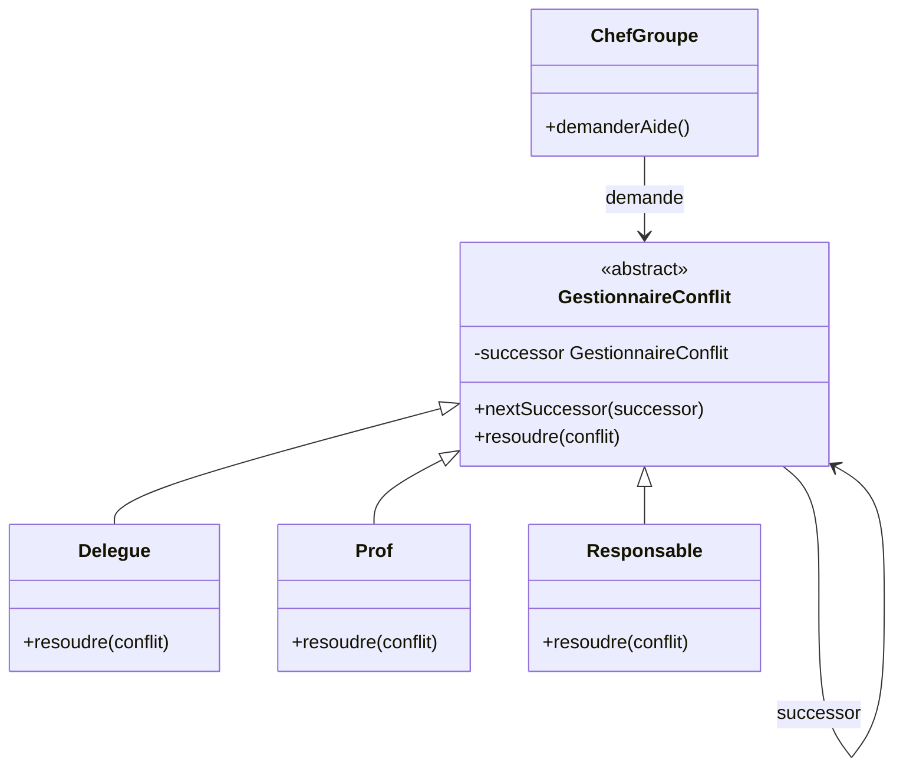
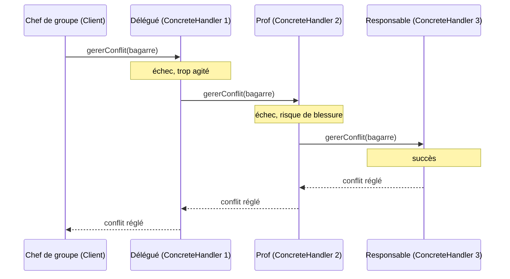
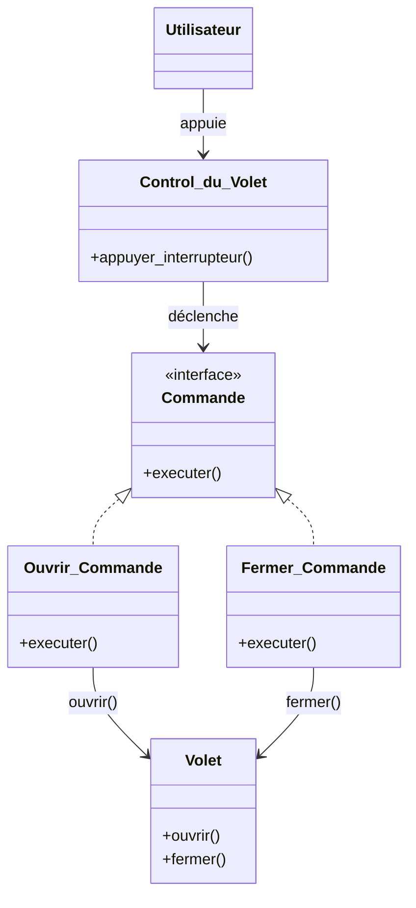

La session 3 a ouvert la famille des **patterns de comportement** avec le Visitor. Ces patterns s'intéressent au **comportement** des objets et des classes, et aux **schémas de communication** entre eux : comment des objets **collaborent** sur une tâche sans être soudés les uns aux autres. Cette session en présente deux, qui portent tous les deux sur la **requête**, cet appel qu'un objet adresse à un autre. La **Chain of Responsibility** répond à la question « **qui** va traiter cette requête ? » quand l'émetteur ne doit pas le savoir. Le **Command** répond à « comment faire de cette requête un **objet** » qu'on peut stocker, retarder, journaliser ou annuler.

<Callout type="note" title="Des exposés d'étudiants">
  Cette session est construite à partir d'un exposé SIGL consacré aux deux patterns. Il cite le livre du Gang of Four comme source ; les exemples de la classe ont été légèrement neutralisés. Les points qui méritent d'être nuancés sont signalés dans les encadrés « pour aller plus loin ».
</Callout>

## Chain of Responsibility

### Intention

**Type** : pattern de comportement. **Principe** : transmettre une requête **le long d'une chaîne de handlers**, à partir de l'appel d'un émetteur. Chaque maillon décide soit de **traiter** la requête, soit de la **passer à son successeur**. **Objectif** : **éviter de coupler l'émetteur d'une requête à son récepteur**, en donnant à **plusieurs objets** une chance de la traiter.

Le cas d'usage de l'exposé est une **demande de remboursement** : elle part d'un conseiller, remonte à un manager, puis à un directeur, et **s'arrête dès qu'un handler a l'autorité budgétaire suffisante** pour valider le montant. Le salarié qui dépose la demande ne choisit pas qui la valide : il la confie au premier maillon.

<KeyIdea>L'émetteur connaît **le début de la chaîne**, jamais **celui qui finira par répondre**.</KeyIdea>

Essaie avec plusieurs montants, puis retire le manager de la chaîne :

<Figure caption="Une demande de remboursement qui remonte la chaîne · Cas d'usage de l'exposé, plafonds fictifs">
  <RefundChain />
</Figure>

### Structure

<CardGrid cols={2}>
  <Card kicker="Handler" title="Le maillon abstrait" tone="signal">Définit le **comportement par défaut** (traiter, ou passer la requête au successeur) et garde la référence vers le **successeur**.</Card>
  <Card kicker="ConcreteHandler" title="Un maillon réel" tone="signal">**Tente** d'effectuer la tâche ; s'il n'y parvient pas, il la **délègue** au maillon suivant.</Card>
  <Card kicker="Client" title="L'émetteur" tone="signal">L'élément qui **déclenche** la requête, en l'envoyant au premier maillon.</Card>
  <Card kicker="Requête et condition d'arrêt" title="Ce qui circule, et quand ça s'arrête" tone="signal">La **requête** est l'objet qui circule le long de la chaîne ; la **condition d'arrêt** permet de stopper la chaîne sans atteindre le dernier maillon.</Card>
</CardGrid>

L'exposé illustre la structure par une scène de classe : un conflit entre deux étudiants est signalé par un chef de groupe (le client) au **délégué** ; s'il ne parvient pas à le régler, il passe la main au **professeur**, qui la passe à son tour à un **responsable** de l'école, lequel règle le conflit. Chaque maillon applique la même règle : « si je n'ai pas réussi, je passe la main à mon successeur ».

<Figure caption="Chain of Responsibility appliquée à un conflit en classe · D'après l'exposé, SIGL 2026">

</Figure>

<Figure caption="Le conflit remonte jusqu'au maillon qui le règle · D'après l'exposé, SIGL 2026">

</Figure>

En Java, le comportement par défaut du Handler tient en quelques lignes ; chaque maillon concret ne redéfinit que sa capacité :

```java
abstract class Approbateur {
    private Approbateur successeur;

    Approbateur suivant(Approbateur s) { this.successeur = s; return s; }

    void traiter(Demande d) {
        if (peutValider(d)) valider(d);                 // condition d'arrêt
        else if (successeur != null) successeur.traiter(d);
        else System.out.println("Demande non traitée"); // fin de chaîne
    }
    abstract boolean peutValider(Demande d);
    abstract void valider(Demande d);
}

class Manager extends Approbateur {
    boolean peutValider(Demande d) { return d.montant() <= 10_000; }
    void valider(Demande d) { System.out.println("Validé par le manager"); }
}

// Configuration de la chaîne, modifiable à l'exécution
Approbateur chaine = new Conseiller();
chaine.suivant(new Manager()).suivant(new Directeur());
chaine.traiter(new Demande(8_000));
```

### Limites

<CardGrid cols={3}>
  <Card kicker="Limite" title="Réception non garantie" tone="amber">Rien n'oblige un maillon à traiter la requête : si aucun n'en est capable, elle **tombe au bout de la chaîne** sans réponse, parfois silencieusement.</Card>
  <Card kicker="Limite" title="Configuration de la chaîne" tone="amber">L'**ordre** des maillons et leurs liens doivent être construits correctement ; une chaîne mal câblée (maillon oublié, boucle) donne un comportement faux et difficile à repérer.</Card>
  <Card kicker="Limite" title="Complexité de mise en œuvre" tone="amber">Suivre une requête demande de parcourir plusieurs objets : le **débogage** et la compréhension du flux sont plus difficiles qu'avec un appel direct.</Card>
</CardGrid>

<Quiz question="Une chaîne de validation contient Conseiller (≤ 1 000 €) puis Directeur (≤ 50 000 €). Un développeur insère par erreur le Directeur en premier. Que se passe-t-il pour une demande de 300 € ?" options={['Le Conseiller la valide, comme avant', 'Le Directeur la valide : le premier maillon capable arrête la chaîne', 'La demande n\'est traitée par personne']} answer={1}>
  **Le Directeur la valide.** La chaîne s'arrête au **premier** maillon dont la condition est vraie, et 300 € est sous le plafond du Directeur. Le résultat n'est pas une erreur visible, mais le directeur reçoit désormais toutes les petites demandes : c'est la limite « configuration de la chaîne ». On croit souvent que la chaîne trouve « le bon » maillon ; elle trouve le **premier** maillon compétent dans l'ordre où on l'a construite.
</Quiz>

<DeepDive title="Les chaînes de filtres et de middlewares" level="terrain">
  La forme la plus répandue du pattern aujourd'hui est la **chaîne de filtres** d'un serveur web. En Jakarta EE, chaque `Filter` reçoit la requête HTTP et un objet `FilterChain` ; il peut la traiter (authentifier, journaliser, compresser) puis appeler `chain.doFilter()` pour passer au maillon suivant, ou s'arrêter (renvoyer un 401, par exemple). Différence avec la version du GoF : ici, **chaque maillon** agit souvent, puis passe la main ; dans la version classique, un seul maillon traite et la chaîne s'arrête.
</DeepDive>

## Command

### Intention

**Type** : pattern de comportement. **Alias** : *Action*, *Transaction*. L'exposé donne quatre objectifs :

<CardGrid cols={2}>
  <Card kicker="Objectif" title="Encapsuler une requête dans un objet" tone="signal">« Ouvrir le volet » n'est plus un appel de méthode immédiat mais un **objet** `Ouvrir_Commande`, qu'on peut passer, stocker et exécuter plus tard.</Card>
  <Card kicker="Objectif" title="Paramétrer un client avec plusieurs requêtes" tone="signal">Le même bouton peut déclencher n'importe quelle commande : il suffit de lui en donner une autre.</Card>
  <Card kicker="Objectif" title="Organiser et journaliser des requêtes" tone="signal">Des objets se mettent en **file d'attente**, se **sauvegardent** et se **rejouent**.</Card>
  <Card kicker="Objectif" title="Supporter des opérations annulables" tone="signal">Une commande qui sait s'exécuter peut aussi savoir **se défaire** : c'est la base de l'*undo*.</Card>
</CardGrid>

### Les composants

L'exposé donne à chaque participant un surnom qui dit son rôle :

<Figure caption="Les participants du Command · Source : exposé Command, SIGL 2026">
```mermaid
flowchart TB
  CL[Client · chef d'orchestre] -->|instancie la commande| CC[ConcreteCommand · pont]
  CC -->|donne des ordres à| R[Receiver · expert métier]
  CC -.->|implémente| CMD[Command · interface commune]
  INV[Invoker · déclencheur] -->|détient une commande et appelle execute| CMD
  classDef cmd fill:var(--signal-soft),stroke:var(--signal);
  class CC,CMD cmd
```
</Figure>

- **Client** (chef d'orchestre) : crée la commande concrète et lui indique son receiver.
- **ConcreteCommand** (pont) : relie une action à un receiver ; son `execute()` appelle les bonnes méthodes du receiver.
- **Invoker** (déclencheur) : détient une commande et appelle `execute()` quand il le faut, sans savoir ce qu'elle fait.
- **Receiver** (expert métier) : l'objet qui sait réellement faire le travail.
- **Command** (interface commune) : déclare `execute()`, et c'est grâce à elle que l'Invoker peut manipuler n'importe quelle commande.

### Exemple : la télécommande de volet

L'exposé applique le pattern à une **télécommande de volet de fenêtre**. L'utilisateur (client) appuie sur l'interrupteur du `Control_du_Volet` (invoker) ; celui-ci déclenche une `Commande`, soit `Ouvrir_Commande`, soit `Fermer_Commande` ; chacune appelle la bonne méthode du `Volet` (receiver), `ouvrir()` ou `fermer()`.

<Figure caption="Command appliqué à une télécommande de volet · Source : exposé Command, SIGL 2026">

</Figure>

L'encadré « notion d'implémentation » de la slide pointe la frontière entre l'interface `Commande` et ses implémentations : c'est là que le découplage se joue. La télécommande ne connaît que `Commande` ; le volet ne connaît personne.

```java
interface Commande {
    void executer();
    void annuler();
}

class Ouvrir_Commande implements Commande {
    private final Volet volet;
    private int positionAvant;                // l'état mémorisé pour annuler

    Ouvrir_Commande(Volet v) { this.volet = v; }

    public void executer() { positionAvant = volet.position(); volet.ouvrir(); }
    public void annuler()  { volet.allerA(positionAvant); }
}

class Control_du_Volet {                      // l'Invoker
    private final Deque<Commande> historique = new ArrayDeque<>();

    void appuyer(Commande c) { c.executer(); historique.push(c); }
    void annuler()           { if (!historique.isEmpty()) historique.pop().annuler(); }
}
```

Appuie sur quelques boutons, puis annule et rétablis :

<Figure caption="Une télécommande qui historise ses commandes · Exemple de l'exposé Command, étendu avec deux commandes de réglage">
  <CommandRemote />
</Figure>

### Applications et limites

L'exposé reprend les cinq applications du GoF : **paramétrer des objets** par une action à effectuer (un bouton, un élément de menu) ; **spécifier, mettre en file d'attente et exécuter** des requêtes à des moments différents ; prendre en charge l'**annulation** (*undo / redo*) ; **journaliser** les modifications, pour pouvoir les rejouer après une panne ; **structurer des systèmes à base de transactions**, où une opération de haut niveau est faite de commandes élémentaires.

Il cite aussi quatre limites, qui sont des points d'implémentation discutés par le GoF :

<CardGrid cols={2}>
  <Card kicker="Limite" title="Accumulation d'erreurs (hystérésis)" tone="amber">À force d'exécuter, annuler et ré-exécuter, de petites imprécisions s'accumulent (arrondis, opérations non exactement réversibles) et l'état **dérive** de sa valeur d'origine. D'où l'intérêt de mémoriser l'état d'avant plutôt que de recalculer l'inverse.</Card>
  <Card kicker="Limite" title="Gestion de l'état et des instances" tone="amber">Une commande annulable doit **conserver** ce qu'il faut pour se défaire (receiver, arguments, état d'avant). Avec un historique long, cela fait beaucoup d'objets et de mémoire.</Card>
  <Card kicker="Limite" title="Limites des raccourcis d'implémentation" tone="amber">Les versions abrégées (une fonction anonyme, un modèle générique) suffisent pour une action simple, mais ne savent ni s'annuler ni porter d'état : dès qu'il faut l'*undo*, il faut une vraie classe.</Card>
  <Card kicker="Limite" title="L'« intelligence » de la commande" tone="amber">Jusqu'où va la commande ? Elle peut se contenter d'**appeler** le receiver, ou faire tout le travail **elle-même**. Entre les deux, la frontière est floue et les choix divergent d'une équipe à l'autre.</Card>
</CardGrid>

<Quiz question="Dans l'exemple du volet, on ajoute une télécommande murale et une commande vocale qui doivent toutes deux ouvrir le volet. Que réutilise-t-on ?" options={['La classe Volet uniquement : chaque déclencheur appelle ouvrir() lui-même', 'Ouvrir_Commande : les nouveaux invokers déclenchent le même objet commande', 'Control_du_Volet : on le copie pour chaque déclencheur']} answer={1}>
  **La commande.** Les nouveaux déclencheurs sont des **Invokers** : ils détiennent une `Commande` et appellent `executer()`. Ils profitent ainsi gratuitement de l'historique et de l'annulation. Appeler directement `volet.ouvrir()` (premier choix) fonctionne, mais réintroduit le couplage que le pattern supprime : chaque déclencheur devrait connaître le volet, et l'annulation devrait être recodée partout.
</Quiz>

<DeepDive title="Undo/redo en pratique : deux piles" level="best-practice">
  L'implémentation classique de l'annulation garde **deux piles** de commandes : une pile « faites » et une pile « défaites ». Annuler dépile la dernière commande faite, appelle son `annuler()` et l'empile côté « défaites » ; rétablir fait l'inverse ; **exécuter une nouvelle commande vide la pile « défaites »** (on ne peut plus rétablir une branche abandonnée). C'est exactement ce que fait l'îlot ci-dessus, et ce que fournit `javax.swing.undo.UndoManager` en Java, avec une limite configurable du nombre d'éditions conservées (`setLimit`) pour borner la mémoire. Quand une opération n'est pas exactement réversible, on mémorise l'**état d'avant** plutôt que d'appliquer l'opération inverse, ce qui évite l'hystérésis.
</DeepDive>

## Chaîne ou commande ?

Les deux patterns découplent celui qui **demande** de celui qui **fait**, mais pas de la même façon :

<Compare leftTitle="Chain of Responsibility" rightTitle="Command">
  <Fragment slot="left">
    La question est **qui** traite. La requête passe de maillon en maillon jusqu'à trouver preneur. L'émetteur ne connaît que le premier maillon ; le récepteur est **découvert à l'exécution**.
  </Fragment>
  <Fragment slot="right">
    La question est **quoi** faire, et **quand**. La requête devient un **objet** qui connaît son receiver. On peut la stocker, la mettre en file, la journaliser, l'annuler. Le déclencheur ne connaît que l'interface.
  </Fragment>
</Compare>

Ils se combinent volontiers : dans une interface graphique, un clic peut produire une **commande** qui remonte la **chaîne** des composants (bouton, panneau, fenêtre) jusqu'à celui qui sait la traiter.

## À retenir

<Takeaways>
1. **Chain of Responsibility** : faire passer une requête le long d'une chaîne de handlers jusqu'au premier capable de la traiter ; l'émetteur n'est pas couplé au récepteur.
2. **Son risque** : la réception n'est pas garantie, et l'ordre de la chaîne décide de qui répond.
3. **Command** : encapsuler une requête dans un objet ; l'Invoker déclenche `execute()` sans savoir ce qu'elle fait, la ConcreteCommand relie l'action au Receiver qui sait la faire.
4. **Parce que la requête est un objet**, on peut la paramétrer, la mettre en file, la journaliser et l'annuler, à condition qu'elle mémorise l'état nécessaire.
5. **Ses limites** : accumulation d'erreurs à l'annulation, gestion de l'état et des instances, et une frontière floue sur ce que la commande doit faire elle-même.
</Takeaways>
