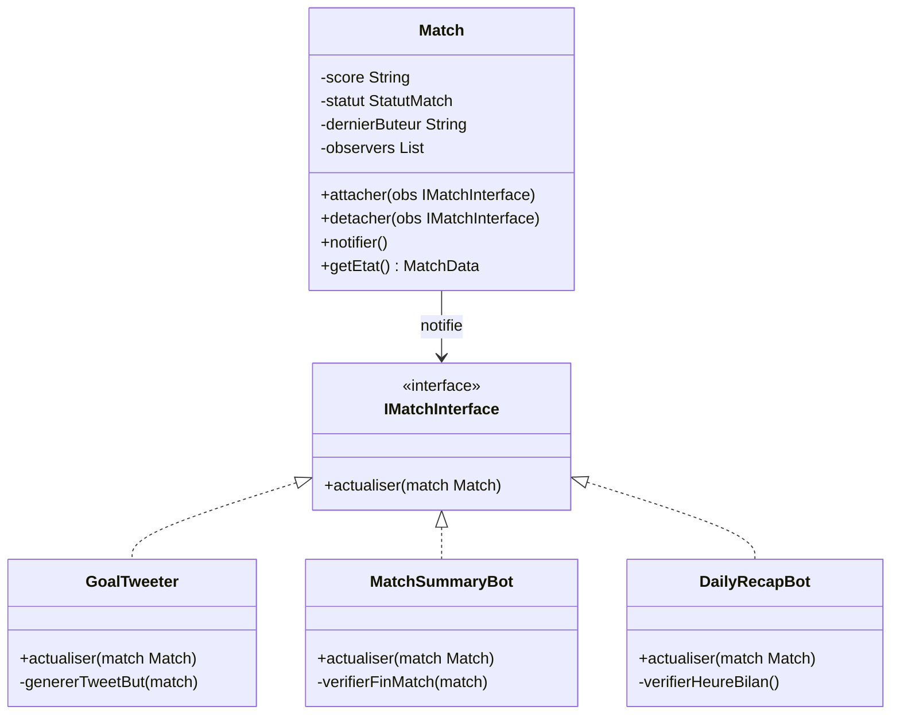
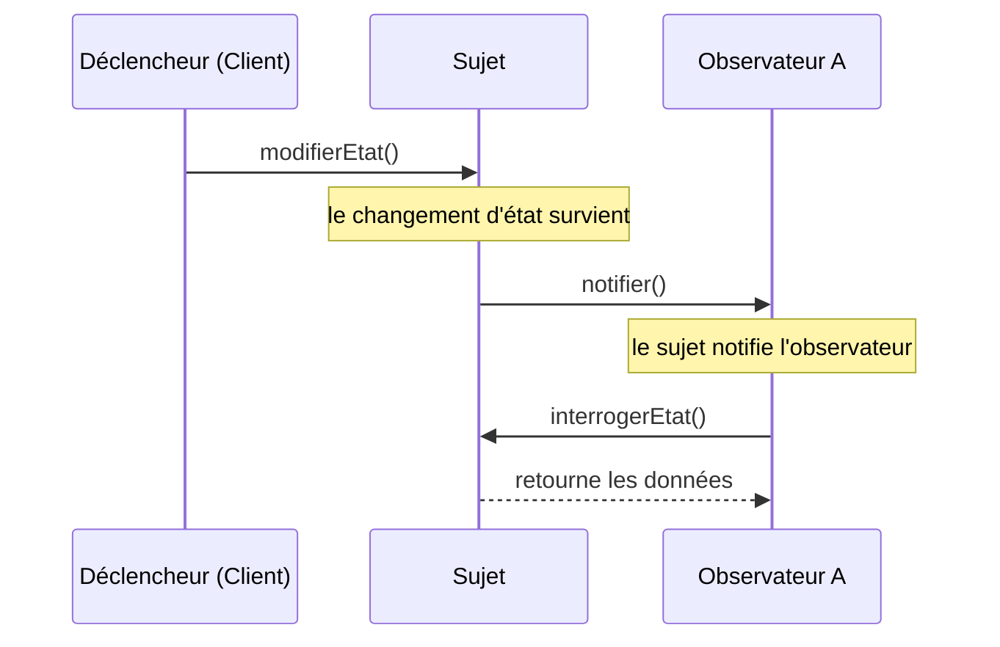
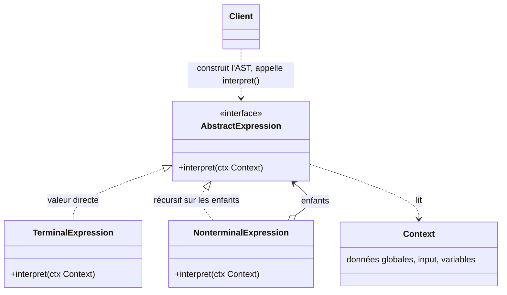

Les patterns de comportement vus jusqu'ici faisaient circuler une requête (Chain of Responsibility), la transformaient en objet (Command) ou sortaient des opérations de leurs classes (Visitor). Cette session en présente deux autres, très différents. L'**Observer** organise la **réaction** : quand un objet change, comment prévenir tous ceux que ça intéresse, sans qu'il ait à les connaître ? C'est le mécanisme derrière les événements d'une interface graphique, les notifications d'une application, la programmation réactive. L'**Interpreter** organise le **langage** : quand des règles se combinent à l'infini, comment cesser de les coder en dur et en faire un petit langage dont chaque phrase est un arbre d'objets ?

<Callout type="note" title="Des exposés d'étudiants">
  Cette session est construite à partir de deux exposés SIGL, l'un sur Observer, l'autre sur Interpreter. Leur contenu est restitué dans le flux ; les points qui méritent d'être nuancés sont signalés dans les encadrés « pour aller plus loin ».
</Callout>

## Observer

### Intention

**Type** : pattern de comportement, de ceux qui modélisent les algorithmes et la **répartition des responsabilités** entre objets. **Alias** : *Publish-Subscribe*.

Le pattern établit une **dépendance un-à-plusieurs** (*one-to-many*) entre objets : un **sujet** et ses **observateurs**. Quand l'état du sujet change, tous ses observateurs sont **notifiés** et se mettent à jour automatiquement. Les observateurs réagissent aux modifications du sujet **sans couplage fort** : le sujet ne connaît d'eux qu'une interface commune.

<Callout type="definition" title="Sujet et observateur">
  Le **sujet** (ou observable) détient un état et une **liste d'abonnés** ; il offre de quoi s'**attacher** et se **détacher**, et **notifie** tous les abonnés à chaque changement. Un **observateur** implémente une méthode de mise à jour (`update`, `actualiser`) que le sujet appelle.
</Callout>

### Exemple : une application de match de foot

L'exposé part d'un besoin concret : pendant un match de foot, une application doit **prévenir des buts marqués**, **résumer le match après sa fin** et **annoncer les matchs à venir dans la journée**. Trois besoins, trois réactions différentes au même événement source : le match qui évolue.

<Figure caption="Observer appliqué à un match de foot · Source : exposé Observer, SIGL 2027">

</Figure>

- **Match** est le **sujet** : il gère sa liste d'observateurs et les prévient à chaque événement.
- **IMatchInterface** est le **contrat** que tous les observateurs doivent implémenter : `actualiser(match)`.
- **GoalTweeter**, **MatchSummaryBot** et **DailyRecapBot** sont les observateurs concrets ; chacun décide, dans `actualiser`, si l'événement le concerne (un but, la fin du match, l'heure du bilan).

La force du pattern est là : ajouter un quatrième bot (des statistiques en direct, par exemple) ne demande **aucune modification** de `Match`. Il suffit de l'attacher.

### Push ou pull

L'exposé insiste sur un choix d'implémentation : **comment** le sujet transmet-il le changement ?

<Compare leftTitle="Push" rightTitle="Pull">
  <Fragment slot="left">
    Le sujet envoie des **informations détaillées** dans l'appel de mise à jour (`actualiser(score, buteur, statut)`).
    - **Réduit les requêtes** vers le sujet : tout arrive d'un coup.
    - **Moins efficace** si les observateurs ont besoin de **sous-ensembles différents** des données : chacun reçoit tout, et le sujet doit savoir quoi envoyer.
  </Fragment>
  <Fragment slot="right">
    Le sujet envoie une **notification minimale** ; les observateurs **interrogent** ensuite le sujet pour obtenir ce qui les intéresse (`getEtat()`).
    - Le sujet **n'a pas besoin de connaître** les besoins précis de chacun.
    - Les observateurs ont le **contrôle** et ne récupèrent que les données pertinentes.
    - **Génère plus d'appels** de méthodes.
  </Fragment>
</Compare>

Le diagramme de séquence de l'exposé montre la version pull : le sujet notifie l'observateur, qui revient l'interroger.

<Figure caption="Notification en mode pull · Source : exposé Observer, SIGL 2027">

</Figure>

Attache et détache les bots, marque des buts, puis compare les deux modes :

<Figure caption="Un match qui notifie ses bots · Exemple de l'exposé Observer">
  <ObserverMatch />
</Figure>

<Quiz question="Le sujet Match passe en mode push et envoie score, buteur et statut à chaque notification. On ajoute un bot qui a besoin de la possession de balle. Que faut-il modifier ?" options={['Rien : le nouveau bot interroge le match', 'La signature de actualiser() dans l\'interface, donc le sujet et tous les observateurs existants', 'Seulement le nouveau bot']} answer={1}>
  **L'interface, et donc tout le monde.** En push, c'est le sujet qui décide quelles données voyagent : un nouveau besoin élargit le message, et la signature commune change pour tous les observateurs. C'est la limite « moins efficace si les observateurs ont besoin de sous-ensembles différents ». Le premier choix décrit le mode **pull**, où le nouveau bot appellerait simplement `getEtat()` : plus d'appels, mais un sujet qui n'a pas à connaître les besoins de chacun.
</Quiz>

### Observer et Mediator

L'exposé associe l'Observer au **Mediator** et les présente comme **concurrents** : le Mediator **centralise** les communications complexes entre objets (chacun ne parle qu'au médiateur, qui orchestre), alors que l'Observer **distribue** la communication par des **notifications diffusées** spontanément (le sujet diffuse, les abonnés réagissent chacun de leur côté).

<Compare leftTitle="Mediator · centraliser" rightTitle="Observer · diffuser">
  <Fragment slot="left">
    Les composants s'adressent tous à un **médiateur** qui connaît les règles d'interaction et décide qui fait quoi. La logique de coordination est **en un seul endroit**, au prix d'un médiateur qui peut grossir.
  </Fragment>
  <Fragment slot="right">
    Le sujet **ne sait pas** ce que font ses abonnés : il diffuse et chacun réagit. La logique est **répartie** entre les observateurs, au prix d'un enchaînement de réactions plus difficile à suivre.
  </Fragment>
</Compare>

<DeepDive title="java.util.Observable, déprécié depuis Java 9" level="état-de-l-art">
  Java a longtemps fourni le pattern clé en main avec `java.util.Observable` et `java.util.Observer`. Les deux sont **dépréciés depuis Java 9** : la documentation explique que leur modèle d'événements est trop limité (l'**ordre des notifications** n'est pas spécifié, et les changements d'état ne correspondent pas un pour un aux notifications) et oriente vers le paquet `java.beans` (`PropertyChangeListener`), les structures de `java.util.concurrent` ou l'API de flux réactifs `Flow`. Le principe, lui, est partout : `addEventListener` du DOM, les *listeners* de Swing, les bibliothèques réactives.
</DeepDive>

## Interpreter

### Intention et motivation

**Type** : pattern de comportement. **Intention** (celle du GoF, citée par l'exposé) : **étant donné un langage, définir une représentation de sa grammaire, ainsi qu'un interpréteur qui utilise cette représentation pour interpréter les phrases du langage**.

Le **problème** de l'exposé est très concret : des règles d'accès dont **chaque combinaison est codée en dur**.

```java
if ((age > 25 && city.equals("Paris"))
    || role.equals("admin")
    || (age > 25 && role.equals("admin")))
    // ... combinaisons infinies
```

Chaque nouvelle règle est une modification du code, et les conditions finissent par se répéter. La **solution** consiste à faire de la règle **un arbre d'objets** : chaque opérateur (`OU`, `ET`, une comparaison) est une classe, et une règle est une **phrase** construite en assemblant ces classes.

```java
Expression expr = new OrExpr(
    new AndExpr(
        new CompareExpr("age", ">", 25),
        new CompareExpr("city", "=", "Paris")
    ),
    new CompareExpr("role", "=", "admin")
);
expr.interpret(context);
```

La règle n'est plus du code mais une **donnée** : on peut la construire à partir d'un fichier de configuration ou d'une saisie utilisateur, la stocker, la modifier, sans recompiler.

### Applicabilité

L'exposé pose trois conditions :

<CardGrid cols={3}>
  <Card kicker="1" title="Une grammaire simple et bien définie" tone="signal">Quelques opérateurs, des règles de combinaison claires. Chaque règle de grammaire deviendra une classe.</Card>
  <Card kicker="2" title="L'efficacité n'est pas la priorité" tone="signal">Des grammaires légères : évaluer un arbre d'objets récursivement est plus lent qu'un code optimisé.</Card>
  <Card kicker="3" title="Des règles qui changent souvent" tone="signal">C'est là que le pattern rapporte : les règles changent, les classes de la grammaire ne bougent pas.</Card>
</CardGrid>

### Structure

<Figure caption="Structure de l'Interpreter · Source : exposé Interpreter, SIGL 2026">

</Figure>

<CardGrid cols={2}>
  <Card kicker="AbstractExpression" title="L'interface commune" tone="signal">Déclare `interpret(ctx)`, que tous les nœuds de l'arbre implémentent.</Card>
  <Card kicker="TerminalExpression" title="Les feuilles" tone="signal">Renvoient une **valeur directe** : une variable lue dans le contexte, une comparaison (`CompareExpr`).</Card>
  <Card kicker="NonterminalExpression" title="Les règles composées" tone="signal">Combinent des sous-expressions et s'évaluent **récursivement sur leurs enfants** (`AndExpr`, `OrExpr`).</Card>
  <Card kicker="Context et Client" title="Les données et le constructeur" tone="signal">Le **Context** porte les données globales (l'entrée, les variables). Le **Client** construit l'arbre syntaxique, puis appelle `interpret()`.</Card>
</CardGrid>

L'arbre syntaxique abstrait (*Abstract Syntax Tree*, **AST**) de l'expression `(A AND B) OR C` a deux nœuds non terminaux (`OR`, `AND`) et trois feuilles terminales (`A`, `B`, `C`) :

```mermaid
flowchart TB
  OR((OR)) --> AND((AND))
  OR --> C[C]
  AND --> A[A]
  AND --> B[B]
  classDef nt fill:var(--signal-soft),stroke:var(--signal);
  class OR,AND nt
```

Change le contexte et regarde chaque nœud de l'arbre de l'exposé s'évaluer :

<Figure caption="Évaluer la règle de l'exposé selon le contexte · Exemple de l'exposé Interpreter">
  <RuleInterpreter />
</Figure>

### Implémentation

L'exposé relève trois points d'implémentation, qui sont aussi trois liens avec d'autres patterns :

<Steps>
1. **AST** : le client **construit l'arbre syntaxique** avant l'interprétation (à la main, comme ci-dessus, ou à l'aide d'un analyseur qui lit une chaîne de caractères). Le pattern ne dit pas comment on obtient l'arbre, seulement comment on l'évalue.
2. **Composite** : la structure **repose sur le Composite** (session 4). Chaque nœud est une `Expression` ; les non terminaux sont des composites, les terminaux des feuilles.
3. **Visitor** : pour **ajouter des opérations** sur l'arbre sans modifier ses classes (afficher la règle, la simplifier, la traduire en SQL), on **combine avec un Visitor** (session 3).
</Steps>

### Conséquences, utilisations et patterns liés

<Compare leftTitle="Avantages" rightTitle="Inconvénients">
  <Fragment slot="left">
    - **Facile d'ajouter** de nouvelles règles de grammaire : une nouvelle classe d'expression.
    - **Chaque règle est une classe** isolée et testable.
    - Respecte le principe **ouvert/fermé** (*Open/Closed Principle*) : on étend la grammaire sans modifier l'existant.
  </Fragment>
  <Fragment slot="right">
    - **Grammaires complexes** : trop de classes, difficiles à maintenir.
    - **Performances limitées** sur de gros volumes d'expressions.
  </Fragment>
</Compare>

**Utilisations connues** d'après l'exposé : l'analyse de **SQL**, les **expressions régulières**, les **requêtes d'ORM** (les objets de critères qu'on assemble pour construire une requête). **Patterns liés** : **Composite** (la structure de l'AST), **Visitor** (l'ajout d'opérations), **Flyweight** (le **partage des terminaux** : un même nœud `A` peut servir à plusieurs endroits de l'arbre, session 4) et **Iterator** (le parcours de l'arbre).

<Quiz question="Une équipe veut un Interpreter pour un langage de programmation complet, avec des centaines de règles de grammaire et des milliers de lignes à exécuter par seconde. Est-ce un bon choix ?" options={['Oui : chaque règle sera une classe isolée et testable', 'Non : la grammaire est trop complexe et la performance compte, deux conditions que le pattern exclut', 'Oui, à condition d\'ajouter un Visitor']} answer={1}>
  **Non.** Les deux premières conditions d'applicabilité de l'exposé sont violées : la grammaire n'est pas simple (des centaines de classes à maintenir) et l'efficacité est une priorité (une évaluation récursive d'objets est lente). Le premier choix cite un vrai avantage, mais qui ne compense pas ces deux limites. Ajouter un Visitor organise mieux les opérations sans rien changer au nombre de classes ni à la vitesse.
</Quiz>

<DeepDive title="Du pattern aux outils : Specification et générateurs d'analyseurs" level="best-practice">
  Pour des **règles métier** comme celles de l'exposé, l'Interpreter a un cousin très utilisé : le pattern **Specification** d'Eric Evans et Martin Fowler. Une spécification est un objet avec une méthode `isSatisfiedBy(candidat)`, qu'on combine par `and`, `or` et `not` exactement comme `AndExpr` et `OrExpr` : c'est un Interpreter spécialisé dans les prédicats. À l'autre bout, pour les **vrais langages** (SQL, langages de programmation), on ne code pas l'analyseur à la main : on utilise un générateur d'analyseurs, qui produit l'arbre à partir d'une grammaire formelle, puis on parcourt cet arbre avec des visiteurs. Le pattern reste utile pour comprendre ce que ces outils font, et pour les petits langages internes.
</DeepDive>

## Reconnaître les patterns dans un cas réel

Les patterns se combinent rarement seuls. Un logiciel du quotidien en mobilise plusieurs à la fois ; la vue d'ensemble des seize patterns de la partie est à la fin de la session 7.

<Quiz question="Un tableur recalcule les cellules qui dépendent d'une cellule modifiée, et permet d'annuler chaque saisie. Quels patterns reconnais-tu ?" options={['Observer pour le recalcul, Command pour l\'annulation', 'Chain of Responsibility pour le recalcul, Prototype pour l\'annulation', 'Composite pour le recalcul, Visitor pour l\'annulation']} answer={0}>
  **Observer et Command.** Les cellules dépendantes **observent** la cellule modifiée et se recalculent quand elle notifie un changement (dépendance un-à-plusieurs). Chaque saisie est une **commande** qui mémorise l'ancienne valeur, ce qui permet de l'annuler. La Chain of Responsibility attire parce que le recalcul « se propage », mais elle cherche **un** maillon pour traiter une requête, alors qu'ici **tous** les dépendants doivent réagir. (Les formules elles-mêmes, `=A1+B2*2`, seraient un bon terrain pour l'Interpreter.)
</Quiz>

## À retenir

<Takeaways>
1. **Observer** : une dépendance un-à-plusieurs ; le sujet notifie ses abonnés à chaque changement sans connaître que leur interface, et on attache ou détache un observateur sans modifier le sujet.
2. **Push ou pull** : envoyer toutes les données dans la notification (moins d'appels, sujet qui doit connaître les besoins) ou une notification minimale suivie d'une interrogation (plus d'appels, observateurs maîtres de ce qu'ils lisent).
3. **Observer et Mediator sont concurrents** : l'un diffuse la communication, l'autre la centralise.
4. **Interpreter** : représenter la grammaire d'un langage par un arbre d'objets (terminaux et non terminaux) qui s'évalue récursivement avec un contexte ; il repose sur le Composite et se combine avec le Visitor.
5. **À réserver aux grammaires simples**, aux règles qui changent souvent et aux cas où la performance n'est pas critique.
</Takeaways>
