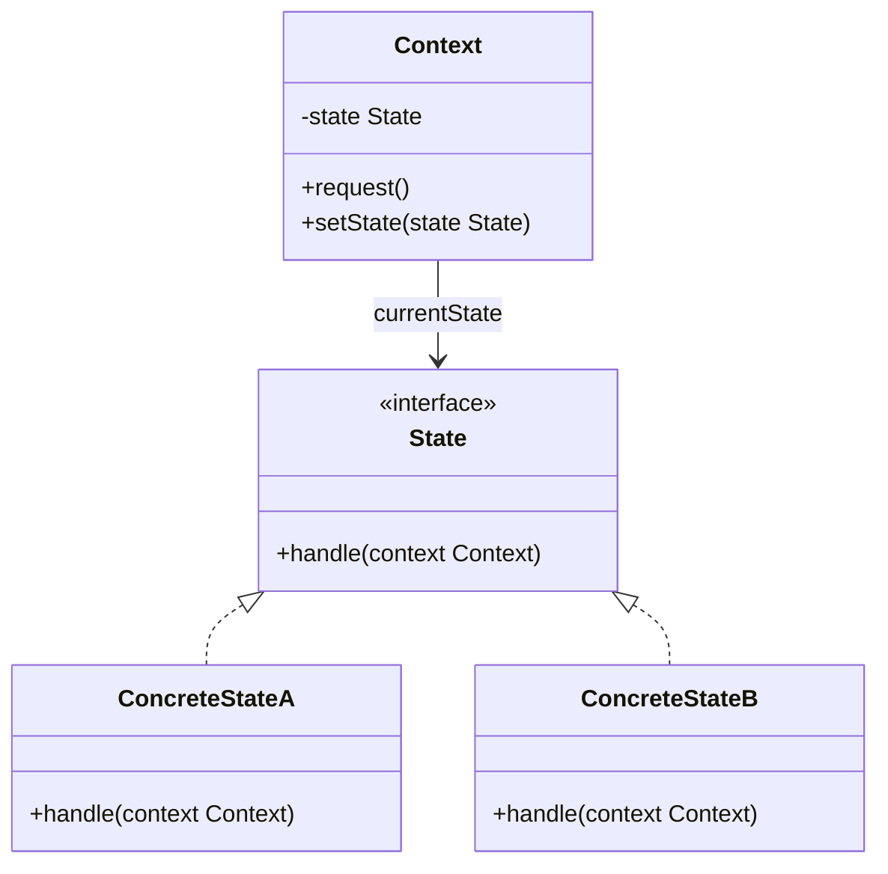
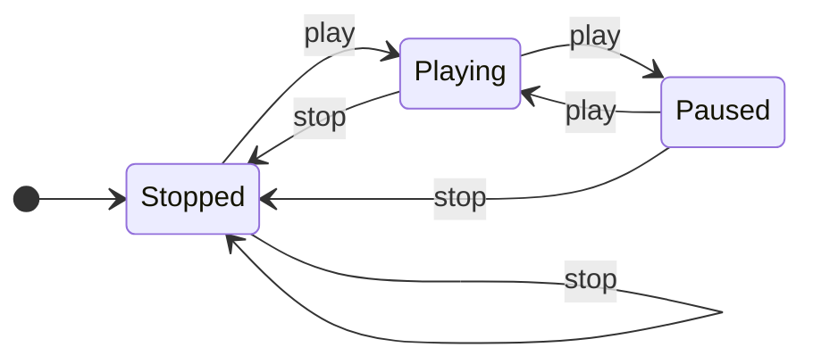
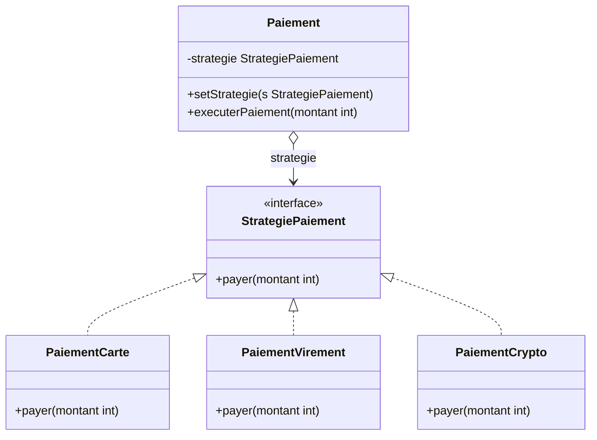
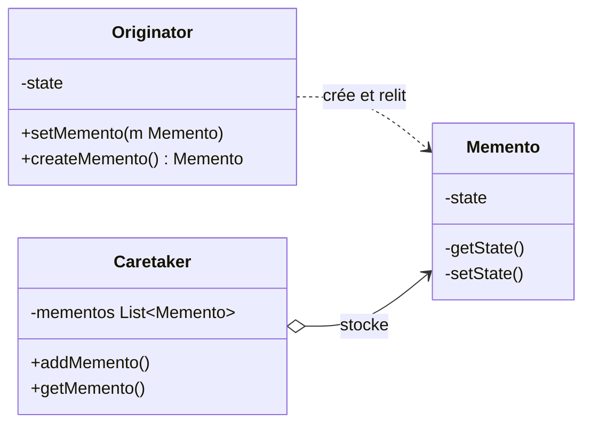
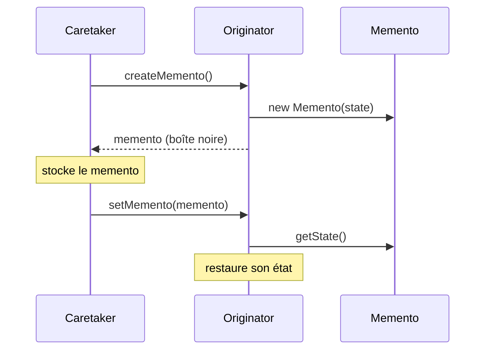

Cette session présente trois derniers patterns de comportement. Le **State** et le **Strategy** ont exactement la même structure (un contexte qui délègue à un objet interchangeable) mais pas la même intention : dans le State, l'objet **change de comportement tout seul** au gré de son état interne ; dans le Strategy, c'est le **client qui choisit** l'algorithme à utiliser. Le **Memento** répond à une autre question, familière depuis le Command de la session 5 : comment **revenir en arrière**, c'est-à-dire sauvegarder l'état d'un objet puis le restaurer, sans exposer ses entrailles à celui qui garde la sauvegarde. La session se termine par la vue d'ensemble des seize patterns de la partie.

<Callout type="note" title="Des exposés d'étudiants">
  Cette session est construite à partir de trois exposés SIGL, un par pattern, chacun tenant en trois ou quatre slides. Leur contenu est restitué dans le flux et complété pour qu'il se comprenne seul ; les points qui méritent d'être nuancés sont signalés dans les encadrés « pour aller plus loin ».
</Callout>

## State

### Le problème : un objet qui teste son état partout

**Type** : pattern de comportement. **Alias** : *Objects for states*. **But** : **modifier le comportement d'un objet lorsque son état interne change**, au point qu'il semble changer de classe.

L'exposé part d'un document qui suit un circuit de publication : brouillon, relecture (modération), puis en ligne. Sa première version range l'état dans une chaîne de caractères et le teste à chaque méthode :

```java
class Document {
    String state = "DRAFT";

    void publish() {
        if (state.equals("DRAFT")) {
            System.out.println("Passage en relecture.");
            state = "MODERATION";
        } else if (state.equals("MODERATION")) {
            System.out.println("Document en ligne.");
            state = "PUBLISHED";
        } // ... et ainsi de suite
    }
}
```

Avec trois états et une méthode, ça tient. Mais chaque nouvelle méthode (`reject()`, `archive()`…) répète la même cascade de `if`, et chaque nouvel état (« planifié », « archivé ») oblige à rouvrir **toutes** ces cascades. Le comportement d'un état donné est éparpillé dans toutes les méthodes, et une faute de frappe dans `"MODERATON"` passe la compilation.

La solution de l'exposé : faire de **chaque état un objet**, et laisser le document **passer le relais** à son état courant.

```java
class Document {
    State currentState = new DraftState();

    void publish() {
        // Le document se contente de passer le relais.
        currentState.publish(this);
    }
}
```

`DraftState.publish()` affiche « Passage en relecture » et remplace l'état courant du document par un `ModerationState` ; `ModerationState.publish()` le met en ligne. Le pattern sert donc à deux choses : gérer un **changement dynamique** de comportement, et **refactorer des conditions** qui se ramifient.

### Structure, participants et collaborations

<Figure caption="Structure du State · Source : exposé State, SIGL 2026">

</Figure>

<CardGrid cols={3}>
  <Card kicker="Context" title="L'objet vu par le client" tone="signal">Expose l'interface utile au client et garde une **référence vers l'état courant**, à qui il délègue.</Card>
  <Card kicker="State" title="L'interface commune" tone="signal">Déclare les opérations dont le comportement dépend de l'état (`handle`, ou `play` et `stop`).</Card>
  <Card kicker="ConcreteState" title="Un état, un comportement" tone="signal">**Implémente le comportement** propre à cet état, et décide au besoin de l'état suivant.</Card>
</CardGrid>

Les collaborations s'enchaînent ainsi :

<Steps>
1. Le **client** interagit avec le **Context**, jamais avec les états.
2. Le Context **délègue** l'action à son objet **State** courant, en se passant lui-même en paramètre.
3. Le **ConcreteState** exécute le comportement.
4. Le ConcreteState peut **changer l'état du Context** (`context.setState(new AutreEtat())`) : c'est la transition.
</Steps>

### Exemple de code : un lecteur multimédia

L'exemple de code de l'exposé est un lecteur avec deux boutons, `play` et `stop`, et trois états : arrêté, en lecture, en pause.

```java
interface State {
    void play(Player player);
    void stop(Player player);
}

class Player {
    private State state;

    public Player() { this.state = new StoppedState(); }

    public void setState(State state) { this.state = state; }

    public void play() { state.play(this); }
    public void stop() { state.stop(this); }
}

class StoppedState implements State {
    @Override public void play(Player player) {
        System.out.println("Démarrage de la lecture");
        player.setState(new PlayingState());
    }
    @Override public void stop(Player player) {
        System.out.println("Déjà arrêté");
    }
}

class PlayingState implements State {
    @Override public void play(Player player) {
        System.out.println("Mise en pause");
        player.setState(new PausedState());
    }
    @Override public void stop(Player player) {
        System.out.println("Arrêt de la lecture");
        player.setState(new StoppedState());
    }
}

class PausedState implements State {
    @Override public void play(Player player) {
        System.out.println("Reprise de la lecture");
        player.setState(new PlayingState());
    }
    @Override public void stop(Player player) {
        System.out.println("Arrêt depuis pause");
        player.setState(new StoppedState());
    }
}
```

Le code se lit comme une **machine à états** : chaque classe dit, pour chaque bouton, ce qui se passe et où l'on va.

<Figure caption="La machine à états du lecteur, telle que la codent les trois classes">

</Figure>

<Figure caption="Appuie sur play() et stop() : chaque appel est traité par l'état courant · Code de l'exposé State">
  <StatePlayer />
</Figure>

### Conséquences et implémentation

<Compare leftTitle="Ce que le pattern apporte" rightTitle="Ce qu'il coûte">
  <Fragment slot="left">
    - **Localise le comportement par état** : tout ce que fait le lecteur en pause est dans `PausedState`.
    - **Réduit les machines à états codées en conditions** : plus de `switch` géant sur une chaîne ou un entier.
    - **Facilite l'ajout de nouveaux états** : un état « chargement » est une nouvelle classe, les autres changent à peine.
  </Fragment>
  <Fragment slot="right">
    - **Plus de classes**, une structure plus lourde : un **surcoût structurel** à garder en tête.
    - Pour deux états et une méthode, un simple booléen reste plus lisible.
  </Fragment>
</Compare>

Trois choix d'implémentation, d'après l'exposé :

- **Le contexte délègue à l'état courant** : c'est le cœur du pattern.
- **Les transitions sont pilotées par le contexte ou par les états**. Si le Context décide (« après `play`, passer en lecture »), les états ne se connaissent pas entre eux mais le Context retrouve des conditions. Si chaque état désigne son successeur, comme dans le lecteur, les transitions sont faciles à modifier mais les états dépendent les uns des autres.
- **Les états sont partageables s'ils ne portent pas de données** : `PlayingState` n'a aucun attribut, une seule instance suffit pour tous les lecteurs. D'où les patterns liés cités par l'exposé, **Singleton** (une instance par état) et **Flyweight** (des états partagés entre contextes, session 4).

**Utilisations connues** selon l'exposé : les **lecteurs multimédias**, les **workflows métier** (un document, une demande de congé, un ticket qui passe d'étape en étape) et le cycle de vie d'une **commande** (créée, payée, expédiée, livrée). **Pattern lié** principal : **Strategy**, juste après.

<DeepDive title="Partager les états, et la version légère en enum" level="best-practice">
  Le code de l'exposé crée un nouvel objet à chaque transition (`new PlayingState()`). Comme ses états n'ont aucun attribut, on peut, comme l'exposé le suggère lui-même, les partager : des constantes `static final` ou, en Java, une **enum** dont chaque constante redéfinit les méthodes. Joshua Bloch recommande ces enums à méthodes spécifiques dans *Effective Java* (item 34) :

  ```java
  enum PlayerState {
      STOPPED { PlayerState play() { return PLAYING; } },
      PLAYING { PlayerState play() { return PAUSED; } },
      PAUSED  { PlayerState play() { return PLAYING; } };

      abstract PlayerState play();              // propre à chaque état
      PlayerState stop() { return STOPPED; }    // commun à tous
  }
  ```

  C'est le même pattern (le comportement est porté par l'état, pas par des `if`), sans allocation et avec une liste d'états fermée et vérifiée par le compilateur. La version à classes reste préférable quand les états portent des données ou beaucoup de code.
</DeepDive>

## Strategy

### Définition et problème résolu

Le pattern **Strategy** consiste à **définir une famille d'algorithmes**, à **encapsuler** chacun dans un objet, et à les rendre **interchangeables** pour un contexte. Le choix de l'algorithme, appelé alors **stratégie**, se décide **au moment de l'utilisation**, et non à l'écriture de la classe qui l'utilise.

**Problème résolu** : une **même opération peut être réalisée de plusieurs manières** dans un même contexte. L'exposé en donne quatre images : **enregistrer un fichier** (en local, dans le cloud, dans tel format), **compresser une image** (JPEG, PNG, WebP), **payer** (carte, virement, crypto) et **voyager** (en train, en voiture, en avion pour aller au même endroit). Sans pattern, la classe qui réalise l'opération accumule un `if` par variante, et chaque nouvelle variante la rouvre.

### Exemple : les moyens de paiement

<Figure caption="Strategy appliqué aux moyens de paiement · Source : exposé Strategy, SIGL 2026">

</Figure>

Trois rôles se lisent sur le diagramme :

- le **contexte** (`Paiement`) garde une référence vers une stratégie, qu'on peut **changer** par `setStrategie()`, et lui délègue le travail dans `executerPaiement(montant)` ;
- l'**interface de stratégie** (`StrategiePaiement`) déclare l'opération commune, `payer(montant)` ;
- les **stratégies concrètes** (`PaiementCarte`, `PaiementVirement`, `PaiementCrypto`) l'implémentent chacune à leur façon.

```java
Paiement paiement = new Paiement();
paiement.setStrategie(new PaiementCarte());   // le client choisit
paiement.executerPaiement(120);

paiement.setStrategie(new PaiementCrypto());  // et peut changer d'avis à l'exécution
paiement.executerPaiement(120);
```

`Paiement` ne contient aucun `if (moyen == ...)` : ajouter Apple Pay, c'est écrire une classe de plus, sans toucher au contexte.

### Quand l'utiliser

<CardGrid cols={3}>
  <Card kicker="Cas 1" title="Des classes qui ne diffèrent que par le comportement" tone="signal">Plutôt que plusieurs sous-classes presque identiques, une classe et plusieurs stratégies.</Card>
  <Card kicker="Cas 2" title="Des variantes d'un même algorithme" tone="signal">Tris, compressions, calculs de prix ou d'itinéraire, à choisir selon les données ou la configuration.</Card>
  <Card kicker="Cas 3" title="Un choix laissé à l'utilisateur" tone="signal">Moyen de paiement, mode de transport, format d'export : l'**interaction utilisateur** sélectionne la stratégie.</Card>
</CardGrid>

<Compare leftTitle="Avantages" rightTitle="Inconvénients">
  <Fragment slot="left">
    - **Ajout ou suppression facile** de stratégies, sans modifier le contexte.
    - **Changement de stratégie à l'exécution** (*runtime*).
    - **Séparation claire** entre la logique de l'algorithme et son usage.
  </Fragment>
  <Fragment slot="right">
    - **Complexifie le code** quand il n'y a que deux ou trois stratégies qui ne changent jamais.
    - **Le client doit connaître les stratégies disponibles** et leurs différences pour choisir la bonne.
  </Fragment>
</Compare>

<DeepDive title="« Flyweight, la version micro de Strategy » ? Pas tout à fait" level="approfondissement">
  L'exposé présente le Flyweight comme « la version micro » du Strategy. Les deux patterns n'ont pas la même intention : le Flyweight (session 4) **économise la mémoire** en partageant l'état intrinsèque d'objets très nombreux, le Strategy **rend un algorithme interchangeable**. Le lien que fait le livre du Gang of Four est plus étroit : une stratégie sans attribut est un **bon candidat pour être un flyweight**, partagée par tous les contextes qui l'utilisent au lieu d'être recréée. Le pattern le plus proche du Strategy est en fait le **State**, qui a la même structure (comparaison juste après).
</DeepDive>

<DeepDive title="En Java moderne, une stratégie est souvent une lambda" level="terrain">
  L'exemple le plus utilisé du pattern est dans la bibliothèque standard : `Comparator`. `list.sort(comparateur)` est le contexte, le comparateur est la stratégie de tri, et on la change à chaque appel. Depuis Java 8, une interface à une seule méthode (interface fonctionnelle) se remplit par une **lambda** ou une référence de méthode : `list.sort(Comparator.comparing(Client::nom))`. Pour des stratégies sans état, plus besoin d'une classe par variante ; les classes nommées restent utiles quand la stratégie a de la configuration, des dépendances ou des tests propres.
</DeepDive>

### State ou Strategy ?

Les deux diagrammes de classes sont superposables : un contexte, une interface, des implémentations concrètes, une délégation. La différence est dans **qui change l'objet délégué, et pourquoi**.

<Compare leftTitle="State" rightTitle="Strategy">
  <Fragment slot="left">
    - **L'objet change de délégué tout seul** : ce sont les états (ou le contexte) qui déclenchent les transitions.
    - Les états **se connaissent** souvent (« après moi, la pause »).
    - Le client ignore qu'il existe des états : il appuie sur `play()`.
    - Question : *comment l'objet se comporte-t-il **maintenant** ?*
  </Fragment>
  <Fragment slot="right">
    - **Le client choisit** la stratégie (`setStrategie()`), et elle ne change pas d'elle-même.
    - Les stratégies **s'ignorent** : chacune est une variante autonome.
    - Le client **connaît** les stratégies disponibles.
    - Question : *quel **algorithme** utiliser pour cette opération ?*
  </Fragment>
</Compare>

<Quiz question="Un distributeur de boissons refuse de servir tant qu'on n'a pas inséré assez d'argent, sert puis rend la monnaie, et passe « hors service » quand il est vide. Quel pattern ?" options={['Strategy : chaque comportement est un algorithme', 'State : le comportement de « servir » dépend de l\'état interne de la machine, qui change tout seul', 'Memento : il faut mémoriser le crédit inséré']} answer={1}>
  **State.** Le même bouton « servir » réagit différemment selon que la machine attend de l'argent, a assez de crédit ou est vide, et c'est la machine elle-même qui passe d'un état à l'autre (après un paiement, après la dernière canette). Personne ne choisit « la stratégie hors service » : c'est un état atteint. Le crédit est bien une donnée à retenir, mais un simple attribut suffit, sans Memento.
</Quiz>

## Memento

### Pourquoi un Memento

Le **Memento** permet de **sauvegarder et restaurer l'état précédent d'un objet**. L'exposé le résume par trois besoins à réunir :

- **sauvegarder** l'état actuel d'un objet ;
- **récupérer** cet état plus tard ;
- **garder une bonne encapsulation** : l'objet ne doit pas exposer ses attributs privés pour se laisser photographier.

C'est le troisième point qui fait le pattern. Sauvegarder un état est facile si l'objet a des getters et des setters publics pour tout, mais alors n'importe qui peut lire et modifier son intérieur. L'image de l'exposé est celle d'une **application d'édition** : chaque saisie produit un memento rangé dans un **historique de points de restauration**, et l'opération d'annulation va y rechercher le dernier pour **revenir** à l'état d'avant.

<Pipeline steps={[
  { title: 'Saisie', caption: 'l\'utilisateur modifie', detail: 'Avant d\'appliquer la modification, l\'application demande un memento de l\'état courant.' },
  { title: 'Memento', caption: 'stocker, sauvegarder', detail: 'L\'état d\'avant est figé dans un objet memento, empilé dans l\'historique.' },
  { title: 'Application', caption: 'l\'état change', detail: 'La modification est appliquée ; l\'historique garde la version précédente.' },
  { title: 'Annulation', caption: 'revenir, restaurer', detail: 'Ctrl Z : l\'application reprend le dernier memento de l\'historique et le rend à l\'objet, qui restaure son état.' },
]} />

### Les acteurs

<CardGrid cols={3}>
  <Card kicker="Originator" title="L'objet dont on sauve l'état" tone="signal">Peut **créer un memento** qui sauvegarde une partie de son état, et **l'utiliser pour restaurer** cet état.</Card>
  <Card kicker="Memento" title="La sauvegarde" tone="signal">Contient une partie de l'état de l'Originator. **Seul l'Originator** peut en relire le contenu.</Card>
  <Card kicker="Caretaker" title="Le gardien" tone="signal">Est **responsable de stocker** les mementos (une liste, une pile), sans jamais les ouvrir.</Card>
</CardGrid>

<Figure caption="Structure du Memento · Source : exposé Memento, SIGL 2026">

</Figure>

Le diagramme de l'exposé porte deux notes : `createMemento()` fait `return new Memento(state)`, et `setMemento(m)` fait `state = m.getState()`. Les méthodes `getState()` et `setState()` du Memento sont marquées **privées** (`-`) : le Caretaker ne peut pas les appeler, seul l'Originator y a accès. Le Caretaker manipule donc une **boîte noire**.

<Figure caption="Les collaborations, d'après le diagramme de séquence du Gang of Four repris par l'exposé">

</Figure>

<Steps>
1. Le **Caretaker demande un Memento** à l'Originator.
2. L'**Originator crée et retourne** le Memento, rempli de son état courant.
3. Le **Caretaker stocke** le Memento, comme une boîte noire.
4. Pour annuler, le **Caretaker repasse** le Memento à l'Originator, qui y relit son état et le restaure.
</Steps>

### Conséquences

- **Préservation de l'encapsulation** : l'état sort de l'Originator sans que ses attributs deviennent publics.
- **Simplifie l'Originator** : il n'a pas à gérer lui-même l'historique de ses versions, c'est le travail du Caretaker.
- **Peut être coûteux en mémoire** : si l'état est gros ou les sauvegardes fréquentes, l'historique grossit vite.
- **Interfaces étroite et large** : le Memento offre une interface **étroite** au Caretaker (le stocker, le rendre) et une interface **large** à l'Originator (lire et écrire l'état). Le langage ne permet pas toujours de faire cette distinction proprement.
- **Coûts cachés de gestion** : le Caretaker ne sait pas ce que pèse un memento qu'il ne peut pas ouvrir ; il doit pourtant décider combien en garder et quand les jeter.

### Implémentation

**Le support du langage.** En **C++**, on déclare l'Originator `friend` du Memento : lui seul accède aux membres privés, ce qui **restreint l'accès du Caretaker** à l'interface étroite. C'est **plus difficile à garantir dans d'autres langages**, qui n'ont pas de `friend`.

**Le stockage incrémental.** Quand les mementos sont créés et restaurés dans un **ordre prévisible**, ce qui est le cas d'un undo/redo, il suffit de stocker le **delta**, la différence avec l'état précédent. Pour annuler le déplacement d'une forme, on garde `(+x, +y)` plutôt que l'état complet du dessin. Le prix : un delta ne vaut que dans l'ordre, on ne peut pas sauter directement au cinquième état en arrière sans défaire les quatre autres.

<Figure caption="Déplace des formes, annule, et compare le poids de l'historique selon le type de memento · Stockage incrémental de l'exposé Memento">
  <MementoHistory />
</Figure>

<DeepDive title="L'interface étroite en Java : la classe imbriquée" level="best-practice">
  Java n'a pas de `friend`, mais une **classe imbriquée** donne le même résultat : l'Originator accède aux membres privés de ses classes internes. Le Caretaker ne voit qu'un type opaque.

  ```java
  class Editeur {                                  // Originator
      private String texte = "";

      public Memento sauvegarder() { return new Memento(texte); }
      public void restaurer(Memento m) { texte = m.texte; }   // accès autorisé : classe imbriquée

      public static final class Memento {          // le Caretaker peut le stocker…
          private final String texte;              // …mais pas le lire
          private Memento(String texte) { this.texte = texte; }
      }
  }

  Deque<Editeur.Memento> historique = new ArrayDeque<>();   // Caretaker
  ```

  Le memento est **immuable** (`final`) : une sauvegarde qu'on pourrait modifier après coup ne serait plus fiable. Avec les **records** de Java 16, un memento s'écrit en une ligne, mais un record expose ses composants : on le garde alors privé ou limité au paquet.
</DeepDive>

### Utilisations connues et patterns liés

L'exposé cite **Lexi**, l'éditeur de documents qui sert d'étude de cas dans le livre du Gang of Four, et deux patterns liés :

- **Command** (session 5) : une commande peut s'appuyer sur un Memento pour **annuler** son effet. Au lieu de calculer l'opération inverse, elle garde un memento de l'état d'avant et le restaure. C'est l'alternative à la commande qui mémorise elle-même la seule valeur utile, vue avec la télécommande de volet.
- **Iterator** : un itérateur peut enregistrer l'**état de son parcours** (où il en est) dans un memento, ce qui permet de reprendre ou de mener plusieurs parcours en parallèle.

<Quiz question="Un jeu vidéo propose « Sauvegarder » et « Charger la partie ». Le gestionnaire de sauvegardes doit écrire les parties sur disque. Qu'est-ce qui change par rapport au Memento « pur » ?" options={['Rien : le Caretaker stocke des boîtes noires, qu\'elles soient en mémoire ou sur disque', 'Le Caretaker doit pouvoir sérialiser le memento, donc l\'Originator doit fournir un format d\'écriture sans exposer sa logique interne', 'Il faut remplacer le Memento par un Command']} answer={1}>
  **Il faut pouvoir sérialiser le memento.** Tant que les mementos restent en mémoire, le Caretaker les garde comme des objets opaques. Pour les écrire sur disque, il faut un format : le memento devient sérialisable (bytes, JSON), et c'est l'Originator qui définit ce format, pour que le Caretaker continue à n'y voir qu'un bloc de données. L'encapsulation se joue alors aussi sur le fichier : un joueur qui l'édite modifie l'état du jeu, d'où les sauvegardes chiffrées ou signées.
</Quiz>

## Les seize patterns de la partie

Pour réviser l'ensemble, chaque pattern tient en une question. Les sessions sont indiquées entre parenthèses.

<CardGrid cols={3}>
  <Card kicker="Création · S1" title="Builder" tone="signal">Comment construire **pas à pas** un objet complexe ?</Card>
  <Card kicker="Création · S1" title="Abstract Factory" tone="signal">Comment créer des **familles** d'objets cohérentes ?</Card>
  <Card kicker="Création · S1" title="Prototype" tone="signal">Comment créer en **clonant** un objet configuré ?</Card>
  <Card kicker="Structure · S2" title="Adapter" tone="synapse">Comment brancher une classe à l'**interface incompatible** ?</Card>
  <Card kicker="Structure · S2" title="Bridge" tone="synapse">Comment éviter que **deux dimensions** multiplient les classes ?</Card>
  <Card kicker="Structure · S2" title="Decorator" tone="synapse">Comment **empiler des comportements** à l'exécution ?</Card>
  <Card kicker="Structure · S4" title="Composite" tone="synapse">Comment traiter une **feuille et un groupe** de la même façon ?</Card>
  <Card kicker="Structure · S4" title="Flyweight" tone="synapse">Comment supporter des **millions d'objets** presque identiques ?</Card>
  <Card kicker="Comportement · S3" title="Visitor" tone="amber">Comment **ajouter des opérations** à une hiérarchie stable ?</Card>
  <Card kicker="Comportement · S5" title="Chain of Responsibility" tone="amber">Comment trouver **qui traite** une requête sans le savoir d'avance ?</Card>
  <Card kicker="Comportement · S5" title="Command" tone="amber">Comment faire d'une requête un **objet** qu'on peut annuler ?</Card>
  <Card kicker="Comportement · S6" title="Observer" tone="amber">Comment **prévenir** tous ceux que ça intéresse d'un changement ?</Card>
  <Card kicker="Comportement · S6" title="Interpreter" tone="amber">Comment faire d'une **grammaire** un arbre d'objets évaluable ?</Card>
  <Card kicker="Comportement · S7" title="State" tone="amber">Comment changer de **comportement** quand l'état interne change ?</Card>
  <Card kicker="Comportement · S7" title="Strategy" tone="amber">Comment rendre un **algorithme interchangeable** à l'exécution ?</Card>
  <Card kicker="Comportement · S7" title="Memento" tone="amber">Comment **revenir à un état** antérieur sans briser l'encapsulation ?</Card>
</CardGrid>

<Quiz question="Un éditeur d'images propose plusieurs filtres d'export (JPEG, PNG, WebP) et un historique d'annulation qui restaure l'image entière à chaque Ctrl Z. Quels patterns reconnais-tu ?" options={['State pour les formats, Command pour l\'historique', 'Strategy pour les formats, Memento pour l\'historique', 'Decorator pour les formats, Observer pour l\'historique']} answer={1}>
  **Strategy et Memento.** Les formats d'export sont des variantes d'un même algorithme que l'utilisateur **choisit** : des stratégies. Restaurer l'image entière, c'est rendre à l'objet un état sauvegardé : un memento (souvent porté par une commande, d'où le lien avec Command). Le State attire parce qu'un format « courant » ressemble à un état, mais rien ne fait passer l'éditeur d'un format à l'autre tout seul.
</Quiz>

## À retenir

<Takeaways>
1. **State** : chaque état devient un objet ; le contexte lui délègue ses appels, et l'état exécute le comportement puis choisit au besoin l'état suivant. Fini les cascades de `if` sur une chaîne d'état, au prix de plus de classes.
2. **Strategy** : une famille d'algorithmes encapsulés et interchangeables ; le client choisit la stratégie à l'usage et peut en changer à l'exécution, sans modifier le contexte.
3. **State et Strategy ont la même structure** : la différence est que l'état change tout seul, alors que la stratégie est choisie par le client.
4. **Memento** : l'Originator crée et relit ses sauvegardes, le Caretaker les stocke comme des boîtes noires ; l'encapsulation est préservée.
5. **Le coût du Memento est la mémoire** : stocker des deltas plutôt que l'état complet quand l'ordre de restauration est prévisible, comme pour un undo/redo.
</Takeaways>
