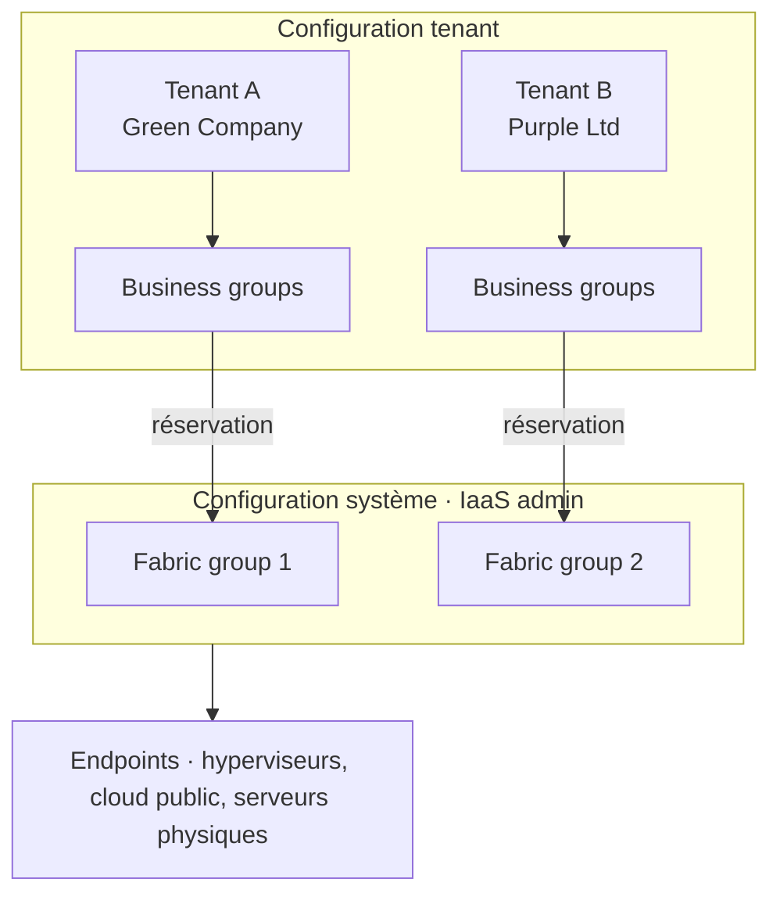

Un cloud privé, c'est un IaaS que tu opères toi-même. Deux familles dominent : **VMware**, qui part de la virtualisation et « monte dans les couches », et **OpenStack**, projet open source pensé dès le départ pour le cloud. Cette session démonte les deux, brique par brique — c'est aussi la session où, côté TD, tu installes ton OpenStack **multi-node** (2 nœuds).

## VMware : de la virtualisation au SDDC

### Rappel : la virtualisation

La **virtualisation**, c'est le **partage de ressources** : CPU, RAM, réseau, disque. Qui dit partage dit **surbooking** et **accès concurrents** : on vend plus de ressources qu'on n'en a, en pariant que tout le monde ne les utilise pas en même temps.

### Fiche signalétique

- **Leader mondial** de la virtualisation de serveurs x86.
- Concurrents sur la virtualisation : XenServer, KVM, Hyper-V.
- Profite de son marché de la virtualisation pour **« monter dans les couches »** et proposer de l'IaaS, voire du PaaS.
- Credo commercial et marketing : le **SDDC**, *Software-Defined DataCenter*.
- Produits phares côté infrastructure : **vSphere**, **NSX**, **VSAN**, **vRealize Suite**.

### Des serveurs à très forte valeur ajoutée

VMware a fourni un **hyperviseur**, puis y a ajouté des services : équilibrage de charge entre hôtes (**DRS**), résilience (**HA**), très haute disponibilité (**FT**), exploitabilité (**vMotion**, **Storage vMotion**), et des VM de plus en plus grosses (**scale in**). Le tout repose sur un stockage partagé et répliqué.

<KeyIdea>Chez VMware, toute l'intelligence a été portée par l'infrastructure : l'application n'a pas à savoir qu'un serveur tombe, c'est la plateforme qui la déplace.</KeyIdea>

C'est l'exact opposé du *design for failure* de la session 1, où c'est l'application qui survit aux pannes.

<DeepDive title="VMware depuis le rachat par Broadcom" level="état-de-l-art">
  Broadcom a finalisé le rachat de VMware en **novembre 2023**. Le catalogue a été fortement resserré autour de **VMware Cloud Foundation** (vSphere, VSAN, NSX et la couche d'automatisation dans un même produit), avec un passage des licences perpétuelles aux **abonnements**. La suite vRealize, renommée **Aria** en 2022, est aujourd'hui intégrée à Cloud Foundation.

  Sur le terrain, la hausse de coût qui a suivi a poussé de nombreuses entreprises à réévaluer leurs alternatives — Proxmox, Nutanix, OpenStack, ou le cloud public. Le schéma du cours (vSphere + VSAN + NSX + une CMP) reste, lui, exactement l'architecture vendue.
</DeepDive>

### La vision SDDC et les produits

Dans le **Software-Defined DataCenter**, chaque ressource physique — compute, réseau, stockage — est virtualisée par un produit, et une plateforme de cloud management pilote l'ensemble :

```mermaid title="Le SDDC selon VMware"
flowchart TB
  CMP[vRealize Suite · Cloud Management Platform<br/>automation · operations · business · cloud hybride]
  subgraph V[Infrastructure virtualisée]
    direction LR
    C[Compute<br/>vSphere]
    N[Network<br/>NSX]
    S[Storage<br/>VSAN]
  end
  P[Physique<br/>serveurs · switchs · disques]
  CMP --> V --> P
  classDef vm fill:var(--signal-soft),stroke:var(--signal);
  class C,N,S vm;
```

<CardGrid cols={3}>
  <Card kicker="Virtualisation" title="vSphere">**ESX** (l'hyperviseur) + **vCenter** (la console qui gère les ESX).</Card>
  <Card kicker="CMP" title="vRealize Suite">Self-service, catalogue, chargeback, capacité, performance, configuration, cycle de vie.</Card>
  <Card kicker="Les deux" title="vCloud Suite">vRealize + vSphere, vendus ensemble.</Card>
</CardGrid>

### VSAN : le stockage scale out

L'architecture VMware « classique » déporte le stockage dans des **baies SAN ou NAS** : c'est du **scale in**, une grosse baie partagée.

**VSAN** utilise les **disques locaux des ESX** pour « virtualiser le stockage » et rendre les fonctions des baies : **réplication** et **déduplication**, essentiellement.

<Callout type="definition" title="Hyperconvergé">
  vSphere + VSAN = une plateforme **hyperconvergée scale out** : chaque serveur apporte à la fois du calcul et du stockage. Ajouter un serveur ajoute les deux.
</Callout>

### NSX : le réseau virtualisé

**NSX**, c'est du quasi-**SDN** — un IaaS réseau, mais un cloud seulement pour la virtualisation. Il apporte des fonctions réseau évoluées **directement au niveau de l'ESX** : switch et routeur logiques, firewall, load balancer, VPN. Une **gateway** le connecte au monde interne. En SDN, le **plan de contrôle** et le **plan de données** sont séparés, et le tout se pilote par une API.

Pour comprendre NSX, il faut d'abord comprendre VXLAN :

<Compare leftTitle="VLAN · niveau 2" rightTitle="VXLAN · overlay">
  <Fragment slot="left">
    Un **domaine de broadcast** (L2), souvent associé à un subnet (L3).

    Limité à **4 096 VLAN**.

    Sert à une discussion L2 entre plusieurs machines.
  </Fragment>
  <Fragment slot="right">
    **Encapsule** (virtualise) des réseaux L2 : on parle d'**overlay** au-dessus d'un **underlay**.

    Concrètement : des trames **L2 transportées dans de l'UDP**.

    S'affranchit de la limite des 4 096 VLAN, et permet du **niveau 2 à longue distance** (comme OTV ou les interconnexions L2 entre datacenters).
  </Fragment>
</Compare>

```mermaid title="VXLAN : une trame L2 voyage dans un paquet UDP"
flowchart TB
  subgraph A[Hôte A]
    direction LR
    vm1[VM 1] --> t1[VTEP<br/>encapsule]
  end
  subgraph U[Underlay IP · switchs simples]
    direction LR
    r1((Routeur)) --- r2((Routeur))
  end
  subgraph B[Hôte B]
    direction LR
    t2[VTEP<br/>décapsule] --> vm2[VM 2]
  end
  t1 -->|trame L2 dans UDP| U --> t2
  classDef ov fill:var(--signal-soft),stroke:var(--signal);
  class vm1,vm2 ov;
```

On a toujours besoin de switchs, mais **de moins en moins intelligents** : l'intelligence passe dans le logiciel. C'est le principe même du cloud.

<DeepDive title="Pourquoi 4 096 et combien avec VXLAN ?" level="approfondissement">
  L'identifiant d'un VLAN (norme 802.1Q) tient sur **12 bits** : 2¹² = 4 096 valeurs, dont deux réservées, soit **4 094 VLAN utilisables**. Pour un cloud qui donne un réseau isolé à chaque client, c'est très vite insuffisant.

  VXLAN (RFC 7348) identifie chaque segment par un **VNI de 24 bits** : environ **16 millions** de réseaux. L'en-tête VXLAN, l'UDP (port 4789) et l'IP externe ajoutent environ 50 octets à chaque trame : il faut monter le MTU de l'underlay, sinon les paquets sont fragmentés — un piège classique des installations OpenStack.
</DeepDive>

À quoi NSX sert concrètement :

- **Filtrer au niveau de la VM** (*security group*) plutôt qu'au périmètre (firewall de subnet).
- Un **load balancer virtuel**, qui remplace des équipements historiquement fournis par l'équipe réseau.
- Un **VPN logique**.
- **Rendre le cloud autonome** vis-à-vis des équipes réseau.

<KeyIdea>vSphere + VSAN + NSX = une cloud infrastructure scale out. Il manque la couche de pilotage : la CMP.</KeyIdea>

## vRealize : la CMP de VMware

### Vue fonctionnelle

vRealize Suite se présente en blocs : **Business** (transparence des coûts, chargeback), **Automation** (portail self-service, livraison de services, gouvernance), **Operations** (performance, capacité, configuration, conformité, logs) et **Extensibility** (API, SDK, orchestration). En dessous, la **cloud infrastructure** — ou le « physique » : clouds publics, virtualisation (vSphere, VSAN, NSX), serveurs physiques.

### Un modèle multi-tenant

vRealize sert plusieurs clients (multi-tenant) sur plusieurs fournisseurs (multi-provider). Quatre niveaux à connaître, du bas vers le haut :



<CardGrid cols={2}>
  <Card kicker="1" title="Endpoint">Une ressource réelle : un vCenter, un OpenStack, un compte AWS.</Card>
  <Card kicker="2" title="Fabric group">Une sous-zone d'un endpoint, gérée par un *fabric admin*.</Card>
  <Card kicker="3" title="Tenant">Une zone client, avec son propre portail (son URL).</Card>
  <Card kicker="4" title="Business group">Une équipe au sein d'un tenant, qui consomme des **réservations** de fabric.</Card>
</CardGrid>

Le portail est un **portail HTTP et une API REST**, orientés **self-service**. Les fonctions de base sont basiques ; on les étend (en JavaScript) par des **flows** et des **blueprints**. La session 4 détaille le processus de configuration.

## OpenStack : le projet

### Fiche signalétique

<CardGrid cols={3}>
  <Stat value="2010" label="naissance" hint="fusion de Nova (NASA) et Swift (Rackspace)" />
  <Stat value="Apache 2.0" label="licence" hint="financé par la fondation, elle-même financée par des entreprises" />
  <Stat value="~50 %" label="des clouds privés" hint="à la date du support" />
</CardGrid>

### Nova : le compute

**Objectif : le calcul.** Nova pilote des hyperviseurs, le plus souvent **KVM**.

<Compare leftTitle="Virtual machine (vision virtualisation)" rightTitle="Cloud instance (vision OpenStack)">
  <Fragment slot="left">
    Une machine qu'on garde, qu'on sauvegarde, qu'on répare, qu'on déplace à chaud. Elle contient ses données.
  </Fragment>
  <Fragment slot="right">
    Une instance de calcul **sans données** (à la base), **sans persistance**. On la jette et on la recrée.

    Même vision chez AWS (**EC2**) ; Azure parle de *Virtual Machine*.
  </Fragment>
</Compare>

Nova gère aussi les **AZ** (*availability zones*) et les **clés SSH** pour se connecter aux instances.

### Disponibilité : AZ et région

<CardGrid cols={2}>
  <Card kicker="AZ" title="Availability zone">Une zone de disponibilité **indépendante**, sur laquelle l'application doit s'appuyer pour **gérer sa propre résilience**. Elle sert à la **disponibilité** de l'application.</Card>
  <Card kicker="Région" title="Région">Une entité **autonome**, regroupant plusieurs AZ. Elle sert à la **couverture mondiale** de l'application.</Card>
</CardGrid>

Le modèle est le même chez OpenStack et chez AWS. Dans OpenStack, certains composants sont **mutualisés** entre régions (Keystone, Horizon) et d'autres **dédiés** à chaque région (Nova, Glance, Cinder, Neutron, Swift). Dans une AZ, on peut regrouper des hôtes par caractéristique (*host aggregates* : disques SSD, SATA, réseau rapide).

<Quiz question="Ton application tourne sur deux instances, toutes deux dans l'AZ 1. L'AZ 1 tombe. Qui est responsable de la coupure ?" options={['Le fournisseur du cloud, qui doit garantir chaque AZ.', 'L’architecture de l’application, qui n’a pas réparti ses instances.']} answer={1}>
  **L'architecture.** Une AZ est faite pour tomber indépendamment des autres : c'est à l'application de se répartir sur plusieurs AZ et de **gérer sa résilience**. Le réflexe « le fournisseur garantit » vient du monde VMware, où l'infrastructure portait la haute disponibilité.
</Quiz>

## OpenStack : le stockage

### Block, file, object

<Figure caption="Trois types de stockage · Source : support ARCL cours 2">

| | Block | File | Object |
| --- | --- | --- | --- |
| **Type** | SAN / DAS | NAS | Object |
| **Protocoles** | iSCSI, FC, FCoE | CIFS, NFS | HTTP (REST, SOAP) |
| **Service** | Raw device | Espace de stockage de fichiers | Bibliothèque de fichiers avec métadonnées |
| **Cas d'usage** | Transactionnel : OS, binaires, données applicatives | Partage de fichiers (bureautique), machines virtuelles, bases de données | Fichiers personnels : photos, vidéos, e-mails |

</Figure>

Plus on monte du block vers l'objet, plus le stockage prend en charge de couches (RAID, métadonnées, *data services*). Chaque technologie colle à un besoin :

<CardGrid cols={2}>
  <Card kicker="Non structuré · dynamique" title="NAS">Fichiers bureautiques.</Card>
  <Card kicker="Non structuré · statique" title="Object" tone="signal">Photos, vidéos, archives.</Card>
  <Card kicker="Structuré · dynamique" title="SAN et DAS">Transactions (ERP, CRM).</Card>
  <Card kicker="Structuré · statique" title="SAN et DAS">BI, data warehouse.</Card>
</CardGrid>

### L'objet, c'est la donnée et ses métadonnées

Une photo de chien, stockée en objet, porte avec elle : « chien, mâle, berger belge, 7 ans », « 2010-12-15, Canon 5200 », « 48.7892527, 2.3770895 ». Les **métadonnées sont aussi importantes que la donnée** — comme les hashtags d'Instagram.

Et **pas d'accès concurrent en écriture** : un objet ne se modifie pas, il se remplace. C'est ce qui **facilite le scale out**.

### Swift

- Gère les fichiers **en HTTP**, un protocole très « Internet » : `GET`, `PUT`, `POST`, **pas de modification** en place.
- Stocke les objets dans des **buckets** (ou *containers*).
- Deux API : **S3** (le standard de fait d'AWS, mais propriété intellectuelle d'AWS) et **Swift**. Différences : expiration d'objets, versioning…
- Cas d'usage : **historisation** et **archivage actif**.

```mermaid title="Swift : des proxys sans état devant des nœuds de stockage"
flowchart TB
  A[Applications<br/>upload · download] --> LB[Load balancer]
  LB --> P[Proxy nodes<br/>sans état, scale out]
  subgraph R[Le ring]
    direction LR
    z0[(Zone 0)] ~~~ z1[(Zone 1)] ~~~ z2[(Zone 2)]
  end
  P --> R
  classDef px fill:var(--signal-soft),stroke:var(--signal);
  class P px;
```

Le **ring** décide où va chaque objet et gère les **réplications** (par `rsync`) et la résilience. Deux stratégies : **3 copies** ou l'**erasure coding**. Le support associe l'erasure coding aux **AZ** et la réplication aux **régions**.

<DeepDive title="Erasure coding contre triple réplication" level="approfondissement">
  La **réplication** stocke 3 copies complètes : 3 To de disque pour 1 To de données (surcoût de 200 %), mais une lecture n'interroge qu'un seul disque.

  L'**erasure coding** découpe l'objet en *k* fragments de données et calcule *m* fragments de parité ; n'importe quels *k* fragments sur *k + m* suffisent à reconstruire l'objet. Avec 10 + 4, on survit à la perte de 4 fragments pour un surcoût de 40 % seulement. En contrepartie, chaque lecture et chaque reconstruction sollicitent plusieurs nœuds et du CPU, et le réseau entre eux doit être rapide.

  D'où le conseil de la documentation Swift : l'erasure coding convient aux **gros objets peu lus** (archives), dans un même site au réseau rapide ; la réplication reste préférable entre régions, où la latence pénalise la reconstruction.
</DeepDive>

### Horizon et Glance

- **Horizon** : site web d'administration (GUI) qui **utilise les API**. Ce n'est **pas un portail self-service** : il est orienté administration et utilisation.
- **Glance** : gestion des **images à déployer**. Par défaut, il fournit **CirrOS**, un mini-OS de test.

## Neutron : le réseau

### Ce que fait Neutron

Neutron est le module réseau d'OpenStack. Il gère et fournit la partie *network* de l'IaaS (et du SDN), et remplace les anciens **nova-network** et **Quantum**. Au-delà d'environ **5 000 VM**, il **peut ou doit être remplacé** par une solution du marché (Cisco, Nuage, Alcatel, Brocade).

Ses services : un **serveur DHCP** (les instances sont en DHCP), le **L3** (routage) et le **L2** (commutation).

<Callout type="definition" title="Floating IP">
  Une instance reçoit une **IP privée** dans un **subnet privé**. Pour la joindre de l'extérieur, on lui associe une **floating IP** : un **NAT** d'une IP publique vers son IP fixe privée. On peut la détacher et la rattacher à une autre instance.
</Callout>

### Bonnes pratiques de déploiement

**Trois réseaux** : management, data, external. Et **trois types de nœuds** :

<CardGrid cols={3}>
  <Card kicker="Controller node" title="Orchestration">MariaDB, RabbitMQ, Glance, Nova-API, Neutron-Server, Cinder-API.</Card>
  <Card kicker="Network node" title="L3, DHCP">Neutron-L3, Neutron-DHCP, Neutron-Meta, Neutron-OVS. Porte le réseau des floating IP.</Card>
  <Card kicker="Compute node" title="L2">Nova-Compute, QEMU/KVM, Neutron-OVS, Cinder-Volume.</Card>
</CardGrid>

| Réseau (exemple du support) | Trafic | Nœuds reliés |
| --- | --- | --- |
| Management · `192.168.1.0/24` | SSH, web, API | Les trois |
| Data · `10.0.0.0/24` | Tunnels GRE entre nœuds | Network, compute |
| External · `192.168.2.0/24` | Trafic des VM, floating IP | Network |

Le réseau des tenants (par exemple `10.0.1.0/24`) n'apparaît sur aucune carte physique : il vit **dans les tunnels**, entre le network node et les compute nodes.

### Underlay et overlay

<Compare leftTitle="Underlay" rightTitle="Overlay">
  <Fragment slot="left">
    Le **réseau physique** : les serveurs, leurs cartes, les switchs, les subnets de management et de tunnels. Il est **commun** à tous.
  </Fragment>
  <Fragment slot="right">
    Les **réseaux virtuels** des tenants, transportés en tunnels (GRE, VXLAN) au-dessus de l'underlay. Chaque tenant a **sa** topologie : routeur, subnets, instances.
  </Fragment>
</Compare>

Exemple typique d'overlay : une topologie **3-tier web / app / DB**, avec un réseau par tier, un routeur virtuel vers l'extérieur, et la base isolée sur son propre réseau.

### Sous le capot : Open vSwitch et namespaces

Sur chaque nœud, Neutron s'appuie sur des bridges **Open vSwitch** :

- `br-int` : le bridge d'intégration, où se branchent les VM ;
- `br-tun` : les tunnels **GRE / VXLAN** vers les autres nœuds (du « L2 dans L3 ») ;
- `br-ex` : la sortie vers le **réseau externe**, sur le network node.

Le **L3 agent** utilise des **namespaces Linux** comme routeurs virtuels : chaque routeur d'un tenant est un namespace isolé, avec sa table de routage et ses règles `iptables`. Le DHCP tourne aussi dans un namespace par réseau (`dnsmasq`). C'est le **network node qui porte le réseau des floating IP**.

<Callout type="tip" title="Côté TD : vérifier un multi-node">
  Sur chaque nœud, `ip addr` montre les interfaces et `ovs-vsctl show` les bridges OVS et leurs ports (dont les tunnels). C'est le premier réflexe quand une instance n'a pas de réseau.
</Callout>

Variante : le **DVR** (*Distributed Virtual Router*). Le SNAT reste sur le network node, mais les **floating IP** et le **trafic est-ouest** (entre instances) sont routés **directement sur les compute nodes**, sans repasser par le network node.

<Quiz question="Dans une installation sans DVR, deux instances de deux subnets différents, sur deux compute nodes, échangent des paquets. Par où passent-ils ?" options={['Directement d’un compute node à l’autre.', 'Par le network node, qui porte le routeur L3.', 'Par le controller node.']} answer={1}>
  **Par le network node** : c'est lui qui héberge le routeur virtuel (L3 agent). C'est précisément le goulot que le **DVR** supprime en distribuant le routage sur les compute nodes. Le piège du controller node vient de son nom : il orchestre (API, base, bus), mais ne transporte pas le trafic des instances.
</Quiz>

## Heat : l'orchestration

**Heat** est le module d'orchestration d'OpenStack, **compatible AWS CloudFormation** (CFN). Tu décris une *stack* dans un **template YAML ou JSON** — grammaire **HOT** — et Heat crée les ressources dans le bon ordre. Les instances démarrent avec un OS équipé de **cloud-init**, qui reçoit des paramètres au démarrage.

La structure d'un template HOT :

```yaml
heat_template_version: 2015-04-30

description:
  # description du template

parameter_groups:
  # groupes et ordre des paramètres d'entrée

parameters:
  # paramètres d'entrée

resources:
  # ressources du template

outputs:
  # paramètres de sortie
```

Le support l'illustre avec un template qui déploie un **WordPress** : exactement ce que le TD te demande de faire.

<DeepDive title="Un WordPress minimal en HOT" level="best-practice">
  L'essentiel d'un template tient en trois idées : des **paramètres** pour ce qui change (image, gabarit, clé SSH), des **ressources** qui se référencent entre elles, et des **sorties** pour ce dont l'utilisateur a besoin (l'URL).

  ```yaml
  heat_template_version: 2015-04-30
  parameters:
    image: { type: string, default: fedora }
    flavor: { type: string, default: m1.small }
    key_name: { type: string }
  resources:
    web:
      type: OS::Nova::Server
      properties:
        image: { get_param: image }
        flavor: { get_param: flavor }
        key_name: { get_param: key_name }
        user_data: |
          #!/bin/bash
          dnf install -y wordpress httpd mariadb-server
          systemctl enable --now httpd mariadb
  outputs:
    url:
      value: { str_replace: { template: http://host/wordpress, params: { host: { get_attr: [web, first_address] } } } }
  ```

  Le script `user_data` est exécuté au premier démarrage par **cloud-init**. Pour aller vers le niveau « Born 2 be Cloud », on sépare la base (Trove, ou une instance dédiée avec un volume Cinder), on met les serveurs web dans un `OS::Heat::AutoScalingGroup` et on stocke les médias dans Swift.
</DeepDive>

## À retenir

<Takeaways>
1. **VMware porte l'intelligence dans l'infrastructure.** HA, vMotion, FT : l'application ignore les pannes ; le SDDC = vSphere + VSAN + NSX + vRealize.
2. **VXLAN transporte du L2 dans de l'UDP.** Un overlay au-dessus d'un underlay, sans la limite des 4 096 VLAN ; les switchs deviennent simples.
3. **Une cloud instance est jetable.** Sans données ni persistance ; la résilience vient de la répartition sur plusieurs AZ, la couverture mondiale des régions.
4. **L'objet = la donnée + ses métadonnées, en HTTP, sans écriture concurrente.** C'est ce qui permet à Swift (et S3) de scaler.
5. **Neutron donne une IP privée, la floating IP la rend joignable.** Trois réseaux (management, data, external), trois nœuds (controller, network, compute), et Heat déploie le tout en template.
</Takeaways>
