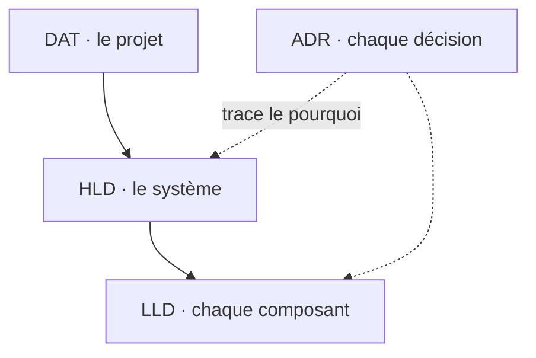

Avant de parler de monolithes, de microservices ou d'APIs, il faut savoir **de quoi on parle** et **qui décide**. Cette première session pose le vocabulaire (logiciel, application, service, produit), situe l'architecte logiciel parmi les autres architectes, puis détaille son quotidien et ses livrables. Le fil conducteur du cours : **il n'y a pas de vérité universelle en architecture, seulement des solutions adaptées à des contraintes réelles**.

## Bien nommer les choses

> « Mal nommer les choses, c'est ajouter au malheur du monde. » — Albert Camus

### Qu'est-ce qu'un logiciel ?

<Callout type="definition" title="Logiciel">
Ensemble des programmes, procédés et règles, et éventuellement de la documentation, relatifs au fonctionnement d'un ensemble de traitement de données.
</Callout>

### Application, service, produit

Trois mots qu'on emploie souvent l'un pour l'autre, et qui n'ont pas le même sens :

<CardGrid cols={3}>
  <Card kicker="Application" title="Unité déployable" tone="signal">
    Une **unité logicielle déployable** : ce qu'on build, livre et fait tourner.
  </Card>
  <Card kicker="Service" title="Capacité exposée" tone="signal">
    Une **capacité fonctionnelle spécifique** exposée via une **interface**.
  </Card>
  <Card kicker="Produit" title="Solution métier" tone="signal">
    La **solution métier complète** livrée à un client.
  </Card>
</CardGrid>

<Callout type="note" title="Le contexte change le sens">
Ces mots n'ont pas le même sens selon qu'on parle technique, business ou fonctionnel. Dans tout ce cours, on se place dans un **contexte technique**.
</Callout>

<Quiz question="Une équipe déploie trois conteneurs (front, API, worker) qui forment ensemble l'offre « Expense.io » vendue aux entreprises. Comment nommer correctement chaque niveau ?" options={['Trois produits qui forment un service', 'Trois applications qui forment un produit, l’API exposant des services', 'Un logiciel qui forme trois produits']} answer={1}>
  **Trois applications, un produit.** Chaque conteneur est une **unité déployable** (application) ; l'API expose des **capacités** via une interface (services) ; l'ensemble vendu au client est le **produit**. Le piège : appeler « service » tout ce qui tourne en conteneur, alors que le service se définit par la capacité qu'il expose, pas par son déploiement.
</Quiz>

## Le périmètre de l'architecte logiciel

### Quatre architectes, du métier à la technique

Le support place quatre profils d'architecte sur un axe qui va du **métier** à la **technique** :

<Figure caption="Du métier à la technique, quatre périmètres d'architecte · Source : support ARLA Cours n°1">
<CardGrid cols={2}>
  <Card kicker="Côté métier" title="Architecte d'entreprise" tone="muted">TOGAF · stratégie business · organisation.</Card>
  <Card kicker="Entre les deux" title="Architecte SI" tone="muted">Intégrations et flux · stratégie SI · principes directeurs.</Card>
  <Card kicker="Côté technique" title="Architecte logiciel" tone="signal">Choix de technos, frameworks et outils · design applicatif · méthodo de dev.</Card>
  <Card kicker="Côté technique" title="Architecte plateforme" tone="muted">Cloud et infra · developer experience · haute dispo et sizing.</Card>
</CardGrid>
</Figure>

### Horizon, largeur, profondeur

Une autre lecture (BearingPoint) croise trois axes : l'**horizon de planification** (court ou long), la **largeur du périmètre** (étroit ou large) et la **profondeur technologique**.

| Rôle | Surnom | Horizon | Périmètre | Profondeur technique |
| --- | --- | --- | --- | --- |
| Enterprise Architect | *The Planner* | Long | Large, stratégique | Faible |
| Domain Architect | *The Owner* | Moyen | Un domaine | Moyenne |
| Solution Architect | *The Coordinator* | Moyen | Une solution, plusieurs équipes | Moyenne à forte |
| Technology Architect | *The Designer* | Court | Étroit, opérationnel | Forte |

Quatre rôles d'architecte selon l'horizon, la largeur et la profondeur technique · Source : BearingPoint, cité par le support

<KeyIdea>Plus on monte vers la stratégie, plus l'horizon s'allonge et le périmètre s'élargit ; plus on descend vers la technique, plus la profondeur augmente. L'architecte logiciel vit en bas de ce schéma.</KeyIdea>

## Qui est responsable de l'architecture ?

### Ça dépend surtout de la taille de l'entreprise

<CardGrid cols={3}>
  <Card kicker="Start-up" title="Aucun poste dédié" tone="signal">
    C'est le **tech lead** qui prend les décisions architecturales.
  </Card>
  <Card kicker="Scale-up" title="Quelques architectes" tone="signal">
    Quelques architectes logiciels dédiés : une **petite équipe transverse**, ou rattachés à une **équipe produit**.
  </Card>
  <Card kicker="Grand groupe" title="Une armada" tone="signal">
    Chaque BU a son équipe d'architectes… et chaque décision prend une éternité.
  </Card>
</CardGrid>

Il est aussi courant que ces profils soient **externalisés**, via des indépendants ou des ESN.

<Callout type="warning" title="Un domaine souvent délaissé">
Aucune vérité générale : l'architecture logicielle est souvent un domaine **délaissé à tort**, faute de quelqu'un dont c'est explicitement le rôle.
</Callout>

### Le RACI

Le support répartit les activités entre trois rôles avec une matrice **RACI** :

<CardGrid cols={2}>
  <Card kicker="R" title="Responsable" tone="signal">Réalise l'activité.</Card>
  <Card kicker="A" title="Approbateur" tone="signal">Valide et rend des comptes ; un seul par activité.</Card>
  <Card kicker="C" title="Consulté" tone="muted">Donne son avis avant la décision.</Card>
  <Card kicker="I" title="Informé" tone="muted">Est tenu au courant après.</Card>
</CardGrid>

| Activité | Software Engineer | Software Architect | Tech Lead / CTO |
| --- | --- | --- | --- |
| Analyser le besoin fonctionnel | R | C | I |
| Concevoir une fonctionnalité | R | I | C |
| Implémenter, tester et maintenir le code | R/A | I | C |
| Arbitrer les trade-offs technique/coût (complexité vs performance, build vs buy) | C | **R/A** | C |
| Concevoir l'architecture technique (composants, interfaces/API, patterns, technos) | R | **A** | C |
| Définir le découpage en services | C | **R/A** | I |
| Définir les interactions entre services | R | **A** | C |
| Valider la scalabilité et la résilience de la solution | C | **A** | R |
| Garantir perf, sécurité, dette technique et stratégie de déploiement | R | **A** | I |
| Arbitrer les choix techniques structurants (stack, priorisation dette vs feature) | C | C | **R/A** |
| Documenter et faire évoluer l'architecture (ADR) | R | **A** | C |

Qui fait quoi dans la production d'un logiciel · Source : support ARLA Cours n°1

<Quiz question="D'après ce RACI, qui tranche entre « rembourser la dette technique » et « livrer la nouvelle feature » ?" options={['L’architecte logiciel, qui garantit la dette technique', 'Le tech lead / CTO, R/A sur les choix structurants', 'L’engineer, qui maintient le code']} answer={1}>
  **Le tech lead / CTO.** La priorisation dette vs feature est un **choix structurant** : l'architecte y est seulement **consulté**. Le piège : l'architecte est bien A sur « garantir la dette technique », mais garantir la qualité n'est pas arbitrer le planning. On remarque aussi que l'architecte est **A** sur presque toutes les activités de conception, mais que ce sont souvent les engineers qui sont **R** : il valide plus qu'il ne code.
</Quiz>

## Le quotidien de l'architecte logiciel

<Figure caption="Les quatre familles d'activités · Source : support ARLA Cours n°1">
<CardGrid cols={2}>
  <Card kicker="1" title="Concevoir et décider" tone="signal">
    - **Documenter** les choix : ADR, HLD, LLD, DAT
    - **Étudier la faisabilité** : PoC, prototypes, benchmarks
    - **Concevoir** les architectures : composants, flux, interactions, résilience, scalabilité
    - **Arbitrer les compromis** : coût, complexité, performance, sécurité, time-to-market
  </Card>
  <Card kicker="2" title="Structurer le SI" tone="signal">
    - Gérer les **composants transverses** : API Gateway, messaging, IAM, observabilité, cache…
    - Définir les **frontières** : services, domaines, responsabilités, interfaces
    - Faire évoluer l'**urbanisation du SI** : intégration, dépendances, trajectoires de migration, DDD
  </Card>
  <Card kicker="3" title="Définir et faire respecter les standards" tone="signal">
    - **De développement** : frameworks, TDD, patterns, conventions, BMAD
    - **D'architecture** : API, événements, synchronisation, résilience
    - **De qualité** : sécurité, observabilité, performance, CI/CD
  </Card>
  <Card kicker="4" title="Accompagner les équipes" tone="signal">
    - **Challenger** les conceptions techniques
    - Faire des **revues** d'architecture et de design
    - **Partager** la connaissance : ateliers, mentoring, tech talks
    - **Aligner** les parties prenantes : métier, produit, sécurité, ops, développeurs
  </Card>
</CardGrid>
</Figure>

<Pipeline steps={[
  { title: 'Décider', caption: 'arbitrer', detail: 'Étudier la faisabilité, arbitrer les compromis, tracer la décision dans un ADR.' },
  { title: 'Concevoir', caption: 'composants et flux', detail: 'Découper en composants, définir les interactions, la résilience et la scalabilité.' },
  { title: 'Standardiser', caption: 'règles communes', detail: 'Standards de développement, d’architecture et de qualité, partagés par toutes les équipes.' },
  { title: 'Accompagner', caption: 'faire adopter', detail: 'Challenger les conceptions, faire des revues, partager la connaissance, aligner les parties prenantes.' },
]} />

## Les livrables de l'architecture logicielle

Quatre documents, chacun répond à **une** question à **un** niveau :

| Livrable | Question | Niveau |
| --- | --- | --- |
| **ADR** — Architecture Decision Record | Pourquoi avons-nous fait ce choix ? | Décision |
| **HLD** — High-Level Design | Quelle architecture allons-nous construire ? | Système |
| **LLD** — Low-Level Design | Comment allons-nous la construire ? | Composant |
| **DAT** — Document d'Architecture Technique | Quelle est l'architecture technique globale ? | Projet |

Quatre livrables, quatre questions · Source : support ARLA Cours n°1, d'après le Microsoft Azure Architecture Guide

<Quiz question="Six mois après la mise en prod, un nouveau dev demande pourquoi l'équipe a choisi PostgreSQL plutôt que MongoDB. Quel livrable aurait dû répondre ?" options={['Le LLD', 'Le HLD', 'L’ADR']} answer={2}>
  **L'ADR.** Il trace **le pourquoi** d'une décision : contexte, options, choix, conséquences. Le HLD dit qu'il y a une base relationnelle, le LLD décrit son schéma, mais aucun des deux ne garde les alternatives écartées ni les raisons. C'est le piège classique : on documente le résultat, pas la décision.
</Quiz>

<DeepDive title="À quoi ressemble un ADR" level="best-practice">
  Le format popularisé par **Michael Nygard** (2011) tient en une page et cinq rubriques : **titre**, **statut** (proposé, accepté, remplacé par…), **contexte** (les forces en présence), **décision** (formulée à la voix active : « nous utiliserons… ») et **conséquences** (positives comme négatives). Les ADR sont numérotés, versionnés avec le code (souvent dans `docs/adr/`) et **jamais réécrits** : une décision qui change donne un nouvel ADR qui remplace l'ancien. On garde ainsi l'historique du raisonnement, pas seulement l'état final.
</DeepDive>

<DeepDive title="Le modèle C4 pour les schémas de HLD et LLD" level="best-practice">
  Pour que les schémas d'architecture se lisent sans légende, **Simon Brown** propose le **modèle C4** : quatre niveaux de zoom emboîtés. **Contexte** (le système, ses utilisateurs et systèmes voisins), **Conteneurs** (les applications et bases déployables), **Composants** (l'intérieur d'un conteneur), **Code** (rarement dessiné). Les deux premiers niveaux correspondent assez bien à un HLD, le troisième à un LLD.
</DeepDive>

## À retenir

<Takeaways>
1. **Bien nommer.** Application = unité déployable, service = capacité exposée via une interface, produit = solution métier livrée au client.
2. **L'architecte logiciel est le plus technique des architectes.** Choix de technos, design applicatif, méthodo de dev ; l'architecte d'entreprise, lui, vise la stratégie à long terme.
3. **Qui décide dépend de la taille.** Tech lead en start-up, quelques architectes en scale-up, une armada en grand groupe ; souvent un domaine délaissé à tort.
4. **L'architecte approuve plus qu'il ne réalise.** Dans le RACI, il est A sur la conception et les trade-offs ; les arbitrages structurants (stack, dette vs feature) reviennent au tech lead / CTO.
5. **Un livrable par question.** ADR = pourquoi, HLD = quoi (système), LLD = comment (composant), DAT = vue globale du projet.
</Takeaways>
