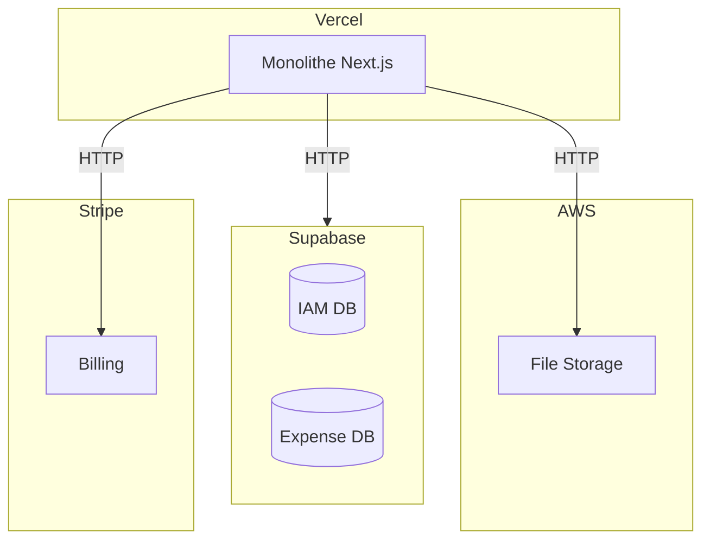
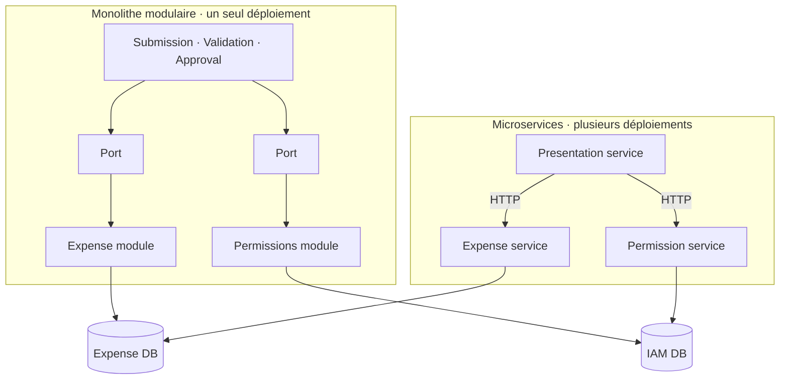
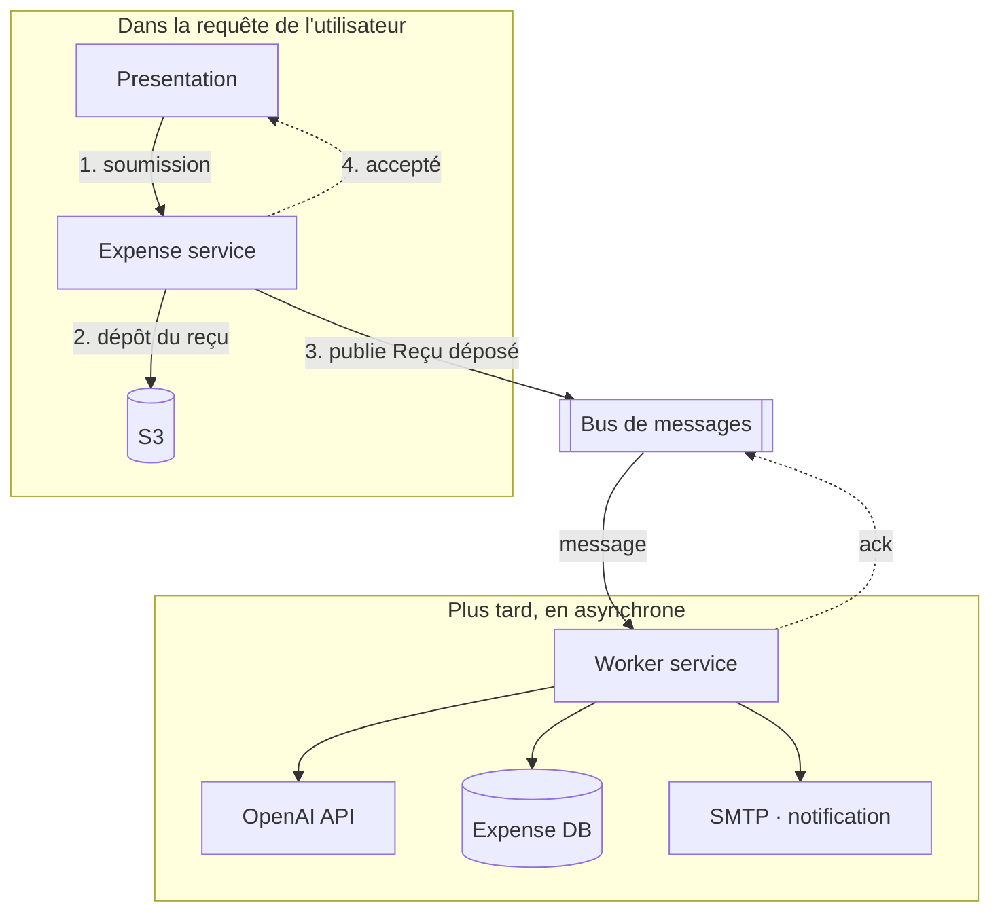
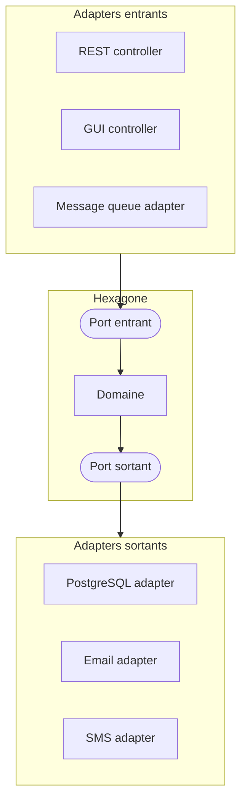

**Comment prendre une (bonne) décision d'architecture ?** Pas en appliquant une règle universelle : en arbitrant entre des contraintes réelles. Pour le montrer, la session suit **Expense.io**, un SaaS de notes de frais lancé à l'arrache, de sa première version à sa phase de legacy. À chaque étape, un problème concret force une décision : découper, passer à l'asynchrone, répartir les données, structurer le code.

## Arbitrer les compromis

### Six questions avant chaque décision

<CardGrid cols={3}>
  <Card kicker="Deadline" title="Time to market" tone="signal">Quelles échéances business ?</Card>
  <Card kicker="Coûts" title="Ce qu'on peut payer" tone="signal">Infra, licences, équipe : que peut-on se permettre ?</Card>
  <Card kicker="Équipe" title="Maturité" tone="signal">Qui opère ce qu'on s'apprête à choisir ?</Card>
  <Card kicker="Conformité" title="Souveraineté" tone="signal">Où vivent les données ? Quelles réglementations s'appliquent ?</Card>
  <Card kicker="Sécurité" title="Niveau de risque" tone="signal">Que se passe-t-il si ça tourne mal ?</Card>
  <Card kicker="Scalabilité" title="Quelle échelle, quand ?" tone="signal">100 utilisateurs ou 10 millions ? Maintenant ou dans 2 ans ?</Card>
</CardGrid>

<Callout type="note" title="« All models are wrong, but some are useful »">
La citation de George E. P. Box résume l'esprit : aucune architecture n'est « vraie », certaines sont **utiles** pour des contraintes données. Les schémas qui suivent portent tous le **triangle qualité / coûts / délais** : chaque décision déplace un curseur.
</Callout>

### Rappel de gestion de projet : ce qui est fixe, ce qui varie

<Compare leftTitle="Projet prédictif" rightTitle="Projet agile">
  <Fragment slot="left">Le **périmètre est fixe** ; les **coûts et les délais** sont variables.</Fragment>
  <Fragment slot="right">Les **coûts et les délais sont fixes** ; c'est le **périmètre** qui varie.</Fragment>
</Compare>

## Expense.io, le fil rouge

### Le point de départ

Un étudiant tout juste sorti d'école de commerce, Manu, lance **Expense.io** : un **SaaS B2B** de notes de frais dont il a entièrement **vibecodé** l'applicatif avec son abonnement Claude. Manu n'a jamais suivi de cours d'architecture logicielle : il ne maîtrise pas les principes fondamentaux.

Fonctionnalités de la première version :

- création d'un compte par entreprise et connexion à son espace ;
- soumission d'une note de frais et du scan de son reçu ;
- consultation de l'historique ;
- facturation de l'abonnement Expense.io.

<Figure caption="Expense.io (1) : un monolithe Next.js sur Vercel, des services managés autour · Source : support ARLA Cours n°2">

</Figure>

### Build vs buy

L'authentification, le stockage de fichiers, la facturation : Manu ne les a pas codés, il les a **achetés** (Supabase, AWS, Stripe). La décision se raisonne avec deux grilles.

<Figure caption="La matrice priorité stratégique × urgence · Source : support ARLA Cours n°2">
<CardGrid cols={2}>
  <Card kicker="Prioritaire · pas urgent" title="Build" tone="signal">Renforcer ses capacités d'exécution stratégiques en interne.</Card>
  <Card kicker="Prioritaire · urgent" title="Partner" tone="signal">Collaboration stratégique pour créer un marché.</Card>
  <Card kicker="Secondaire · pas urgent" title="Dé-prioriser" tone="muted">Ne rien faire pour l'instant.</Card>
  <Card kicker="Secondaire · urgent" title="Buy" tone="synapse">Intégrer rapidement de nouvelles capacités.</Card>
</CardGrid>
</Figure>

| Niveau | Ce que c'est | Perçu comme | Choix |
| --- | --- | --- | --- |
| **Spécifique** | Unique, différenciant | Un atout concurrentiel | Build : on va plus vite sur l'innovation |
| **Progiciel** | Commun à toutes les entreprises du secteur | Un atout de production | Buy |
| **BPO** (*Business Process Outsourcing*) | Commun à toutes les entreprises | Une ressource | Externaliser : on paie moins cher |

Plus une brique est différenciante, plus on la construit · Source : Ludovic Cinquin, OCTO (2012), cité par le support

<Callout type="tip" title="Et avec l'IA ?">
Le **build** est beaucoup plus abordable qu'avant… mais le **maintenir** coûte toujours aussi cher. *For now.*
</Callout>

<Quiz question="Pour Expense.io, quelle brique mérite le plus d'être construite en interne plutôt qu'achetée ?" options={['La facturation de l’abonnement', 'Le stockage des fichiers', 'Le workflow de traitement des notes de frais']} answer={2}>
  **Le workflow de notes de frais.** C'est le cœur **spécifique** du produit, ce qui le différencie. La facturation et le stockage sont communs à toutes les entreprises : Stripe et S3 les font mieux et moins cher. Le piège : la facturation semble « critique » (c'est l'argent), mais critique ne veut pas dire différenciant.
</Quiz>

## Expense.io (2) : rôles, incident et découpage

### Les premiers retours clients

Les clients veulent un **workflow de validation** avec des rôles :

<Steps>
1. L'**employé** soumet une note de frais.
2. Son **manager** hiérarchique peut la valider.
3. La **finance** peut la clôturer.
</Steps>

Manu ajoute ça à la va-vite dans son monolithe Next.js : des vérifications de rôle (`if (user.role === 'manager')`) **copiées-collées dans chaque route**, et un **filtrage par client** des requêtes Supabase directement dans l'app.

### Le premier incident

Un employé de l'entreprise A consulte, via une requête mal filtrée, des notes de frais de l'entreprise B.

<Callout type="danger" title="La fuite entre clients">
Une **fuite de données entre deux clients** du même SaaS : le pire incident possible pour un produit B2B.
</Callout>

<Callout type="note" title="Nuance des intervenants">
La fuite elle-même n'était pas inévitable : une policy **Row Level Security** sur la table des notes de frais, disponible dès le premier jour sur Supabase, l'aurait rendue **structurellement impossible**, même avec une route mal filtrée. Ce qui pousse Expense.io vers la suite, ce n'est donc pas cet incident précis, mais la **complexité croissante des règles d'autorisation** (délégation, réutilisation entre futurs services) que RLS seul exprime mal.
</Callout>

### Monolithe modulaire ou microservices ?

Deux réponses possibles : isoler les **permissions** et les **notes de frais** dans des modules distincts, derrière des **ports**, ou en faire des services séparés.

<Figure caption="Expense.io (2) : les deux découpages proposés · Source : support ARLA Cours n°2">

</Figure>

<Compare leftTitle="Monolithe modulaire" rightTitle="Microservices">
  <Fragment slot="left">
    - Une seule application, des **modules** séparés par des ports
    - Un déploiement, un monitoring
    - Appels de fonction internes
  </Fragment>
  <Fragment slot="right">
    - Un service par domaine, chacun avec son **API**
    - Appels HTTP entre services
    - **Architecture distribuée** : déploiements et monitoring plus complexes
  </Fragment>
</Compare>

<DeepDive title="« Monolith first »" level="best-practice">
  **Martin Fowler** observe que presque toutes les architectures microservices réussies ont commencé par un **monolithe** devenu trop gros, et que les projets partis directement en microservices ont souvent eu de sérieux problèmes. La raison : les bonnes **frontières** entre services ne se voient qu'à l'usage, et les déplacer coûte cher une fois qu'elles sont des appels réseau. Un monolithe modulaire bien découpé laisse l'option ouverte.
</DeepDive>

### Le découplage fonctionnel

Que l'on choisisse un monolithe modulaire ou des microservices, une architecture durable cherche à **découpler ses domaines fonctionnels** au maximum. Une approche communément admise pour les identifier : le **Domain-Driven Design** (Eric Evans).

<Callout type="note" title="Un découpage haut niveau">
Le DDD dit **où couper**. Les implémentations plus fines, dans le code (clean architecture, architecture hexagonale, ports et adapters), viennent plus loin.
</Callout>

<DeepDive title="Bounded context : la frontière du DDD" level="approfondissement">
  Le concept central du DDD stratégique est le **bounded context** : une zone où un modèle et son vocabulaire ont un sens précis. « Note de frais » ne veut pas dire la même chose pour l'employé (un reçu à soumettre), le manager (une demande à valider) et la finance (une écriture à comptabiliser). Plutôt qu'un modèle unique qui contente mal tout le monde, on découpe par contexte et on définit explicitement les traductions entre eux. Ces contextes sont de bons candidats pour des modules, puis éventuellement des services (Martin Fowler, « BoundedContext »).
</DeepDive>

## Expense.io (3) : l'IA et l'asynchrone

### L'app se tourne vers l'IA

Les clients peuvent désormais **automatiser le traitement** de leurs notes de frais : le reçu est stocké comme avant, puis **traité et catégorisé** par un appel à l'API OpenAI, et Expense.io répond que la requête a été traitée. Manu recrute un dev à plein temps pour intégrer OpenAI et refactorer en microservices.

<Figure caption="Expense.io (3) : flux de soumission séquentiel · Source : support ARLA Cours n°2">
<Pipeline steps={[
  { title: 'Soumission', caption: '1 · front → Expense', detail: 'Le presentation service envoie la note de frais et le reçu à l’Expense service.' },
  { title: 'Object storage', caption: '2 · S3', detail: 'Le reçu est déposé dans un bucket S3.' },
  { title: 'Data process', caption: '3 · OpenAI', detail: 'L’API OpenAI lit et catégorise la note de frais.' },
  { title: 'Structured storage', caption: '4 · Expense DB', detail: 'Le résultat est écrit en base.' },
  { title: 'Réponse', caption: '5 · → front', detail: 'Ce n’est qu’après les quatre étapes que l’utilisateur reçoit sa réponse HTTP.' },
]} />
</Figure>

### L'app devient lente

La fonctionnalité a du succès… et l'app ralentit :

- des réponses HTTP n'arrivent **jamais**, sans prévenir l'utilisateur : **ambiguïté** sur le traitement de sa note ;
- des requêtes partent en **timeout** dans le front, côté Vercel ;
- le nombre de **retries explose** sur la console OpenAI.

<KeyIdea>« La résilience du système est celle de son maillon le plus lent. »</KeyIdea>

<Figure caption="Synchrone ou asynchrone : fais varier le temps de réponse d'OpenAI (durées illustratives) · Source : support ARLA Cours n°2">
<SyncAsync />
</Figure>

### Le vocabulaire de l'asynchrone

Il est temps pour Expense.io d'entrer dans le monde de l'**asynchrone** : l'utilisateur soumet sa note, puis reçoit **plus tard** une notification qui l'informe du traitement.

<CardGrid cols={2}>
  <Card kicker="Producer" title="Émetteur" tone="signal">Composant qui produit le message et l'envoie au broker.</Card>
  <Card kicker="Broker" title="Bus de messages" tone="signal">Réceptionne le message et le rend disponible pour le consumer.</Card>
  <Card kicker="Consumer" title="Worker" tone="signal">Récupère le message, le traite, puis envoie un **ack** au broker.</Card>
  <Card kicker="Ack" title="Accusé de réception" tone="signal">Confirme au broker que le message a été traité. **Sans ack, le message est redistribué.**</Card>
  <Card kicker="Pub/Sub" title="Diffusion" tone="signal">Un émetteur diffuse un message à un ensemble de workers abonnés, via le broker.</Card>
  <Card kicker="Coordination" title="Chorégraphie vs orchestration" tone="signal">Pair à pair, ou *hub and spoke* autour d'un orchestrateur.</Card>
</CardGrid>

<Compare leftTitle="Chorégraphie" rightTitle="Orchestration">
  <Fragment slot="left">Chaque service réagit aux événements des autres, **pair à pair**. Personne ne voit le processus en entier.</Fragment>
  <Fragment slot="right">Un **orchestrateur** central appelle chaque service dans l'ordre (*hub and spoke*). Le processus est lisible à un seul endroit.</Fragment>
</Compare>

<Callout type="tip" title="Pour visualiser Kafka">
« Gently down the stream » (gentlydownthe.stream) raconte le fonctionnement de Kafka comme un livre pour enfants.
</Callout>

### Le flux asynchrone d'Expense.io

<Figure caption="Expense.io (3) : le flux de soumission asynchrone · Source : support ARLA Cours n°2">

</Figure>

### Les bonnes pratiques de l'asynchrone

<CardGrid cols={2}>
  <Card kicker="DLQ" title="Dead Letter Queue" tone="signal">
    Une queue qui reçoit les messages qui échouent encore après X retries : traitement impossible, qui peut déclencher une opération manuelle (par exemple une image envoyée qui n'a rien d'un ticket de caisse).
  </Card>
  <Card kicker="Rejeu" title="Idempotence" tone="signal">
    Un worker peut crasher et un événement être rejoué : il ne faut **ni doublon, ni re-notification** de l'utilisateur.
  </Card>
  <Card kicker="Contrat" title="Contract first" tone="signal">
    Une fois établi, le contrat d'un message ne peut plus changer sans implications lourdes pour les consommateurs.
  </Card>
  <Card kicker="Debug" title="Traçabilité" tone="signal">
    En synchrone, une erreur donne une stacktrace unique ; ici, on ne sait pas quel worker a traité le message. Il faut des moyens de remonter cette information.
  </Card>
</CardGrid>

<Callout type="warning" title="Toujours questionner son utilité">
L'asynchrone est **par nature plus complexe**. Il ne se justifie que si le problème (un maillon lent, une charge irrégulière) le demande.
</Callout>

<Quiz question="Le worker catégorise une note, l'écrit en base, envoie l'e-mail… puis crashe avant d'envoyer son ack. Que se passe-t-il ?" options={['Rien : la note est en base, le traitement est fini', 'Le broker redistribue le message ; sans idempotence, l’utilisateur reçoit un second e-mail', 'Le message part directement en DLQ']} answer={1}>
  **Le message est redistribué.** Pour le broker, sans ack, le message n'a pas été traité : un autre worker le reprend. D'où l'**idempotence** : le worker doit détecter que la note est déjà traitée et ne pas re-notifier. Le piège : croire que « c'est en base » suffit, alors que le broker ne regarde que l'ack. La DLQ n'arrive qu'après X échecs répétés.
</Quiz>

<DeepDive title="Écrire en base et publier, sans perdre l'un des deux" level="best-practice">
  Un piège voisin : l'Expense service écrit en base **puis** publie sur le bus. S'il crashe entre les deux, la base dit « reçu déposé » mais aucun worker ne le saura jamais. Le pattern **transactional outbox** (Chris Richardson) règle ça : on écrit le message dans une table `outbox` **dans la même transaction** que la donnée métier, et un processus séparé relaie cette table vers le broker. Le message peut alors être publié deux fois… ce qui ramène, encore, à l'idempotence côté consumer.
</DeepDive>

## Expense.io (4) : l'international et le théorème CAP

### « Il suffit de répliquer la BDD ? »

Expense.io signe son premier client international. L'app n'est déployée qu'en Europe : les Américains subissent des latences. Manu promet que ce sera vite réglé : « Il suffit de répliquer la BDD sur plusieurs régions, non ? »

Ce qu'il n'avait pas anticipé : un **manager international** doit valider les notes de frais d'une équipe répartie **sur plusieurs continents**, donc **sur plusieurs bases**.

### Le théorème CAP

<Callout type="definition" title="Théorème CAP">
« Any distributed database system can provide at most 2 of the following 3 guarantees: Consistency, Availability, Partition Tolerance. »
</Callout>

<Figure caption="Choisis deux garanties et vois ce que devient la validation du manager · Source : support ARLA Cours n°2 (classement des bases repris du support)">
<CapTheorem />
</Figure>

<Quiz question="Le lien réseau entre l'Europe et les États-Unis est coupé. Le produit exige qu'aucun manager ne voie jamais une note « validée » qui ne l'est pas ailleurs. Quel choix fais-tu ?" options={['AP : on répond toujours, on réconcilie après', 'CP : on refuse ou on fait attendre la validation tant que la partition dure', 'CA : on garde les trois garanties']} answer={1}>
  **CP.** L'exigence est la **cohérence** : pendant la coupure, on sacrifie la **disponibilité** (erreur ou attente). AP attire parce que l'utilisateur n'est jamais bloqué, mais il verrait temporairement des états divergents. CA n'existe pas pendant une partition : dès que le réseau peut se couper, il faut choisir entre C et A.
</Quiz>

<DeepDive title="CAP, douze ans après" level="approfondissement">
  **Eric Brewer**, l'auteur du théorème, a lui-même nuancé la lecture « 2 sur 3 » en 2012. Dans un système distribué, les **partitions arrivent** : le vrai choix n'est pas « CA, CP ou AP » une fois pour toutes, mais **que faire pendant une partition** (privilégier C ou A), puis comment **réconcilier** ensuite. Hors partition, on peut avoir C et A. Et le choix peut varier selon l'opération : la validation d'une note peut être CP pendant que la consultation de l'historique reste AP. Le « CA » des bases mono-nœud comme PostgreSQL signifie surtout qu'elles ne sont pas conçues pour tolérer une partition.
</DeepDive>

## Expense.io (5) : la phase de run, début du legacy

### Une codebase aux pratiques multiples

Changement d'organisation : un **nouveau tech lead** est recruté. Malgré les efforts pour garder des composants propres, il trouve une codebase aux **pratiques multiples**. Il décide de mettre en place une **architecture « type »** dans une **codebase template**. Mais laquelle ?

Les références du support : *Clean Architecture* (Robert C. Martin), *Designing Hexagonal Architecture with Java* (Davi Vieira), *Architecture Patterns with Python* (Harry Percival et Bob Gregory).

### La clean architecture

Des cercles concentriques ; les dépendances pointent **toujours vers l'intérieur**.

<Figure caption="Les quatre cercles de la clean architecture, du cœur vers l'extérieur · Source : support ARLA Cours n°2">
<CardGrid cols={2}>
  <Card kicker="Cœur" title="Entities" tone="signal">Les règles métier de l'entreprise (*enterprise business rules*).</Card>
  <Card kicker="Cercle 2" title="Use cases" tone="signal">Les règles métier de l'application (*application business rules*), avec leurs ports d'entrée et de sortie.</Card>
  <Card kicker="Cercle 3" title="Interface adapters" tone="muted">Controllers, presenters, gateways.</Card>
  <Card kicker="Extérieur" title="Frameworks & drivers" tone="muted">Web, UI, base de données, devices, interfaces externes.</Card>
</CardGrid>
</Figure>

### L'architecture hexagonale

Aussi appelée **« Ports and Adapters »** : le **domaine** au centre, des **ports** sur ses bords, et des **adapters** qui branchent le monde extérieur sur ces ports.

<Figure caption="L'hexagone : le domaine ne connaît que ses ports · Source : support ARLA Cours n°2">

</Figure>

### Ce qu'il faut retenir

<Compare leftTitle="Hexagonale" rightTitle="Clean architecture">
  <Fragment slot="left">
    - **Peu guidée** : un principe, libre à l'implémentation
    - Vocabulaire : *server port*, *application*, *adapter*
  </Fragment>
  <Fragment slot="right">
    - **Fortement guidée** : règles très précises (un port = un fichier, *Screaming Architecture*)
    - Vocabulaire : *gateway*, *entity*, *controller*
  </Fragment>
</Compare>

Il faut surtout comprendre leurs **principes communs** :

<CardGrid cols={3}>
  <Card kicker="Tests" title="Testabilité du cœur métier" tone="signal">On **mocke l'infrastructure** pour tester le métier seul.</Card>
  <Card kicker="Dépendances" title="Inversion des dépendances" tone="signal">Le **métier ne dépend pas de la technique** : c'est la technique qui dépend du métier.</Card>
  <Card kicker="Évolution" title="Évolutivité" tone="signal">Un composant évolue **indépendamment de son implémentation**.</Card>
</CardGrid>

<Callout type="tip" title="À lire aussi">
Les principes **The Twelve-Factor App** (12factor.net), cités par le support pour construire des applications faciles à déployer et à faire évoluer.
</Callout>

<Quiz question="Le service de facturation d'Expense.io importe directement le SDK Stripe dans ses règles de calcul de l'abonnement. Quel principe commun est violé ?" options={['La testabilité seulement', 'L’inversion des dépendances : le métier dépend de la technique', 'Aucun, Stripe est un service acheté']} answer={1}>
  **L'inversion des dépendances.** Les règles métier devraient appeler un **port** (« encaisser un paiement »), implémenté par un **adapter** Stripe. Ici, changer de prestataire oblige à toucher au métier, et tester le calcul exige de mocker le SDK. La testabilité est bien dégradée, mais c'est une conséquence : la cause est la dépendance dans le mauvais sens.
</Quiz>

### Et en pratique ?

- On retrouve souvent les idées **mal implémentées** : la terminologie est la bonne, mais le métier reste couplé à l'infrastructure. Exemple du support : un schéma présenté comme « hexagonal » par Netflix, mais avec la terminologie de la clean architecture.
- Il faut être **pragmatique** : ce n'est pas toujours utile (**KISS**, *Keep It Stupid Simple*). Du code qui fonctionne ne vaut pas toujours le coup d'être touché.
- Toujours s'adapter aux **contraintes** : langage, infra, équipe…

<KeyIdea>L'absence d'architecture spécifique doit toujours être un **choix**. Et ce choix ne doit pas prendre plus d'une demi-journée de discussion.</KeyIdea>

## À retenir

<Takeaways>
1. **Pas de vérité universelle.** Une décision d'architecture arbitre délais, coûts, maturité de l'équipe, conformité, sécurité et échelle ; on build ce qui différencie, on achète le reste.
2. **Découpler par domaines, quel que soit le déploiement.** Monolithe modulaire ou microservices, le DDD dit où couper ; les microservices ajoutent la complexité d'une architecture distribuée.
3. **La résilience est celle du maillon le plus lent.** L'asynchrone (broker, workers, ack) découple l'utilisateur d'un service lent, au prix de DLQ, idempotence, contrats et traçabilité.
4. **CAP : deux garanties sur trois.** Avec des données sur plusieurs régions, une partition force à choisir entre cohérence et disponibilité.
5. **Clean ou hexagonale, mêmes principes.** Métier testable sans l'infra, dépendances inversées, composants remplaçables ; et ne pas en faire est un choix assumé.
</Takeaways>
