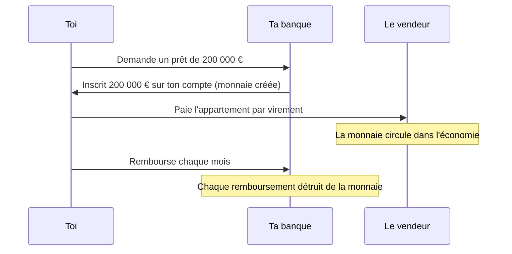

Tu reçois ton salaire par virement, tu paies ta baguette sans contact, ton épargne dort sur un livret. Mais au fond, **qu'est-ce que c'est, l'argent ?** Qui a le droit d'en fabriquer ? Pourquoi une baguette coûtait 0,70 € en 2002 et plus d'un euro aujourd'hui ? Ce chapitre ouvre la « salle des machines » de l'économie : la monnaie, l'inflation et les banques centrales qui tentent de garder le tout sous contrôle. C'est aussi la clé pour comprendre, plus tard, pourquoi les taux d'intérêt font monter ou baisser la bourse.

## À quoi sert la monnaie

### Avant la monnaie : le troc et ses impasses

Imagine une économie sans argent. Tu es boulanger et tu veux des chaussures. Il faut trouver un cordonnier qui **veut du pain**, **au même moment**, et s'entendre sur combien de pains vaut une paire. C'est ce que les économistes appellent la « double coïncidence des besoins » : elle rend le **troc** terriblement inefficace dès que l'économie devient un peu complexe.

La monnaie résout ce problème : tout le monde l'accepte, donc tu vends ton pain à qui veut, et tu achètes tes chaussures à qui veut.

### Trois fonctions

<CardGrid cols={3}>
  <Card title="Intermédiaire des échanges" kicker="Fonction 1">
    On l'accepte en paiement de n'importe quoi. Plus besoin de trouver quelqu'un qui veut exactement ce que tu as.
  </Card>
  <Card title="Unité de compte" kicker="Fonction 2">
    Elle sert d'**étalon** commun : on exprime tous les prix en euros, ce qui permet de les comparer d'un coup d'œil.
  </Card>
  <Card title="Réserve de valeur" kicker="Fonction 3">
    On peut la **garder** pour dépenser plus tard. Tant que l'inflation reste faible, elle conserve son pouvoir d'achat.
  </Card>
</CardGrid>

La troisième fonction est la plus fragile. Une monnaie dont la valeur fond trop vite (pense à l'Allemagne de 1923, au Zimbabwe des années 2000 ou au Venezuela récent) cesse d'être une réserve de valeur : les gens la dépensent dès qu'ils la reçoivent, ou se réfugient dans le dollar ou l'or.

### Une monnaie de plus en plus immatérielle

L'histoire de la monnaie est celle d'une **dématérialisation** : des coquillages et du métal précieux, on est passé aux pièces frappées, puis aux billets (au départ convertibles en or), puis aux simples écritures dans les comptes des banques.

<Callout type="definition" title="Monnaie fiduciaire et monnaie scripturale">
  La **monnaie fiduciaire**, ce sont les pièces et les billets (du latin *fiducia*, « confiance »). La **monnaie scripturale**, c'est l'argent inscrit sur les comptes bancaires, qui circule par virement, carte ou chèque. Dans la zone euro, l'immense majorité de la monnaie est scripturale.
</Callout>

Aujourd'hui, un billet de 50 € ne vaut rien en lui-même : il n'est plus échangeable contre de l'or. Il a de la valeur **parce que tout le monde l'accepte**, et parce que la loi oblige à l'accepter. C'est une monnaie fondée entièrement sur la confiance. D'où l'importance de ceux qui la gèrent.

## Qui crée la monnaie ?

### Une idée reçue : « la planche à billets »

On imagine souvent que la monnaie est fabriquée par l'État ou la banque centrale, qui « imprime des billets ». C'est vrai pour les billets, mais ils ne représentent qu'une petite partie de la monnaie. **L'essentiel de la monnaie est créé par les banques commerciales** (BNP Paribas, Crédit Agricole, ta banque en ligne) quand elles accordent des crédits.

### Les crédits font les dépôts

Quand ta banque t'accorde un prêt immobilier de 200 000 €, elle ne prend pas l'argent sur le compte d'un autre client. Elle **inscrit** 200 000 € sur ton compte, d'un simple jeu d'écriture. Cet argent n'existait pas avant : il vient d'être **créé**. En face, la banque inscrit à son actif ta dette de 200 000 €.

Le mécanisme marche aussi dans l'autre sens : quand tu **rembourses** ton prêt, la monnaie correspondante **disparaît**. La quantité de monnaie dans l'économie résulte donc d'un flux permanent de créations (nouveaux crédits) et de destructions (remboursements).

<KeyIdea>Les banques ne prêtent pas l'argent des épargnants : en accordant un crédit, elles créent de la monnaie nouvelle, qui disparaît quand le crédit est remboursé.</KeyIdea>

### Alors, qu'est-ce qui empêche les banques de créer à l'infini ?

Plusieurs garde-fous limitent la création monétaire.

<Steps>
1. **La demande de crédit** : une banque ne peut prêter qu'à des clients qui veulent emprunter, et qu'elle juge capables de rembourser. Si elle prête mal, elle perd de l'argent.
2. **Les règles prudentielles** : les banques doivent détenir des **fonds propres** (leur propre argent) en proportion des risques qu'elles prennent. Ces règles, dites de Bâle, ont été durcies après la crise de 2008.
3. **La banque centrale** : quand l'argent part vers un client d'une autre banque, les banques se règlent entre elles en **monnaie de banque centrale**, qu'elles doivent emprunter à la banque centrale. Le prix de cet emprunt, c'est le **taux directeur** : la banque centrale peut ainsi rendre le crédit plus ou moins cher.
</Steps>

<Quiz question="Tu déposes 1 000 € en liquide sur ton compte. Ta banque vient-elle de créer de la monnaie ?" options={['Oui, 1 000 € de plus sur ton compte', 'Non : tu as seulement converti des billets en monnaie scripturale', 'Oui, elle peut maintenant prêter 10 000 €']} answer={1}>
  **Non.** Tu as échangé une forme de monnaie (billets) contre une autre (dépôt bancaire) : la quantité totale de monnaie n'a pas bougé. La troisième réponse correspond à l'ancien modèle du « multiplicateur » enseigné longtemps dans les manuels : la Banque d'Angleterre a expliqué en 2014 qu'il décrivait mal la réalité (voir l'encadré).
</Quiz>

<DeepDive title="La Banque d'Angleterre remet les manuels à jour" level="approfondissement">
  En 2014, la Banque d'Angleterre publie « Money creation in the modern economy », un article devenu célèbre parce qu'une banque centrale y affirme noir sur blanc que **la plupart des manuels décrivent mal la création monétaire**.

  Le modèle classique disait : les épargnants déposent, la banque garde une réserve et prête le reste, ce qui crée un « multiplicateur ». La Banque d'Angleterre explique que c'est l'inverse : la banque **prête d'abord**, ce qui crée un dépôt, puis se procure ensuite la monnaie de banque centrale nécessaire. La quantité de monnaie dépend surtout de la **demande de crédit** et du **prix** fixé par la banque centrale, pas d'un stock d'épargne préalable.
</DeepDive>

## L'inflation

### Définition

<Callout type="definition" title="Inflation">
  La hausse **générale et durable** du niveau des prix. Quand l'inflation est de 3 % sur un an, il faut en moyenne 103 € pour acheter ce qui coûtait 100 € un an plus tôt. Son contraire est la **déflation** : une baisse générale et durable des prix.
</Callout>

« Générale » est important : que le prix des fraises explose en hiver n'est pas de l'inflation. L'inflation, c'est quand **presque tout** augmente en même temps, ce qui revient à dire que **la monnaie perd de sa valeur**.

### Comment on la mesure

En France, l'Insee calcule l'**indice des prix à la consommation** (IPC). Le principe : on suit chaque mois le prix d'un **panier** représentatif de ce qu'achètent les ménages (alimentation, loyers, énergie, transports, services, loisirs), chaque poste étant pondéré selon sa part dans le budget moyen. L'inflation, c'est la variation de cet indice sur un an.

Conséquence : l'inflation « officielle » est une moyenne. Si tu fais beaucoup de kilomètres en voiture, une flambée du carburant te touche plus que la moyenne. D'où l'écart fréquent entre l'inflation mesurée et l'**inflation ressentie**, qui se focalise sur les achats fréquents (courses, essence) plus que sur les achats rares (électroménager, ordinateur), dont les prix baissent parfois.

<Figure caption="Inflation annuelle moyenne en France (indice des prix à la consommation), en % · Source : Insee">
  <BarChart unit=" %" data={[
    { label: '2019', value: 1.1 },
    { label: '2020', value: 0.5 },
    { label: '2021', value: 1.6 },
    { label: '2022', value: 5.2, highlight: true },
    { label: '2023', value: 4.9, highlight: true },
    { label: '2024', value: 2.0 },
    { label: '2025', value: 0.9 }
  ]} />
</Figure>

Le pic de 2022-2023 a été le plus fort depuis le milieu des années 1980. On verra plus bas comment la BCE y a répondu.

### D'où vient l'inflation ?

<CardGrid cols={3}>
  <Card title="Par la demande" kicker="Trop d'acheteurs">
    Quand la demande dépasse ce que l'économie peut produire (relance massive, épargne Covid dépensée d'un coup), les vendeurs montent leurs prix.
  </Card>
  <Card title="Par les coûts" kicker="Production plus chère">
    Quand l'énergie, les matières premières ou les salaires augmentent, les entreprises répercutent la hausse sur leurs prix. C'est ce qui a dominé en 2022, avec la guerre en Ukraine et la flambée du gaz.
  </Card>
  <Card title="Par la monnaie" kicker="Trop de monnaie">
    Si la quantité de monnaie augmente beaucoup plus vite que la production, chaque euro « vaut » moins. C'est la thèse monétariste de Milton Friedman.
  </Card>
</CardGrid>

Une fois lancée, l'inflation peut s'**auto-entretenir** : les salariés réclament des hausses de salaire pour compenser, les entreprises répercutent ces hausses sur leurs prix, et ainsi de suite. C'est la **boucle prix-salaires**, que les banques centrales redoutent par-dessus tout. Les **anticipations** jouent ici un rôle clé : si tout le monde croit que les prix monteront de 5 % l'an prochain, chacun ajuste ses prix et ses salaires en conséquence, et la prophétie se réalise.

### Ce que l'inflation fait à ton argent

L'inflation n'est pas neutre : elle fait des **gagnants** et des **perdants**.

<Compare leftTitle="Ceux qui y perdent" rightTitle="Ceux qui y gagnent (souvent)">
  <Fragment slot="left">
    **Les épargnants** dont l'argent rapporte moins que l'inflation. **Les salariés** dont le salaire n'est pas revalorisé. **Les prêteurs** à taux fixe, remboursés en euros qui valent moins.
  </Fragment>
  <Fragment slot="right">
    **Les emprunteurs** à taux fixe : leur mensualité ne bouge pas alors que leur salaire, à terme, augmente. C'est aussi vrai pour **l'État**, gros emprunteur, dont la dette pèse moins lourd par rapport au PIB.
  </Fragment>
</Compare>

Pour juger un placement, il faut donc raisonner en **termes réels** : ce qu'il rapporte **une fois l'inflation déduite**. Joue avec l'inflation, la durée et le taux de ton placement.

<Figure caption="Ce que valent 1 000 € dans quelques années, en pouvoir d'achat d'aujourd'hui · Calcul exact : rendement réel = (1 + taux) / (1 + inflation) − 1">
  <PurchasingPower />
</Figure>

<Callout type="definition" title="Taux réel">
  Le rendement d'un placement **corrigé de l'inflation**. Approximation : **taux réel ≈ taux nominal − inflation**. Un livret à 3 % quand l'inflation est à 5 % a un taux réel d'environ −2 % : ton solde grossit, mais ton pouvoir d'achat recule.
</Callout>

<Quiz question="En 2022, l'inflation est de 5,2 % et ton livret rapporte 2 %. Ton épargne de 10 000 € devient 10 200 €. Es-tu plus riche ?" options={['Oui, de 200 €', 'Non : en pouvoir d’achat, tu as perdu environ 300 €', 'Ni l’un ni l’autre, c’est neutre']} answer={1}>
  **Non.** Tes 10 200 € achètent ce que 10 200 / 1,052 ≈ 9 700 € achetaient un an plus tôt. Tu as **plus d'euros** mais **moins de pouvoir d'achat**. C'est « l'illusion monétaire » : on raisonne naturellement sur le chiffre affiché sur le compte, pas sur ce qu'il permet d'acheter.
</Quiz>

### Pourquoi pas zéro inflation ?

Si l'inflation est si nocive, pourquoi les banques centrales ne visent-elles pas 0 % ? Parce que **la déflation est encore pire**. Quand les prix baissent, les ménages repoussent leurs achats (« ce sera moins cher le mois prochain »), les entreprises vendent moins et réduisent leurs effectifs, et la dette, elle, ne baisse pas : elle pèse de plus en plus lourd par rapport à des revenus qui diminuent. Le Japon a connu ce piège pendant près de vingt ans à partir des années 1990.

Une légère inflation **graisse les rouages** : elle laisse de la marge pour baisser les taux en cas de crise et facilite les ajustements de salaires et de prix relatifs. D'où la cible de **2 %** adoptée par la plupart des grandes banques centrales.

## Les banques centrales, gardiennes de la monnaie

### Le rôle d'une banque centrale

Une **banque centrale** est la « banque des banques ». Elle émet les billets, tient les comptes des banques commerciales, leur prête en dernier recours, et surtout **conduit la politique monétaire** : elle agit sur le coût du crédit pour garder l'inflation sous contrôle.

<CardGrid cols={2}>
  <Card title="Banque centrale européenne (BCE)" kicker="Zone euro · Francfort">
    Créée en 1998, elle gère l'euro pour les pays de la zone euro, avec les banques centrales nationales comme la Banque de France. Son mandat principal : **la stabilité des prix**, définie comme une inflation de **2 % à moyen terme**.
  </Card>
  <Card title="Réserve fédérale (Fed)" kicker="États-Unis · Washington">
    Elle a un **double mandat** : la stabilité des prix **et** le plein emploi. Ses décisions influencent le monde entier, parce que le dollar est la monnaie de référence du commerce et de la finance internationale.
  </Card>
</CardGrid>

Ces institutions sont **indépendantes** des gouvernements. L'idée : un gouvernement pourrait être tenté de faire tourner la planche à billets avant une élection pour financer ses dépenses, au prix d'une inflation future. Confier la monnaie à des experts protégés de la pression politique rend leurs promesses de stabilité **crédibles**, ce qui ancre les anticipations d'inflation.

### Le levier principal : les taux directeurs

Les **taux directeurs** sont les taux auxquels la banque centrale prête aux banques commerciales, ou rémunère l'argent qu'elles déposent chez elle. Pour la BCE, le plus suivi aujourd'hui est le **taux de la facilité de dépôt**. En modifiant ces taux, la banque centrale déclenche une réaction en chaîne dans toute l'économie.

<Pipeline steps={[
  { title: 'La BCE monte ses taux', caption: 'Le refinancement des banques coûte plus cher', detail: 'Les banques paient plus cher la monnaie de banque centrale dont elles ont besoin.' },
  { title: 'Le crédit renchérit', caption: 'Prêts immobiliers et prêts aux entreprises plus chers', detail: 'Les banques répercutent la hausse sur leurs clients. En 2023, les taux des crédits immobiliers en France ont dépassé 4 %, contre environ 1 % fin 2021.' },
  { title: 'La demande ralentit', caption: 'Moins d’achats immobiliers, moins d’investissements', detail: 'Emprunter devient moins attractif, épargner devient plus attractif : les ménages et les entreprises dépensent moins.' },
  { title: 'L’inflation reflue', caption: 'Les vendeurs ne peuvent plus augmenter autant leurs prix', detail: 'Avec une demande plus faible, la pression sur les prix diminue. Ce mécanisme prend en général un à deux ans.', tone: 'synapse' }
]} />

Le mécanisme fonctionne dans les deux sens : pour **relancer** une économie en panne, la banque centrale **baisse** ses taux, ce qui rend le crédit moins cher et stimule la demande. Le dosage est délicat : monter trop fort peut provoquer une récession, monter trop peu laisse l'inflation s'installer.

<KeyIdea>Une banque centrale ne fixe pas les prix : elle fixe le prix de l'argent. En rendant le crédit plus ou moins cher, elle freine ou accélère la demande, et donc l'inflation.</KeyIdea>

<Quiz question="L'inflation de la zone euro tombe nettement sous 2 % et l'économie ralentit. Que devrait logiquement faire la BCE ?" options={['Monter ses taux pour protéger l’euro', 'Baisser ses taux pour soutenir le crédit et la demande', 'Imprimer des billets pour les distribuer aux ménages']} answer={1}>
  **Baisser ses taux.** Une inflation trop basse avec une économie qui ralentit fait craindre la déflation : la BCE rend le crédit moins cher pour relancer la demande. Le piège de la première réponse : une banque centrale monte ses taux contre une inflation **trop forte**, pas trop faible. Distribuer directement de l'argent aux ménages (la « monnaie hélicoptère ») est une idée discutée par les économistes, mais la BCE ne l'a jamais pratiquée.
</Quiz>

### Quand les taux sont à zéro : l'assouplissement quantitatif

Après la crise de 2008, puis pendant la crise de la zone euro et le Covid, les banques centrales ont baissé leurs taux jusqu'à zéro, et même en dessous. La BCE a maintenu un taux de dépôt **négatif** de 2014 à 2022 : les banques payaient pour déposer leur argent chez elle.

Quand on ne peut plus guère baisser les taux, il reste un autre outil : l'**assouplissement quantitatif** (*quantitative easing* ou QE). La banque centrale **achète massivement des obligations** (des titres de dette d'États et d'entreprises) sur les marchés, en payant avec de la monnaie qu'elle crée. Cela fait baisser les taux d'intérêt à long terme, soutient le prix des actifs financiers et facilite l'endettement des États. L'opération inverse, quand la banque centrale réduit ses avoirs, s'appelle le **resserrement quantitatif** (*quantitative tightening*).

<DeepDive title="La BCE de 2022 à 2026 : du taux négatif à 4 %, puis la décrue" level="terrain">
  Face à l'inflation de 2022, la BCE a engagé le resserrement monétaire le plus rapide de son histoire. Son taux de dépôt est passé de **−0,50 %** en juillet 2022 à **4 %** en septembre 2023, en dix hausses successives.

  Une fois l'inflation revenue près de la cible, elle a commencé à baisser ses taux en juin 2024, jusqu'à **2 %** en juin 2025. En 2026, la flambée de l'énergie liée à la guerre en Iran a relancé l'inflation : la BCE a remonté son taux de dépôt à **2,25 %** en juin, puis à **2,50 %** en septembre, et l'a laissé inchangé lors de sa réunion du 29 octobre 2026.

  Ce cycle se lit directement dans ta vie : taux des crédits immobiliers, rémunération du Livret A (calculée en partie sur l'inflation), rendement des fonds en euros des assurances-vie. Et on verra dans la partie « Bourse » qu'il a aussi fortement fait bouger le prix des obligations et des actions.
</DeepDive>

<DeepDive title="Friedman : « L'inflation est toujours et partout un phénomène monétaire »" level="approfondissement">
  Dans les années 1960-1970, Milton Friedman (prix Nobel 1976) défend l'idée que l'inflation durable vient toujours d'une croissance trop rapide de la masse monétaire. Son étude de l'histoire monétaire américaine, avec Anna Schwartz, accuse aussi la Fed d'avoir **aggravé la crise de 1929** en laissant la masse monétaire s'effondrer.

  Ses idées ont inspiré l'indépendance des banques centrales et leur focalisation sur l'inflation. Mais la relation mécanique entre monnaie et prix a été contestée par les faits : entre 2009 et 2020, les banques centrales ont créé énormément de monnaie avec le QE, sans provoquer d'inflation des prix à la consommation. La hausse s'est plutôt portée sur les **prix des actifs** (actions, immobilier).
</DeepDive>

## À retenir

<Takeaways>
1. **La monnaie repose sur la confiance.** Elle sert à échanger, à compter et à épargner, et elle est aujourd'hui essentiellement scripturale.
2. **Les banques créent la monnaie en prêtant.** Un crédit crée un dépôt, un remboursement le détruit.
3. **L'inflation ronge le pouvoir d'achat.** Un placement se juge en taux réel : taux nominal moins inflation.
4. **La BCE vise 2 % d'inflation à moyen terme.** Ni trop (perte de valeur), ni trop peu (risque de déflation).
5. **Les taux directeurs sont son levier principal.** Les monter freine le crédit et l'inflation, les baisser relance l'économie. Quand ils sont à zéro, elle achète des obligations (QE).
</Takeaways>
