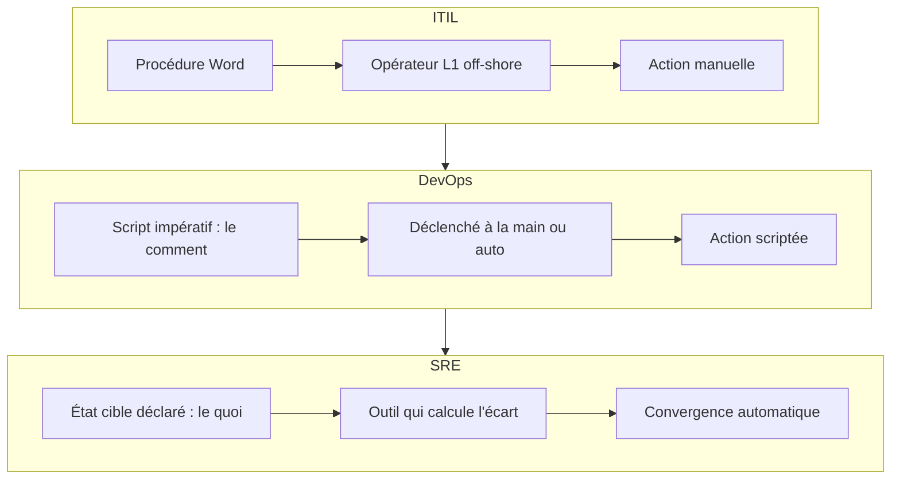
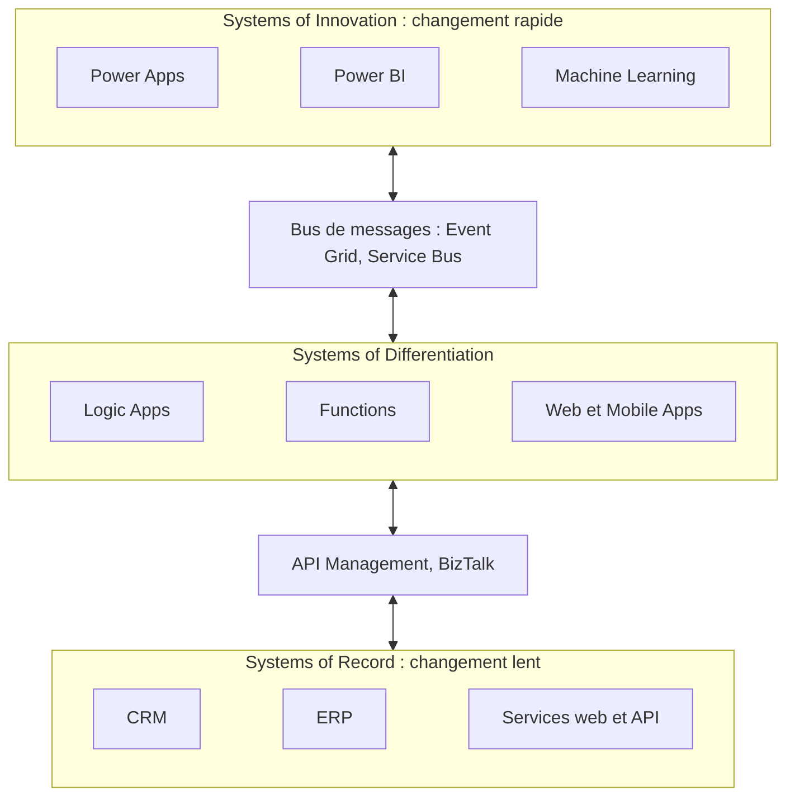

Une grand-mère et sa petite-fille devant le même ordinateur. Une barre HLM des années 70 à côté d'un immeuble neuf. Une calèche et une Peugeot 208. **Que vois-tu ?** Le même besoin (se loger, se déplacer, utiliser l'informatique) servi par **deux générations** différentes, qui coexistent au même moment. C'est l'idée de toute l'UE : l'IT, et donc l'architecture, avance par **générations de plateformes**, et un SI réel en mélange toujours plusieurs.

## Le cours en un coup d'œil

### Le programme

Le cours prolonge « Architecture Cloud » et « Architecture Cloud Native » avec une vue d'ensemble : les **plateformes** et leurs **générations**. Chaque génération est déroulée couche par couche : **compute**, **stockage**, **réseau**, sécurité et poste de travail (*workplace*).

| Bloc | Volume | Contenu |
| --- | --- | --- |
| Architecture | 3 h | Les générations de plateformes et d'architecture (cette session) |
| Platform 2 | 6 h | L'infrastructure (serveur, réseau, stockage) puis le middleware |
| Platform 3 | 6 h | Les principes d'architecture : conteneurs, 12-factor |
| Production | 3 h | Exploiter un SI : supervision, sauvegarde, environnements, ITIL |

<Callout type="tip" title="Le mot d'ordre">
  **Pose des questions !** Le support le répète dès l'agenda : le cours avance par échanges.
</Callout>

### People, process, technologies

L'IT, c'est trois ensembles qui bougent ensemble :

<CardGrid cols={3}>
  <Card kicker="People" title="Les personnes" tone="signal">Compétences, rôles, métiers.</Card>
  <Card kicker="Process" title="Les processus" tone="signal">Management, opérations.</Card>
  <Card kicker="Techno" title="Les technologies" tone="signal">Architecture, outillage.</Card>
</CardGrid>

Quand une **génération d'IT** change, les trois changent, et l'architecture avec : **génération IT ⇒ génération architecture**.

<KeyIdea>« On ne fait pas de l'IT aujourd'hui comme il y a 20 ans » : l'équation se complique d'une nouvelle composante, le temps (t).</KeyIdea>

## Platform 2 contre Platform 3

### Trois plateformes successives

Le modèle des « trois plateformes » (IDC) montre l'accélération : chaque plateforme multiplie les utilisateurs et les applications.

| Plateforme | Terminal et technologies | Utilisateurs | Applications |
| --- | --- | --- | --- |
| **1st platform** | Mainframe, mini-ordinateur, **terminal** | Des millions | Des milliers |
| **2nd platform** | LAN/Internet, client/serveur, **PC** | Des centaines de millions | Des dizaines de milliers |
| **3rd platform** | Mobile, cloud, big data, social : **terminaux mobiles** | Des milliards | Des millions |

« Accelerating pace of change » · Source : IDC, repris dans le support

La **Platform 2** du cours, c'est le monde du datacenter et de la virtualisation d'entreprise ; la **Platform 3**, celui du cloud.

### Trois glissements

<Steps>
1. **De « infrastructure based » à « application based ».** Ce n'est plus l'infrastructure qui porte les garanties, c'est l'application.
2. **De la redondance d'infrastructure à la résilience applicative.** On ne double plus chaque équipement : l'application sait survivre à la perte d'un composant.
3. **Des *pets* au *cattle*.** On passe des animaux de compagnie au troupeau.
</Steps>

<Compare leftTitle="Pets · Platform 2" rightTitle="Cattle · Platform 3">
  <Fragment slot="left">
    Les serveurs ont un **nom** (`pussinboots.cern.ch`).

    Ils sont **uniques**, élevés à la main avec amour.

    Quand l'un tombe malade, on le **soigne** jusqu'à ce qu'il guérisse.
  </Fragment>
  <Fragment slot="right">
    Les serveurs ont un **numéro** (`vm0042.cern.ch`).

    Ils sont **identiques** les uns aux autres.

    Quand l'un tombe malade, on en **prend un autre**.
  </Fragment>
</Compare>

Exemples du CERN · Source : support, « Service Model »

Les futures architectures applicatives devraient traiter leurs serveurs comme du bétail, avec une **gestion de configuration forte** et des serveurs **jetables** et **reconstruits** à la demande.

<DeepDive title="D'où vient « pets vs cattle » ?" level="approfondissement">
  L'analogie est attribuée à **Bill Baker** (Microsoft), à propos du *scale up* contre le *scale out* vers 2011-2012. **Randy Bias** l'a popularisée pour expliquer le cloud « ouvert » face à la virtualisation d'entreprise. Il précise une nuance qu'on oublie souvent : il ne s'agit pas de maltraiter les serveurs, mais de concevoir un système où **la perte d'un serveur n'est pas un incident**, parce que l'application est conçue pour y survivre.
</DeepDive>

### L'évolution des modèles de calcul

| | Mainframe « Big Iron » 1.0 | Client-serveur « Enterprise » 2.0 | Web « Cloud » 3.0 |
| --- | --- | --- | --- |
| **SLA** | Extreme uptime (99,999) | Designed for failover (99,9) | **Designed for failure** (always on) |
| **Scalabilité** | Verticale | ← Verticale · Horizontale → | Horizontale |
| **Matériel** | Expensive custom hardware | Expensive « commodity » hardware | **Cheap commodity hardware** |
| **Haute dispo** | Hardware HA | ← Hardware HA · Software HA → | Software HA |
| **Déploiement** | Centralisé | Décentralisé | **Distribué** |
| **Consommation** | Centralized service model | Shared service model | **Self-service model** |

Evolution of IT Computing Models · Source : support, Cours 1

Lis la dernière colonne de haut en bas : on accepte que le matériel tombe (il est bon marché), donc c'est le **logiciel** qui assure la haute disponibilité, en **distribuant** la charge horizontalement.

<Quiz question="Une application Platform 3 tourne sur du « cheap commodity hardware ». Comment peut-elle promettre d'être « always on » ?" options={['En achetant des serveurs plus fiables', 'En étant conçue pour la panne : du logiciel qui redistribue la charge sur des machines interchangeables', 'En doublant chaque serveur par un serveur de secours identique', 'Elle ne peut pas : always on exige du matériel spécifique']} answer={1}>
  **Designed for failure.** Le matériel bon marché tombe, c'est accepté : la haute disponibilité passe dans le **logiciel** (software HA) et la scalabilité devient **horizontale**. Doubler chaque serveur (réponse 3), c'est la logique Platform 2 de **redondance** d'infrastructure, *designed for failover* : elle marche, mais coûte cher et ne passe pas à l'échelle.
</Quiz>

### L'architecture applicative, génération par génération

Le même tableau de maturité que dans le cours d'Architecture Cloud, lu ici comme une progression de génération :

| | **Virtual 2 Virtual** · DC as a Service | **Virtual 2 Cloud** · Cloud-Ready | **Born 2 be Cloud** · Cloud-Based |
| --- | --- | --- | --- |
| **Principe** | Le cloud est vu comme un « virtual datacenter », sans transformation applicative | Les applications sont **reconçues** pour utiliser des briques de service cloud | Les applications sont **recodées** sur les briques de service cloud |
| **Compute** | « Virtual Machine », VM as a Service | « Instance compute », Auto Scaling group 1:1, scaling sur statistiques d'usage ou prédiction (VM éteintes la nuit) | « Pool d'instances », Auto Scaling group 1:n, scaling sur la **charge réelle**, piloté par l'application (*follow the sun*) |
| **Stockage** | Block | Object | Object |
| **Réseau** | VLAN et subnet /24, firewall dans la VM, network ACL | VLAN et subnet /21, security group | SDN, security group, réseau centré application |
| **Backup** | Intégré au plan de backup existant | Protection native des données (snapshots…) | Backup géré par l'application (journalisation intégrée) |
| **Monitoring** | Alerte puis traitement manuel | Alerte et prétraitement automatique | Alerte puis **destruction / reconstruction** automatique |
| **Patch** | Intégré au patch management existant | Rebuild mensuel | Continuous delivery |
| **Résilience et DRP** | Mono-AZ (un DC), DRP manuel | Dual-AZ mono-région, tâches de DRP automatisées | Multi-AZ multi-région, **test de DRP permanent** |
| **Déploiement** | Manuel | Automatisé (compute), user-data et outils type Puppet | Automatisé (compute, stockage, réseau), template de déploiement applicatif |
| **Exploitation** | Infogérance | DevOps | **NoOps** |
| **Middleware (DB…)** | Installé dans la VM | DBaaS | DBaaS |

<Figure caption="La ligne « Résilience & DRP » en action : fais tomber une AZ, puis une région">
  <AzFailure />
</Figure>

## Une IT à plusieurs vitesses

### Multi speed IT

Corollaire trivial : **l'IT a plusieurs vitesses**, donc à un instant T, **l'IT a plusieurs générations**, à l'instar des êtres vivants. La Platform 2 ne disparaît pas quand la Platform 3 arrive : elles cohabitent, et chaque grille de lecture du marché les nomme à sa façon.

| | Gen 1 | Gen 2 |
| --- | --- | --- |
| **Génération de plateforme** | Platform 2 | Platform 3 |
| **Mode de calcul** | Virtualisation d'entreprise | Cloud |
| **Management / opérations** | ITIL, infogérance, *outsourcing* | DevOps et SRE, *inner sourcing* |
| **Style Gartner** | System of Record | System of Differentiation / of Innovation |
| **Style Capgemini** | Cargos / yacht | Yacht / speedboat |
| **Make or buy ?** | Plutôt *buy* | Plutôt *make* |
| **IT bimodale** | Porte-avions | Avion de chasse |
| **L'infra…** | se « builde » | se « code » (*infrastructure as code*) |
| **Unité** | Composant | Service |

<DeepDive title="L'IT bimodale selon Gartner" level="approfondissement">
  Gartner a formalisé l'IT **bimodale** en 2014 : un **mode 1** prévisible, centré sur la fiabilité et l'existant (le porte-avions), et un **mode 2** exploratoire, centré sur l'agilité et l'expérimentation (l'avion de chasse). Le concept a été beaucoup critiqué pour avoir créé une IT « à deux classes » : la plupart des organisations cherchent aujourd'hui à **outiller le mode 1** avec les pratiques du mode 2 (automatisation, DevOps) plutôt qu'à les opposer. La lecture du cours, « plusieurs générations à l'instant T », reste la plus utile : c'est un constat, pas une organisation cible.
</DeepDive>

### Management et opérations : ITIL, DevOps, SRE

Trois façons d'opérer un SI, qui correspondent à trois générations :

<CardGrid cols={3}>
  <Card kicker="Platform 2" title="ITIL" tone="muted">
    **Procédure écrite**, exécutée **manuellement**, souvent *outsourcée* ou *off-shore*.

    Techno : ITSM + Word. People : L1, L2, L3.
  </Card>
  <Card kicker="Transition" title="DevOps" tone="signal">
    **Script** : du code **impératif**, le **comment**. Peut être lancé à la main ou automatiquement.

    Techno : scripts (PowerShell, Python…). People : L2, L3.
  </Card>
  <Card kicker="Platform 3" title="SRE" tone="synapse">
    **Template / state** : la **cible**, le **quoi**. Lancé automatiquement (vers le NoOps).

    Techno : Terraform, Ansible, « rules » Azure/AWS. People : L3.
  </Card>
</CardGrid>

<Quiz question="Un fichier Terraform décrit « 3 VM derrière un load balancer ». Une VM est supprimée par erreur. Que se passe-t-il au prochain apply ?" options={['Rien : le script a déjà été exécuté une fois', 'Terraform recrée la VM manquante pour revenir à l’état déclaré', 'Terraform crée 3 nouvelles VM en plus des 2 restantes', 'Il faut écrire une procédure de recréation']} answer={1}>
  **Il recrée la VM manquante.** C'est toute la différence entre le **quoi** (un état cible, côté SRE) et le **comment** (un script impératif, côté DevOps) : l'outil compare l'état réel à l'état déclaré et corrige l'écart. Un script impératif « crée 3 VM », lui, en aurait recréé 3 de plus (réponse 3) s'il ne vérifiait rien.
</Quiz>

<DeepDive title="Le SRE, plus qu'un outil déclaratif" level="approfondissement">
  Chez Google, qui a inventé le terme, le SRE est « ce qui arrive quand on demande à un ingénieur logiciel de concevoir une équipe d'exploitation » (Ben Treynor Sloss). Au-delà de l'automatisation, il repose sur des **SLO** (objectifs de niveau de service mesurés), un **budget d'erreur** (la part d'indisponibilité tolérée, qui arbitre entre vitesse de livraison et stabilité) et une règle : au plus **50 %** du temps d'un SRE en tâches opérationnelles manuelles (*toil*), le reste en ingénierie pour les faire disparaître.
</DeepDive>

## Les générations d'architecture

### Du monolithe à l'IoT

Chaque génération d'architecture naît d'une technologie d'échange et change la forme du système : d'un bloc unique à une constellation de machines.

<Pipeline steps={[
  { title: 'Monolithic', caption: 'Rise of the Web', detail: 'TCP/IP, IPC : un seul bloc qui fait tout.', tone: 'muted' },
  { title: 'RPC', caption: 'Rise of the Frameworks', detail: 'COM/DCOM, RMI, EJB, CORBA : quelques composants qui s’appellent à distance.', tone: 'signal' },
  { title: 'EAI', caption: 'Rise of the Middleware', detail: 'MOM, XML : un hub central relie les applications.', tone: 'signal' },
  { title: 'SOA', caption: 'Rise of the Services', detail: 'SOAP, ESB, JSON : des services branchés sur un bus.', tone: 'signal' },
  { title: 'IOT', caption: 'Rise of the Machines', detail: 'REST, cloud, mobile : une nuée d’objets et de services.', tone: 'synapse' },
]} />

### Cinq générations, deux critères

Une autre lecture (Jeremy Chone, BriteSnow) suit deux critères : l'**expérience utilisateur** et le **déploiement instantané**. Chaque génération a gagné sur l'un en perdant sur l'autre, jusqu'à la cinquième.

| Génération | Expérience utilisateur | Déploiement instantané | Où tourne le code |
| --- | --- | --- | --- |
| **1G** Mainframe | Faible | Élevé | 99 % serveur |
| **2G** Client/serveur | Élevée | Faible | 99 % client |
| **3G** Web 1.x | Moyenne | Élevé | Serveur |
| **4G** Mobile apps | Élevée | Moyen | Client (le grand public, aujourd'hui) |
| **5G** HTML5 et hybride | Élevée | Élevé | Les deux |

« 5 Generations of Software Architecture Evolution » · Source : Jeremy Chone, BriteSnow, repris dans le support

Le **Web 2.0** ouvrait une « opportunité » vers la 5G, que l'entreprise et le grand public ont rattrapée par des chemins différents (l'entreprise depuis le web, le grand public depuis les apps mobiles).

### SMACS

L'approche **SMACS**, présentée comme le futur de la transformation numérique, résume les briques de la Platform 3 :

<CardGrid cols={3}>
  <Card kicker="S" title="Social" tone="signal">Réseaux sociaux, outils collaboratifs, partage de documents, individus interconnectés.</Card>
  <Card kicker="M" title="Mobile" tone="signal">Hyperconnectivité (any time, any where, any device), terminaux et applications mobiles, peu de limites géographiques.</Card>
  <Card kicker="A" title="Analytique" tone="signal">Statistiques, big data, intelligence artificielle, algorithmes prédictifs.</Card>
  <Card kicker="C" title="Cloud" tone="signal">Données consultables partout, tout le temps ; travail à distance ; données sécurisées hors de l'entreprise.</Card>
  <Card kicker="S" title="Sécurité" tone="signal">Confidentialité et traitement des données, protection contre les intrusions.</Card>
</CardGrid>

## Les grilles de lecture de Gartner

### Prendre les modèles pour ce qu'ils sont

Les modèles qui suivent ont des nuances, des subtilités, des appellations et des détournements. La consigne du cours :

- **tirer les grandes lignes** (80 %) de ces modèles, ou de la représentation qu'on en trouve et interprète sur Internet ;
- même un modèle doit **itérer, mûrir, converger** ;
- tout part du **besoin** (le quoi), pour arriver à des **architectures** (le comment).

### System of Record, of Differentiation, of Innovation

Gartner découpe le SI en trois couches, qui n'évoluent pas au même rythme :

| | **Systems of Innovation** | **Systems of Differentiation** | **Systems of Record** |
| --- | --- | --- | --- |
| **Rôle** | Applications pour des activités nouvelles, innovantes | Processus propres à l'organisation ou à son secteur | Cœur administratif et transactionnel |
| **Focus** | Expérimental ; idée neuve, innovation de rupture | Différenciation business, engagement client ; critique | Moteur métier *mission-critical* |
| **Caractère** | Peu gouverné, changement rapide, **risque élevé** | Bien gouverné, rythme modéré, risque plus faible | Très gouverné, changement lent, **risque faible** |
| **Durée de vie** | Quelques mois à quelques années | Plusieurs années | **Des décennies** |
| **Moteur** | Nouvelles idées, menaces concurrentes | Meilleures idées, processus uniques | Efficacité, idées communes |

Les trois couches du SI · Source : Gartner, repris dans le support

L'histoire de l'informatique se lit aussi comme un passage des **Systems of Record** aux **Systems of Engagement** :

| Ère | Mainframe | Mini | PC | Internet | Social et cloud |
| --- | --- | --- | --- | --- | --- |
| **Années** | 1960-1975 | 1975-1992 | 1992-2001 | 2001-2009 | 2010-2015 |
| **Ce qu'on gère** | Une transaction batch | Un processus départemental | Un document | Une page web | **Une conversation** |
| **Entreprise phare** | IBM | Digital Equipment | Microsoft | Google | Facebook |
| **Gestion de contenu** | Mainframe | Image management | Document management | Content management | Social business systems |

Les trois premières ères produisent des **Systems of Record** ; les deux dernières, des **Systems of Engagement**.

### Du waterfall au « next »

La même progression, dimension par dimension (grille WealthGrid). La cible de la Platform 3, c'est la colonne **cloud native** :

| | Waterfall | Agile | **Cloud native** | Next |
| --- | --- | --- | --- | --- |
| **Culture** | Prédictive | Itérative | Collaborative | Expérimentale |
| **Conception** | Plan à long terme | Par fonctionnalités | Pilotée par la donnée | Tout piloté |
| **Équipe** | Hiérarchie | Équipes pluridisciplinaires | DevOps / SRE | Chaînes d'approvisionnement internes |
| **Processus** | Waterfall | Agile (Scrum, Kanban) | Design thinking + agile + lean | Distribué, auto-organisé |
| **Architecture** | Monolithe fortement couplé | Client-serveur | **Microservices** | Fonctions |
| **Maintenance** | Monitoring ad hoc | Alerting | Observabilité complète et auto-réparation | Maintenance prédictive, IA |
| **Livraison** | Releases périodiques | Intégration continue | **Livraison continue** | Déploiement continu |
| **Provisioning** | Scripté | Gestion de configuration (Puppet, Chef, Ansible) | **Orchestration** (Kubernetes) | Serverless |
| **Infrastructure** | Serveurs multiples | VM (*pets*) | **Conteneurs, cloud hybride (*cattle*)** | Edge computing |

Un exemple de mise en œuvre : les trois couches de Gartner projetées sur les services Azure, avec un **bus de messages** (Event Grid, Event Hubs, Service Bus, BizTalk) qui les traverse verticalement. En bas, les **Systems of Record** (CRM, ERP) exposés par services web et API ; au milieu, les **Systems of Differentiation** (Logic Apps, Functions, Web Apps, Mobile Apps) ; en haut, les **Systems of Innovation** (Power Apps, Power BI, Cognitive Services, Machine Learning). Le **rythme de changement** croît du bas vers le haut.

<Quiz question="Une banque veut moderniser son moteur de comptes (vieux de 30 ans) et lancer une app d'épargne gamifiée. Lequel des deux doit suivre un rythme de changement rapide et accepter un risque élevé ?" options={['Le moteur de comptes : c’est le plus vieux, il faut le changer vite', 'L’app gamifiée : c’est un System of Innovation', 'Les deux au même rythme, pour rester cohérent', 'Aucun : un SI bancaire ne prend jamais de risque']} answer={1}>
  **L'app gamifiée** est un **System of Innovation** : vie courte, changement rapide, risque élevé accepté. Le moteur de comptes est un **System of Record** : très gouverné, durée de vie en décennies. Le moderniser se fait, mais lentement et sans prise de risque. Vouloir tout faire au même rythme (réponse 3), c'est ignorer qu'un SI a **plusieurs vitesses**.
</Quiz>

### Les hype cycles

Gartner publie chaque année des **hype cycles** : la courbe des attentes autour d'une technologie, dans le temps. Le support en montre trois (Enterprise Architecture 2015, Enterprise Architecture 2020, Emerging Technologies 2020).

<Steps>
1. **Innovation trigger.** Une percée déclenche l'intérêt.
2. **Peak of inflated expectations.** Les attentes s'emballent.
3. **Trough of disillusionment.** Les premiers échecs déçoivent.
4. **Slope of enlightenment.** On comprend enfin à quoi elle sert vraiment.
5. **Plateau of productivity.** Elle devient un outil courant.
</Steps>

Chaque technologie y porte un délai estimé avant le plateau : moins de 2 ans, 2 à 5 ans, 5 à 10 ans, plus de 10 ans, ou obsolète avant le plateau.

<DeepDive title="Ce qu'un hype cycle ne dit pas" level="best-practice">
  La méthodologie de Gartner positionne les technologies selon la **visibilité** et les attentes, pas selon leur maturité technique mesurée. Toutes ne suivent pas la courbe jusqu'au bout : beaucoup disparaissent dans le creux. Bon usage pour un architecte : y lire **où en est le discours du marché** (méfiance au sommet, opportunités sur la pente), jamais une prévision.
</DeepDive>

## À retenir

<Takeaways>
1. **Génération IT ⇒ génération architecture.** People, process et technologies changent ensemble, et le temps entre dans l'équation.
2. **Platform 2 → Platform 3.** De l'infrastructure redondante à l'application résiliente, des *pets* au *cattle*, de la scalabilité verticale à l'horizontale.
3. **Un SI a plusieurs vitesses.** À un instant T, plusieurs générations cohabitent : System of Record, of Differentiation, of Innovation.
4. **ITIL, DevOps, SRE.** La procédure manuelle, le script impératif (le comment), puis l'état cible déclaré (le quoi).
5. **Des modèles, pas des vérités.** Tirer 80 % des tendances, partir du besoin (quoi) pour arriver à l'architecture (comment).
</Takeaways>
