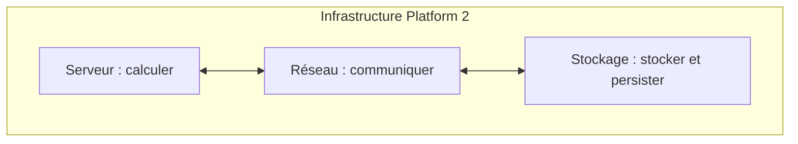
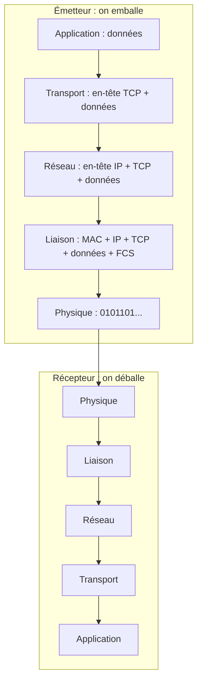
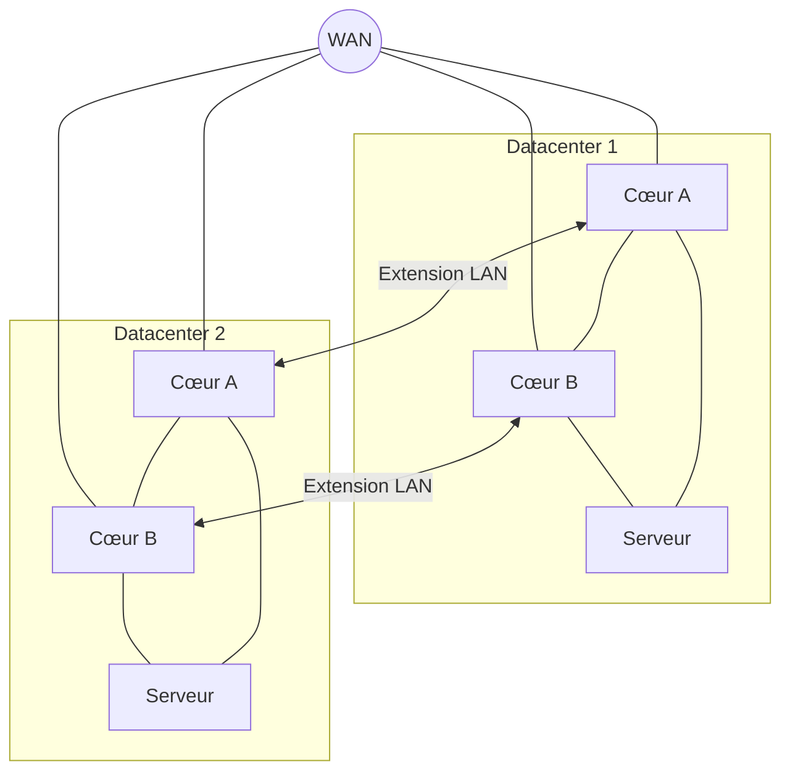
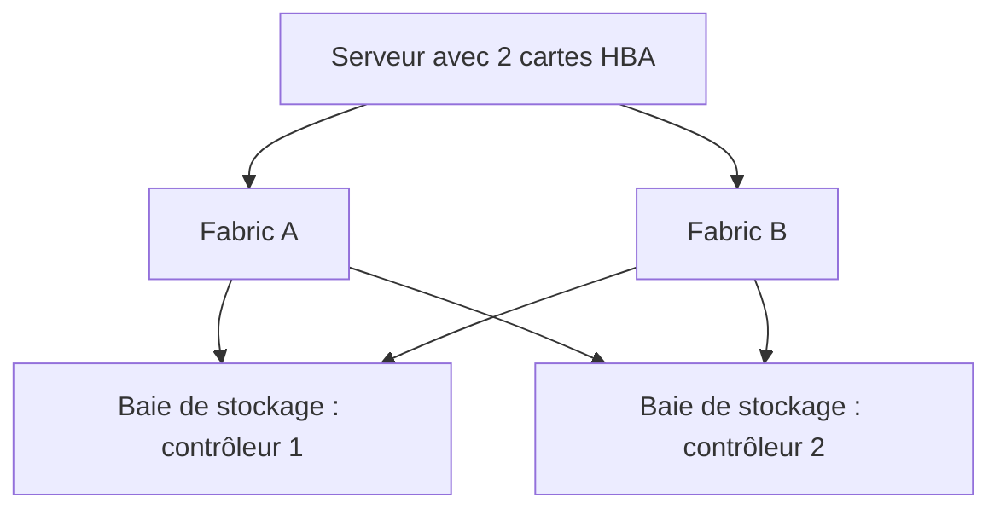
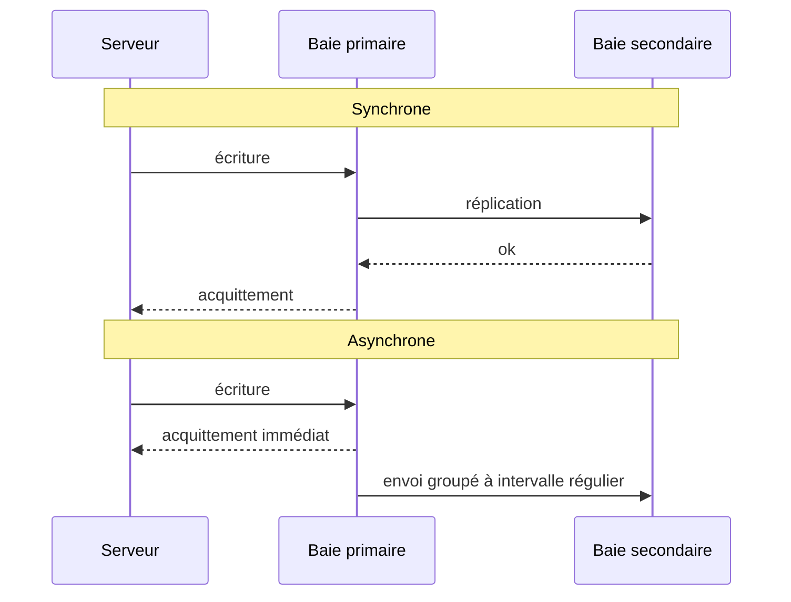

Une infrastructure, c'est trois verbes : **calculer**, **communiquer**, **stocker**. Cette session ouvre le capot de la **Platform 2**, celle du datacenter et de la virtualisation d'entreprise, pilier par pilier. C'est le socle que la Platform 3 va abstraire : pour comprendre ce que le cloud cache, il faut savoir ce qu'il y a dessous.

## Le serveur : calculer

### Les ingrédients

Un serveur est une **unité de calcul** (*compute*). Ses ingrédients :

- **CPU** : le calculateur ;
- **RAM** : la mémoire éphémère ;
- **I/O** (entrées/sorties) : le **stockage** (disque dur, ou pas, et/ou carte SAN) et le **réseau** (carte LAN, NIC).

La différence avec un PC ou un microcontrôleur d'IoT (Arduino) ? On peut en débattre, et le Raspberry Pi brouille la frontière.

### Grossir : scale out ou scale in

Comment augmenter la capacité de calcul ? Deux voies : **scale out** (ajouter des machines) ou **scale in** (grossir la machine). Les processeurs illustrent le passage de l'une à l'autre : la fréquence a buté sur la **limite du GHz** (le scale in), alors on a **multiplié les cœurs** (le scale out).

<Figure caption="Monte la charge, change de mode, puis fais tomber un serveur">
  <Scaling />
</Figure>

<DeepDive title="Scale in, scale up : attention au vocabulaire" level="approfondissement">
  Le cours dit **scale in** pour grossir une machine. Dans la documentation des clouds publics, on dit plutôt **scale up** (vertical, grossir) contre **scale out** (horizontal, ajouter des machines), et *scale in* désigne l'inverse du scale out : **retirer** des instances d'un groupe. Ne confonds pas les deux en lisant une doc AWS ou Azure.
</DeepDive>

### Trois gammes, cinq familles

Les serveurs se rangent en trois gammes : **entrée de gamme** (≈ x86), **milieu de gamme** (≈ Unix), **haut de gamme** (≈ gros système). Le CPU catégorise le serveur et la famille d'OS :

| CPU | x86 | Sparc | Power | Mainframe | Itanium |
| --- | --- | --- | --- | --- | --- |
| **Vendeurs** | HP, Dell, IBM, Cisco | Oracle | IBM, Bull | IBM, Fujitsu | HP |
| **OS** | Windows, Linux | Solaris, Linux | AIX, OS400, Linux | MVS | Windows, Linux, HP-UX |
| **Format** | Tour, rack, blade | Rack | Rack, armoire | Armoire | Tour, rack, blade, armoire |
| **Coût unitaire** | 10 k | 30 k | 30 k | 100 k | 30 k |
| **Marché** | +++ | −−− | − | − | −−− |
| **Usage** | Tout venant | Base Oracle | Base de données | Gros traitements | Base de données |

En annexe, le support détaille les familles :

- **x86** : la plus répandue, celle des serveurs « Wintel » et des PC ; Intel domine. Limite du GHz atteinte, d'où la multiplication des cœurs.
- **« Unix » / RISC**, une gamme en perdition : **Power** (IBM, pSeries et iSeries, ≈ AS400), **Sparc** (Sun puis Oracle), **PA-RISC** (HP), **Itanium** (Intel). Chaque grand constructeur avait « son » CPU.
- **Mainframe**, et **ARM** (IoT).
- **GPU** : le processeur de la carte graphique, pour la 3D et le **calcul intensif** (cassage de mots de passe, grilles de calcul métier : risque financier, météo, génome humain).

<Callout type="note" title="CISC, pas CICS">
  Le support écrit « architecture CICS » pour le x86 : il s'agit de **CISC** (*Complex Instruction Set Computer*), par opposition à **RISC**. CICS est un moniteur transactionnel IBM, qu'on croise dans la session sur le middleware.
</Callout>

### Saucissonner un serveur

Un serveur peut être découpé de l'intérieur, du cloisonnement le plus fort (isolation matérielle) au plus faible (mutualisation matérielle). L'analogie du logement :

<Steps>
1. **Standalone** : un serveur tout seul. Une **maison**.
2. **Partition physique** : un CPU alloué à une partition. Un **appartement** : du commun (escaliers, ascenseur, parking) et du dédié (l'appartement, la place de parking). Cloisonnement **électrique** : un mur porteur, qu'on peut casser, mais c'est long et compliqué.
3. **Partition logique** : un CPU alloué, mais facilement changeable. Une **salle de cours modulable**.
4. **Machine virtuelle** : le temps CPU et les I/O sont partagés entre les VM, rien n'est dédié. Une **colocation d'étudiants**.
5. **Conteneur** : la super virtualisation (Platform 3).
6. **Process / thread** : *Inception*, une colocation dans un appartement, une colocation dans une maison…
</Steps>

<Figure caption="Choisis un niveau de cloisonnement : qu'est-ce qui reste dédié, que gagne-t-on en agilité ?">
  <Partitioning />
</Figure>

| CPU | x86 | Sparc | Power | Mainframe | Itanium |
| --- | --- | --- | --- | --- | --- |
| **VM** | VMware, Hyper-V | Zones | PowerVM | Hyperviseur | HP VM |
| **Cloisonnement physique** | Non | Non | ? | Oui | nPar |
| **Cloisonnement logique** | Non | Zones (partagent le noyau) | lPar | Sûrement | vPar |
| **Conteneur** | Docker… | | | Si Linux | |

<KeyIdea>Choisis le cloisonnement selon le besoin d'isolation (fort, moyen, faible) et d'agilité : plus le cloisonnement est faible, plus l'agilité est grande.</KeyIdea>

### La virtualisation

Le constat de départ : une machine x86 est utilisée **5 % du temps**. La capacité dépasse de loin le besoin, et l'OS est incapable d'assurer le cloisonnement (c'est pourtant son rôle…). La virtualisation apporte :

<CardGrid cols={3}>
  <Stat value="1 h" label="pour un serveur" hint="contre 3 mois pour un serveur physique : l'agilité" />
  <Stat value="40:1" label="consolidation" hint="40 VM par hôte physique : 2 500 serveurs dans une armoire, un petit SI du CAC 40" />
  <Stat value="5 %" label="d'utilisation" hint="d'une machine x86 non virtualisée" />
</CardGrid>

- **Agilité** : déplacement à chaud d'un serveur d'un hôte vers un autre.
- **Consolidation** : 40 VM pour un hôte.
- **Standardisation** : le matériel est abstrait.
- **Sécurité** : meilleur uptime (vMotion, HA, DRP).

<KeyIdea>Le conteneur, c'est le principe de la virtualisation poussé à l'extrême et allégé. Conteneur = Platform 3.</KeyIdea>

### Formats et usages

| Format | Tour | Rack | Blade | Armoire | Cartouche |
| --- | --- | --- | --- | --- | --- |
| **Avantage** | Autonome, pas de *facilities* | Standard | Haute densité | Monolithique | Très haute densité |
| **Emplacement** | Petit site (agence bancaire, magasin) | Petit site, siège | Siège, datacenter | Datacenter | Datacenter |
| **Densité** | Faible | Moyenne | Haute | Faible | Très haute |
| **Standardisation** | ++ | +++ | + | | + |
| **Inconvénient** | Taille | | Haute densité : électricité, poids, chaleur | | |
| **Usage** | Infrastructure de site distant | Tout venant | Cloud, virtualisation | Gros calcul | VDI, grille |
| **Serveurs par rack** | 4 | 42 | 64 | 1 | 450 |
| **Scale** | In | In / out | Out | In | Out |

### Synthèse

Le choix du format et de l'OS dépendra :

- du type de **workload** (scale out ou scale in) ;
- de la **compatibilité descendante** (legacy) ;
- des besoins en **performance** ;
- de la **culture d'entreprise** (Unix contre x86) et des compétences des équipes.

Le **x86 domine le marché**, a écrasé l'Unix, mais peut se faire challenger par l'**ARM**. Et rappel : **haute dispo ⇒ cluster**.

<DeepDive title="L'ARM dans le datacenter" level="état-de-l-art">
  Le challenger annoncé est arrivé. AWS conçoit ses propres processeurs ARM, **Graviton**, et met en avant un meilleur rapport prix/performance et une consommation d'énergie plus faible que des instances x86 comparables. Les autres clouds ont suivi avec leurs propres puces ARM. Pour une application interprétée ou compilée pour plusieurs architectures (Java, Python, Go, conteneurs multi-arch), la bascule est souvent un simple changement de type d'instance ; pour un binaire x86 legacy, c'est un portage.
</DeepDive>

<Quiz question="Une banque fait tourner sa base Oracle critique sur Sparc depuis 15 ans, avec une équipe Solaris expérimentée. Le nouveau directeur veut tout passer en x86 « parce que le marché est +++ ». Quel critère du support pèse contre une migration immédiate ?" options={['La densité des serveurs par rack', 'La compatibilité descendante et la compétence des équipes', 'Le prix au port réseau', 'Le fait que x86 ne sait pas faire tourner Oracle']} answer={1}>
  **Le legacy et les compétences.** Le format et l'OS dépendent aussi de la **compatibilité descendante** et de la **culture d'entreprise** (Unix contre x86). La dynamique du marché pousse vers x86, mais elle ne suffit pas à justifier un changement à court terme. Oracle tourne très bien sur x86 (réponse 4) : ce n'est pas le blocage.
</Quiz>

## Le réseau : communiquer

### À quoi ça sert

Le réseau sert à **échanger des 0 et des 1 d'un point A à un point B**, à plusieurs. Le parallèle avec les réseaux qui transportent les humains ou le courrier est constant dans ce chapitre.

Ses problématiques :

- l'**étendue** (LAN, MAN, WAN) : aller du KB (Kremlin-Bicêtre) à Villejuif, ce n'est pas aller à Marseille ou à Los Angeles ;
- le **débit** (Mbit/s) ;
- la **latence** (ms).

Trois architectures possibles : **point à point** (l'avion), **boucle** (≈ l'autoroute), **réseau** (la route). Le **modèle OSI** date des années 70, il a près de 50 ans. Concept important : l'**adresse unique** (URL, MAC, IP, IP + port).

### L'encapsulation

Principe fondamental : chaque couche ajoute son en-tête à ce que lui confie la couche du dessus, et chaque couche **dialogue avec son homologue** de l'autre côté. Comme un déménagement : les affaires vont dans des cartons, les cartons dans un camion, et on déballe dans l'ordre inverse à l'arrivée.

### Unicast, multicast, broadcast

<CardGrid cols={3}>
  <Card kicker="A → B" title="Unicast" tone="signal">Le **courrier**. Quasiment toutes les communications sont en unicast.</Card>
  <Card kicker="A → un groupe" title="Multicast" tone="signal">La **pub dans la boîte aux lettres** d'un quartier. Grilles de calcul, postes de traders.</Card>
  <Card kicker="A → tout le monde" title="Broadcast" tone="amber">La **télé**, la **radio**. En informatique : DHCP, webcasts vidéo. Pose des problèmes de **boucles**.</Card>
</CardGrid>

### Ethernet, IP, TCP et UDP

| Protocole | Rôle | L'analogie du courrier | À retenir |
| --- | --- | --- | --- |
| **Ethernet** | **Distribution** de paquets | Le facteur à vélo dépose le courrier dans la boîte aux lettres | Ne supporte ni les boucles ni le multichemin |
| **IP** | **Routage** de paquets | Le facteur en voiture dépose le courrier du quartier | Supporte les boucles (grâce au TTL) et le multichemin |
| **TCP / UDP** | **Transport** d'un point A à un point B | L'envoi de bout en bout | Avec (TCP) ou sans (UDP) accusé de réception |

- **TCP** quand l'**intégrité** prime sur la vitesse : e-mail, document…
- **UDP** quand la **vitesse** prime sur l'intégrité : jeu vidéo, vidéo.

<KeyIdea>Rappel : on doit toujours faire un choix entre performance, intégrité et disponibilité.</KeyIdea>

<DeepDive title="QUIC : la fiabilité au-dessus d'UDP" level="état-de-l-art">
  La frontière « TCP = fiable, UDP = rapide » s'est déplacée. **QUIC** (RFC 9000, 2021), le transport de **HTTP/3**, tourne sur **UDP** mais réimplémente au-dessus la fiabilité, le contrôle de congestion et le chiffrement (TLS 1.3 intégré). Pourquoi ? Pour supprimer le blocage en tête de file de TCP (un paquet perdu bloque tous les flux), accélérer l'établissement de connexion et survivre à un changement de réseau (Wi-Fi vers 4G). Le choix performance / intégrité reste vrai, mais il se fait de plus en plus **dans l'application** plutôt que dans le protocole.
</DeepDive>

### LAN, MAN, WAN et VLAN

L'étendue se lit sur l'adresse de l'EPITA, 14-16 rue Voltaire, 94270 Le Kremlin-Bicêtre :

<CardGrid cols={3}>
  <Card kicker="Rue Voltaire" title="LAN" tone="signal">Le réseau local : un bâtiment, un campus.</Card>
  <Card kicker="Le Kremlin-Bicêtre" title="MAN" tone="signal">Le réseau métropolitain : une ville.</Card>
  <Card kicker="France" title="WAN" tone="signal">Le réseau étendu : un pays, le monde.</Card>
</CardGrid>

Un **VLAN** (couche 2) découpe logiquement un LAN physique : sur les mêmes switchs, le service Ingénierie, le Marketing et la Comptabilité ne se voient pas. Un **subnet** (couche 3) découpe l'adressage IP (`192.168.0.0/24`, `192.168.1.0/24`) ; un routeur relie les subnets. **Subnet (L3) ≈ VLAN (L2)** : en règle générale, **un seul subnet par VLAN**.

En annexe, le support compare les LAN selon leur contexte :

| | SOHO | Campus | Datacenter |
| --- | --- | --- | --- |
| **Prix au port** | 1 € | 10 € | 1 000 € |
| **Fournisseurs** | Netgear | HP, Cisco | Cisco, HP, Juniper |
| **Attachements par serveur** | 1 | 1 | 2, 4 |
| **Fonctionnalités** | | NAC, spanning tree, VLAN | Teaming, haute dispo, NAC, spanning tree, modules (firewall, load balancer, IPS), miroir, VLAN… |

### La haute dispo du réseau

La règle est simple et chère : **redonder tous les équipements et construire deux réseaux**. Chaque serveur est attaché deux fois, chaque switch, routeur et lien a son jumeau, jusqu'aux deux datacenters reliés entre eux.

### Les services IP

| Service | Rôle |
| --- | --- |
| **NTP** | Serveur de temps (l'horloge) |
| **DNS** | FQDN ↔ IP (l'annuaire) |
| **DHCP** | Adressage IP dynamique |
| **Firewall** | Filtrage L3/L4 |
| **WAF** | Filtrage L7 (injection SQL, antivirus, antispam…) |
| **Next-gen firewall** | QoS Skype/Citrix, VIP, firewall identitaire |
| **Proxy / reverse proxy** | Passerelle L7 HTTP |
| **VPN** | *Virtual Private Network* |

### Le load balancer

Objectif : **équilibrer la charge** et assurer le **fail over**. C'est le **point d'entrée** des services des datacenters. Ce qu'il sait faire :

- des **poids** (30 %/70 %, 99 %/1 %, A/B testing) et des règles avancées ;
- du **logging**, de l'**authentification**, une page « maintenance » ;
- de l'**anti-DDoS** et du **cache** ;
- du **(dé)chiffrement SSL** : il faut bien inspecter les flux, et les chiffrer.

Deux portées : le **local load balancing** (deux DC, ou un dual-DC) et le **global load balancing** (mondial, avec géolocalisation).

<Quiz question="Une application doit tester une nouvelle version sur 1 % des utilisateurs avant de la généraliser. Quel équipement du support le permet sans toucher au code ?" options={['Le DHCP', 'Le load balancer, avec des poids 99 %/1 %', 'Le NTP', 'Un VLAN dédié']} answer={1}>
  **Le load balancer.** Ses **poids** (99 %/1 %, A/B testing) envoient une petite part du trafic vers la nouvelle version. Un VLAN (réponse 4) isole un réseau, il ne répartit pas du trafic applicatif entre deux versions.
</Quiz>

### Le SDN

Le **Software Defined Network** fait porter l'intelligence par un **contrôleur central** : le switch devient banalisé. Le pilotage est accessible aux **applications** (Skype, Citrix…), qui peuvent par exemple ouvrir automatiquement un flux dans le firewall, configurer la QoS ou activer l'enregistrement vidéo. C'est ce qui rend possible le « réseau centré application » de la Platform 3.

## Le stockage : stocker et persister

### La donnée et ses usages

Réseau ou stockage, c'est toujours la même problématique : **un déplacement de données** entre un client et un support. Trois usages des 0 et des 1 :

<CardGrid cols={3}>
  <Card kicker="Persister" title="Stockage" tone="signal">Garder la donnée, contrairement à la RAM qui l'oublie.</Card>
  <Card kicker="Redonder" title="Sauvegarde" tone="signal">**Copier** la donnée pour la restaurer plus tard si besoin. Finalité : la **restauration**.</Card>
  <Card kicker="Déplacer" title="Archivage" tone="signal">**Déplacer** la donnée pour décharger le système principal (ranger le courrier) et l'empêcher d'être modifiée. Finalité : la **consultation**.</Card>
</CardGrid>

Capacité : Mo, Go, To… (attention, octets et bits). Les unités de performance se lisent comme une **autoroute** :

| Unité | Ce qu'elle mesure | Sur l'autoroute | Exemple |
| --- | --- | --- | --- |
| **IOPS** | Densité d'I/O | Le nombre de voies en parallèle | 100 IOPS |
| **Latence** | Le temps d'un aller-retour | Le temps d'aller-retour | 3 ms |
| **Bloc** | La taille d'une I/O | La taille du camion | 4 Ko, 1 Mo |
| **Débit** | Quantité × temps | Ce qui passe par seconde | 40 Mo/s |

On distingue enfin les **lectures** (R) et les **écritures** (W).

### Séquentiel ou aléatoire

| | Séquentiel | Aléatoire |
| --- | --- | --- |
| **Exemples** | Flux vidéo lu ou écrit (film, musique), sauvegarde full | Sauvegarde incrémentale ou différentielle, transactionnel (base de données, web) |
| **Média de prédilection** | Bande, optique, disque dur | Flash, SSD, disque dur |
| **Taille de bloc** | 1 Mo | 4 Ko |
| **Dans la vie** | Le train | La voiture sur l'autoroute |

### Block, file, object

| | Block | File | Object |
| --- | --- | --- | --- |
| **Type** | SAN, DAS | NAS | Object |
| **Protocoles** | iSCSI, FC, FCoE | CIFS, NFS | HTTP (REST, SOAP) |
| **Service** | *Raw device* | Espace de stockage de fichiers | Bibliothèque de fichiers avec métadonnées |
| **Usages** | Transactionnel : OS, binaires, fichiers de données applicatives | Partage de fichiers (bureautique), machines virtuelles, base de données | Fichiers personnels : photos, vidéos, e-mails |

Plus on monte de block à object, plus le stockage prend en charge de couches : le **block** s'arrête au RAID, le **file** gère aussi les métadonnées, l'**object** va jusqu'aux *data services*. Et les technologies se rangent selon deux axes :

<CardGrid cols={2}>
  <Card kicker="Non structuré · dynamique" title="NAS" tone="signal">Fichiers bureautiques.</Card>
  <Card kicker="Non structuré · statique" title="Object" tone="synapse">Photos, vidéos, archives. C'est le stockage de la **Platform 3**.</Card>
  <Card kicker="Structuré · dynamique" title="SAN et DAS" tone="signal">Transactions (ERP, CRM).</Card>
  <Card kicker="Structuré · statique" title="SAN et DAS" tone="signal">BI, data warehousing.</Card>
</CardGrid>

### DAS, NAS, SAN

Tout se joue sur le réseau entre le client (carte LAN/SAN, port USB, port SATA) et la baie de stockage ou le disque :

<CardGrid cols={3}>
  <Card kicker="Point à point · block" title="DAS" tone="signal">Le **disque dans le client** (USB, SATA…).</Card>
  <Card kicker="Réseau IP · file" title="NAS" tone="signal">Un **serveur de fichiers** distant, accessible par le LAN.</Card>
  <Card kicker="Réseau FC · block" title="SAN" tone="signal">Un **réseau de stockage** dédié, en Fibre Channel.</Card>
</CardGrid>

Le **SAN** relie les serveurs (par une carte **HBA**) aux baies de stockage, sur un réseau **FC** (le protocole de transport, le « code de la route ») organisé en **fabrics**. Par construction, le SAN est **dual-fabric** : le client a conscience de tous les chemins possibles vers les baies.

### Les fonctionnalités d'une baie

- **Classes** de disques : SSD, HDD (RAID 10 de 300 Go, RAID 7D+2P de 4 To).
- **Dynamic tiering** : changer de classe à chaud, avec un algorithme qui détecte les flux aléatoires et séquentiels.
- **Compression**.
- **Déduplication** : ne pas stocker deux fois la même chose. **40:1** sur des sauvegardes, **100:1** sur de la VDI…
- **Thin provisioning** : du surbooking, on promet plus que ce qu'on a.
- **Snapshot** : une photo des données pour revenir en arrière.
- **Clone** : copie locale des données, pour une sauvegarde par exemple.
- **Réplication** : redondance des données sur un campus ou à distance.

### Les médias de stockage

| | Disque dur | SSD | Bande magnétique | Optique |
| --- | --- | --- | --- | --- |
| **Workload** | Aléatoire, séquentiel | Aléatoire | Séquentiel | Séquentiel |
| **Prix au Go** | 30 cts | 50 cts | 5 cts | 5 cts |
| **Transportable** | Non | Non | Bien | Bien |
| **Durée de vie** | 5 ans | 5 ans | 10-20 ans | 10 ans |
| **Temps moyen d'accès** | Millisecondes | Microsecondes | Heures, jours | Heures, jours |
| **Électricité** | Oui | Oui | Non | Non |
| **Usage** | Transactions faibles | Transactions fortes | Sauvegarde, archivage | Sauvegarde, archivage |

### Le RAID

Comment se prémunir de la panne d'un disque dur ou d'un SSD ? Par le **RAID**, en choisissant entre **performance et disponibilité**. Le support montre le RAID 0, 1, 5, 6 (« 7D+2P ») et 10.

<Figure caption="Choisis un niveau de RAID, puis clique sur les disques pour les faire tomber">
  <Raid />
</Figure>

<DeepDive title="D'où vient le RAID ?" level="approfondissement">
  Le terme vient d'un rapport de Berkeley de 1987 (Patterson, Gibson, Katz) : « *Redundant Arrays of **Inexpensive** Disks* ». L'idée était déjà celle du *cattle* : remplacer un gros disque cher par plusieurs petits disques bon marché, et compenser leur moins bonne fiabilité par la **redondance** (miroir ou parité). Les industriels ont ensuite préféré lire « *Independent* ». La leçon pour la Platform 3 est la même : le matériel bon marché tombe, c'est l'organisation des données qui assure la disponibilité.
</DeepDive>

<Quiz question="Une base transactionnelle très sollicitée en écriture doit survivre à la perte d'un disque. Entre RAID 5 et RAID 10, lequel privilégier et à quel prix ?" options={['RAID 5 : plus de capacité utile et meilleures écritures', 'RAID 10 : meilleures écritures, mais la moitié de la capacité', 'RAID 0 : c’est le plus rapide', 'Aucun : le RAID ne protège que les lectures']} answer={1}>
  **RAID 10.** Il écrit chaque bloc en miroir, sans calcul de parité : les écritures restent rapides, au prix de **la moitié de la capacité**. Le RAID 5 offre plus de capacité utile (tous les disques sauf un), mais chaque écriture recalcule la parité, ce qui le pénalise sur un workload transactionnel. Le RAID 0 (réponse 3) est le plus rapide, mais ne survit à aucune panne.
</Quiz>

### La réplication : synchrone ou asynchrone

Pour la haute dispo du stockage, on **réplique** une baie primaire vers une baie secondaire. Tout tient au moment de l'**acquittement** de l'écriture :

<Compare leftTitle="Synchrone" rightTitle="Asynchrone">
  <Fragment slot="left">
    Le serveur n'est acquitté qu'une fois la donnée écrite **sur les deux baies**.

    Aucune perte de données en cas de sinistre, mais chaque écriture attend l'aller-retour vers le site secondaire : la **distance** devient le facteur limitant.
  </Fragment>
  <Fragment slot="right">
    Le serveur est acquitté **dès l'écriture sur la baie primaire** ; les données partent vers le secondaire à intervalle régulier.

    Pas de pénalité de latence, mais les dernières écritures peuvent être **perdues** en cas de sinistre.
  </Fragment>
</Compare>

Comment architecturer une redondance de stockage ? Deux questions :

<Steps>
1. **Quel est ton existant ?** L'interconnexion entre DC (WAN MPLS ? fibre noire ?) et la **distance** entre eux.
2. **Quel est ton besoin ?** Un **RTO / RPO à 0** ? C'est ce qui décide du **synchrone ou de l'asynchrone**.
</Steps>

Le support illustre le tout par une architecture réelle sur quatre sites (Arc-20, Arc-30, Saint-Denis, Bordeaux) : réplication **synchrone** entre les deux sites proches (Arc-20 et Arc-30), **asynchrone** vers les sites lointains.

<Quiz question="Deux datacenters sont séparés de 600 km. L'entreprise exige un RPO à 0 pour sa base critique. Quel est le problème ?" options={['Aucun : il suffit d’activer la réplication asynchrone', 'Le RPO à 0 impose du synchrone, et à 600 km chaque écriture attend l’aller-retour : la latence devient pénalisante', 'Le RPO à 0 interdit toute réplication', 'Il faut passer en RAID 0']} answer={1}>
  **Le synchrone ne passe pas bien la distance.** Un RPO à 0 (aucune perte) exige que chaque écriture soit acquittée sur les deux sites, donc d'attendre l'aller-retour à chaque fois. D'où l'architecture classique du support : synchrone entre deux salles proches, asynchrone vers un site lointain. L'asynchrone (réponse 1) ne garantit pas le RPO à 0.
</Quiz>

## À retenir

<Takeaways>
1. **Trois piliers.** Serveur (calculer), réseau (communiquer), stockage (persister) ; dans tous les cas, des données qui se déplacent.
2. **Cloisonnement contre agilité.** De la partition physique au conteneur, on perd en isolation ce qu'on gagne en agilité ; la virtualisation consolide des serveurs utilisés à 5 %.
3. **Le réseau, c'est le courrier.** Encapsulation, Ethernet distribue, IP route, TCP garantit, UDP va vite ; la haute dispo, c'est tout redonder.
4. **Block, file, object.** SAN/DAS en block, NAS en file, object pour la Platform 3 ; séquentiel (le train) ou aléatoire (la voiture).
5. **Performance contre disponibilité.** RAID pour la panne d'un disque, réplication synchrone ou asynchrone selon la distance et le RPO.
</Takeaways>
