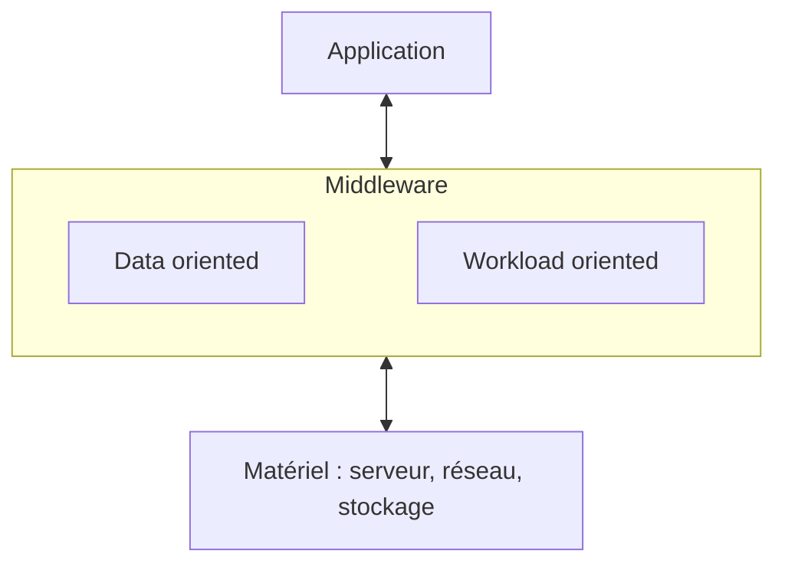
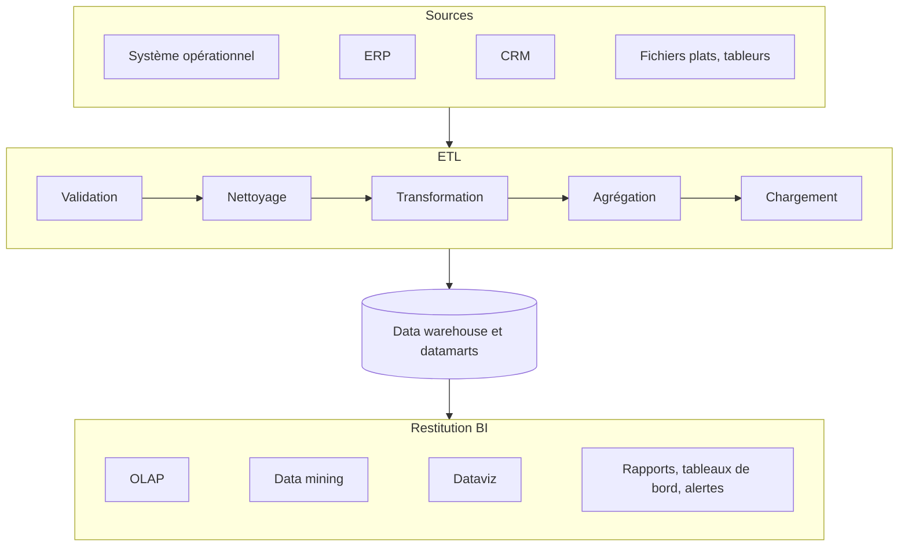
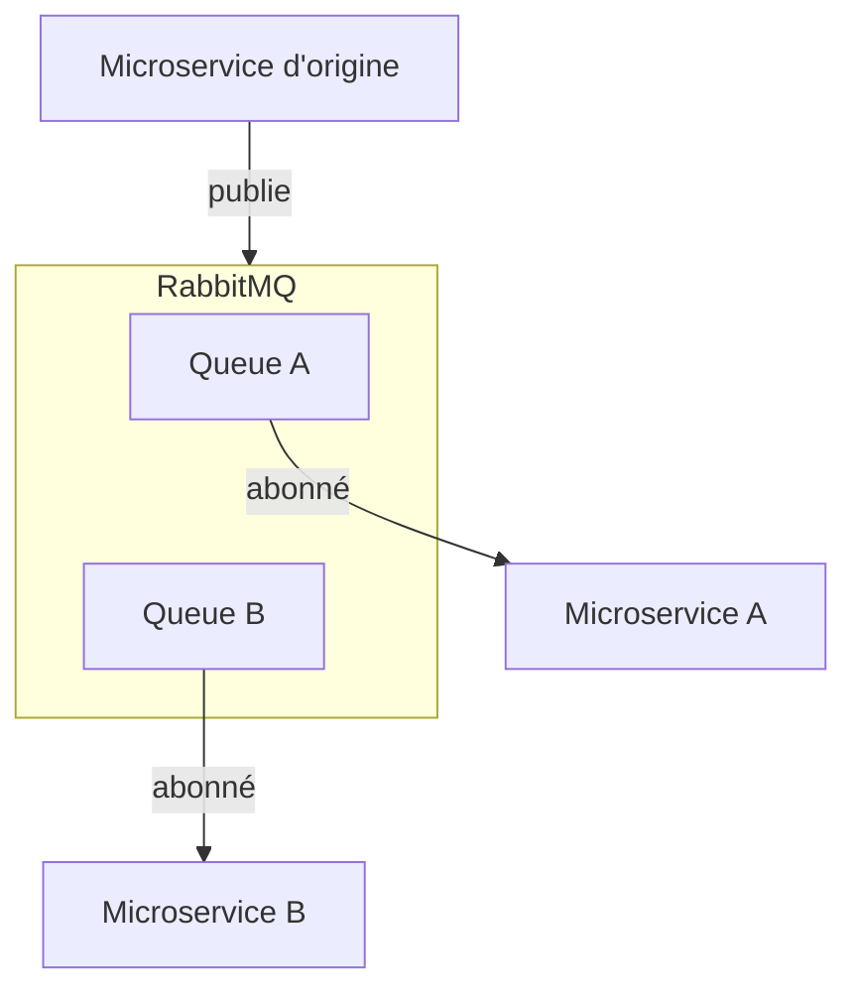
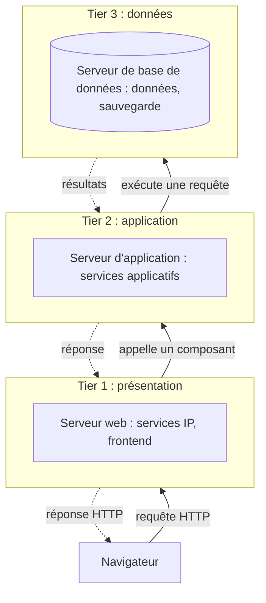
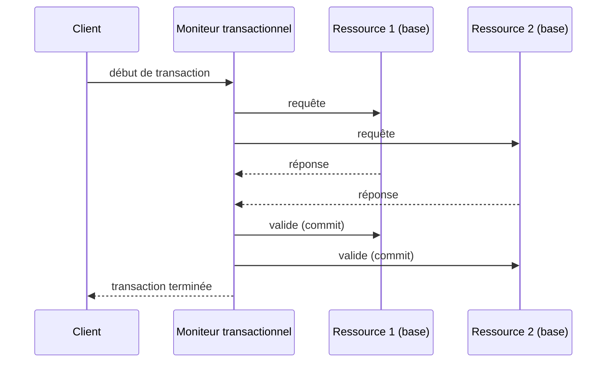
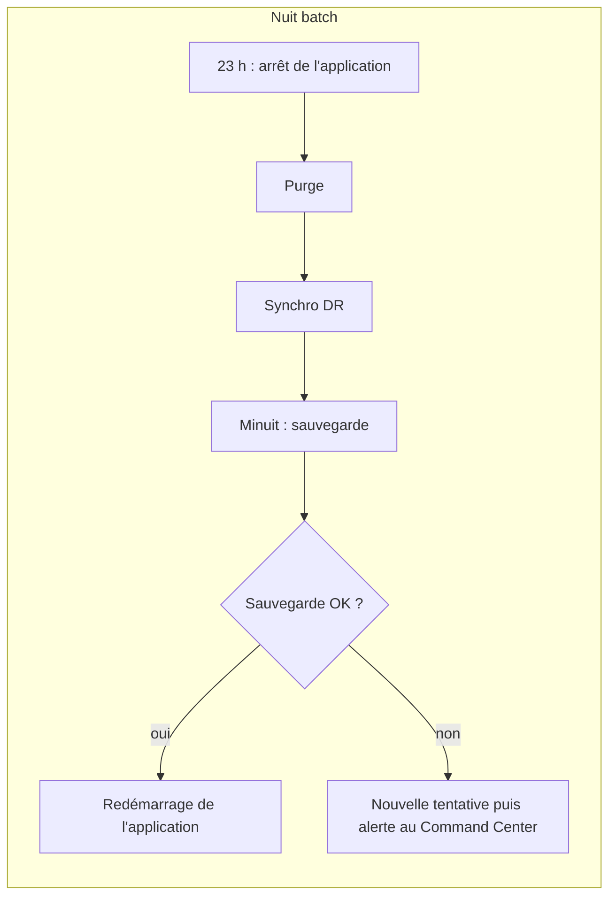

Entre le serveur et l'application, il y a toute une famille de logiciels qu'on ne voit jamais à l'écran mais sans lesquels rien ne tourne : bases de données, files de messages, serveurs d'application, bus d'intégration, ordonnanceurs. C'est le **middleware**. Cette session en fait le tour, tel qu'on le trouve dans un SI Platform 2, en repérant au passage ce que la Platform 3 va remplacer.

## Qu'est-ce qu'un middleware ?

<Callout type="definition" title="Middleware">
  Un **médiateur** : une famille de logiciels située entre le **matériel** (*hardware*) et le **logiciel** applicatif (*software*). Il reçoit une requête, la fait traiter par l'application et rend la réponse.
</Callout>

La frontière est **floue**, à l'appréciation des entreprises et des architectes : pour certains, les middlewares sont de l'**infra**, pour d'autres, de l'**application**.

<CardGrid cols={2}>
  <Card kicker="Faire circuler et garder la donnée" title="Data oriented" tone="signal">
    - Base de données (SGBDR et NoSQL)
    - ETL
    - MOM (middleware orienté message)
    - Transfert de fichiers
    - Partage de fichiers
  </Card>
  <Card kicker="Exécuter les traitements" title="Workload oriented" tone="signal">
    - Serveur web
    - Serveur d'application
    - Moniteur transactionnel
    - EAI / ESB
    - Orchestrateur et planificateur
  </Card>
</CardGrid>

## Data oriented

### La base de données

Son rôle : **stocker**, **donner accès** et **requêter** des données. Deux grandes familles :

<Compare leftTitle="SGBDR (RDBMS)" rightTitle="NoSQL (Platform 3)">
  <Fragment slot="left">
    Bases **relationnelles** : des tableaux, comme dans Excel, interrogés en **SQL**.

    Oracle DB, Microsoft SQL Server, PostgreSQL, MySQL.
  </Fragment>
  <Fragment slot="right">
    *Not only SQL* : d'autres formats de stockage, comme le **clé-valeur** (une hashtable) ou l'**objet** (LDAP).

    MongoDB, Cassandra, Couchbase.
  </Fragment>
</Compare>

Et d'autres choses servent aussi de base de données : Hadoop, S3… et le fichier Excel.

### ACID, et ses limites

<Callout type="definition" title="ACID">
  Les quatre garanties d'une transaction **totalement consistante** : **A**tomique, **C**ohérente, **I**solée, **D**urable.
</Callout>

L'ACID est un modèle « parfait », mais **limité en performance en mode distribué** (à l'échelle). Le modèle **partiellement consistant** des bases NoSQL (Platform 3) fait un autre choix, entre **performance et consistance** : il est impossible d'assurer à la fois la **cohérence**, la **disponibilité** et la **tolérance au partitionnement** (la panne réseau). On n'en garantit que deux.

| Couple choisi | Ce qu'on sacrifie | Exemples du support |
| --- | --- | --- |
| **C + A** | La tolérance au partitionnement | SGBDR |
| **C + P** | La disponibilité | Bigtable, HBase, Hypertable, Megastore, Spanner, Accumulo |
| **A + P** | La cohérence | Dynamo, Riak, Voldemort, Cassandra, CouchDB |

Classement du triangle de Nathan Hurst, repris dans le support

<DeepDive title="« ACP » : CAP d'un côté, BASE de l'autre" level="approfondissement">
  Le support titre « ACID vs ACP ». Deux notions sont en fait mêlées. Le triangle cohérence / disponibilité / partitionnement est le **théorème CAP** (Eric Brewer, 2000), que tu retrouves dans la session 2 d'Architecture logicielle. Et l'opposé d'ACID, côté NoSQL, s'appelle **BASE** : *Basically Available, Soft state, Eventually consistent* (Dan Pritchett, eBay, 2008). Une base BASE reste disponible, accepte des états intermédiaires et devient cohérente **à terme**. Nuance moderne : le choix n'est pas binaire, beaucoup de bases NoSQL proposent un niveau de cohérence réglable requête par requête.
</DeepDive>

### Ce qu'on attend d'une base

<CardGrid cols={3}>
  <Card kicker="Requêter" title="Recherche" tone="signal">Recherche, agrégation, jointures. SQL avancé : procédures stockées, déclencheurs (*triggers*), unions. Un SDK dans tous les langages.</Card>
  <Card kicker="Protéger" title="Sécurité" tone="signal">**Chiffrement** at rest, in transit, in memory. **Intégrité** : journalisation, snapshots, réplicat interne, parité. **Disponibilité** : cluster, distribution, réplication. **Traçabilité** : logs, journaux.</Card>
  <Card kicker="Tenir la charge" title="Performance" tone="signal">Moteur SQL, in-memory, taille (To, Po…), ajout ou retrait **à chaud** de CPU et de RAM, orchestrateur interne (le plan d'exécution).</Card>
</CardGrid>

Côté **production** : la **sauvegarde** (à chaud, différentielle, à froid, snapshot) et des outils de management centralisé, de suivi de la performance et de dépannage.

### L'ETL : Extract, Transform, Load

L'**ETL** extrait les données des systèmes sources, les transforme, puis les charge dans une cible, typiquement un **data warehouse** qui alimente l'informatique décisionnelle.

Marché : Azure Data Factory, Talend, Power Query (Power BI)… Usages :

- **migrer** des données d'une application à une autre ;
- **répliquer** des données pour la sauvegarde ou l'analyse des redondances ;
- des **processus opérationnels**, comme passer des données d'un CRM vers un **ODS** (*Operational Data Store*) pour les enrichir, puis les replacer dans le CRM ;
- alimenter un **data warehouse** avant de trier et transformer les données pour la BI ;
- migrer des applications on-premises vers le **cloud**, hybride ou multi-cloud ;
- **synchroniser** des systèmes critiques.

### Le MOM : middleware orienté messages

Le **MOM** (ou MQ, *message queuing*) envoie des **messages** pour faire communiquer des applications, ou les composants d'une application (notifications, mails). C'est la base de la **programmation événementielle**.

Ses fonctionnalités :

- un **SDK** ;
- **synchrone** ou **asynchrone**, **unicast** ou **multicast** ;
- du **routage** (info, erreur) ;
- de l'**intégrité** (découpage, ordre) et des **accusés de réception** ;
- un **suivi** en production.

Technos : RabbitMQ, WebSphere MQ, ActiveMQ, JMS. Cas d'usage : le **découplage** (une bonne pratique de développement) et l'**intégration d'applications hétérogènes**.

### Transférer ou partager des fichiers

<Compare leftTitle="Transfert de fichiers" rightTitle="Partage de fichiers">
  <Fragment slot="left">
    **Envoyer** des fichiers entre applications : ce qui remplace le **fax**.

    Technos : Connect:Express, Axway CFT, Waarp (open source), FTP (la version du pauvre).

    Cas d'usage : intégrer des applications d'entreprises différentes (les banques vers la Banque de France, Danone avec Carrefour), centraliser l'information (pour la BI par exemple). Bref, l'**échange inter-applicatif**.
  </Fragment>
  <Fragment slot="right">
    **Déposer** un fichier sur un serveur de fichiers (**NAS**) commun : le serveur A dépose un fichier, le serveur B le lit.

    Protocoles : **NFS**, **CIFS/SMB**.

    Un NAS performant, voire très performant, suffit à en faire un canal d'échange inter-applicatif.
  </Fragment>
</Compare>

Une plateforme de transfert comme Axway CFT se place au centre du réseau d'entreprise : mainframe, Unix, Windows, Linux et réseaux distants y sont tous raccordés, avec une **gouvernance centrale** des échanges.

<Quiz question="Chaque nuit, une banque doit envoyer un fichier réglementaire à la Banque de France, avec une trace de chaque envoi. Quel middleware le support associe-t-il à ce cas ?" options={['Un MOM comme RabbitMQ', 'Le transfert de fichiers (CFT, Connect:Express)', 'Un partage NAS en NFS', 'Un serveur d’application J2EE']} answer={1}>
  **Le transfert de fichiers.** C'est l'exemple même du support : l'échange de fichiers **entre entreprises** (banques vers Banque de France, Danone avec Carrefour), avec une plateforme qui gouverne et trace les envois. Un partage NAS (réponse 3) suppose un serveur commun aux deux parties, ce qui convient à deux applications internes, pas à deux organisations distinctes.
</Quiz>

## Workload oriented

### Le serveur web

Technos : IIS, Apache, nginx, Node.js. Son objectif : exécuter des **sites web** (HTML, scripting PHP, ASP, Perl, JavaScript, Node.js…, souvent sous forme de framework) et des **API** (Python, Node.js, Ruby…).

Ses fonctionnalités : **cache**, **authentification**, **équilibrage de charge**, **réécriture d'URL**, **exécution** (isolation…).

### Le serveur d'application

Le serveur web exécute la partie **front** d'une application (la présentation) ; le **serveur d'application** exécute la partie **application**.

- **Agnostique à l'OS** : J2EE, .NET.
- **ORM**, workflow, règles.
- S'intègre par **connecteurs** aux autres middlewares : MOM, EAI, moniteur transactionnel, web.
- Technos : Oracle WebLogic, IBM WebSphere, Borland, IIS (ASP.NET), JBoss et Tomcat.
- Disponibilité : un **cluster embarqué**.

### L'architecture trois tiers

Les deux serveurs s'assemblent avec la base de données dans l'architecture **trois tiers**, dite « PAD » : **P**résentation, **A**pplication, **D**onnées.

### Le moniteur transactionnel

Un **orchestrateur de transactions et de ressources** :

- il gère la **distribution des transactions** sur plusieurs nœuds ;
- il s'intègre avec les autres middlewares (base de données, MOM) **du même éditeur**.

Technos : Oracle Tuxedo, IMS/CICS (mainframe), MS DTC.

<DeepDive title="Ce qu'il y a dans le moniteur : le commit à deux phases" level="approfondissement">
  Pour qu'une transaction répartie sur deux bases reste **atomique**, le moniteur suit le protocole de **validation à deux phases** (2PC), standardisé par la spécification **XA** de l'Open Group. Phase 1 : il demande à chaque ressource « es-tu prête à valider ? » et chacune verrouille ses données. Phase 2 : si toutes ont dit oui, il ordonne le commit ; sinon, le rollback partout. Le prix : des verrous tenus pendant tout l'échange, et un blocage si le coordinateur tombe entre les deux phases. C'est exactement la limite de « l'ACID en mode distribué » vue plus haut, et la raison pour laquelle la Platform 3 lui préfère des transactions compensées (sagas) et la cohérence à terme.
</DeepDive>

### EAI et ESB

<CardGrid cols={2}>
  <Card kicker="Enterprise Application Integration" title="EAI" tone="signal">
    La **pieuvre du SI** : ses nombreux connecteurs interfacent des applications hétérogènes (RH, finance, supply chain, métier…) autour d'un hub central.

    **Scalabilité faible.** Aujourd'hui : l'**iPaaS**.

    Marché : Talend, Blueway, MuleSoft, SAP NetWeaver Integration.
  </Card>
  <Card kicker="Enterprise Service Bus" title="ESB" tone="signal">
    Le « **next gen EAI** », toujours pour l'**intégration** : un **bus de messages central** où chaque application vient poser et consommer ses messages (SOAP, REST, JMS, RMI…).

    **Plus scalable** que l'EAI (scale out). Fonctionnalités : découverte, enregistrement, orchestrations…

    Marché : Tibco, MS BizTalk, WebSphere Message Broker, Oracle Enterprise Service Bus, Talend ESB, webMethods.
  </Card>
</CardGrid>

<Figure caption="Fais varier le nombre d'applications à intégrer, puis compare les trois topologies">
  <IntegrationTopology />
</Figure>

<Quiz question="Un SI a 10 applications reliées en point à point. On en ajoute une onzième, qui doit échanger avec toutes les autres. Combien de nouvelles interfaces faut-il écrire, et combien avec un ESB ?" options={['1 dans les deux cas', '10 en point à point, 1 connecteur avec l’ESB', '11 en point à point, 11 avec l’ESB', '55 en point à point, 10 avec l’ESB']} answer={1}>
  **10 contre 1.** En point à point, la nouvelle application doit se brancher à chacune des 10 existantes (et le total passe de 45 à 55 interfaces). Avec un ESB ou un EAI, elle n'a qu'**un connecteur** vers le bus ou le hub. Le piège (réponse 4) confond le total d'interfaces et l'effort d'ajout.
</Quiz>

<DeepDive title="Ce que la Platform 3 a gardé de l'ESB" level="approfondissement">
  Les microservices ont pris le contre-pied de l'ESB. Martin Fowler le résume par « *smart endpoints and dumb pipes* » : l'intelligence (transformation, routage, règles métier) quitte le bus central pour revenir dans les services, et le transport devient simple (HTTP, ou un broker léger comme RabbitMQ ou Kafka). Ce qui reste du bus : le **découplage** par messages et événements. Ce qui disparaît : le point central, qui concentrait la logique d'intégration et devenait un goulot d'étranglement, technique comme organisationnel.
</DeepDive>

### Orchestrateur et planificateur

<Compare leftTitle="Planificateur" rightTitle="Orchestrateur">
  <Fragment slot="left">
    Exécute des traitements **à heure fixe**.

    Marché : cron Unix, planificateur de tâches Windows, Jenkins/Nagios (pipeline).
  </Fragment>
  <Fragment slot="right">
    **Orchestre** les traitements : conditions, boucles, nouvelles tentatives…

    Marché : Dollar Universe ($U), Control-M, VTOM, Jenkins.
  </Fragment>
</Compare>

C'est l'outil de la **« nuit batch »** : tout ce qui se passe la nuit dans un SI. Une console d'orchestrateur affiche les chaînes de traitements, leurs dépendances et leur état (en cours, terminé, en échec), et permet de relancer un job.

<Figure caption="Exemple de chaîne de nuit batch, avec les étapes du plan de sauvegarde vu en session 4">

</Figure>

## À retenir

<Takeaways>
1. **Le middleware est un médiateur.** Entre matériel et application, avec une frontière floue entre infra et appli ; on le classe en data oriented et workload oriented.
2. **ACID ne passe pas l'échelle.** Parfait mais limité en distribué ; le NoSQL (Platform 3) choisit deux garanties sur trois entre cohérence, disponibilité et partitionnement.
3. **Faire circuler la donnée.** ETL pour transformer et charger, MOM pour des messages découplés, transfert de fichiers entre organisations, partage NAS entre applications.
4. **Trois tiers.** Serveur web (présentation), serveur d'application (application), base de données ; le moniteur transactionnel distribue les transactions.
5. **Intégrer sans pieuvre.** Le point à point explose, l'EAI centralise mais scale mal, l'ESB passe en bus scale out ; l'orchestrateur pilote la nuit batch.
</Takeaways>
