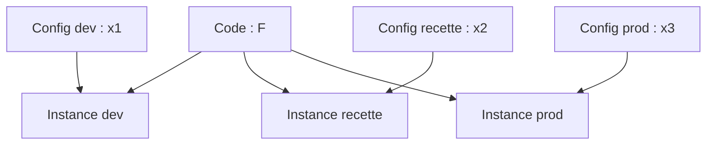
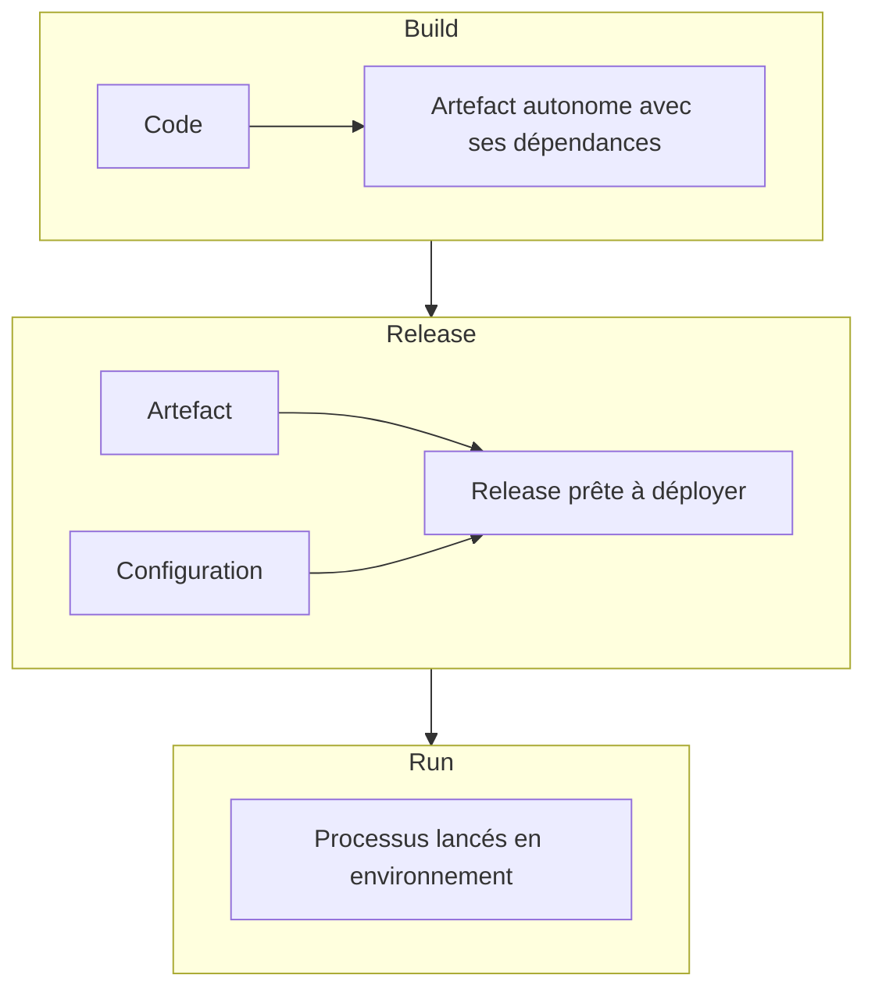

Deux moitiés pour cette dernière session. D'abord, **comment on architecture une application Platform 3** : pilotée par les événements, en conteneurs, selon les **12 facteurs**. Ensuite, **comment on fait tourner un SI** au quotidien : la production, qui est « l'argent d'aujourd'hui », quand le projet est celui de demain. Pour chaque brique d'exploitation, le cours compare la manière Platform 2 et la manière Platform 3.

## Platform 2 contre Platform 3

### Le tableau de synthèse

| | Platform 2 | Platform 3 |
| --- | --- | --- |
| **Architecture** | Data-driven | **Event-driven** |
| **Hébergement** | Datacenter et virtualisation | Cloud, *as a Service* |
| **Terminal** | PC | Smartphone, IoT… |
| **Delivery et run** | ITIL | DevOps |
| **Scalabilité** | Verticale | Horizontale |
| **Échanges** | Fichiers | API, événements, logs |
| **Découpage** | Monolithique | Microservices |
| **Haute dispo** | Redondance | Résilience |
| **Compute** | VM, serveur | Lambda, conteneur |
| **Patching** | Patch | **Rebuild** |

### Data-driven ou event-driven

<Compare leftTitle="Data-driven · Platform 2" rightTitle="Event-driven · Platform 3">
  <Fragment slot="left">
    La **donnée au repos** est au centre ; applications, services et événements gravitent autour.

    Priorité : **préserver la donnée**. La source de vérité est la **base de données**.

    L'IT est le **référentiel d'information** de l'entreprise.
  </Fragment>
  <Fragment slot="right">
    Les **événements** sont au centre : la **donnée en mouvement**.

    Priorité : **réagir aux événements**. La source de vérité est le **journal des événements**.

    L'IT est le **système nerveux** de l'entreprise numérique.
  </Fragment>
</Compare>

Source : Gartner (2017), repris dans le support

## Les conteneurs

### Ce que les conteneurs changent à l'architecture

Les conteneurs ajoutent des couches à la pile, et c'est la couche d'**orchestration** qui change la donne :

| Couche | Rôle | Exemples |
| --- | --- | --- |
| **6** | Development workflow, opinionated containers | Deis, OpenShift, Cloud Foundry, Docker Cloud, Apprenda |
| **5** | **Orchestration / scheduling, service model** | **Kubernetes**, Docker, Mesos, Marathon |
| **4** | Container engine | Docker, Rocket, OSv |
| **3** | Système d'exploitation | Ubuntu, Red Hat, CoreOS |
| **2** | Infrastructure virtuelle | VMware vSphere, Amazon EC2 |
| **1** | Infrastructure physique | Compute, réseau, stockage |

L'orchestration apporte de **nouvelles responsabilités** :

- elle **remplace certaines capacités des middlewares** (cluster, équilibrage de charge, redémarrage, configuration) ;
- elle **influence le design** et les pratiques de code ;
- elle **modifie l'usage de l'infrastructure**.

### Orchestrer les conteneurs

<CardGrid cols={3}>
  <Card kicker="Placer" title="Intelligent scheduling" tone="signal">Choisir le nœud où lancer chaque conteneur.</Card>
  <Card kicker="Réparer" title="Self-healing" tone="signal">Redémarrer ou remplacer un conteneur qui tombe.</Card>
  <Card kicker="Grossir" title="Horizontal scaling" tone="signal">Ajouter ou retirer des réplicas selon la charge.</Card>
  <Card kicker="Trouver" title="Service discovery et load balancing" tone="signal">Donner une adresse stable à un service et répartir le trafic.</Card>
  <Card kicker="Livrer" title="Rollouts et rollbacks automatisés" tone="signal">Déployer progressivement, revenir en arrière si ça casse.</Card>
  <Card kicker="Configurer" title="Secrets et configuration" tone="signal">Injecter la configuration et les secrets sans reconstruire l'image.</Card>
</CardGrid>

Compare avec le chapitre middleware : le cluster embarqué du serveur d'application, le load balancer, la configuration en base de registre… L'orchestrateur reprend tout cela, **pour toutes les applications à la fois**.

<DeepDive title="Kubernetes : un état désiré, une boucle de contrôle" level="approfondissement">
  Kubernetes applique au conteneur la logique SRE vue en session 1 : tu déclares un **état désiré** (« 3 réplicas de cette image, exposés sur ce port ») et des **contrôleurs** comparent en boucle l'état réel à l'état désiré pour corriger l'écart. Le *self-healing* n'est donc pas une fonction à part : c'est la même boucle qui recrée un pod disparu, qu'il ait planté, que son nœud soit tombé ou qu'on l'ait supprimé à la main.
</DeepDive>

### L'application cloud native

Une application cloud native se pense sur huit axes, avec les 12 facteurs au centre :

<CardGrid cols={2}>
  <Card kicker="Qualité" title="Tests" tone="signal">Automatisation ; tests unitaires, fonctionnels, d'intégration, de sécurité, de performance.</Card>
  <Card kicker="Cohérence" title="Transactions distribuées" tone="signal">Event-driven, compensation, chorégraphie, *eventual consistency*.</Card>
  <Card kicker="Échanges" title="Interaction" tone="signal">REST niveau 2 du modèle de maturité de Richardson, sérialisation JSON, échange d'événements, échange de fichiers.</Card>
  <Card kicker="Accès" title="Sécurité" tone="signal">Authentification et autorisation inter-services et utilisateur.</Card>
  <Card kicker="Livraison" title="Déploiement" tone="signal">Réduire les dépendances externes, chaîne de fabrication automatisée, base de code unique, configuration externalisée.</Card>
  <Card kicker="Charge" title="Performance" tone="signal">Gestion dynamique de la charge, arrêt gracieux, stateless.</Card>
  <Card kicker="Pannes" title="Dysfonctionnement" tone="signal">*Design for failure*, rejeter les requêtes au-delà du seuil de tolérance, couper provisoirement le lien avec un service défaillant, être *retry-ready*, prévoir de rejouer les requêtes en échec.</Card>
  <Card kicker="Diagnostic" title="Surveillance" tone="signal">Des traces utiles au diagnostic, des API dédiées aux contrôles de santé, des traces reliées entre elles, tout indicateur qui aide au diagnostic et à l'alerting.</Card>
</CardGrid>

« Application Cloud Native » · Source : IBM Studios Paris, repris dans le support

## Les 12 facteurs

Les principes de [The Twelve-Factor App](https://12factor.net/fr/), relus avec des yeux d'architecte d'infrastructure.

### I. Une base de code

On stocke l'infra (et l'application) dans un **dépôt de code** (git). L'application, comme l'infrastructure, est une **instance du code**, obtenue grâce à des **paramètres**.

- Langage **de programmation** pour l'appli (C, C++…), langage **de déclaration** pour l'infra : l'**IaC**, *Infrastructure as Code* (Terraform…).
- Le code, c'est le **F** de **F(x) = y**.
- Il remplace, en partie, le **DAT** (dossier d'architecture technique).

Une seule base de code, plusieurs déploiements : production, staging, les postes des développeurs.

### II. Des dépendances déclarées et isolées

**Supprimer l'implicite.** Toutes les dépendances sont déclarées dans un **manifeste** (pip, autoconf), puis embarquées ou spécifiées : rien ne doit reposer sur un outil « déjà installé sur le serveur ».

### III. La configuration dans l'environnement

**Base de code + configuration = instance.** La configuration (paramètres, clés de connexion), c'est le **x** de F(x) = y.

Où la stocker ? Dans un dépôt (`/config`), une base ou un *state* (`tfstate`), la base de registre (les années 2000), des **variables d'environnement**. En Platform 2, elle vit dans la **CMDB** ; en Platform 3, dans les **dépôts de code**.

### IV. Les services externes comme ressources attachées

Les services « internes » sont traités comme des services **tiers** : ce sont des **ressources**. La base de données d'une application est gérée comme un service externe, au même titre qu'un service d'envoi de mails. C'est le paradigme des **interfaces** : pas de changement de code si on change de **type** de ressource (MySQL sur un serveur, ou AWS RDS).

### V. Assemblage, publication, exécution séparés

**Séparation stricte** : le **build** compile un artefact autonome qui inclut ses dépendances externes (bibliothèques) ; la **release** combine un build et une configuration ; le **run** l'exécute.

### VI. Des processus sans état

Les traitements sont **stateless** : ils stockent leurs données dans un **service externe stateful** (base de données, S3…). C'est ce qui permet le scale out.

### IX. Jetable

Les processus d'une application 12 facteurs sont **jetables** : ils démarrent ou s'arrêtent en un instant. Cela simplifie le scale out, le déploiement rapide du code ou de la configuration, et la robustesse des déploiements en production. C'est **lié au stateless** : on ne jette sans risque qu'un processus qui ne garde rien.

### X. La parité dev/prod

**Réduire les fossés** entre développement et production :

<CardGrid cols={2}>
  <Card kicker="Temps" title="Temporel" tone="signal">Le délai de mise en production.</Card>
  <Card kicker="People" title="Les personnes" tone="signal">Faire du DevOps.</Card>
  <Card kicker="Outils" title="Les outils" tone="signal">Les mêmes outils (conteneurs…) ; pas de SQLite en dev et SQL Server en prod.</Card>
  <Card kicker="Taille" title="La taille" tone="amber">2 VM en dev contre 20 en prod.</Card>
</CardGrid>

### XII. Les processus d'administration

Les processus d'administration et de maintenance se lancent comme des **processus ponctuels** (*one-off processes*). Ils font partie intégrante de l'application et de son cycle de vie, leur code est dans le dépôt. Fini, par exemple, la carte réseau d'administration dédiée.

### Les autres facteurs

Plus liés au monde « appli », le support les cite sans les détailler :

- **VII.** Exporter les services via des associations de ports.
- **VIII.** Grossir à l'aide du modèle de processus (la concurrence).
- **XI.** Traiter les logs comme des flux d'événements.

<Quiz question="Une équipe stocke le mot de passe de la base de production dans le code, dans un fichier `settings_prod.py`. Quel facteur viole-t-elle, et pourquoi est-ce gênant pour l'infra ?" options={['I. Base de code : il faudrait un dépôt par environnement', 'III. Configuration : le code n’est plus le même F pour tous les environnements, et un secret vit dans le dépôt', 'VI. Stateless : le processus garde un état', 'IX. Jetable : le processus démarre trop lentement']} answer={1}>
  **Le facteur III.** La configuration (le **x**) doit vivre dans l'environnement, pas dans le code (le **F**). Sinon, chaque environnement a sa propre version du code, et un secret se retrouve dans le dépôt. Un dépôt par environnement (réponse 1) aggraverait le problème : le facteur I demande justement **une seule** base de code pour tous les déploiements.
</Quiz>

## La production

### Ce que recouvre l'exploitation

La production, c'est **l'argent d'aujourd'hui** ; le projet, c'est demain. Elle recouvre :

<Steps>
1. **Monitoring et supervision**, Platform 2 contre Platform 3.
2. **Sauvegarde**, Platform 2 contre Platform 3.
3. **Métrologie**, Platform 2 contre Platform 3.
4. **Batch et orchestrateur**, Platform 2 contre Platform 3.
5. **Capacity planning**.
6. **Gestion des environnements**.
7. **Test de DR**.
8. **Organisation** (les personnes) et **ITIL** : changement, incident, problème.
</Steps>

## Monitoring et supervision

### L'objectif

**Détecter les pannes** des couches matérielle, OS, middleware et applicative. Il faut surveiller **chaque couche**, car chacune apporte une redondance ou une résilience à la couche du dessus.

- Il existe une multitude de logiciels de monitoring, et parfois le logiciel arrive avec sa propre solution (l'antivirus Microsoft sur Windows, par exemple).
- Deux types d'alertes : **curative** (la panne) et **préventive** (la prévention).
- Le monitoring est souvent mêlé à la **métrologie** pour détecter les problèmes de performance et remonter des métriques.

### L'architecture Platform 2

Deux approches : **généraliste** (IBM Patrol, HP, BMC) ou **spécialiste** (monitoring d'AD, d'Hadoop, de Citrix, du cloud public…). Il faut une **console centrale** qui remonte toutes les alertes : l'**hypervision**.

L'architecture classique : des **agents** (ou connecteurs) et **un serveur de monitoring**, en deux modes :

<Compare leftTitle="Push" rightTitle="Pull">
  <Fragment slot="left">
    Un **agent** installé sur la machine **envoie** les pannes au serveur.

    Mais si l'agent est en panne, il n'enverra pas de panne…
  </Fragment>
  <Fragment slot="right">
    Le serveur de monitoring **interroge** régulièrement les machines.

    Il faut ces contrôles réguliers en pull, qui peuvent même se faire **sans agent** (*agentless*).
  </Fragment>
</Compare>

<Figure caption="Choisis une architecture, puis une panne : l'alerte arrive-t-elle jusqu'à quelqu'un ?">
  <Monitoring />
</Figure>

Ce qu'on surveille, couche par couche :

| Couche | Ce qu'on détecte | Exemples |
| --- | --- | --- |
| **Matériel** | Les pannes hardware | Logiciel propre au matériel (serveur, stockage, réseau) des gammes « entreprise », livraison automatique de la pièce de rechange, en curatif ou préventif |
| **OS** | Les pannes liées à l'OS | File system plein, process ou service arrêté, ping, sauvegarde, batch |
| **Middleware** | Les pannes du serveur d'application et de la base | Perte de connexion à la base, logs pleins, certificats SSL expirés ; *tablespace* plein, index, sauvegarde, batch |
| **Applicatif** | Les pannes applicatives | Des tests codés dans l'application ou à l'extérieur (comme le *health check* d'un load balancer) |

Protocole : **SNMP** ou propriétaire. Le marché :

<CardGrid cols={3}>
  <Card kicker="Open source" title="Nagios, Zabbix" tone="signal">Centreon, Shinken.</Card>
  <Card kicker="Propriétaire généraliste" title="BMC Patrol" tone="signal">HP SiteScope, Nimsoft/CA.</Card>
  <Card kicker="Spécifique" title="Oracle Enterprise Manager" tone="signal">SAP.</Card>
</CardGrid>

Le support montre trois architectures de référence : un serveur de monitoring Oracle qui collecte les agents de plusieurs instances GoldenGate et remonte vers l'e-mail, le SNMP ou le web ; **Nagios XI**, qui combine contrôles **actifs** (pull) et **passifs** (push) à travers un réseau ou un VPN ; **Nimsoft**, avec des robots déployés sur site qui remontent vers un serveur central.

### L'organisation dans les grandes entreprises

Si le SI est **infogéré**, c'est l'**infogérant** qui s'en charge. Une équipe **24 h/24, 7 j/7** devant des murs d'écrans attend et traite les alertes : le **Command Center**, la tour de contrôle. Traiter, c'est essayer de résoudre seul (redémarrer le process, par exemple) ou passer au **N2** / à l'**astreinte**.

### L'architecture Platform 3

- **Fusion avec l'observabilité** : le monitoring détecte le plantage, l'**observabilité** détecte la **root cause** (le pourquoi).
- Notion d'**événement** et de **log** : les événements de monitoring permettent de **piloter l'application**.
- Le traitement des alertes est **automatisé** : panne ⇒ **remédiation automatique** (≈ destruction). Une instance EC2 est supprimée et reconstruite automatiquement par l'**Auto Scaling Group**.
- Les alertes doivent être configurées pour déclencher des **événements** et des **actions** (CloudWatch Event, puis Lambda).

Marché : Datadog, Dynatrace, Splunk.

<DeepDive title="OpenTelemetry, le standard de l'observabilité" level="état-de-l-art">
  L'observabilité repose sur trois signaux : les **métriques**, les **logs** et les **traces** (le parcours d'une requête à travers les services, qui répond au « relier les différentes traces » de l'application cloud native). Pour ne pas dépendre d'un éditeur, la CNCF porte **OpenTelemetry** : des API, des SDK et un *collector* standard pour produire ces signaux une seule fois et les envoyer vers n'importe quel outil (Datadog, Dynatrace, Splunk, ou une pile open source). C'est devenu le moyen par défaut d'instrumenter une application Platform 3.
</DeepDive>

## La sauvegarde

### Objectif et plan de sauvegarde

Objectif : **sauvegarder les données et le SI pour les restaurer à un état antérieur**, si besoin ! Deux paramètres : la **fréquence** et la **rétention**.

Le **plan de sauvegarde** orchestre et planifie le lancement des sauvegardes :

- **orchestration** : les pré- et post-conditions (arrêt de l'appli, purge, synchro DR, sauvegarde) ;
- **planification** : à quelle heure ? Arrêt à 23 h, lancement de la sauvegarde à minuit.

Qu'est-ce qui empêche une sauvegarde de se faire ? Un **fichier verrouillé**, par exemple.

### Les actions humaines

- Vérifier que les sauvegardes se font bien (le **rapport quotidien**) : un KO est un **événement de monitoring**.
- Dépanner si KO.
- Vérifier que les actions de *destaging* sont bien réalisées.
- Tester la restauration (c'est **rare**).

Une architecture de sauvegarde type (NetBackup) : des serveurs maîtres avec leur catalogue, des *media servers* qui écrivent sur un stockage, et une **réplication** de l'image de sauvegarde vers un second domaine, avec notification et import du côté cible.

### Le catalogue de service

La sauvegarde se vend comme un service, par niveau de criticité :

| | Non critique | Standard | Critique |
| --- | --- | --- | --- |
| **Interruption maximale de l'application** | Moins de 12 h | Moins de 6 h | Moins d'1 h |
| **RPO** (fréquence de sauvegarde) | Hebdomadaire | Journalière | Toutes les heures |
| **RTO** (délai max de restauration) | 24 heures | 1 journée | Moins d'1 h |
| **Granularité de restauration** (en standard) | À la semaine près, jusqu'à 5 semaines en arrière | Au jour près, jusqu'à 5 semaines | À l'heure près, jusqu'à 5 semaines |
| **Granularité** (en option) | Selon besoins spécifiques | Selon besoins spécifiques | Selon besoins spécifiques |
| **Unité d'œuvre** (Go sauvegardé indexé) | 0,5 × le prix standard | Prix standard (open ou mainframe) | 2 × le prix standard |

Exemple de catalogue de service sauvegarde · Source : support, Cours 4

<Callout type="definition" title="RPO et RTO">
  Le **RPO** dit **combien de données** on accepte de perdre : c'est la fréquence de sauvegarde. Le **RTO** dit **combien de temps** on accepte d'attendre : c'est le délai maximal de restauration.
</Callout>

<Quiz question="Une application « standard » plante à 17 h, sa dernière sauvegarde date de la nuit précédente. Que perd-on au pire, et combien de temps attend-on ?" options={['Rien, et moins d’une heure', 'Jusqu’à une journée de données, et jusqu’à une journée de restauration', 'Une semaine de données, et 24 heures', 'Une heure de données, et 6 heures']} answer={1}>
  **Une journée, et une journée.** Le **RPO** standard est journalier : tout ce qui a été saisi depuis la sauvegarde de la nuit est perdu. Le **RTO** standard est d'une journée. Le piège (réponse 4) mélange les lignes : les 6 h, c'est l'interruption maximale visée, pas le RPO.
</Quiz>

### La sauvegarde Platform 3

On utilise les **mécanismes de protection internes** des données :

- les **snapshots** (AWS RDS, OpenStack Cinder) ;
- la **journalisation** (AWS S3, OpenStack Swift) ;
- la **copie dans Glacier**.

Si besoin, on externalise les données hors du site principal.

## Métrologie, batch et capacity planning

### La métrologie

La **métrologie** historise les métriques et capteurs de performance dans des **graphiques** et des **tableaux de bord** (par exemple, le nombre de mails reçus, envoyés et rejetés par un serveur Sendmail, semaine après semaine).

- Objectif : suivi de la performance, **capacity planning**, débogage, dépannage, analyse *forensic*.
- Domaines : réseau, compute, stockage, middleware, applicatif.
- Elle a besoin d'un **humain pour interpréter**, ce qui est souvent complexe.
- Elle peut servir à la **facturation**.

En **architecture 3.0**, elle utilise les technos **big data** : les métriques se déversent souvent dans un **data lake** (par exemple **ELK** : Elasticsearch, Logstash, Kibana), sont présentées par des outils de dataviz et couplées aux outils de logs (Splunk, SIEM).

### Batch et orchestrateur

Des outils d'**ordonnancement de tâches** : dans une entreprise du CAC 40, **8 000 jobs toutes les nuits**.

- Types de job : alimentation, transfert, transformation, sauvegarde, purge, archivage…
- Des conditions entre les jobs, des boucles… c'est la **programmation du SI**.
- Marché : Control-M, Dollar Universe ($U).
- People : l'activité est surveillée par le **Command Center**.

<Compare leftTitle="Batch · Platform 2" rightTitle="Batch · Platform 3">
  <Fragment slot="left">
    La **nuit batch** : des milliers de jobs enchaînés pendant que les utilisateurs dorment.
  </Fragment>
  <Fragment slot="right">
    **Très peu de batch** : les traitements sont **transactionnels**, voire (quasi) temps réel.

    Il n'y a **pas de notion de nuit** : le business tourne 24/7, en *follow the sun*.
  </Fragment>
</Compare>

### Le capacity planning

Une activité **humaine et outillée** du SI. Objectif : **anticiper les changements à réaliser maintenant pour accepter un besoin futur**. C'est une gestion du stock, avec une vigilance sur les **limites et effets de seuil** (l'architecture n'est ni linéaire ni infinie).

Analogies : une grossesse (on prépare la chambre avant l'arrivée), faire ses courses (on achète avant que le frigo soit vide). Outils : la métrologie, Excel (l'extrapolation) et le cerveau.

## Les environnements

### Gérer les environnements

Un **environnement** (prod, non-prod, test, dev, UAT, PRA…) est une **zone cloisonnée et étanche** du SI : infrastructure, middleware, applications. L'objectif : **ne pas développer sur la production**, ne pas tester sur la production.

Un circuit type va du **développement** (postes de développeurs) à la **QA / test** (une ferme de recette, un clone des composants majeurs de la production) puis à la **production** (plusieurs serveurs, accès restreint pour les développeurs).

On peut ainsi doubler ou tripler la production… mais cela coûte cher, et il faut **optimiser** :

- l'**infrastructure** (nombre, type, performance) : virtualisation, partitionnement et cloud pour les serveurs ; classes de stockage et activation ou non des fonctions avancées ; équipements réseau différents, moins de redondance ;
- les **licences** (SQL Server Enterprise en production, SQL Express ailleurs).

### Cloisonnement contre communication

Le cloisonnement se fait à **chaque couche** :

| Couche | Comment on cloisonne |
| --- | --- |
| Serveur | Serveurs différents (VM, conteneurs…) |
| Stockage | Stockage distinct (file system) |
| Réseau | VLAN, subnet, firewall |
| Middleware | Instances différentes (appli, base) |
| Appli | URL différentes : la même application existe en `.uat.` ou `.pprod.` dans son nom de domaine |

Un cloisonnement **fort** évite les erreurs et les actions malveillantes. Mais les environnements doivent aussi **communiquer** : pour **mettre en production**, et pour **rafraîchir les données de test** depuis la production. C'est le rôle de la **Software Factory**, et sur ce point les modes 2 et 3 sont identiques.

### Le test de DR

Objectif : tester que le **DR** (*Disaster Recovery*) fonctionne. Dans les faits, le test est souvent **partiel**. Plusieurs niveaux de test :

<Steps>
1. **Bascule avec aller-retour instantané** (Platform 2).
2. **Bascule avec run sur le site de secours** (Platform 2 maîtrisée).
3. **Allers-retours perpétuels** (Platform 3.0).
</Steps>

Il se fait **une fois par an**, voire tous les deux ans (et l'arrêt électrique des DC, tous les cinq ans). Il est une **obligation légale** pour certaines fonctions vitales de l'État : banque, CHU, transports, médias…

<Quiz question="Une application Platform 3 tourne en actif/actif sur deux régions et bascule régulièrement de l'une à l'autre. Pourquoi est-ce un meilleur test de DR qu'une bascule annuelle ?" options={['Parce qu’il coûte moins cher en licences', 'Parce que la bascule est exercée en continu : on sait qu’elle marche, au lieu de le découvrir le jour du sinistre', 'Parce qu’il supprime le besoin de sauvegarde', 'Parce qu’il est exigé par la loi']} answer={1}>
  **Une bascule exercée en permanence est une bascule qui marche.** C'est le niveau « allers-retours perpétuels » de la Platform 3.0. Une bascule annuelle, souvent partielle, laisse un an de changements non testés. Elle ne supprime pas la sauvegarde (réponse 3) : le DR protège contre la perte d'un site, la sauvegarde contre la perte ou la corruption des données, qui se répliquerait aussi sur l'autre site.
</Quiz>

## Organisation et ITIL

### Les niveaux de support

| Niveau | Nature | Exemple |
| --- | --- | --- |
| **N1** | **Procédé** | « Redémarrez votre box » |
| **N2** | Non procédé | |
| **N3** | **Expertise** | |

<Compare leftTitle="Infogérance 2.0" rightTitle="Infogérance 3.0 (CloudOps, SRE)">
  <Fragment slot="left">
    Les poids lourds : IBM, HP, Sogeti, Capgemini, Sopra Steria, Atos.

    **N1 et N2 off-shore**, N3 en France.
  </Fragment>
  <Fragment slot="right">
    **N1 et N2 automatisés**, N3 en France.
  </Fragment>
</Compare>

Et il faut aussi **redonder les personnes** : PRU (plan de reprise utilisateurs), VPN.

### ITIL et ITSM

- **ITIL** : un **standard d'opérations**, qui répond à « comment structurer sa production ? ».
- **ITSM** (*IT Service Management*) : tout ce qui sert à piloter un service IT (logiciels et processus) : portail, ticketing, référentiels et **CMDB**, gestion des changements, des problèmes, des incidents. L'ITSM **mesure l'atteinte des SLA**.
- Marché : ServiceNow (SaaS), BMC, ou des processus internes.

### Le changement

Qu'est-ce qu'un changement ? Un projet ? Comment réaliser un changement de manière **industrielle et maîtrisée** ?

<Pipeline steps={[
  { title: 'Plan', caption: 'Proposer le changement', detail: 'Mesurer l’impact : ajouter une prise électrique peut imposer de changer le compteur de l’usine. Planifier pour éviter les collisions.', tone: 'signal' },
  { title: 'CAB', caption: 'Revue', detail: 'Le Change Advisory Board valide la proposition avant la construction.', tone: 'amber' },
  { title: 'Build', caption: 'Construire le changement', detail: 'Prévoir les bonnes personnes et les bons outils, et une procédure de rollback.', tone: 'signal' },
  { title: 'CAB', caption: 'Revue', detail: 'Seconde revue avant la mise en œuvre.', tone: 'amber' },
  { title: 'Implement', caption: 'Mettre en œuvre', detail: 'Tracer : selon le support, 80 % des problèmes viennent d’un changement mal réalisé.', tone: 'synapse' },
]} />

<KeyIdea>Tracer chaque changement et prévoir son rollback : 80 % des « problèmes » proviennent d'un changement mal réalisé.</KeyIdea>

<DeepDive title="ITIL 4 : du contrôle du changement à sa facilitation" level="approfondissement">
  Depuis ITIL 4 (2019), la pratique ne s'appelle plus *change management* mais **change enablement** : l'objectif est de **maximiser le nombre de changements réussis**, pas de les freiner. Concrètement, le CAB ne voit plus tout passer : les **changements standard** (pré-autorisés, faible risque, souvent automatisés dans un pipeline) partent sans réunion, et l'autorité de validation dépend du risque. C'est la manière dont ITIL a intégré le rythme DevOps de la Platform 3.
</DeepDive>

### L'incident

Un **incident** est un **événement imprévu qui perturbe le bon fonctionnement**.

- **Réaction** : il faut réparer.
- **Action** : **communiquer**.
- **Outils** : gestion de configuration, gestion des changements, traçabilité des incidents, gestion des problèmes.

## À retenir

<Takeaways>
1. **Platform 3 = event-driven.** Cloud, microservices, conteneurs ou lambdas, scalabilité horizontale, résilience et rebuild plutôt que redondance et patch.
2. **L'orchestrateur reprend le middleware.** Scheduling, self-healing, scaling, découverte de services, rollouts, configuration : pour toutes les applis à la fois.
3. **F(x) = y.** Le code est F, la configuration est x, l'instance est y ; build, release et run séparés, processus stateless et jetables.
4. **De l'alerte à la remédiation.** Push et pull vers un Command Center en Platform 2 ; observabilité et destruction/reconstruction automatique en Platform 3.
5. **La production se prépare.** RPO et RTO par niveau de service, environnements cloisonnés, test de DR, changements tracés avec rollback.
</Takeaways>
