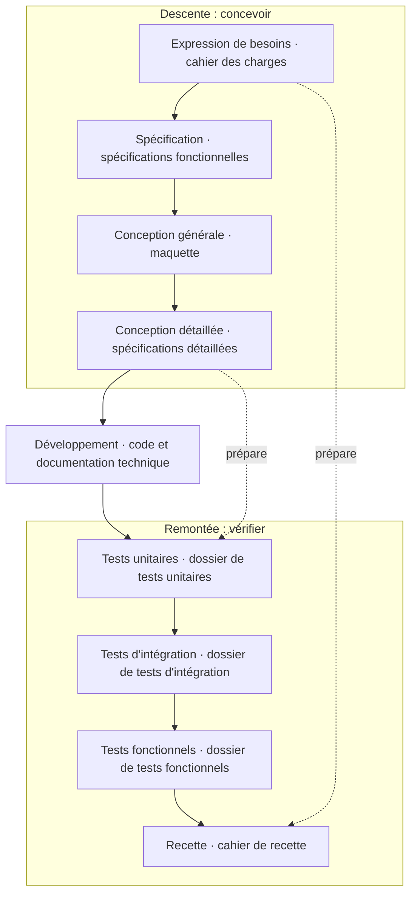

Un projet informatique part d'une situation confuse : des besoins flous, des gens qui ne parlent pas la même langue, un budget et une date. Le **génie logiciel** est né pour mettre de l'ordre dans ce chaos, et sa réponse s'appelle la **méthode**. Cette session pose les bases : pourquoi des méthodes, ce qu'elles ont toutes en commun, comment estimer une charge, puis un premier tour des familles, du cycle en V à Scrum.

<Callout type="note" title="Le plan du cours de méthodes">
Points abordés sur l'ensemble du cours : introduction aux méthodes, méthodes traditionnelles, agilité, gouvernance, tendances et évolutions. Cette session couvre l'introduction et un panorama ; XP (session 2) et CMMI (session 3) sont approfondis ensuite.
</Callout>

## Pourquoi des méthodes ?

### L'histoire en bref

<Pipeline steps={[
  { title: 'Années 1950-60', caption: 'Origines', detail: 'Premiers ordinateurs et premiers projets logiciels.' },
  { title: '1960-70', caption: 'Crise du logiciel', detail: 'Naissance du génie logiciel : conférence OTAN de Garmisch-Partenkirchen (1968), sur deux constats. Le logiciel n’est pas fiable (maintenance !) et la planification est hasardeuse. Premières formalisations : cycle en V, Waterfall.', tone: 'danger' },
  { title: '1980-90', caption: 'Objet et RAD', detail: 'Évolution des méthodes : méthodes orientées objet, RAD (Rapid Application Development).' },
  { title: '2000', caption: 'Tournant agile', detail: 'Manifeste agile (2001), Scrum, XP.' },
  { title: 'Aujourd’hui', caption: 'Hybridation', detail: 'Entre agilité, DevOps et hybridation des méthodes.', tone: 'signal' },
]} />

Le support résume aussi l'évolution par **génération** :

| Années | Informatique | Méthode |
| --- | --- | --- |
| 70 | Mainframe | Analyse structurée |
| 80 | Client-serveur, répartie | SI relationnel |
| 90 | Web | Communicante (objet) |
| 2000 | Agile | Cycles courts |

### Ce que vise le génie logiciel

Le génie logiciel est fondé sur la nécessité de **rationaliser** l'implication et la gestion des ressources **techniques**, **humaines**, **économiques et stratégiques**.

<CardGrid cols={3}>
  <Card kicker="Ambition" title="Productivité" tone="signal">Optimiser la productivité de chaque euro (dollar) investi dans le développement. Pilotage par l'OTAN, puis par l'industrie.</Card>
  <Card kicker="Stratégie" title="Qualité" tone="signal">Viser la **qualité du logiciel**.</Card>
  <Card kicker="Tactique" title="Méthode" tone="signal">Se doter d'une **méthode** pour assurer cette qualité.</Card>
</CardGrid>

### La qualité du logiciel

Le génie logiciel s'inspire de l'**industrie** : un processus de développement proche de l'usage industriel (le **cycle de vie**), pertinent car le logiciel s'intègre souvent dans des systèmes complexes. **Mais** le logiciel n'a pas de production en série, et ses tests sont abstraits (pas de test destructif).

Les critères de qualité, « en désordre et même si c'est parfois contradictoire » : **validité**, **fiabilité**, **extensibilité**, **réutilisabilité**, **compatibilité**, **efficacité**, **portabilité**, **vérifiabilité**, **intégrité**, **facilité** (d'utilisation).

<Quiz question="Pourquoi le support dit-il que les critères de qualité sont « parfois contradictoires » ?" options={['Parce que certains critères sont mal définis', 'Parce qu’en améliorer un peut en dégrader un autre', 'Parce qu’ils changent selon le langage de programmation']} answer={1}>
  **Améliorer un critère peut en dégrader un autre.** Un code très optimisé (efficacité) devient souvent moins portable ou moins lisible (vérifiabilité, extensibilité). Une méthode sert justement à arbitrer ces compromis de façon explicite, plutôt qu'au hasard.
</Quiz>

### Quand on s'y prend mal

<Figure caption="Échecs logiciels cités par le support · Source : support du cours">

| Qui | Ce qui s'est passé |
| --- | --- |
| NASA | Sonde Mariner vers Vénus perdue dans l'espace, à cause d'une erreur de programme FORTRAN |
| Météo France | 72 ballons d'instruments de mesure détruits lors d'une expérience : bug logiciel |
| NASA | Lancement de la navette spatiale retardé de 2 jours (1981) par un problème logiciel ; lancée sans que le problème soit défini, mais ses symptômes délimités |
| Control Data | N'a jamais pu aboutir sur le compilateur PL1 |
| EDF | 10 ans perdus pour la mise en service des systèmes de contrôle-commande des centrales 1 400 MW |
| SNCF | Les pires difficultés techniques et humaines pour exploiter SOCRATE |
| Ariane 5 | Explose le 4/6/96 (0,5 Md€ non assurés) pour une faute d'un module non indispensable au vol |
| NHS (Royaume-Uni, 2011) | Programme national abandonné après 10 ans et 12 Md£ : complexité excessive, manque d'adhésion des utilisateurs |
| Queensland (2010) | Système de paie : projet de 1,2 M$ qui a finalement coûté 6 Md$ ; spécifications mal définies, tests insuffisants |
| Airbus A380 (2005) | Retard massif : versions différentes de CATIA, 500 km de câblage incompatibles entre usines |
| Boeing 737 Max (2018-2019) | Logiciel MCAS : défaut de conception, capteurs sans redondance, pilotes mal formés ; 189 + 157 morts |

</Figure>

### Les risques classiques et majeurs

<CardGrid cols={2}>
  <Card kicker="Humain et planning" title="Le projet lui-même" tone="danger">
    Défaillance du personnel · calendrier et budget irréalistes · composants externes manquants · tâches externes défaillantes.
  </Card>
  <Card kicker="Produit" title="Ce qu'on livre" tone="amber">
    Fonctions inappropriées · interfaces utilisateur inappropriées · produit « plaqué or » · validité des besoins · problèmes de performance · exigences démesurées par rapport à la technologie.
  </Card>
</CardGrid>

### Le poids de la maintenance

Sur 55 entreprises américaines, **53 % du budget total** d'un logiciel part dans la maintenance. Voici sa répartition :

<Figure caption="Répartition de l'effort de maintenance (en % de la maintenance) · Source : support du cours">
<BarChart unit="%" data={[
  { label: 'Évolutive (spécifications modifiées)', value: 34, highlight: true },
  { label: 'Corrective (bogues)', value: 17 },
  { label: 'Perfective (performances)', value: 16 },
  { label: 'Adaptative (nouvel environnement)', value: 10 },
  { label: 'Organisation / suivi', value: 7 },
  { label: 'Assistance utilisateurs', value: 6 },
  { label: 'Contrôle qualité', value: 6 },
  { label: 'Divers', value: 4 },
]} />
</Figure>

<KeyIdea>Corriger les bogues ne pèse que 17 % de la maintenance : l'essentiel vient de besoins qui changent. Une méthode doit donc rendre le logiciel facile à faire évoluer.</KeyIdea>

## Méthode, méthodologie, projet

### Des méthodes pour maîtriser le développement

Les méthodes répondent à quatre besoins : la **maîtrise des coûts**, la **pérennité des investissements**, se maintenir dans un environnement technique (parfois légal) **en évolution rapide**, et un **environnement social** à prendre de plus en plus en compte. En un mot : **ne pas subir mais maîtriser**.

<Callout type="definition" title="Méthode">
Du grec *meta* (vers) et *odos* (voie). Sens commun : manière de dire, de faire, d'enseigner une chose suivant un certain principe et un certain ordre, pour atteindre un but. En philosophie, l'ensemble des procédés rationnels pour rechercher la vérité ; Descartes : « des règles certaines et faciles, grâce auxquelles tous ceux qui les observent exactement ne supposeront jamais vrai ce qui est faux ». Sens **admis** en informatique : une **composition particulière d'éléments** (phasage, dimension temporelle, cycle de vie, processus, modes opératoires…).
</Callout>

<Callout type="definition" title="Méthodologie">
Du grec *meta* et *logos* (la science). Ce n'est pas l'étude de la meilleure manière de pratiquer, mais de **comment un procédé peut être pratiqué** ; sa source est l'épistémologie. On admet donc (pardon Descartes !) que la **méthode** est essentiellement **technologique et dédiée à un domaine** particulier.
</Callout>

### Projet ou produit

<Callout type="definition" title="Projet (ANSI/PMI 99-001-2004, PMBOK v7 2021)">
Une démarche **temporaire** menée pour atteindre un **unique** résultat, produit ou service.
</Callout>

- **Temporaire** : un début et une fin, ce n'est pas une activité. La fin signifie que le résultat est atteint, ou ne le sera pas, ou que le projet est abandonné. La durée peut être longue, et le produit n'est pas forcément temporaire.
- **Unique** : même avec plusieurs livrables, le projet est global.
- **Objectif** : atteindre son résultat. **Problématique** : le faire dans un environnement contraint (RH, économie, délais).

<Compare leftTitle="Projet · le constructeur" rightTitle="Produit · le jardinier">
  <Fragment slot="left">
    - **Périmètre** : initié, temporaire et délimité (un début, une fin)
    - **Focus** : les livrables (*output*) et la mise en production
    - **Succès** : mesuré par OTOCOQ (*on time, on cost, on quality*)
    - **Équipe** : éphémère
    - **Mantra** : on livre et on passe au suivant
    - **À éviter** : le risque
    - **Budget** : global, unique
  </Fragment>
  <Fragment slot="right">
    - **Périmètre** : stratégie, roadmap, concurrents
    - **Focus** : la valeur (*outcome*) et l'impact utilisateur
    - **Succès** : adoption, RoI, satisfaction / NPS
    - **Équipe** : pérenne, responsable
    - **Mantra** : on cultive, on sème, on étend
    - **À éviter** : l'obsolescence, un *time to market* trop long
    - **Budget** : capacitaire
  </Fragment>
</Compare>

### Pour qui, et pourquoi adopter une méthode

Les **destinataires** des méthodes : directeurs informatiques, concepteurs, développeurs, ingénieurs maintenance, utilisateurs, clients et MOA, enseignants, décideurs et managers, étudiants, chercheurs.

Adopter une méthode, c'est instaurer entre l'entreprise et le système d'information **un fil conducteur cohérent et reconnu** et **un langage de communication commun**, compris de tous, pour que les équipes collaborent. Pour garantir :

<Steps>
1. Un résultat **conforme à un besoin** (exprimé, du client…).
2. Une **qualité** de résultat, **dans le budget** et **dans les temps**.
3. Une réponse à la **complexité** des projets.
4. Des **points de contrôle intermédiaires**, avant d'aller trop loin.
5. Un **formalisme** pour communiquer sur le projet avant, pendant et après.
6. Une **documentation**.
</Steps>

<Callout type="tip" title="Trois concepts communs à toute méthode">
Le **cycle du projet**, le **formalisme** et, pour l'implémentation, le **SI et le SIA**. Les parties suivantes les détaillent un par un.
</Callout>

## Panorama des méthodes

### Comment les différencier

On segmente les méthodes selon plusieurs critères : la **phase** du projet couverte (de la spécification au retrait, maintenance comprise), le **modèle** (séquentiel, itératif…), le **positionnement** dans le génie logiciel (sujets spécifiques), **méthodes vs outils vs bonnes pratiques**, et les **modèles de maturité** et référentiels (ISO, CMMI, ITIL).

### Les grandes familles

<CardGrid cols={2}>
  <Card kicker="Séquentielles" title="Une phase après l'autre" tone="muted">Cycle en V / Waterfall (Royce, 1970), Prince2, Merise.</Card>
  <Card kicker="Itératives" title="Des cycles répétés" tone="amber">RAD (Rapid Application Development), RUP (Rational Unified Process).</Card>
  <Card kicker="Agiles" title="Cycles courts, livrable au centre" tone="signal">Manifeste agile (2001), Scrum, Kanban, Extreme Programming (XP), SAFe (Scaled Agile Framework).</Card>
  <Card kicker="Hybrides" title="Un peu des deux" tone="synapse">Water-Scrum-Fall, Agile@Scale, DevSecOps.</Card>
</CardGrid>

### Les méthodes spécifiques

Au-delà du développement, des méthodes couvrent chaque sujet du génie logiciel :

| Domaine | Exemples du support |
| --- | --- |
| Ergonomie et UX | User-Centered Design (ISO 9241-210), Design Thinking, tests utilisateurs, eye-tracking, personas et scénarios, prototypage rapide |
| Tests | Cycle de test ISTQB, automatisation, intégration continue et CI/CD, tests de charge et de stress, TDD, BDD |
| Sécurité | Gestion des risques (ISO 27005, EBIOS), Maryse, Security by Design, DevSecOps, pentest, audit (ISO 27001) |
| Architecture logicielle | SOA, architecture hexagonale, Domain Driven Design, microservices |
| Données | Notation UML, anonymisation et pseudonymisation, Data Governance Framework, qualité des données |
| Plateformes et infrastructures | ITIL, CMDB, IaC, DevOps, *Platform Engineering* |
| Risques | AMDEC, Monte-Carlo et méthodes probabilistes, ISO 31000, Risk-Based Testing |
| Innovation et transformation | Lean Startup, Design Thinking, prospective (*foresight*), hackathons, *AI-Native SDLC*, FinOps, GreenTech, éthique et conformité |

## Tendances et évolutions

### L'IA dans la conduite de projet

Pour le support, l'IA est un **levier de la conduite de projet**, pas un simple outil technique.

<Compare leftTitle="IA pour le chef de projet (AIPM)" rightTitle="IA dans le cycle de développement">
  <Fragment slot="left">
    - **Planification et risques** : planification prédictive, analyse automatique des risques à partir des données historiques
    - **Documentation** : aide à la rédaction des user stories (support au Product Owner)
    - **Qualité** : gestion et analyse des tests et rapports de tests
    - **Planning** : élaboration, suivi, analyse prédictive (ex. CRISP-DM, TDSP de Microsoft)
    - **Support général** : assistance au management
  </Fragment>
  <Fragment slot="right">
    - Des outils comme GitHub Copilot ou Cursor **transforment l'estimation des charges**
    - La vitesse de codage et de test change radicalement, ce qui modifie sensiblement les **facteurs de vélocité**
  </Fragment>
</Compare>

<Callout type="warning" title="Éthique et conformité">
Selon le support, en 2025 une méthode de projet IT doit intégrer une **phase de conformité réglementaire**, surtout avec l'IA (AI Act).
</Callout>

<DeepDive title="Le calendrier de l'AI Act" level="approfondissement">
Le règlement européen sur l'IA (UE 2024/1689) est entré en vigueur le 1er août 2024, mais s'applique par étapes : interdictions des pratiques inacceptables à partir de février 2025, obligations des modèles d'IA à usage général à partir d'août 2025, puis l'essentiel des obligations sur les systèmes à haut risque à partir d'août 2026 et 2027. Concrètement, pour un projet, la conformité se prépare dès le cadrage : classer le système selon son niveau de risque, puis prévoir la documentation, la gestion des risques et la supervision humaine qui en découlent.
</DeepDive>

### Éco-conception et FinOps

**Objectif** de l'éco-responsabilité : réduire l'empreinte environnementale du numérique **à chaque phase** du projet. Pourquoi c'est une tendance forte : attentes de la société, des clients et des collaborateurs (e-réputation, marque employeur), **législation** (loi REEN du 15/11/2021), évolution des coûts (fiscalité carbone, énergie), et gains financiers atteignables.

<CardGrid cols={3}>
  <Card kicker="Sobriété amont" title="Éco-conception fonctionnelle" tone="synapse">Questionner le besoin avant de coder, supprimer les fonctionnalités « zombies », UX sobre (mode sombre, parcours simplifiés, pas de vidéo en lecture automatique). « Le code le plus vert est celui qui n'existe pas. »</Card>
  <Card kicker="Faire mieux avec moins" title="Optimisation technique et données" tone="synapse">Assets allégés (WebP, compression), rétention stricte des données, algorithmes économes en CPU et RAM.</Card>
  <Card kicker="Matériel" title="Infrastructures bas carbone" tone="synapse">Éteindre les environnements non essentiels (FinOps/GreenOps), hébergeurs responsables à faible PUE, durée de vie du matériel allongée.</Card>
</CardGrid>

<Callout type="definition" title="FinOps">
Pratique culturelle et opérationnelle qui vise à **maximiser la valeur métier du cloud en optimisant ses coûts**. Objectif : passer d'un coût fixe (**CAPEX**) à un coût variable maîtrisé (**OPEX**).
</Callout>

<Pipeline loop steps={[
  { title: 'Inform', caption: 'Visibilité', detail: 'Rendre les coûts transparents : tableaux de bord des dépenses en temps réel pour les équipes, par service ou par fonctionnalité.' },
  { title: 'Optimize', caption: 'Réduire le gaspillage', detail: 'Éteindre les environnements de dev et de test la nuit et le week-end (GreenOps), redimensionner les instances (rightsizing), engagements d’utilisation (Reserved Instances).' },
  { title: 'Operate', caption: 'Alignement continu', detail: 'Intégrer ces pratiques durablement et automatiquement dans le cycle de vie du produit (CI/CD), alignées sur les priorités stratégiques.' },
]} />

### Méthodes adaptatives et tendances

<Callout type="definition" title="Méthode adaptative">
Une approche qui accepte **l'incertitude et le changement comme des constantes**, et privilégie l'apprentissage continu sur la planification rigide : l'organisation pivote vite grâce à l'agilité et/ou à l'IA. Exemples : projets de R&D, Adaptive Software Development (ASD), Kanban. Le PMI (PMBOK 7) et l'ISO (ISO 21502) publient sur ces cycles.
</Callout>

Les tendances retenues par le support : **agile à l'échelle et adaptatif**, **IA** (automatisation du code et des tests), **virtualisation et cloud**, **DevSecOps**, **low-code / no-code**, **Green IT et éthique**.

## Le cycle du projet

<Callout type="definition" title="Cycle du projet">
L'ensemble des **phases successives** qui permettent de conduire la démarche intellectuelle raisonnée en vue d'atteindre le but recherché.
</Callout>

Les cycles de développement cités : **V / cascade / Waterfall**, **W**, **spirale**, **incrémental**, **itératif ou semi-itératif**, **agile**, **Y**.

### Le cycle en V

Chaque phase de conception, à gauche, produit le document qui servira à **vérifier** la phase de test qui lui fait face, à droite.

Le support associe à chaque phase ses entrées et ses sorties :

| Phase | Activité | Entrée → sortie |
| --- | --- | --- |
| Spécification | Traduire les besoins en fonctionnalités, interfaces, performances, contraintes, exigences qualité | **Cahier des charges** → Dossier de spécifications, manuels (installation, utilisation) |
| Conception générale | Architecture, découpage en modules, communication inter-modules, échange de données, contrôle | **Dossier de spécifications** → Dossier de conception générale, dossier provisoire de tests d'intégration |
| Conception détaillée | Décomposer chaque module en fonctions simples facilement testables | **DCG** → Dossier de conception détaillée, dossier provisoire de tests unitaires |
| Codage | Traduction des traitements en code, production | **DCD** → Listing du code, dossier des tests unitaires |
| Tests unitaires | Test de chaque composant | **DCD, DTU** → Listing des composants testés, dossier des tests d'intégration |
| Intégration | Assemblage progressif des composants | **DCG, DTI** → DTI complet, listing des composants testés, dossier des tests de validation |
| Validation | Test du logiciel complet en fonctionnement opérationnel, recette par le commanditaire, vérification des modifications | **DSL, DTV, cahier de recettes** → DTV complet, manuels, dossier de livraison |

### Spirale et incrémental

<Compare leftTitle="Spirale" rightTitle="Incrémental">
  <Fragment slot="left">
    Une **évolution pilotée par une priorité** (besoins, risques, bugs…). Chaque tour de spirale suit 4 phases :

    1. Détermination
    2. Analyse des risques
    3. Développement
    4. Revue
  </Fragment>
  <Fragment slot="right">
    **Éviter le développement monolithique** au profit d'un développement par sous-ensembles de composants. La première brique adresse le **noyau** (l'infrastructure) du SI.

    - **Forces** : chaque incrément est plus simple à développer, intégration progressive, livraisons intermédiaires, effort lissé
    - **Faiblesse** : identifier et maîtriser le noyau
  </Fragment>
</Compare>

<Quiz question="Une équipe découvre en recette que le besoin a été mal compris. Dans quel cycle ce risque est-il le plus coûteux ?" options={['Le cycle en V', 'La spirale', 'L’incrémental']} answer={0}>
  **Le cycle en V.** La recette, qui vérifie l'expression de besoins, arrive tout à la fin : l'erreur de départ a traversé toutes les phases. La spirale (revue à chaque tour) et l'incrémental (livraisons intermédiaires) exposent le produit plus tôt. Le piège : croire que la rigueur documentaire du V suffit à éviter le malentendu.
</Quiz>

## Formalisme, modèle et système

### Le formalisme

Le formalisme est **le langage de communication de tous les acteurs** du projet : l'équipe projet, les utilisateurs, les autres responsables de l'entreprise. C'est le lien principal entre les individus, pendant le projet ou après : **la clef de voûte de la maintenance**.

### Le modèle

<Callout type="definition" title="Modèle">
Inspiré du formalisme, une **représentation abstraite** issue de la compréhension d'un élément du sujet d'étude. Trois caractéristiques : **représentation** (des figures et relations perçues dans l'environnement), **figuration** (identifier et substituer des figures aux concepts généraux), **formalisation** (établir un ordre dans le chaos du système). Modéliser, c'est faire de la géométrie : disposer des figures, étudier des propriétés, raisonner par définitions.
</Callout>

Modéliser demande d'**écouter**, de **dialoguer** avec les organisations, d'**observer, expérimenter, critiquer**, d'être **créatif**, de faire preuve d'**abstraction** et d'adhérer au niveau d'abstraction choisi, et de **travailler en groupe**.

### Les familles de formalismes

<Compare leftTitle="Textuels" rightTitle="Graphiques ou semi-formels">
  <Fragment slot="left">
    - **Informel** : le langage naturel. Grande souplesse, mais risques importants en grand projet (complétude, cohérence, ambiguïté, redondance)
    - **Dictionnaire de données / glossaire** : termes, sigles, codes, synonymes, alias, parfois leurs caractéristiques
    - **Table de décision** : valeurs d'entrée ⇔ valeurs de sortie d'un processus
    - **Table états-transitions** : matrice des stimuli (événements, actions) qui font passer d'un état à un autre
  </Fragment>
  <Fragment slot="right">
    - **Modèle entité-association** : entités identifiées par des attributs, reliées par des liens avec cardinalités
    - **Diagramme de flots de données** : comment un processus transforme ses entrées en sorties
    - **Diagramme de structures** : décomposition arborescente des fonctions
    - **Diagramme états-transitions** : la version graphique de la table
    - **Réseaux de Petri, Grafcet** : la dynamique d'un système à états finis réagissant à des événements
  </Fragment>
</Compare>

### Système, SI et SIA

<Callout type="definition" title="Système">
« Ensemble structuré d'éléments liés par des relations connexes » (Le Moigne). Mieux vaut le définir par ses caractéristiques : une entité plus ou moins finie, ayant une finalité, au sein de l'entreprise, délivrant un service, et **qui évolue**, selon son métier (composante fonctionnelle), son rôle (responsabilité, capacité) et sa mission (objectif).
</Callout>

Toute méthode sert un **but**. Or la composante informatique, le **SIA** (système d'information automatisé), n'est souvent qu'une **parcelle**, même stratégique, du problème posé au **SI** de l'entreprise. Et comme le SI évolue sans cesse, le périmètre visé par le SIA peut lui aussi changer en cours de route.

## Estimer une charge

### Cinq approches

<CardGrid cols={3}>
  <Card kicker="Bottom-up" title="Par analyse" tone="signal">On décompose et on additionne.</Card>
  <Card kicker="Top-down" title="Par objectif" tone="signal">« Design to cost » : on part du budget.</Card>
  <Card kicker="Analogie" title="Par expertise" tone="signal">On compare à des projets connus.</Card>
  <Card kicker="Statistique" title="Par ratios" tone="signal">Des proportions stables entre phases.</Card>
  <Card kicker="Par itération" title="Planning poker" tone="signal">L'équipe estime ensemble, itération par itération.</Card>
</CardGrid>

### La méthode des ratios

Tout s'exprime en pourcentage du **développement** (Dvt) : études 30 %, réalisation 50 %, intégration et validation 20 %. Le projet complet pèse **130 % du développement**, en ajoutant acceptation (+10 %), documentation utilisateur (+5 %) et management/qualité (15 %). Il suffit donc d'estimer **une** phase pour extrapoler toutes les autres.

<Figure caption="Choisis la phase que tu sais estimer, règle ton estimation : le reste se déduit des ratios du support · Source : support du cours" wide>
<EffortRatios />
</Figure>

<Quiz question="Ton équipe estime le codage à 80 jours.homme. Quelle charge totale du projet donne la méthode des ratios ?" options={['104 j.h', '200 j.h', '260 j.h']} answer={2}>
  **260 j.h.** Le codage vaut 40 % du développement, donc le développement vaut 80 ÷ 0,4 = 200 j.h, et le projet 130 % de 200 = 260 j.h. Le piège à 104 j.h : appliquer les 130 % au codage seul, comme si le codage était tout le développement.
</Quiz>

## Petit tour de méthodes

En dehors du développement classique, le support passe en revue des méthodes de natures très différentes.

### SA-RT et Jackson

<CardGrid cols={2}>
  <Card kicker="Ward et Mellor, 1985" title="SA-RT" tone="default">
    *Structured Analysis with Real Time extensions*, dérivée de SA(DT) avec une composante **temporelle**. Couvre l'analyse de système : diagrammes de flux de données, hiérarchie des processus, spécification des processus, dictionnaire des données ; et pour le temps : diagrammes de contrôle de flux, automates finis (états-transitions, tables de décision), diagrammes de temps.
  </Card>
  <Card kicker="Dédiée IHM" title="Jackson" tone="default">
    Méthode d'analyse et de conception similaire à SSADM, qui utilise des diagrammes entités-structures et des diagrammes réseaux.
  </Card>
</CardGrid>

### SDL, la sécurité dans le cycle

<Callout type="definition" title="Microsoft SDL (Security Development Lifecycle)">
Un processus d'assurance qualité centré sur le développement : des **activités de sécurité obligatoires**, regroupées par phases tout au long du cycle de développement. Valeur : corriger les failles **dès la conception et l'implémentation**. Cible : limiter le coût des correctifs et le nombre de vulnérabilités.
</Callout>

<KeyIdea>« L'écriture et la diffusion de correctifs en production coûtent en moyenne 30 fois plus cher que le surcoût lié à la correction d'un bug lors de la phase de conception. » (Blaise Vignon, Microsoft)</KeyIdea>

- Utilisée en interne par les **15 000 développeurs** de Microsoft ; mêle cycle de développement et guides de bonnes pratiques. Retour sur investissement en 6 mois dans une petite entreprise, 1 an à 1 an et demi dans les plus grandes.
- Trois outils : le **Threat Modeling Tool** (vérifier par exemple qu'une authentification est sûre, avec des préconisations de tests), l'**Optimization Model** (auto-évaluation fondée sur des retours d'expérience) et le **Pro Network** (réseau d'experts pour analyses de menaces et tests d'intrusion).
- Historique : lancement interne 2002, publiée en 2004, intégrée à Vista et Office (2005-2007), sous licence Creative Commons (2008-2011), puis évolution vers le mobile (2012+). Elle se décline pour la modélisation de processus métier et pour le développement agile.
- Risques adressés : *buffer overruns*, erreurs d'arithmétique entière, problèmes de canonicalisation, *cross-site scripting*, injection SQL, faiblesses cryptographiques.

### Le modèle STRIDE

Chaque lettre est une **menace** qui attaque une **propriété** de sécurité :

| Propriété visée | Menace | Définition |
| --- | --- | --- |
| Authentification | **S**poofing (usurpation) | Usurper l'identité de quelqu'un ou de quelque chose |
| Intégrité | **T**ampering (falsification) | Modifier le code ou la donnée sans autorisation |
| Non-répudiation | **R**epudiation (répudiation) | Prétendre ne pas avoir effectué une action |
| Confidentialité | **I**nformation disclosure (divulgation) | Publier des informations à un public non autorisé |
| Disponibilité | **D**enial of service (déni de service) | Bloquer ou dégrader le service aux utilisateurs légitimes |
| Autorisation | **E**levation of privilege (élévation de privilèges) | Augmenter ses droits dans l'application sans y être autorisé |

On modélise le système en **DFD** (*data flow diagram*), puis on cherche, pour chaque type d'élément, les menaces qui s'y appliquent :

| Élément | S | T | R | I | D | E |
| --- | --- | --- | --- | --- | --- | --- |
| Entité externe | ✓ |  | ✓ |  |  |  |
| Processus | ✓ | ✓ | ✓ | ✓ | ✓ | ✓ |
| Stockage de données |  | ✓ | ✓ | ✓ | ✓ |  |
| Flux de données |  | ✓ |  | ✓ | ✓ |  |

<Quiz question="Pourquoi un flux de données n'est-il pas concerné par le spoofing dans STRIDE ?" options={['Parce qu’un flux est toujours chiffré', 'Parce qu’un flux n’a pas d’identité propre à usurper : ce sont ses extrémités qui en ont une', 'Parce que le spoofing ne concerne que les bases de données']} answer={1}>
  **Un flux n'a pas d'identité.** On usurpe l'identité d'un acteur (entité externe) ou d'un processus ; le flux, lui, peut être modifié (T), lu (I) ou coupé (D). Le piège du chiffrement : il protège la confidentialité et l'intégrité, il ne fait pas disparaître la catégorie.
</Quiz>

<DeepDive title="Le R du stockage de données" level="best-practice">
Dans la méthode « STRIDE par élément » de Microsoft, un stockage de données est exposé à T, I et D, et à **R seulement s'il contient des journaux** (logs) : falsifier ou effacer des logs permet de nier une action. C'est pourquoi ce R est souvent marqué à part. En pratique, l'outil Threat Modeling Tool génère la liste des menaces à partir du DFD, et chaque menace doit recevoir une mitigation ou une acceptation explicite.
</DeepDive>

### UML

**UML** (*Unified Modeling Language*) **n'est pas une méthode** mais un **langage de modélisation graphique** universel. Il naît en 1995 de la fusion des travaux des « 3 Amigos » : Booch (conception), Rumbaugh (OMT, analyse) et Jacobson (OOSE, cas d'utilisation). Versions : 1.x de 1997 à 2001 (1.4), 2.0 en 2005 (architectures complexes), 2.5 en décembre 2017 (standard actuel simplifié), pour visualiser, spécifier et documenter les artefacts d'un système logiciel.

Ses ancêtres, présentés en fin de support :

| Méthode | Auteur, année | Idée clé |
| --- | --- | --- |
| Oz | — | Analyse et conception de systèmes **répartis** ; l'acteur est décrit par un diagramme fonctionnel (fonctions, messages reçus) et un diagramme structurel (interfaces entre acteurs) |
| Booch | Grady Booch, 1993 | Quatre modèles : logique, physique, statique, dynamique ; diagrammes de classes, d'objets, d'états, de modules, de processus. Peu utilisée car absorbée par UML |
| OMT | James Rumbaugh, 1995 | Trois points de vue : modèle objet (structurel), fonctionnel, dynamique ; modéliser les objets du monde réel indépendamment du langage |
| OOSE | Ivar Jacobson, 1992 | Transformer des besoins en une suite de modèles à partir des **cas d'utilisation** ; 3 processus : analyse, construction, tests |

### Hermes et Prince2

<Compare leftTitle="Hermes" rightTitle="Prince2">
  <Fragment slot="left">
    - Méthode de gestion de projets de l'**administration suisse** pour l'informatique (projet, produit, service)
    - Standard ouvert de cyberadministration (eCH-0054) ; version 5.1 depuis 2014 (1.0 en 1975)
    - Décrit tâches, activités, rôles de la collaboration inter-organisationnelle, et fournit des modèles de documents
    - Basée sur des scénarios de projet, très complète
  </Fragment>
  <Fragment slot="right">
    - *PRojects IN Controlled Environments* : gestion et **certification** de projet centrée sur l'organisation, la gestion et le contrôle
    - Ultra-scalable ; issue de l'UK Office of Government Commerce, compatible avec ses autres démarches (ITIL, P3M3)
    - Le programme comme cadre de projets
    - Au centre : la raison d'affaire, la justification de l'avancement, les *lessons learnt*, l'organisation et la gestion par exception
  </Fragment>
</Compare>

## Les méthodes agiles

### Les fondamentaux

Les méthodes agiles visent à **obtenir rapidement un résultat** ; elles sont centrées sur le **délivrable**. Une étude de leurs principes révèle un **tronc commun issu des racines du RAD**. Méthodes de référence : Scrum, XP, RUP et 2TUP, ASD, FDD, Crystal Clear, DSDM, RAD…

<CardGrid cols={3}>
  <Card kicker="1" title="Itérations courtes" tone="signal">Un projet minimal mais essentiel pour vérifier vite la faisabilité, des objectifs à court terme, des avancées souvent hebdomadaires. On mesure un blocage en jours ou semaines, plutôt qu'en mois ou années.</Card>
  <Card kicker="2" title="Conception par les tests" tone="signal">Le code, les scénarios de test et les tests unitaires d'une fonction sont menés conjointement.</Card>
  <Card kicker="3" title="Réécriture" tone="signal">Le code n'est pas immuable : plutôt que de le corriger à l'infini, on le réécrit (*refactoring*).</Card>
  <Card kicker="4" title="Travail en binôme" tone="signal">L'un code, l'autre suit la spécification et guide le codeur.</Card>
  <Card kicker="5" title="Travail en équipe" tone="signal">Pas de spécialisation : la rotation partage information, expérience et connaissance.</Card>
</CardGrid>

### Scrum

Scrum (« mêlée » au rugby) est une méthode très répandue, au modèle **incrémental itératif**, initiée en 1986. Ses caractéristiques : le **sprint**, la **mêlée** et l'**auto-organisation**.

<Pipeline loop steps={[
  { title: 'Planification', caption: 'Début de sprint', detail: 'Estimation, suivie d’une planification opérationnelle.' },
  { title: 'Développement', caption: 'Le sprint', detail: 'Un incrément de 15 jours en moyenne (de quelques heures à 1 mois maximum). Chaque jour, la mêlée : 15 minutes, ce que j’ai fait, ce que je dois faire, les difficultés qui arrivent.', tone: 'signal' },
  { title: 'Démonstration', caption: 'Fin de sprint', detail: 'On montre ce qui est achevé et augmente la valeur d’affaires du produit.' },
  { title: 'Rétrospective', caption: 'Lessons learnt', detail: 'Avant un nouveau sprint, retour sur le ou les sprints précédents.' },
]} />

<CardGrid cols={3}>
  <Card kicker="Pilier" title="Transparence" tone="amber">Un langage commun entre l'équipe et le management, qui permet à tout observateur de comprendre vite le projet.</Card>
  <Card kicker="Pilier" title="Inspection" tone="amber">Des points de situation réguliers, menés par des gens bien formés, sur ce qui a été fait.</Card>
  <Card kicker="Pilier" title="Adaptation" tone="amber">En cas de dérive, on replanifie les sprints, l'organisation, le travail.</Card>
  <Card kicker="Rôle" title="Product Owner" tone="signal">Exprime le **backlog** (carnet du produit) en user stories, définit les priorités, suit les points restants à la fin de chaque sprint (*release burndown chart*).</Card>
  <Card kicker="Rôle" title="Scrum Master" tone="signal">Responsable de la méthode : s'assure qu'elle est comprise et appliquée, gère l'équipe.</Card>
  <Card kicker="Rôle" title="Développeurs" tone="signal">Une équipe **auto-gérée** (sans rôle ni hiérarchie) et **pluridisciplinaire**.</Card>
</CardGrid>

<Callout type="warning" title="Scrum ne dit pas comment coder">
Scrum ne couvre **aucune technique d'ingénierie logicielle** : pour développer une application, il faut le compléter avec des pratiques de XP, du RAD… C'est l'objet de la session 2.
</Callout>

<DeepDive title="Ce qu'a changé le Scrum Guide 2020" level="état-de-l-art">
Le support date la dernière version de Scrum à 2011 et mentionne la mise à jour de 2020. Le Scrum Guide de novembre 2020 parle de **responsabilités** (*accountabilities*) plutôt que de rôles, et fond l'ancienne « équipe de développement » dans une seule **Scrum Team** sans sous-équipe ni hiérarchie. Il ajoute un **Product Goal** au backlog, un engagement pour chaque artefact (Product Goal, Sprint Goal, Definition of Done) et retire les trois questions imposées du Daily Scrum. Le sprint dure toujours un mois au plus.
</DeepDive>

### SAFe, UP, Crystal Clear, DSDM

<CardGrid cols={2}>
  <Card kicker="À l'échelle" title="SAFe" tone="default">*Scaled Agile Framework* : étend l'agilité au SI des grandes organisations (*large scale Scrum*). S'appuie sur le Lean Thinking, le manifeste agile, quatre *core values*, 9 principes et une démarche de conduite du changement. Hérite de Scrum, Lean, XP, Kanban, Kaizen, qualité totale, intégration continue et DevOps.</Card>
  <Card kicker="Unified Process" title="UP" tone="default">Piloté par les cas d'utilisation, centré sur l'architecture, itératif et incrémental ; gère les exigences, fondé sur des composants, modélisation visuelle, surveillance de la qualité et des risques. Cycle : étude d'opportunité (10 % des use cases), élaboration (80 %), construction (version bêta), transition (corrections, itération suivante).</Card>
  <Card kicker="Petite équipe" title="Crystal Clear" tone="default">6 personnes maximum, dans une même pièce, avec un tableau commun. Phases : spécialisation (démarche des utilisateurs traduite en cas d'utilisation priorisés), ébauche de conception, planning des itérations (2-3 mois), puis itérations : on produit !</Card>
  <Card kicker="Royaume-Uni, 1995" title="DSDM" tone="default">Autonomie, développement itératif, réversibilité, schéma directeur, tests, souplesse, livraison régulière. Spectre : analyse, conception, développement, maintenance.</Card>
</CardGrid>

<DeepDive title="Qui a créé UP ?" level="approfondissement">
Le support attribue UP à Ward Cunningham et Kent Beck (1996). Ces deux noms sont ceux des pères d'**XP** (voir session 2). Le **Unified Process** est formalisé par Ivar Jacobson, Grady Booch et James Rumbaugh (les « 3 Amigos » d'UML) dans *The Unified Software Development Process* (1999) ; sa déclinaison commerciale, le **RUP**, vient de Rational Software (1998). À l'oral comme à l'écrit, retiens le lien UP ↔ UML ↔ 3 Amigos.
</DeepDive>

### Ce que chaque méthode apporte

| Méthode | Pratique | Explication |
| --- | --- | --- |
| DSDM | Notion de rôles | Sponsor exécutif, ambassadeur utilisateur visionnaire, utilisateur conseiller… plus facilitateur et rapporteurs (base du RAD) |
| FDD | Mission focused | Ambition globale d'une itération (RAD : objectif du focus ; Scrum : le sprint suivi du backlog) |
| FDD | Features driven | Priorité aux fonctionnalités porteuses de valeur (RAD : livraison en fonctionnalités réduites ou par thème) |
| XP | Planning game | La planification se fait sous forme de jeu, avec utilisateurs et développeurs |
| XP | Binôme et code collectif | Les développeurs travaillent en binôme, pilote et copilote (RAD : limité aux parties stratégiques) |
| XP | Refactoring, intégration continue | Amélioration continue du code ; intégration journalière |
| RUP | Vue 4+1 | 5 vues de synthèse : cas d'utilisation, logique, implémentation, processus, déploiement |
| RUP | Processus guide, CCM | Comme RAD mais propriétaire et outillé, processus adaptable ; management des changements |
| RAD | GAR, variabilité des groupes | Groupe d'animation et de rapport ; groupes de travail dont la taille varie selon les phases |
| RAD | Validation permanente, salle RAD | Client sur site (comme XP) ; un plateau de communication équipé |
| RAD | SWAT, session | Équipe autonome, formée, motivée et outillée ; séances de travail en 3 étapes formelles |

## Épistémologie

Le cours s'ouvre et se ferme sur Descartes. L'**épistémologie** (voir Descartes, Pascal, Popper, Piaget) est la discipline qui prend **la science pour objet** : critique de la connaissance scientifique (principes, hypothèses, conclusions, leur valeur et leur portée), philosophie des sciences (empirisme, rationalisme, formalisme, métrologie), histoire et théorie des sciences. Dans la pensée anglo-saxonne, elle s'intéresse surtout à l'**évolution et la croissance de la connaissance** plutôt qu'à la connaissance elle-même (Popper). C'est la source de l'esprit méthodologique.

## À retenir

<Takeaways>
1. **Le génie logiciel est né d'une crise** (OTAN, 1968) : logiciels peu fiables, planification hasardeuse. Sa tactique pour viser la qualité : la méthode.
2. **La maintenance pèse 53 % du budget**, surtout à cause des besoins qui évoluent (34 %) : une méthode doit rendre le changement maîtrisable.
3. **Toute méthode a un cycle, un formalisme et un SI** à servir ; le formalisme est la clef de voûte de la maintenance.
4. **V, spirale, incrémental, agile** : plus le cycle expose tôt le produit, plus un malentendu coûte peu. La méthode des ratios estime tout le projet (130 % du Dvt) à partir d'une seule phase.
5. **Scrum** = sprints, 3 piliers (transparence, inspection, adaptation), 3 rôles (PO, Scrum Master, développeurs), mais aucune technique d'ingénierie : d'où XP.
</Takeaways>
