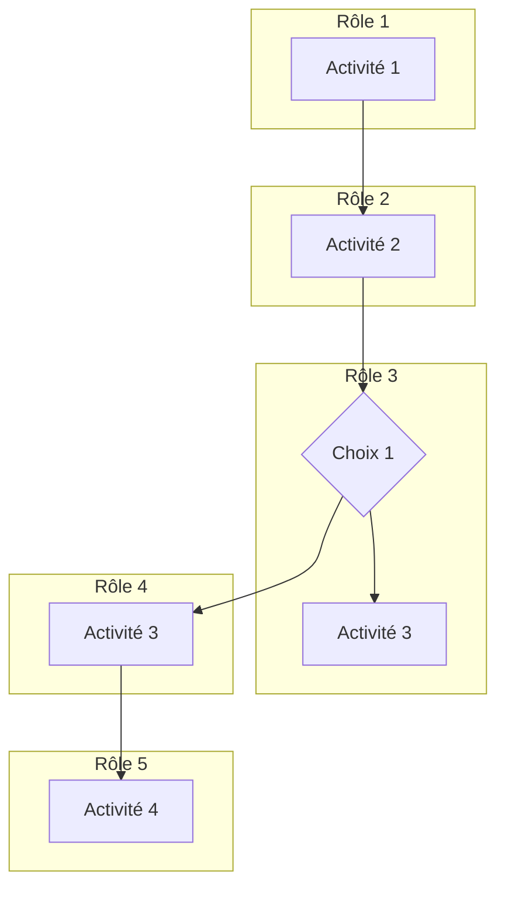
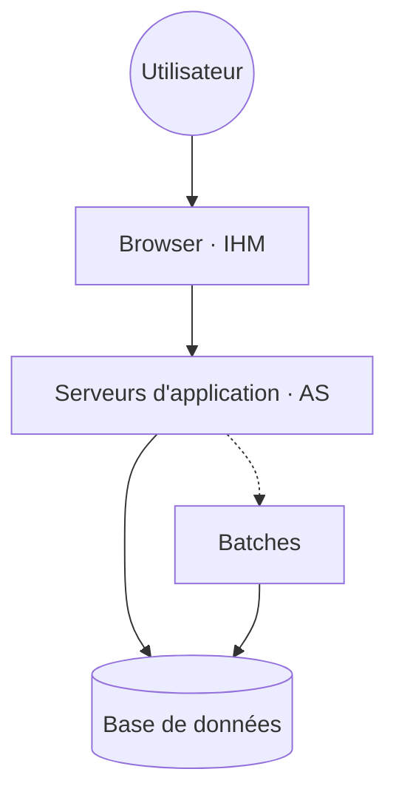
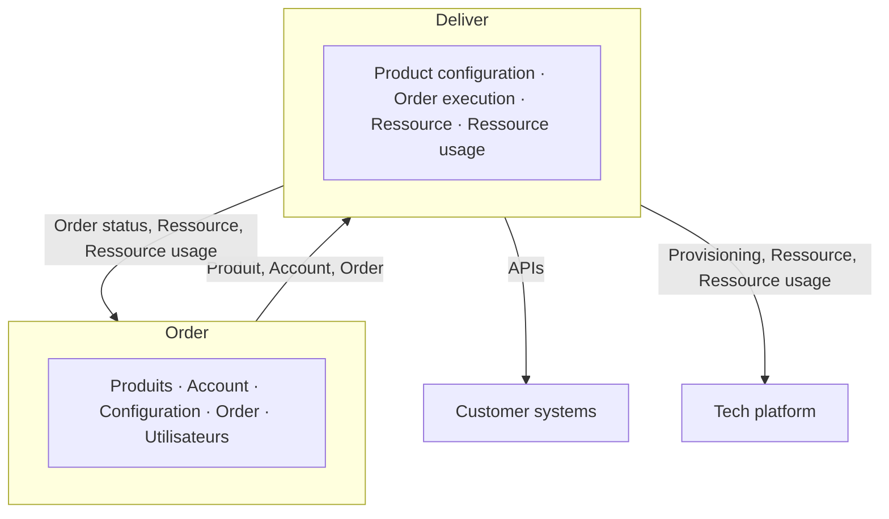
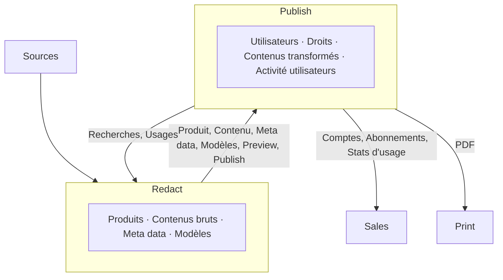

Une application, on la modélise avec MERISE ou UML. Mais un **système d'information** entier ? Personne ne le conçoit « from scratch » : on le fait **évoluer**, projet après projet. Sans modèle à l'échelle du SI, chaque projet optimise son coin et l'ensemble devient un plat de spaghettis. Cette session donne la méthode : **quatre plans de modélisation**, et les critères pour faire les vrais choix, ceux de découpage et de partage.

## Pourquoi urbaniser le SI

### Ce qu'on cherche à obtenir

Comme tout ce qu'on construit, un SI demande une **méthode** et des **outils** pour être construit et pour vivre. Comme on raisonne presque toujours sur son **évolution** (ou au minimum sur des projets de transformation), les objectifs sont souvent les mêmes :

<CardGrid cols={3}>
  <Card kicker="Besoin" title="Satisfaire les besoins fonctionnels" tone="signal">Le SI sert d'abord les métiers.</Card>
  <Card kicker="Agilité" title="Évoluer vite et à coût limité" tone="signal">La capacité du SI à changer sans tout casser.</Card>
  <Card kicker="Run" title="Limiter les coûts de fonctionnement" tone="default">Maintenance et exploitation.</Card>
  <Card kicker="Service" title="Améliorer le niveau de service" tone="default">Performance, fluidité de l'information.</Card>
  <Card kicker="Risques" title="Maîtriser les risques" tone="amber">Obsolescence, incidents d'exploitation, sécurité informatique.</Card>
</CardGrid>

### Architecture et urbanisme : l'analogie de la ville

Dans la vie, l'**architecte** conçoit un bâtiment, l'**urbaniste** organise la ville : zones, quartiers, réseaux, règles de construction. Pour un SI, c'est pareil. L'architecte conçoit une application. L'urbaniste dessine la **carte d'ensemble** : quelles applications, quels flux entre elles, quelles données de référence partagées.

L'urbanisme apporte trois choses :

<CardGrid cols={3}>
  <Card kicker="#1" title="Vision globale" tone="signal">
    Donner une **visibilité globale du SI à tous les acteurs**, pour améliorer leur efficacité collective : processus, fonctions, applications, données de référence, données de transaction, flux (fichiers, messages, synchrones).
  </Card>
  <Card kicker="#2" title="Cohérence" tone="signal">
    Faire contribuer les projets à la dynamique d'ensemble en orientant leurs choix vers des **décisions cohérentes** : alignement aux besoins métier de bout en bout, cohérence transversale des données et des processus, efficacité dans la durée, agilité face aux évolutions.
  </Card>
  <Card kicker="#3" title="Choisir la trajectoire" tone="signal">
    Identifier **toutes les options** et leurs conséquences à court, moyen et long terme. Remettre les choix locaux des projets dans leur perspective SI. **Piloter la transformation** du SI.
  </Card>
</CardGrid>

<KeyIdea>Pas de réponse absolue à des questions absolues : l'urbaniste éclaire des options, il ne déroule pas une recette.</KeyIdea>

### Des principes d'architecture, pas des dogmes

Les choix d'urbanisme et d'architecture s'appuient sur des **règles partagées**, compréhensibles et largement reconnues. Ces règles :

- **peuvent être enfreintes** pour des raisons tactiques ou stratégiques (consciemment, pas par accident) ;
- doivent **s'enrichir et évoluer** avec le SI et son environnement.

Le support montre enfin pourquoi on a besoin de **modèles** : une même réalité (gestion commerciale, plateforme d'intégration, logistique, ordonnanceurs, fichiers `.dat` et `.csv` échangés en FTP ou NFS…) se lit sur plusieurs cartes superposées, chacune à son niveau. Sans ces cartes, la complexité est ingérable.

## Les quatre plans de modélisation

Le SI se modélise en **quatre plans superposés**, du plus « métier » au plus « technique ». Chaque élément d'un plan s'appuie sur des éléments du plan du dessous.

<Figure caption="Les quatre plans de modélisation · Source : support UBSI, « Plans de modélisation »">
```mermaid
flowchart TB
  M["Plan métier · macro-processus, processus, activités"]
  F["Plan fonctionnel · zones, quartiers, îlots, fonctions"]
  A["Plan applicatif · applications et flux"]
  T["Plan technique · sites, serveurs, stockage, réseau"]
  M --> F --> A --> T
  classDef c fill:var(--signal-soft),stroke:var(--signal);
  class M,F,A,T c;
```
</Figure>

Le schéma du support ajoute deux axes transverses : le **plan de développement** dans le temps (le SI se transforme par étapes) et les acteurs qui travaillent sur chaque plan (support métier, accompagnement fonctionnel, gestion applicative, exploitation technique).

### Plan métier : l'organisation du travail

Le plan métier adresse l'**organisation du travail et des collaborateurs** de l'entreprise.

- Il modélise l'organisation des utilisateurs en **rôles**, et la distribution de ces rôles entre les acteurs.
  - Vue historiquement très **hiérarchique**, avec des **silos** assez étanches entre grands domaines : comptabilité/finance, RH, ventes, marketing, achats…
  - Organisation battue en brèche par les *pure players*, qui repensent complètement business models et organisation.
- Il modélise aussi les **processus** : qui fait quoi, quand.
  - Vision plus décloisonnée, **de bout en bout**.
  - Mais souvent encore découpée, avec des questions de responsabilité mal résolues aux frontières.

En théorie, ce plan concerne plus l'organisation que l'IT (parfois réunies dans une **DOSI**). En pratique, il interfère de plus en plus avec l'IT :

- l'IT gouverne et structure de plus en plus l'organisation du travail : c'est la **digitalisation** de l'entreprise, voire son « uberisation » ;
- les cloisonnements et dysfonctionnements de l'organisation **se reflètent dans le SI**.

### Plan fonctionnel : raisonner « neutre »

Un plan **intermédiaire** de réflexion, qui se veut indépendant du plan métier et du plan applicatif. Son but : raisonner de manière « neutre » sur le SI pour l'urbaniser de façon « optimale ».

Il n'est pas vraiment indépendant pour autant : le SI doit **servir une organisation humaine** (lien au métier) et **obéir à des règles de construction** (lien à l'applicatif).

Il porte sur deux choses :

- les **fonctions** : ce que fait le SI pour ses utilisateurs ;
- les **données** : moins mises en avant, mais c'est en fait **l'essentiel du SI**. C'est le modèle de l'information manipulée et échangée entre les fonctions.

### Plan applicatif : comment le SI est construit

Le plan applicatif décrit le SI en termes de **développement applicatif** :

- le **périmètre fonctionnel** de chaque application ;
- les **données** gérées par chaque application ;
- les **flux** qui les intègrent, avec le choix de copier ou non les données selon les besoins d'accès.

Il fixe aussi les grandes lignes d'architecture : **progiciel ou développement spécifique**, et filières technologiques des développements spécifiques. Mais pas d'architecture logicielle détaillée (couches, modèles de données détaillés) à cette échelle.

<Callout type="definition" title="Objectif du plan applicatif">
Arbitrer les **frontières** entre applications et concevoir l'**intégration** du SI de manière transversale.
</Callout>

### Plan technique : sur quoi ça tourne

Le plan technique décrit les architectures techniques qui supportent les applications :

- les **middlewares** : serveurs d'application, bases de données, outils de reporting, ESB, ETL… ;
- les **services techniques transverses** : annuaires, GED… ;
- les **socles d'infrastructure** : poste de travail, serveur, stockage, réseau ;
- les **outils d'exploitation**.

Ses objectifs : la **sécurité** du SI, la tenue du **niveau de service** et l'**optimisation des coûts** de fonctionnement.

<Quiz question="Une équipe veut décider si la gestion des stocks magasin et la gestion des stocks entrepôt doivent être une seule fonction ou deux. Sur quel plan raisonne-t-elle d'abord ?" options={['Le plan métier', 'Le plan fonctionnel', 'Le plan applicatif', 'Le plan technique']} answer={1}>
  **Le plan fonctionnel.** On décide de la structuration et du partage des **fonctions** selon les périmètres, indépendamment de l'application qui les portera. Le plan applicatif vient ensuite (quelle application, quel progiciel) ; le piège est de partir directement de là, en raisonnant « outil » avant « fonction ».
</Quiz>

<DeepDive title="Les mêmes plans dans ArchiMate et TOGAF" level="approfondissement">
  Le standard de modélisation d'architecture d'entreprise **ArchiMate** (The Open Group) organise lui aussi ses éléments en couches : **Business** (acteurs, rôles, processus, objets métier), **Application** (composants applicatifs, interfaces, flux, objets de données) et **Technology** (nœuds, logiciels systèmes, réseaux). Il ajoute une couche « Strategy » (capacités, chaîne de valeur) au-dessus. Le plan fonctionnel français n'a pas d'équivalent direct : ArchiMate passe par les **business capabilities** et les *application functions*. Si tu rencontres un outil de cartographie (LeanIX, Mega HOPEX, Archi…), c'est le plus souvent ce métamodèle qu'il implémente.
</DeepDive>

## Plan métier

### Ce qu'on modélise, et pourquoi

Objectifs de la modélisation métier :

1. **Comprendre la chaîne de valeur** de l'entreprise : principale et de support.
2. **Documenter les processus métier**, pour partager une représentation des cinématiques clés des activités des utilisateurs autour du SI.
3. **Identifier l'organisation des acteurs métier** (internes et externes) autour du SI, et surtout cerner les différents **rôles**.
4. **Comprendre ce qui est partagé** entre acteurs, en distinguant ce qui « semble » partagé de ce qui l'est vraiment, et à quelle étendue.
5. **Partager une vision et un vocabulaire commun des données**, pour clarifier les notions essentielles et transverses du SI.

Les choix qui se font sur ce plan :

<Compare leftTitle="Organisation du travail" rightTitle="Organisation du partage et de la collaboration">
  <Fragment slot="left">
    - Séparation des tâches
    - Séquencement des activités
    - Automatisation et outillage « IT » des activités
  </Fragment>
  <Fragment slot="right">
    - Partage de l'information
    - Partage des fonctions
    - Partage et délégation des rôles
  </Fragment>
</Compare>

### La chaîne de valeur

Un modèle simple de l'entreprise pour appréhender sa **valeur ajoutée** (notion très proche de celle de la TVA) :

<KeyIdea>Valeur ajoutée = ce qu'on vend − ce qu'on achète.</KeyIdea>

La chaîne de valeur décrit les principales activités qui contribuent à cette valeur ajoutée :

- **directement** : les activités qui portent le travail « productif » (achat, production, vente) ;
- **indirectement** : les activités de **support** aux précédentes, comme l'IT ou les RH.

C'est un point d'entrée simplifié vers des concepts plus riches, notamment les **business capabilities**, qui décrivent plus précisément les missions opérationnelles de l'entreprise.

<Figure caption="Chaîne de valeur principale · Source : support UBSI, « Plan métier — chaîne de valeur »">
<Pipeline steps={[
  { title: 'Design', caption: 'Concevoir' },
  { title: 'Buy', caption: 'Acheter' },
  { title: 'Build', caption: 'Transformer' },
  { title: 'Store', caption: 'Stocker' },
  { title: 'Market', caption: 'Promouvoir' },
  { title: 'Sell', caption: 'Vendre' },
  { title: 'Ship', caption: 'Livrer' },
  { title: 'Support', caption: 'Après-vente' },
]} />
</Figure>

La **chaîne de valeur support**, elle, regroupe : RH, finance, communication, juridique, IT.

La représentation « classique » de **Porter** sépare de la même façon :

<Compare leftTitle="Activités principales (primary)" rightTitle="Activités de support">
  <Fragment slot="left">
    Inbound logistics · Operations · Outbound logistics · Marketing & Sales · Service. Elles débouchent sur la **marge**.
  </Fragment>
  <Fragment slot="right">
    Firm infrastructure · Human resource management · Technology development · Procurement. Elles irriguent toutes les activités principales.
  </Fragment>
</Compare>

### Les outils de modélisation métier

<CardGrid cols={3}>
  <Card kicker="Qui" title="Rôles" tone="signal">Permissions associées, affectation dans l'organisation.</Card>
  <Card kicker="Structure" title="Organisation" tone="signal">Hiérarchique fonctionnelle, par business unit, ou matricielle.</Card>
  <Card kicker="Comment" title="Processus clés" tone="signal">Activités, rôles, enchaînements.</Card>
</CardGrid>

Le **métamodèle** du plan métier relie cinq notions :

<Figure caption="Modèle du plan métier · Source : support UBSI">
| Notion | Relation |
| --- | --- |
| Processus | **contient** des activités |
| Périmètre | **contient** (isole, spécialise) des activités |
| Rôle | mène des activités |
| Activité | **utilise** ou **produit** des données |
| Donnée | manipulée par les activités |
</Figure>

### Modéliser les processus

- **Macro-processus** : les grands enchaînements de la chaîne de valeur, souvent attachés à une direction fonctionnelle principale, et faisant collaborer plusieurs acteurs. Exemples : recruter de nouveaux clients, traiter les commandes client, facturer les clients.
- **Rôles** : rôles internes d'employés, rôles clients, rôles fournisseurs, sous-traitants ou partenaires externes. Formalisme : une simple liste.
- **Activités** : les actions menées par les rôles dans le processus, avec leur contexte. Elles sont **séquencées par des liens** ; certaines sont distinguées pour expliciter le diagramme (choix/décision, début/fin, lien vers un autre processus).

La représentation visuelle (à adapter selon l'outil) est un **diagramme en couloirs** : une colonne par rôle, les activités placées dans le couloir du rôle qui les mène.

<Figure caption="Processus en couloirs : une colonne par rôle · Source : support UBSI, « Représentation visuelle »">

</Figure>

### Modèle étendu : données et périmètres

**Les données**, au niveau métier :

- avant tout un **lexique / glossaire partagé** ;
- un modèle de données **conceptuel simplifié** : les principales entités et leurs relations, avec leur arité ;
- modéliser **par l'exemple** : des phrases de définition qui expriment les relations, des exemples concrets ;
- les données sont **associées aux activités**, qui les utilisent ou les créent.

**Le périmètre** « isole » ou « spécialise » des activités métier. Dans le SI, il conduira à spécialiser des fonctions ou à cloisonner la visibilité et le partage des données. C'est une **clé de lecture essentielle** : un axe de séparation qui permet à l'entreprise de **scaler** (en séparant les activités non reliées) et de s'**adapter** à des contextes spécifiques.

<CardGrid cols={3}>
  <Card kicker="Exemple" title="Produits ou services" tone="muted">Un périmètre par gamme.</Card>
  <Card kicker="Exemple" title="Marché" tone="muted">Pays, marque.</Card>
  <Card kicker="Exemple" title="Clients" tone="muted">B2B ou B2C, grands comptes ou SMB.</Card>
</CardGrid>

## Plan fonctionnel

### Les fonctions : une hiérarchie

La modélisation des fonctions est habituellement **hiérarchique** : domaines et sous-domaines, ou, pour filer la métaphore urbaine, **zones, quartiers, îlots**.

Les fonctions sont regroupées selon deux clés :

- des fonctions relatives aux **mêmes données** ;
- des fonctions en support à des **processus cohérents**, menés par les **mêmes utilisateurs**.

<Figure caption="Une carte fonctionnelle de distribution · Source : support UBSI, « Les fonctions — 2 »">
<div class="not-prose grid grid-cols-[auto_1fr_auto] gap-1.5 text-center text-xs sm:text-sm">
  <div class="row-span-4 grid place-items-center rounded-md bg-synapse-soft p-2 [writing-mode:vertical-rl] sm:[writing-mode:horizontal-tb]">Référentiels</div>
  <div class="rounded-md bg-signal-soft p-2">Ventes</div>
  <div class="row-span-4 grid place-items-center rounded-md bg-synapse-soft p-2 [writing-mode:vertical-rl] sm:[writing-mode:horizontal-tb]">Décisionnel</div>
  <div class="grid grid-cols-2 gap-1.5 sm:grid-cols-4">
    <div class="rounded-md bg-signal-soft p-2">Marketing</div>
    <div class="rounded-md bg-signal-soft p-2">Achats</div>
    <div class="rounded-md bg-signal-soft p-2">Logistique</div>
    <div class="rounded-md bg-signal-soft p-2">Relation client</div>
  </div>
  <div class="rounded-md bg-surface-2 p-2">Comptabilité</div>
  <div class="rounded-md bg-surface-2 p-2">RH</div>
</div>
</Figure>

### Les données : trois choses à capturer

Au niveau SI, on ne fait **pas** de modélisation technique des données. On capture :

1. l'identification **macroscopique** des principales données du SI ;
2. les **principales relations** entre ces données ;
3. l'**usage** de ces données dans les principales zones fonctionnelles.

<Compare leftTitle="Données de référentiel" rightTitle="Données de transaction">
  <Fragment slot="left">
    Elles **qualifient** l'ensemble des événements du SI.
    - **Données de référence statiques** : devises, pays, adresses, codes TVA…
    - **Données maîtres dynamiques** : clients, fournisseurs…
  </Fragment>
  <Fragment slot="right">
    Elles **supportent les événements** des processus : commandes, factures, bons de livraison, ventes…
  </Fragment>
</Compare>

<Figure caption="Carte des données d'un distributeur : chaque transaction référence des données de référentiel · Source : support UBSI, « Les données — 2 »">
| Donnée de transaction | Référence |
| --- | --- |
| Commande fournisseur | Fournisseur, Produit |
| Facture fournisseur | Fournisseur, Produit |
| Avis d'expédition | Fournisseur, Entrepôt |
| Bon de livraison | Fournisseur, Produit, Entrepôt |
| Bon de livraison magasin | Produit, Magasin, Entrepôt |
| Commande magasin | Produit, Magasin |
| Vente Internet | Produit, Client, Paiement |
| Ticket magasin | Produit, Client, Paiement |
| Paiement | Banque |
</Figure>

Côté référentiel, la carte relie aussi le **Produit** à son **Fournisseur**, et le **Magasin** aux produits qu'il vend. Le support colore en vert les données de référentiel (Fournisseur, Produit, Client, Banque, Entrepôt, Magasin) et en bleu les données de transaction.

### La notion de périmètre

Les sociétés sont rarement homogènes. Elles se segmentent en :

- filiales, business units ou marques ;
- unités organisationnelles (magasin, région…) ;
- familles de produits ;
- canaux de vente : Internet, vente indirecte, magasin en propre, magasin en franchise ;
- pays.

Le SI se segmente souvent en conséquence pour certaines fonctions : solutions spécifiques, déclinaisons spécifiques, ou données plus ou moins fortement **cloisonnées**.

### Les choix de modélisation fonctionnelle

<CardGrid cols={3}>
  <Card kicker="Structure" title="Fonctions et données" tone="signal">
    Comment découper les fonctions ? Lesquelles regrouper ou séparer ?
  </Card>
  <Card kicker="Partage" title="Fonctions selon les périmètres" tone="signal">
    Quelle spécialisation ? Quelle communalité d'usage et de paramétrage ? Quelle centralisation ?
  </Card>
  <Card kicker="Partage" title="Données selon les périmètres" tone="signal">
    Partage et visibilité des données de référentiel, puis des données de transaction.
  </Card>
</CardGrid>

<Callout type="tip" title="Côté TP">
Les mêmes questions, appliquées au cas Darty/Fnac du TP :

- **Structure** : sépare-t-on le back office et les ventes magasin ? Le back office magasin et les achats ? Les achats et le référentiel produit ?
- **Fonctions selon les périmètres** : gestion de stock entrepôt ou magasin ? Stocks Internet ou entrepôts magasin ? Quelles fonctions partager entre Darty et Fnac ? Back offices centralisés ou décentralisés ?
- **Données selon les périmètres** : partage et visibilité des données client entre Darty et Fnac ? Quelles informations client partager entre magasins ? Entre Internet et les magasins ?
</Callout>

### Comment faire les choix

<CardGrid cols={3}>
  <Card kicker="Métier" title="L'organisation" tone="signal">
    On ne regroupe pas des fonctions pilotées et utilisées par des organisations **disjointes**, sauf volonté forte de collaboration.
  </Card>
  <Card kicker="Applicatif" title="Les progiciels" tone="signal">
    Critère fort et structurant : le découpage s'inspire de la segmentation des **progiciels**, et le niveau de partage s'aligne sur leur capacité à faire cohabiter les périmètres.
  </Card>
  <Card kicker="Technique" title="La distribution" tone="signal">
    Centraliser et partager est d'autant plus dur que les populations sont **hétérogènes, distribuées et nombreuses**. La centralisation est un *enabler* métier, mais aussi un facteur de **risque et de rigidité**.
  </Card>
</CardGrid>

Mais il n'y a **pas de « vrais » critères fonctionnels absolus** :

- le seul vrai principe : ne pas faire de choix techniques qui s'imposent au métier **sans adhésion métier** ;
- et ne pas sous-estimer les **contraintes techniques** qui découlent des choix métier ;
- les choix applicatifs reflètent souvent plus l'**organisation** (métier et DSI) et la structuration des projets qu'un plan à long terme ;
- il est plus important d'obtenir l'**adhésion** que d'atteindre une vision idéale.

<Callout type="warning" title="Le risque du plan fonctionnel">
Un modèle fonctionnel qui n'est pas enraciné dans la réalité applicative et technique d'un côté, et aligné avec la structure métier de l'autre, **ne sert à rien**.
</Callout>

<DeepDive title="La loi de Conway" level="approfondissement">
  Le constat du support (« les choix applicatifs sont le reflet de l'organisation ») a un nom : la **loi de Conway** (1968). « Les organisations qui conçoivent des systèmes sont contraintes de produire des designs qui copient leur structure de communication. » Deux directions qui ne se parlent pas produisent deux applications reliées par un flux minimal. Le mouvement micro-services en a tiré une pratique, la « manœuvre de Conway inverse » : organiser les équipes selon l'architecture qu'on veut obtenir.
</DeepDive>

## Plan applicatif

### Objectifs et choix

<Compare leftTitle="Objectifs de la modélisation" rightTitle="Choix à faire">
  <Fragment slot="left">
    - Déterminer des **périmètres d'application**
    - Identifier les liens entre applications et **limiter leur couplage**
    - Comprendre la **circulation des données**
    - Vérifier le respect des principes d'urbanisation et d'intégration
    - Planifier la mise en œuvre et les évolutions
    - Maîtriser le **patrimoine**
  </Fragment>
  <Fragment slot="right">
    - Ce qui est dans le périmètre d'une application ou non (données, fonctions, traitements)
    - Le rôle de chaque application vis-à-vis des données : la **stocker** ou non, l'**utiliser** ou la **modifier**
    - Les **mécanismes d'intégration** adaptés aux (vrais) besoins, dans une palette de patterns éligibles
    - Les modalités d'implémentation : **SaaS**, **progiciel** on premise, **développement spécifique**
  </Fragment>
</Compare>

### Le modèle du plan applicatif

Trois notions suffisent :

- **Application** : un élément **autonome** du SI, porteur de données et de services exposés au SI (services utilisateur ou applicatifs). Les *golden copies* et leurs API, qui gèrent les objets partagés du SI, sont des applications d'un type un peu particulier.
- **Donnée** : une application la manipule parce qu'elle en est le **créateur principal**, ou parce qu'elle l'**utilise** (par copie locale ou par accès distant).
- **Flux** : un échange inter-applicatif **point à point** qui transporte des données. Il peut être associé à un (voire deux) demi-flux, c'est-à-dire un service exposé par chaque application concernée.

<Figure caption="Modèle du plan applicatif · Source : support UBSI">
```mermaid
flowchart TB
  A1[Application productrice] -->|produit| D[Donnée]
  A1 --> F[Flux point à point]
  F --> A2[Application consommatrice]
  A2 -->|utilise| D
  classDef c fill:var(--signal-soft),stroke:var(--signal);
  class A1,A2,F,D c;
```
</Figure>

### La cartographie des flux

Un modèle **extrêmement simple** : tout échange est répertorié et identifié par son couple **producteur / consommateur** de données, avec :

- le **sens** des données, l'**initiateur** et le **mode** d'échange ;
- la **nature** des données échangées.

Cela suppose d'identifier les applications dans un **référentiel**. La clé : que cette carte **structure les projets dès leur cadrage**. On l'enrichit selon le contexte : éléments de mise en œuvre, fonctionnels, d'usage, de classification, et **dates** (identification, mise en œuvre, retrait).

L'exemple du support (une *flow map* autour de Salesforce) distingue chaque flux par sa légende : *webservice push*, *batch push*, *webservice pull*, *message push*.

### Pourquoi découper

L'option **monolithe** n'est ni soutenable ni possible. C'était pourtant la promesse des **ERP** : une seule application pour toute l'entreprise.

<CardGrid cols={3}>
  <Card kicker="Organisation" title="On construit une ville par quartiers" tone="signal">
    Très difficile de construire toute une ville d'un coup. En réalité, elle se construit et se rénove **par quartiers**.
  </Card>
  <Card kicker="Mutualisation" title="Des besoins communs sur des sous-ensembles" tone="signal">
    Des besoins communs émergent plus facilement sur des sous-ensembles. Et les éditeurs investissent pour traiter les besoins d'un **marché large**.
  </Card>
  <Card kicker="Pouvoir" title="Une affaire humaine" tone="amber">
    Derrière le SI, il y a des directions métier. Chacune veut légitimement s'approprier un des outils essentiels de **sa performance**.
  </Card>
</CardGrid>

### Comment découper : la modularité

Il faut une **abstraction** qui matérialise le découpage, une notion de **modularité**, qui permet de construire le SI par parties et d'assembler ces parties. Et des propriétés qui garantissent que le découpage est **possible et durable** :

1. faire évoluer un module **sans impacter** les autres ;
2. **arrêter** un module sans arrêter l'ensemble ;
3. **minimiser** les liens avec les autres modules.

### Qu'est-ce qu'une application ?

La méthode de découpage la plus éprouvée : l'**application**, la brique de Lego de la construction des SI. Une application est principalement définie par :

<CardGrid cols={3}>
  <Card kicker="Data" title="Un stock de données" tone="signal">Que **seule** l'application peut accéder.</Card>
  <Card kicker="IHM" title="Une interaction utilisateur" tone="signal">Pour saisir ou consulter les données.</Card>
  <Card kicker="Traitement" title="Une capacité de traitement" tone="signal">Sur les données de l'application.</Card>
  <Card kicker="Intégration" title="Des mécanismes d'intégration" tone="default">Pour communiquer avec les autres applications.</Card>
  <Card kicker="Opération" title="Des mécanismes d'opération" tone="default">Arrêter, démarrer, mettre à jour, sauvegarder, restaurer **sans impacter les autres**.</Card>
</CardGrid>

Cette méthode fonctionne et est éprouvée dans **tous les SI de toutes les entreprises**.

<Figure caption="Architecture générique d'une application · Source : support UBSI">

</Figure>

### D'autres manières de découper

Ce modèle n'est pas universel. Il existe **trois autres visions** du découpage d'un SI : le modèle **ERP**, le modèle **data centric** et le modèle **micro services**. Aucun n'a prouvé à ce jour son universalité, mais chacun a un vrai sens sur **des sous-ensembles** du SI.

<Figure caption="Quatre visions du découpage d'un SI · Source : support UBSI, « Plan applicatif »">
<SplitModels />
</Figure>

<Quiz question="Dans le modèle « data centric », plusieurs applications partagent une base de données commune. Quelle propriété de la modularité est la plus menacée ?" options={['Pouvoir arrêter un module sans arrêter l’ensemble', 'Pouvoir faire évoluer un module sans impacter les autres', 'Disposer d’une IHM par application']} answer={1}>
  **Faire évoluer un module sans impacter les autres.** Si deux applications lisent les mêmes tables, changer le modèle de données de l'une casse l'autre : le couplage passe par la base. C'est exactement ce qu'interdit la définition « un stock de données que **seule** l'application peut accéder ». L'arrêt séparé reste possible tant que la base tourne, d'où le piège.
</Quiz>

<DeepDive title="Micro-services : la définition de référence" level="approfondissement">
  L'article de **Martin Fowler et James Lewis** (2014) décrit le style micro-services comme une suite de petits services, chacun dans son propre processus, communiquant par des mécanismes légers (souvent HTTP), **organisés autour des capacités métier**, déployables indépendamment, avec une **gestion décentralisée des données** : chaque service possède sa base. On retrouve la définition d'application du support, à une granularité plus fine. Les auteurs mettent eux-mêmes en garde : le coût de la distribution (latence, cohérence, exploitation) n'est rentable qu'au-delà d'une certaine complexité, ce qui rejoint le « pas universel » du support.
</DeepDive>

### Les critères qui influencent le découpage

Quel que soit le modèle, reste la question de **où découper**. Il n'y a pas de réponse magique : un bon découpage est fait par un **bon architecte**, faute de règles formalisées qui le rendraient automatique. Mais des critères pèsent :

- l'**organisation humaine** utilisatrice (standards d'organisation des entreprises) ;
- la séparation **front office / back office** ;
- l'**organisation projet** ;
- la structure de l'**offre** disponible en progiciels (et maintenant en SaaS) ;
- l'**autonomie** forte de certaines fonctions (contraintes techniques) et les contraintes de **niveau de service** (SLA) ;
- sinon, une forte **connexité** des données et traitements (analyse en composantes connexes d'un graphe), avec peu de liens entre éléments.

### Quelques règles de découpage

<Steps>
1. Un **sponsor métier** clair, idéalement unique.
2. Une population d'usagers assez **homogène**.
3. Des fonctions **fortement liées** entre elles, notamment par les données manipulées.
4. Un **nombre limité d'applications** pour un même utilisateur, surtout dans un processus business.
5. **Pas deux applications écrivain de la même donnée** ; limiter la réplication des données.
6. **Une seule implémentation** des règles métier complexes.
7. Usage de **solutions standards** du marché, en minimisant le spécifique et les adaptations.
8. Minimiser la complexité des composants de **forte criticité**.
9. Ne pas mixer des **workloads** très différentes dans la même application.
10. Pas tous les œufs dans le même panier.
</Steps>

<Callout type="warning" title="La règle qui évite le plus de dégâts">
**Une donnée, un seul écrivain.** Deux applications qui écrivent la même donnée, c'est la garantie d'incohérences et de flux de réconciliation sans fin.
</Callout>

La méthode est **expérimentale et pragmatique** : s'appuyer sur les pratiques communes des SI et sur les offres du marché (progiciels et SaaS), **imaginer plusieurs scénarios** et les évaluer par rapport aux objectifs.

### Et dans la vraie vie ?

<Compare leftTitle="La théorie" rightTitle="Les projets réels">
  <Fragment slot="left">
    Un **besoin métier** → une **conception fonctionnelle** → de nouvelles applications, des applications modifiées, des applications supprimées.
  </Fragment>
  <Fragment slot="right">
    - Le besoin est exprimé **en termes de solution** (Salesforce, SAP, Magento…) plutôt qu'en vrais besoins.
    - La « solution » pose des questions complexes de mise en œuvre : il faut **revenir aux besoins fonctionnels**, et souvent à l'organisation métier.
    - L'effort d'**intégration au SI** dépasse souvent l'effort de mise en œuvre de la solution.
    - Les applications qu'on devait supprimer **demeurent**, parce qu'on a « oublié » des fonctions mal connues.
  </Fragment>
</Compare>

### Deux exemples de découpage

Le support illustre le découpage par deux SI coupés en **deux grandes applications** : chaque application porte ses données, et les flux qui les relient sont nommés par la donnée qu'ils transportent.

<Figure caption="Exemple AWS · Order to Deliver · Source : support UBSI, « Découpage applicatif »">

</Figure>

<Figure caption="Exemple édition B2B · Redact to Publish · Source : support UBSI, « Découpage applicatif »">

</Figure>

## Plan technique

### Objectifs et choix

Objectifs : **maîtriser** les grands socles et leur obsolescence, les évolutions, les opérations et les risques.

<CardGrid cols={2}>
  <Card kicker="Hébergement" title="Où ça tourne" tone="signal">On premise, cloud public, cloud privé ou hybride.</Card>
  <Card kicker="Socles" title="Avec quoi" tone="signal">Langages et frameworks, socles middleware et d'intégration, socles de stockage.</Card>
  <Card kicker="Sécurité et réseau" title="Comment c'est relié" tone="signal">Infrastructure réseau globale et infrastructures de sécurité associées.</Card>
  <Card kicker="Opération" title="Qui le fait tourner" tone="signal">Outils d'exploitation et d'automatisation, DevOps et collaboration avec les projets, niveau d'externalisation.</Card>
</CardGrid>

### Le modèle SOI

Le plan technique se décrit comme une **pile de services**, chaque couche s'appuyant sur celle du dessous, encadrée par des services transverses de projet et d'opération.

<Figure caption="Modèle SOI, du haut vers le bas · Source : support UBSI, « Plan technique »">
| Couche | Exemples |
| --- | --- |
| Services utilisateurs | Poste de travail, bureautique, messagerie, téléphonie |
| Services applications | ERP, décisionnel, intranet |
| Services applications génériques | Frontal de flux, reporting, référentiel, GED, gestion des entrées/sorties, portail, archivage, contrôle d'accès, framework applicatif |
| Services middleware | Serveur d'application, base de données, ETL, EAI, transfert de fichiers |
| Services ressources | Espace de stockage, partition serveur, accès réseau LAN, accès Internet |
| Services physiques | Stockage, serveur, LAN, WAN/MAN, hébergement, robotique |
| *Transverse : services opération* | Supervision, provisioning, sauvegarde, ordonnancement, reporting |
| *Transverse : services projet* | Gestion d'environnements, intégration technique, tests de performance |
</Figure>

## Du métier aux applications : s'entraîner

Le support termine sur des cas réels, à traiter avec la méthode de la session : identifier les acteurs et les processus, les fonctions et les données, puis proposer un ou plusieurs **découpages applicatifs** et les flux qui vont avec.

<CardGrid cols={2}>
  <Card kicker="#0 · Asset management" title="Un reporting de qualité par client et par fonds" tone="default">
    Plusieurs outils de gestion selon les types de fonds. Reporting très réglementé, calcul intensif d'indicateurs sur tout l'historique, adapté par client ou canal, mêlant calculs et textes des gérants, diffusé en ligne, en PDF, en marque blanche et par API.
  </Card>
  <Card kicker="#1 · Retail B2C" title="Une marketplace sur un e-commerce historique" tone="default">
    Commandes multi-vendeurs, offre des vendeurs (produits, prix, promotions, contenus), paiement unique, livraison propre à chaque vendeur avec un checkout commun, service client commun intégré à celui du vendeur.
  </Card>
  <Card kicker="#2 · B2B abonnement" title="Refondre l'Order To Cash" tone="default">
    Commande e-commerce ou devis commercial à pricing complexe, facturation pré/post-payée, réabonnement, recouvrement et relance, primes des commerciaux, comptabilité client, analytique et générale.
  </Card>
  <Card kicker="#3 · B2C multicanal" title="De l'IA pour réduire le churn" tone="default">
    Usage des services, incidents de paiement, échéances, historique d'achats sur plusieurs canaux (in app, e-commerce, plateformes tierces). L'IA détecte le risque et ses causes et déclenche des communications push ou à l'initiative du client.
  </Card>
  <Card kicker="#4 · B2B services" title="Refondre la relation client autour de Salesforce" tone="default">
    Clients B2C, PME et grands comptes ; les commerciaux veulent toute l'information client (référentiel, ventes, facturation, usage), le marketing digital et des devis complexes sur une offre large.
  </Card>
  <Card kicker="#5 · Industrie automobile" title="Réconcilier demande commerciale et capacité industrielle" tone="default">
    Plus de 30 marchés, prévisions de vente par marché, référentiel commercial et tarifs, historique détaillé, stocks centraux et locaux, contraintes de capacité et de logistique, optimisation par un produit standard du marché.
  </Card>
</CardGrid>

<Callout type="tip" title="Le réflexe à avoir">
Chaque cas commence par « Je veux… » suivi d'une **solution** ou d'un outil. C'est exactement le piège de la « vraie vie » : reformule d'abord le besoin métier, puis les fonctions et les données, avant de parler d'application.
</Callout>

## À retenir

<Takeaways>
1. **Urbaniser, c'est donner une vision globale, de la cohérence et une trajectoire** au SI, qu'on fait évoluer plutôt que de le construire from scratch.
2. **Quatre plans** : métier (rôles, processus), fonctionnel (fonctions, données), applicatif (applications, flux), technique (socles, infrastructure).
3. **Les données sont l'essentiel du SI** : référentiel (statique ou maître) et transactions, à partager ou cloisonner selon les périmètres.
4. **Une application = un stock de données qu'elle seule accède**, une IHM, des traitements, des mécanismes d'intégration et d'opération autonomes.
5. **Pas de découpage idéal** : des critères (organisation, progiciels, SLA, connexité) et des règles (une donnée, un écrivain), et l'adhésion métier avant la vision idéale.
</Takeaways>
