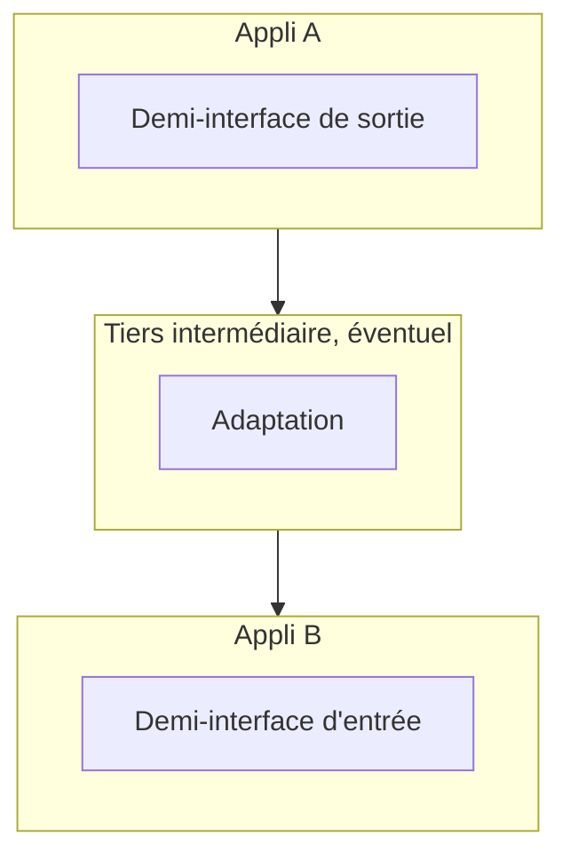

Appli A doit parler à Appli B. Entre les deux, sur la première diapositive du support, une flèche et quatre points d'interrogation. Cette session remplit la flèche : **quel transport**, **quel format**, **par quelle porte** de chaque application, et **quels traitements** placer entre les deux. C'est le cadre qui sert à raisonner sur n'importe quel flux de la cartographie vue en session 1.

## Que signifie « intégrer » ?

### Deux intentions

<Compare leftTitle="Échanger de l'information" rightTitle="Déléguer un traitement">
  <Fragment slot="left">A transmet des données à B (une commande, un référentiel, un fichier de ventes).</Fragment>
  <Fragment slot="right">A demande à B de faire quelque chose pour son compte (calculer un prix, réserver un stock).</Fragment>
</Compare>

### Les grands types de transport

<CardGrid cols={3}>
  <Card kicker="Synchrone" title="J'attends la réponse" tone="signal">
    L'initiateur **attend la réponse** du partenaire pour continuer son travail. Web services, et d'autres variantes spécifiques. Souvent une logique **transactionnelle**.
  </Card>
  <Card kicker="Asynchrone · masse" title="Échange de fichiers" tone="synapse">
    L'initiateur **n'attend pas** la réponse, mais pourra en recevoir une plus tard. Transport **de masse**.
  </Card>
  <Card kicker="Asynchrone · message" title="Échange de messages" tone="synapse">
    Même principe, mais par **message unitaire**, au fil de l'eau.
  </Card>
</CardGrid>

### Les principaux formats d'échange

**Binaire**, **CSV**, **XML**, **JSON** : les forces et limites de chacun sont détaillées en session 2.

## Comment intégrer : les demi-interfaces

### Chaque application apporte sa moitié

- Chaque application doit apporter une **demi-interface** : pour **émettre** des données, ou pour en **recevoir**.
- Éventuellement, un **tiers intermédiaire** est nécessaire, pour **adapter** la sortie de l'un à l'entrée de l'autre.

### Par où une application peut-elle échanger ?

On reprend l'**architecture générique d'une application** de la session 1 : un utilisateur, une **IHM** (le navigateur), des **serveurs d'application** (AS), des **batches**, une **base de données**. Chacun de ces étages est une porte possible, **en entrée comme en sortie** ; on y ajoute l'intégration **manuelle**, où c'est l'utilisateur qui fait le lien.

<Figure caption="Les cinq points d'intégration : choisis-en un pour voir l'étage concerné · Source : support UBSI, « Cadre général d'intégration »">
<IntegrationTiers />
</Figure>

<Quiz question="Un éditeur de progiciel propose de laisser l'application partenaire lire directement ses tables. Quel est le principal risque à moyen terme ?" options={['Les performances SQL', 'Le partenaire dépend du modèle de données interne : la prochaine version du progiciel peut casser l’intégration', 'L’absence de format XML']} answer={1}>
  **L'exposition du modèle de données.** Le partenaire devient couplé aux tables internes : toute évolution du schéma le casse, et l'AS ne « voit » pas ce qui se passe dans la base (règles de gestion contournées). D'où les **vues** et les **tables d'interface**, qui recréent une demi-interface stable. Les performances SQL attirent parce que l'accès direct est rapide, mais ce n'est pas le problème.
</Quiz>

### La « compatibilité » entre sortie et entrée

Le support met face à face toutes les demi-interfaces de sortie d'Appli A et toutes les demi-interfaces d'entrée d'Appli B. Certaines se branchent **directement** l'une sur l'autre ; d'autres non.

<Compare leftTitle="Sortie d'Appli A" rightTitle="Entrée d'Appli B">
  <Fragment slot="left">
    - **Manuel** : lecture visuelle, export de fichiers
    - **IHM** : exposition d'URL, de pages, de portlets, de fragments d'IHM ; post IHM ; IHM standard
    - **AS** : exposition ou consommation de service, envoi de message, de fichier, envoi dans la base cible
    - **Batch** : envoi de message, de fichier, accès en écriture à une base distante
    - **Base** : accès direct aux tables, via des vues, tables d'interface de sortie
  </Fragment>
  <Fragment slot="right">
    - **Manuel** : saisie IHM, import de fichiers
    - **IHM** : redirection d'URL, iFrame, portlets, intégration de fragments, appel de service, IHM standard, GET IHM
    - **AS** : consommation ou exposition de service, réception de message, de fichier, extraction de la base source
    - **Batch** : réception de message, de fichier, accès en lecture à une base distante
    - **Base** : accès direct aux tables, via des vues, tables d'interface
  </Fragment>
</Compare>

Exemples de branchements directs : un **envoi de fichier** (AS ou batch) chez A vers une **réception de fichier** chez B ; une **exposition de service** chez A vers une **consommation de service** chez B ; un **export de fichiers** manuel vers un **import de fichiers**. Quand les deux moitiés ne se rejoignent pas (un fichier d'un côté, un service de l'autre), il faut un **tiers** : ce sont les **outils et solutions d'intégration**, eux-mêmes dotés de leurs propres demi-interfaces.

<Compare leftTitle="Branchement direct" rightTitle="Avec un tiers d'intégration">
  <Fragment slot="left">Appli A · **envoi de fichier** → Appli B · **réception de fichier**. Les deux demi-interfaces se rejoignent.</Fragment>
  <Fragment slot="right">Appli A · **envoi de fichier** → **outil d'intégration** → Appli B · **consommation de service**. Le tiers adapte la sortie de l'un à l'entrée de l'autre.</Fragment>
</Compare>

### Décrire un flux

Sur le schéma du support, chaque flux entre A et B porte une **fiche d'identité** :

<Figure caption="Les attributs d'un flux · Source : support UBSI, « Cadre général d'intégration »">
| Attribut | Question |
| --- | --- |
| Data functional nature | Quelle donnée métier circule ? |
| Data exchange direction | Dans quel sens ? |
| Business event trigger | Quel événement métier déclenche l'échange ? |
| Finesse (volume) | Unitaire ou en masse ? Combien ? |
| Synchronism | Synchrone ou asynchrone ? |
| Trigger | Qui ou quoi lance techniquement l'échange ? |
| Service Level Agreement | Quels engagements (délai, disponibilité) ? |
</Figure>

<Callout type="tip" title="Lien avec la session 2">
La ligne **Service Level Agreement** est le contrat de service du flux : usage, performances, risques, coûts. Un flux sans SLA écrit est un flux dont personne ne sait s'il est en panne.
</Callout>

## Les grands choix d'intégration

<CardGrid cols={2}>
  <Card kicker="1" title="Copier les données ou non" tone="signal">Copie locale chez B, ou accès distant à chaque besoin.</Card>
  <Card kicker="2" title="Le mode" tone="signal">Synchrone, asynchrone au fil de l'eau, asynchrone de masse (batch), IHM.</Card>
  <Card kicker="3" title="Réutilisabilité" tone="signal">Un échange unique, ou une **approche service** réutilisable.</Card>
  <Card kicker="4" title="Tiers intermédiaire ou non" tone="signal">Point à point, ou via une plateforme d'intégration.</Card>
  <Card kicker="5" title="Répartition des traitements" tone="signal">Entre les deux (ou trois) tiers : A, B et l'éventuel intermédiaire.</Card>
  <Card kicker="6" title="La sécurité" tone="signal">Les choix de sécurité de l’échange, dont la propagation de l’identité à l’origine de la demande.</Card>
</CardGrid>

<Quiz question="Le référentiel produit (100 000 articles) est mis à jour une fois par nuit, et la caisse magasin doit afficher les prix même si le réseau vers le siège tombe. Quels choix d'intégration sont les plus cohérents ?" options={['Appel synchrone au référentiel à chaque scan d’article', 'Copie locale des données, transport asynchrone de masse (fichier) chaque nuit', 'Intégration par l’IHM du référentiel dans la caisse']} answer={1}>
  **Copie locale par un batch de masse.** Le besoin d'autonomie (réseau coupé) impose de **copier** la donnée ; le rythme (une mise à jour par nuit) et le volume orientent vers un **fichier**. L'appel synchrone attire parce qu'il donne toujours la donnée fraîche, mais il rend chaque vente dépendante du réseau et du référentiel : deux composants en série de plus.
</Quiz>

## Les traitements d'intégration

Entre « A émet » et « B a intégré », plusieurs traitements s'enchaînent. La question d'architecture est **où** les placer : chez A, chez B, ou dans un tiers.

<Figure caption="Les traitements d'intégration, de l'émission à la réception · Source : support UBSI, « Les traitements d'intégration »">
<Pipeline steps={[
  { title: 'Émission', caption: 'extraction', detail: 'En réponse à une demande, ou sur détection d’un événement ; puis extraction des données.' },
  { title: 'Transformation', caption: 'format', detail: 'Grands formats techniques (XML, CSV, JSON) et formats logiques des données (dates, montants…).' },
  { title: 'Transcodification', caption: 'codes', detail: 'Traduire les codes de A en codes de B : taux de TVA, type de client, type de produit, poids, codes pays…' },
  { title: 'Enrichissement', caption: 'compléter', detail: 'Ajouter les données implicites non transférées, par exemple depuis des référentiels transverses partagés.' },
  { title: 'Routage', caption: 'orchestration', detail: '1 → N, 1 parmi N, 1 → N en séquence, ou N en orchestration avec une logique intermédiaire.' },
  { title: 'Réception', caption: 'intégration', detail: 'Acquisition technique, validation (format, intégrité référentielle, intégrité sémantique), intégration dans les bases métier, traitements associés.', tone: 'synapse' },
]} />
</Figure>

### Émission et réception

<Compare leftTitle="Émission / extraction" rightTitle="Intégration / réception">
  <Fragment slot="left">
    - En **réponse à une demande**
    - Sur **détection d'événements**
    - **Extraction** des données
  </Fragment>
  <Fragment slot="right">
    - **Acquisition** technique
    - **Validation** des données : format, intégrité référentielle, intégrité sémantique
    - **Intégration** dans les bases métier
    - **Traitements** associés
  </Fragment>
</Compare>

### Transformation de format

Deux niveaux : les grands **formats techniques** (XML, CSV, JSON) et les **formats logiques** des données (dates, montants…). Un `24/10/2026` d'un côté, un `2026-10-24` de l'autre.

### Transcodification

Les données d'Appli A sont **codifiées** pour normaliser la saisie, et cette codification n'est **pas nécessairement partagée** avec B : taux de TVA, type de client, type de produit, poids, codes pays… Il faut traduire.

### Enrichissement

La donnée reçue fait **référence implicite** à des données non transférées. Il peut être nécessaire de l'enrichir, par exemple à partir de **référentiels transverses partagés**.

### Routage et orchestration

Entre deux applications, la relation peut être plus complexe qu'un simple point à point :

<CardGrid cols={2}>
  <Card kicker="1 → N" title="Diffusion" tone="signal">Un émetteur, plusieurs destinataires.</Card>
  <Card kicker="1 parmi N" title="Aiguillage" tone="signal">Un seul destinataire, choisi selon le message.</Card>
  <Card kicker="1 → N en séquence" title="Enchaînement" tone="signal">Plusieurs destinataires, dans un ordre donné.</Card>
  <Card kicker="N en orchestration" title="Logique intermédiaire" tone="signal">Plusieurs applications coordonnées par une logique propre.</Card>
</CardGrid>

<KeyIdea>Cette logique gagne à ne pas être dans les applications : sinon chacune embarque la connaissance de la complexité du SI.</KeyIdea>

C'est une vraie **logique de service** : un **guichet frontal** qui masque la complexité.

<DeepDive title="Les mêmes traitements dans les Enterprise Integration Patterns" level="approfondissement">
  Le catalogue de **Hohpe et Woolf** (2003), qui sert de vocabulaire commun aux outils d'intégration (Apache Camel, Spring Integration, MuleSoft…), nomme chacun de ces traitements. La transformation est un **Message Translator** ; l'enrichissement, un **Content Enricher** ; le « 1 parmi N », un **Content-Based Router** ; le « 1 → N », un **Recipient List** ou un **Publish-Subscribe Channel** ; l'enchaînement, un **Routing Slip** ; l'orchestration, un **Process Manager**. La transcodification se fait souvent par un translator adossé à une table de correspondance. Connaître ces noms aide à lire la documentation d'un ESB ou d'un iPaaS.
</DeepDive>

<Quiz question="Trois applications reçoivent les commandes, chacune pour un pays. Où placer la règle « commande française → appli FR, allemande → appli DE » ?" options={['Dans l’application émettrice', 'Dans chaque application destinataire, qui filtre ce qui la concerne', 'Dans un tiers d’intégration qui route le message']} answer={2}>
  **Dans un tiers qui route** (un « 1 parmi N »). L'émetteur n'a pas à connaître la carte des applications pays : si on en ajoute une, seul le routage change. Placer la règle dans l'émetteur attire parce que c'est le plus rapide à coder, mais cela y enferme la connaissance de la complexité du SI, exactement ce que le support déconseille.
</Quiz>

## À retenir

<Takeaways>
1. **Intégrer, c'est échanger de l'information ou déléguer un traitement**, en synchrone (on attend) ou en asynchrone (fichier de masse ou message unitaire).
2. **Chaque application apporte une demi-interface** ; quand sortie et entrée ne se branchent pas, un tiers d'intégration adapte.
3. **Cinq portes : manuel, IHM, AS, batch, base de données**, chacune avec ses motivations et ses limites ; l'accès direct à la base expose le modèle de données.
4. **Un flux se décrit** par sa nature, son sens, son déclencheur, son volume, son synchronisme et son SLA.
5. **Transformation, transcodification, enrichissement, routage** : une logique à sortir des applications, dans un guichet qui masque la complexité du SI.
</Takeaways>
