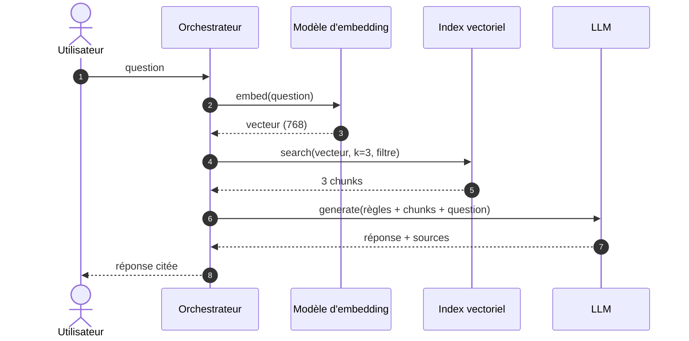
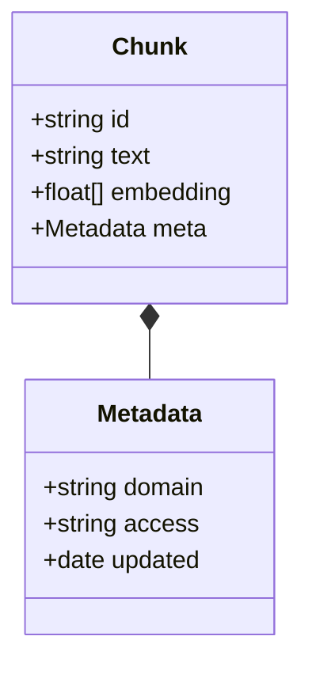

import { components as c } from '@/components/mdx';
export const components = c;

## Diagrammes Mermaid

Un bloc de code ` ```mermaid ` est rendu en SVG, aux couleurs du thème, et re-rendu quand on bascule clair/sombre. L'attribut `title="…"` ajoute une légende.





## Encadrés

<Callout type="definition" title="Token">
  Fragment de texte de quelques caractères : l'unité que le modèle lit, écrit, **et facture**.
</Callout>

<Callout type="exam">Ce point tombe au quiz d'ouverture de la session suivante.</Callout>
<Callout type="tip">Une astuce concrète.</Callout>
<Callout type="warning">Une limite ou une condition à ne pas oublier.</Callout>
<Callout type="danger">Le piège classique.</Callout>
<Callout type="note">Une remarque de contexte.</Callout>

## Enrichissement

<DeepDive title="Pourquoi la sortie coûte plus cher que l'entrée" level="approfondissement">
  Le *prefill* traite tous les tokens d'entrée en parallèle sur le GPU ; le *decode* génère un token à la fois, chacun nécessitant un passage complet du modèle. Le coût marginal d'un token de sortie est donc structurellement plus élevé.
</DeepDive>

## Cartes, comparaisons, chiffres

<CardGrid cols={3}>
  <Card kicker="Niveau 0" title="Assistant privé">Un modèle généraliste, sans les données de l'entreprise.</Card>
  <Card kicker="Niveau 1" title="Assistant enrichi" tone="synapse">Le même, branché sur les données (RAG).</Card>
  <Card kicker="Niveau 2" title="Agent interactif" tone="signal">Agit sur le SI via ses API.</Card>
</CardGrid>

<Compare leftTitle="RAG · livre ouvert" rightTitle="Fine-tuning · livre fermé">
  <Fragment slot="left">
    - Données injectées **à chaque appel**
    - Filtrage des droits possible
  </Fragment>
  <Fragment slot="right">
    - Données apprises **une fois**, dans les poids
    - Aucun contrôle d'accès fin
  </Fragment>
</Compare>

<CardGrid cols={3}>
  <Stat value="2" label="mois pour 100 M d'utilisateurs" hint="ChatGPT, source UBS" />
  <Stat value="3–5×" label="prix d'un token de sortie" hint="vs un token d'entrée" />
  <Stat value="768" label="dimensions" hint="nomic-embed-text" />
</CardGrid>

<KeyIdea>Envoie le paragraphe qui répond, pas la documentation.</KeyIdea>

## Visualisations animées

`<Pipeline>` : étapes séquentielles, animées au scroll, cliquables.

<Figure caption="Cycle de vie d'un modèle">
  <Pipeline steps={[
    { title: 'Corpus', caption: 'Web, livres, code', detail: 'Découpé en tokens : le modèle ne voit jamais une page, seulement une séquence.' },
    { title: 'Pré-entraînement', caption: 'Texte à trous', detail: 'Deviner le token masqué, mesurer l’erreur, ajuster les poids. Des milliards de fois.' },
    { title: 'Post-entraînement', caption: 'Paires Q/R', detail: 'Façonne le comportement (ton, format, refus), pas les connaissances.', tone: 'synapse' },
    { title: 'Inférence', caption: 'Poids figés', detail: 'Le modèle tourne dans un cloud ; tes applications l’appellent par API.', tone: 'muted' },
  ]} />
</Figure>

`<BarChart>` : barres qui se remplissent à l'entrée dans l'écran.

<Figure caption="Mois pour atteindre 100 M d'utilisateurs mensuels · UBS / Yahoo Finance">
  <BarChart unit=" mois" data={[
    { label: 'Google Translate', value: 78 },
    { label: 'Uber', value: 70 },
    { label: 'Spotify', value: 55 },
    { label: 'Instagram', value: 30 },
    { label: 'TikTok', value: 9 },
    { label: 'ChatGPT', value: 2, highlight: true },
  ]} />
</Figure>

## Frise d'étapes

<Steps>
1. **Indexer** — avant toute question.
2. **Récupérer** — à chaque question.
3. **Générer** — à partir des passages seulement.
</Steps>

## Quiz

<Quiz question="Avec une température à 0, deux appels identiques renvoient toujours la même réponse." options={['Vrai', 'Faux']} answer={1}>
  **Faux.** L'échantillonnage est figé, mais pas le reste de la chaîne (batching, calcul flottant non déterministe sur GPU, version du modèle).
</Quiz>

## À retenir

<Takeaways>
1. **Une idée par point.** Une phrase d'explication derrière.
2. **Cinq points maximum.** C'est la matière du quiz suivant.
</Takeaways>

## Code

```python
from openai import OpenAI
client = OpenAI()
resp = client.chat.completions.create(
    model="gpt-4o-mini", temperature=0,
    messages=[{"role": "user", "content": "Bonjour"}],
)
```
